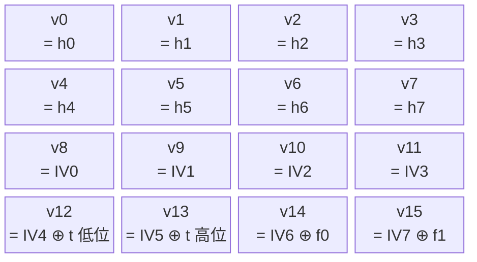
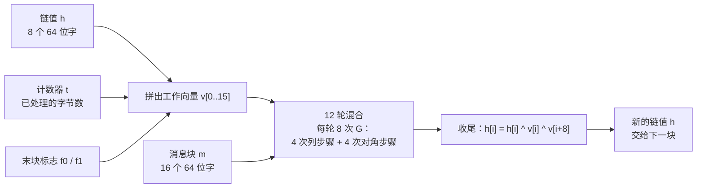
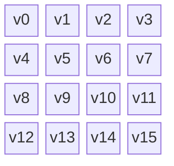
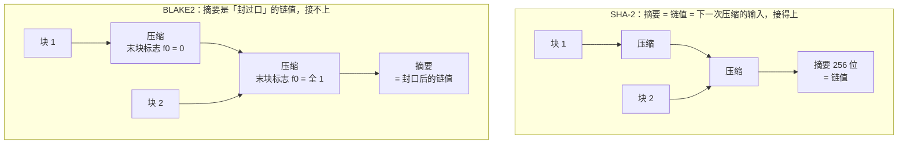

# BLAKE2 原理

[[toc]]

BLAKE2 是 2012 年发布的哈希算法，来路有点特别：它的前身 BLAKE 是 SHA-3 竞赛的五个决赛方案之一，2012 年输给了 Keccak，几个设计者转头把 BLAKE 改造成了 BLAKE2——不是为了参赛，而是为了快。

它的结构没走 SHA-3 的海绵那条路，走的还是 SHA-2 那种「链值一块块接力」，但把 SHA-2 世代靠补丁解决的问题（长度扩展、做 MAC 要套 HMAC、大文件没法并行）直接长进了算法本体。区别在于，它至今没有一个像 NIST 那样的标准机构背书，只有一份 RFC。

本文是[《哈希函数与数据完整性验证》](./hash-function-integrity.md)里 BLAKE2 那一节的展开，把它的内部构造从零拆开讲。同族的另外两篇可以对照着看：[《SHA-256 原理》](./hash-sha256-principle.md)讲链值接力这条路到底是什么样，[《SHA-3 原理》](./hash-sha3-principle.md)讲绕开这条路的海绵结构。

## 哈希函数是干什么的

哈希函数把任意长度的输入（一段文字、一个文件、一部电影）压成固定长度的一串比特，通常是 128 到 512 位。同一个输入永远得到同一个输出，稍微改动一个字符，输出就会面目全非。

它要满足三件事：

- 单向：拿输出反推输入，没有比一个个试更快的办法
- 抗碰撞：找不到两个不同的输入，它们的输出相同
- 抗第二预图像：给定输入 A 和它的输出，找不到另一个输入 B（≠A）输出相同

哈希不加密数据、也不能还原数据，它只用来判断数据有没有被动过，以及把任意长的东西压成一把短尺子去比较。文件的完整性校验、密码存储、数字签名、区块链，底下都是它。

## BLAKE2 的来路

这条家族线要往前追到 1990 年的 MD4——Ron Rivest 设计的哈希函数，128 位输出、3 轮运算，设计简洁高效：

| 算法 | 年份 | 结构 | 现状 |
| --- | --- | --- | --- |
| MD4 | 1990 | Merkle–Damgård | 1996 年被证明存在碰撞漏洞，MD5 与 SHA-1 都由它派生 |
| MD5 | 1991 | Merkle–Damgård | 2004 年找到碰撞，不能用于安全场景 |
| SHA-1 | 1995 | Merkle–Damgård | 2017 年被 Google 找到碰撞，已弃用 |
| SHA-2 | 2001 | Merkle–Damgård 加固版 | 至今未被攻破，目前的主力 |
| BLAKE2 | 2012 | Merkle–Damgård 加固版（加计数器 / 末块标志） | 性能导向，广泛用于非标准场景 |
| SHA-3 | 2015 | 海绵结构 | 与 SHA-2 并列的独立骨架 |

血缘是这样的：MD5 是 MD4 的改进版，把轮数从 3 加到 4；SHA-1 基于 MD4 设计，把输出从 128 位加宽到 160 位；SHA-2 又是 SHA-1 的继任者。四代共用一套骨架，MD4、MD5、SHA-1 相继倒下，密码学界的态度是「同一种骨架被攻破过一次，就不该把鸡蛋全放这一个篮子里」。2007 年 NIST 公开征集替代方案，2012 年 10 月宣布 Keccak 胜出。

BLAKE 进入了最后一轮五个决赛方案（BLAKE、Grøstl、JH、Keccak、Skein），输在 Keccak 手上。同一年，BLAKE 的几位设计者把它改成了 BLAKE2：减轮数、换旋转常数、省掉轮常量、参数直接编进状态里。2015 年，BLAKE2b 和 BLAKE2s 被收进 RFC 7693。

所以 BLAKE2 和 SHA-3 的关系不是「竞争」，是「同门不同路」：都是 SHA-3 竞赛的产物，一个成了标准，一个走了性能路线。

::: warning
BLAKE2 不是 NIST 标准，也没有像 SHA-2 / SHA-3 那样被纳入 FIPS 体系。在需要合规或互操作的场合（证书、签名算法标识），先用 SHA-2 或 SHA-3；BLAKE2 的战场是自家系统的校验、KDF 内部原语、MAC 这类不需要标准机构背书的场景。
:::

## 整体结构总览

BLAKE2 用的还是「链值一块块接力」：消息切块，每块混进一个固定大小的链值，链值一路传下去，最后一个链值（截一段）就是摘要。

<!-- @include: ./hash-blake2-structure.md -->

图里有两条线索，分开看：

- 上面那条：消息补零后切成 1024 位一块，每块都有一根线连到自己那一次压缩
- 下面那条：链值从初始向量出发，一块接一块接力，最后截前 `nn` 字节当摘要

和 SHA-2 的区别在链值的接力方式上加了两个东西：一个**计数器 t**（已经处理过多少字节）和一个**末块标志 f**（这一块是不是最后一块）。这两个东西每块都跟着一起进压缩函数，SHA-2 没有它们——后面「补位」和「长度扩展」两节都会回到这里。

## 内部状态：16 个字

压缩函数操作的工作向量叫 `v`，16 个 64 位字（BLAKE2b），共 1024 位。它由三个源头拼成：



- 前 8 个字 `v0…v7`：进入这一块时的链值，也就是上一块算完的结果。第一块时它等于 IV 异或参数块
- 中间 4 个字 `v8…v11`：IV 的一部分，每块都重新填一遍，不携带历史
- 最后 4 个字 `v12…v15`：IV 的另一部分，分别异或上计数器 `t` 的两半和两个末块标志 `f0`、`f1`

被消息碰过的是 `v0…v7`；后 8 个字是「背景」，每块归位一次。这个安排和 SHA-2 的压缩函数是一回事——SHA-2 也是 8 个字从链值来、8 个字是固定初值。

`IV` 直接借用了 SHA-512 的初始向量（BLAKE2s 借用 SHA-256 的），生成规则是 SHA-2 定的那套老规矩：取前 8 个质数平方根的小数部分。

## 压缩函数在做什么



一轮里做 8 次 `G`，每次 `G` 吃两个消息字，一共用到 16 个字——正好把这一块的消息字各用一遍。12 轮下来，16 个消息字各被用了 12 次。

收尾那一步是把工作向量的两半折回去：`h[i] = h[i] ^ v[i] ^ v[i+8]`。注意异或的左边也有 `h[i]`——这是「喂回」（feed-forward），让进入这一块的链值本身也参与输出。SHA-2 的收尾是同名工作变量相加，SHA-3 没有这一步（它靠海绵的容量段）。喂回的作用是防止不动点：如果没有它，某块消息算出 `v` 恰好等于进入的链值，链值就不再变化，后续所有块都白算。

### 一轮里的列步骤和对角步骤

把 16 个字排成 4 行 4 列：



| 步骤 | 4 次 G 各作用于哪四个字 |
| --- | --- |
| 列步骤 | (v0, v4, v8, v12)、(v1, v5, v9, v13)、(v2, v6, v10, v14)、(v3, v7, v11, v15) |
| 对角步骤 | (v0, v5, v10, v15)、(v1, v6, v11, v12)、(v2, v7, v8, v13)、(v3, v4, v9, v14) |

列步骤就是字面意思：每一竖列混一遍。对角步骤则是把行下标和列下标一起往前挪——比如第一组取的是 (0,0)、(1,1)、(2,2)、(3,3) 这条主对角线，其余三组是同一条对角线在左右接起来的圆筒上错开一格。

两套分组交错是必须的。只做列步骤的话，混合永远发生在同一竖列内部，四列之间没有通路，16 个字等于四个互不相干的 4 字小组。加上对角步骤，`v4` 同时属于列分组 (v0,v4,v8,v12) 和对角分组 (v3,v4,v9,v14)，两组就被串起来了——一轮之内每个字都跨出了自己那一列。

### G 函数

`G` 是真正的混合单元，8 条语句，只用到加法、异或、循环右移三种操作（BLAKE2b 的写法）：

```
a = a + b + x            // x、y 是两个消息字
d = (d ^ a) >>> 32
c = c + d
b = (b ^ c) >>> 24
a = a + b + y
d = (d ^ a) >>> 16
c = c + d
b = (b ^ c) >>> 63
```

`+` 是模 2⁶⁴ 加法（超出 64 位的部分丢掉），`^` 是异或，`>>>` 是循环右移。后 4 条把同样的动作重复一遍，用另一个消息字 `y`，旋转位数换成 16 和 63。

BLAKE2s 的骨架一模一样，只有旋转常数不同：16、12、8、7。

::: tip 为什么旋转常数是这几个数
不是随便挑的。BLAKE-512 原本用的是 32、25、16、11，BLAKE2b 把 25 改成 24、11 改成 63：

- 24 是 8 的倍数，SSSE3 之后的 CPU 能用一条 `pshufb` 指令并行做两个旋转；旋转 25 位则要拆成两次移位加一次或
- 63 位右旋等价于左旋 1 位，在把 1 当特例处理的架构上更快

改完 G 的算术指令数在当时的 Intel CPU 上从 18 条降到 16 条。这几个数也是「性能优先」这条设计线上的典型例子——设计者的分析是：这类改动不会让已知的差分攻击显著变强，也不会显著变弱（BLAKE 上的差分特征通常不能直接套用到 BLAKE2）。
:::

::: tip 循环移位
把一串比特整体往一个方向挪，挪出去的比特不丢弃，从另一端接回来。

```
右移 2 位：  b0 b1 b2 b3 b4 … b63
变成：      b2 b3 b4 … b63 b0 b1
                          └─ 移出去的两位绕到了左端
```

普通移位会丢掉移出去的比特，循环移位一个不少，所以这一步是可逆的。
:::

### 非线性从哪来

`G` 里加法、异或、循环移位各出现若干次，但**只有模加法是非线性的**。异或和循环移位在数学上都属于线性操作——每个输出比特都是输入比特的异或组合。

线性的东西可以整批解掉：成千上万个异或方程摆在一起，也就是解一个一次方程组，计算机几秒钟出结果。密码学上管这叫「可用线性代数攻破」。

模加法不一样，差别在进位。看一个最小的例子：

```
  0 1 1 1     (7)
+ 0 0 0 1     (1)
─────────
  1 0 0 0     (8)
```

四个比特全变了。这不是巧合：最低位之外的每一个比特，结果都取决于比它更低的那几位有没有产生进位，而进位是一路往左传的。这种「后面的结果依赖前面算出了什么」的关系，写成方程就是高次的，一次方程组表达不了。

对照[《SHA-3 原理》](./hash-sha3-principle.md)：SHA-3 用按位与（`&`）制造非线性，BLAKE2 用模加法的进位。两条路都走得通，区别只在于哪个在目标平台上更快——现代 CPU 的加法器是一条指令，按位与也是一条指令，真正拉开差距的是别的部分。

还有一个容易被混淆的点：**非线性**和**可逆性**是两件独立的事。`G` 的每一步都留了逆运算（加法配减法、异或自己是自己的逆、旋转配反向旋转），所以 `G` 整体是个双射，信息一个比特都不丢。但如果某一步不可逆——比如按位与一个固定掩码，或者干脆丢掉高位的几个比特——两个不同的输入就可能撞到同一个输出，攻击者会顺着这种「丢信息」的地方去找碰撞。BLAKE2 的设计里没有这种地方。

### 消息调度：SIGMA 表

每次 `G` 要两个消息字，哪个字进哪次 `G`，由一张固定的表决定。这张表是 10 行、每行 16 个 0 到 15 的排列（`σ`，读作 sigma）：

```
第 0 轮   0  1  2  3  4  5  6  7  8  9 10 11 12 13 14 15
第 1 轮  14 10  4  8  9 15 13  6  1 12  0  2 11  7  5  3
第 2 轮  11  8 12  0  5  2 15 13 10 14  3  6  7  1  9  4
第 3 轮   7  9  3  1 13 12 11 14  2  6  5 10  4  0 15  8
第 4 轮   9  0  5  7  2  4 10 15 14  1 11 12  6  8  3 13
第 5 轮   2 12  6 10  0 11  8  3  4 13  7  5 15 14  1  9
第 6 轮  12  5  1 15 14 13  4 10  0  7  6  3  9  2  8 11
第 7 轮  13 11  7 14 12  1  3  9  5  0 15  4  8  6  2 10
第 8 轮   6 15 14  9 11  3  0  8 12  2 13  7  1  4 10  5
第 9 轮  10  2  8  4  7  6  1  5 15 11  9 14  3 12 13  0
```

读法：第 1 轮第 0 次 `G` 拿 `m[σ[1][0]] = m[14]` 和 `m[σ[1][1]] = m[10]` 当 `x`、`y`；第 1 次 `G` 拿 `m[4]` 和 `m[8]`，以此类推。第 0 行是恒等排列，和顺序读一遍没区别。

几个要留意的地方：

- 每一行都是 0 到 15 的一个排列，一个不重一个不漏。所以一轮之内 16 个消息字各被用了恰好一次（8 次 `G` × 2 个字 = 16 个位置）
- 10 行互不相同，同一个字在相邻两轮去的位置不一样
- BLAKE2b 有 12 轮但只有 10 行表，第 10、11 轮复用第 0、1 行

把消息字打散进不同的位置是必要的。如果每轮都用同一张表（比如每轮都是恒等排列 `σ0`），第 0 次 `G` 就永远吃到 `m0` 和 `m1`，而第 0 次 `G` 永远只碰 `v0`、`v4`、`v8`、`v12` 这 4 个位置——攻击者可以只盯住一条固定的字-位置通路做差分分析，其余 15 个字之间的牵连完全不用管。

### 为什么是 12 轮

`G` 每次只混合 4 个字，一轮也就 8 次。轮数堆的是扩散的充分程度：让任意一个比特的改动，最终影响到整个 1024 位向量。

BLAKE2b 取 12 轮，BLAKE2s 取 10 轮。BLAKE 原本用的是 16 轮和 14 轮——BLAKE 最初提交给 SHA-3 竞赛的版本其实是 14 轮和 10 轮，后来为了保险往上加了，BLAKE2 又把它减了回来。设计者的判断是：以现有的分析进展和可预见的未来进展看，16 轮和 14 轮并没有比 12 轮和 10 轮显著更安全。省下的轮数直接变成 25% 到 29% 的速度。

这个取舍是有代价的：BLAKE2 的抗攻击裕度比 SHA-2 薄。SHA-256 有 64 轮，BLAKE2b 只有 12 轮。设计者论文里交代了当时的分析现状：BLAKE-512 的核心置换上已经有覆盖 8 轮的 boomerang 区分器，而这类攻击可以平移到 BLAKE2b 上——也就是说 12 轮里已经有人摸到第 8 轮，剩 4 轮缓冲。轮数少意味着「距离被攻破还剩几轮」这个裕度小，这是拿安全裕度换速度的明账，不是隐藏成本。

## 补位：什么都不补

BLAKE2 的补位规则简单到几乎没有：**长度不够整块时，在末尾补 0 补满；正好是整块的整数倍时，一个字节都不补。**

没有长度字段，没有 `1` 结尾的标记，什么都没有。对比一下前几代：

| 算法 | 补位规则 |
| --- | --- |
| SHA-1 / SHA-2 | 补一个 `1`、若干 `0`，再在末尾写下原始长度（64 位或 128 位） |
| SHA-3 | `pad10*1`：补 `1`、若干 `0`、再补一个 `1`，把长度信息编进补位模式 |
| BLAKE2 | 只补 `0` |

少了长度字段，为什么还能唯一地还原出原消息？

因为长度信息没丢，只是换了地方存——它由计数器 `t` 携带。`t` 记录的是「处理到当前这一块末尾时，一共处理了多少字节」。最后一块压缩时，`t` 就等于消息的真实长度；而 BLAKE2 的补位只补 0，最后一块里有多少个 0 是为凑长度补的、有多少是消息自带的，由 `t` 一减就出来了。长度和内容合起来唯一确定了原始消息，补位里不需要再写一遍。

顺带的好处是长度上限变大了。`t` 对 BLAKE2b 是 128 位、对 BLAKE2s 是 64 位，能表示的长度分别到 2¹²⁸ − 1 字节和 2⁶⁴ − 1 字节——后者已经超过 64 位处理器最大可寻址内存。

有一个边界情况：**空消息**（没有 key、也没输入数据）仍然会压缩一个全 0 的块，而不是什么都不做。因为摘要必须由链值算出来，链值必须经过至少一次压缩才能从 IV 变成有意义的状态。

## 末块标志 f

补位省掉的东西还有第二处补偿：**末块标志 `f0`**。

压缩函数运行时，如果这一块是消息的最后一块，`v14` 上会异或一个全 1 的字（BLAKE2b 是 64 位全 1）；如果不是最后一块，什么都不异或。另外还有个 `f1`，在树哈希模式下用来标记「这一层里的最后一个节点」，顺序模式下始终为 0。

只改一个字的做法看着不起眼，作用却有两层：

- **区分「内容相同、位置不同」的块**。消息末尾补的 0，和消息中间恰好出现的 0，在 `m` 里长得一模一样。`f0` 把「这块是结尾」这件事作为独立输入喂进压缩函数，两种情况的输出就不会撞在一起
- **堵死长度扩展攻击**。下一节展开

## 为什么不怕长度扩展攻击

这是 BLAKE2 相比 SHA-2 最实际的一个优势，也是它能直接当 MAC 用的前提。

先看这种攻击怎么打的。假设有个系统用 `hash(密钥 + 消息)` 当签名（这不是推荐做法，但历史上很常见），密钥是保密的。攻击者截获了消息和它的摘要，但不知道密钥。

对 SHA-2 来说，摘要就是最后那个 256 位链值，也就是「压缩完所有块之后，内部状态的完整样子」。攻击者手里有了这个内部状态，就能假装自己是算法本身，继续往下压缩：先按规则补位，再喂一段自己挑的附加数据，算出来的结果正好是 `hash(密钥 + 消息 + 补位 + 附加数据)`。

整个过程一次都不需要知道密钥，却得到了一条合法的新消息和它的摘要。



BLAKE2 挡掉它的关键在末块标志。BLAKE2b 输出 512 位时，摘要确实就是完整的 8 字链值，看起来和 SHA-2 一样「暴露了内部状态」。但这里有个区别：算这条摘要时，最后一块是用 `f0 = 全 1` 压缩的。

攻击者要续算 `hash(密钥 + 消息 + 补位 + 附加数据)`，需要的是「把同一块按非末块处理」得到的那个链值——也就是同样的链值输入、同样的消息块、同样的计数器 `t`，唯独 `f0 = 0`。这两次压缩的差别只在 `v14` 异或的那一个全 1 字上，但压缩函数里的 12 轮混合作会把这点差别彻底放大，输出是两个毫不相干的值。

攻击者手里的摘要是「封口后」的那个，续算需要「没封口」的那个。知道前者推不出后者——中间隔着一次不可逆的压缩。长度扩展攻击在第一步就断了。

顺带一句：`t` 也在这里出了力。它把「已经处理了多少字节」绑进了每一次压缩，攻击者想伪造续算的上下文，长度这一项也对不上。

## 密钥哈希：不用 HMAC 的 MAC

哈希函数本身没有密钥，要拿它做消息认证码（MAC），传统做法是套一层 HMAC。BLAKE2 不需要，它自带密钥模式。

用法上就是在调用时多传一个密钥（最长 64 字节）。内部发生的事：

1. 参数块里的「密钥长度」字段写上密钥的实际字节数（没传密钥就写 0）
2. 密钥补 0 补满一整块，作为**第一块** `d[0]` 送进压缩
3. 计数器 `t` 从**整块的字节数**开始算，而不是从密钥的实际长度开始
4. 密钥块处理完，才是消息本身

第 3 条容易忽略但很关键：密钥无论 1 字节还是 64 字节，补出来的块都按整块字节数计入 `t`。这样 `t` 的语义就统一成了「送进压缩函数的字节数」，不用为密钥块单开一套规则。

第 1 条则是把密钥长度编进了**初始状态**。参数块在第一次压缩之前就和 IV 异或，进的是 `h`。这意味着用 16 字节密钥和用 32 字节密钥的 BLAKE2，从第一步起就是两个不同的函数，不是同一个函数喂了不同内容。

::: tip 为什么这样就是安全的 MAC
长度扩展攻击打的是「拿到摘要能接着往下算」。BLAKE2 天生堵死了这条路（上一节），所以密钥放在消息**前面**就够了，不需要 HMAC 那种「密钥前后各包一层」的结构。

反过来说：SHA-2 的 HMAC 之所以长成 `H(K ⊕ opad ‖ H(K ⊕ ipad ‖ M))` 那个样子，就是因为 `H(K ‖ M)` 对 SHA-2 是不安全的。BLAKE2 把这个问题在算法内部解决掉了。
:::

参数块里还有两个可选字符串：**盐（salt）** 和**个人化（personalization）**，各 16 字节（BLAKE2b）。它们和 IV 一起异或，同样作用于初始状态。用途是把同一把密钥在不同场合下隔开——比如都拿 `K` 做 MAC，给「会话令牌签发」和「文件校验」各自填一个不同的个人化字符串，两条链上的输出就永远不会撞车。

## 树哈希与并行

前面讲的都是顺序模式：一块接一块，前一块算完才能算后一块。这是哈希函数的老毛病——单条链上没法并行，多核 CPU 和大文件场景下白白浪费算力。

BLAKE2 把并行能力做进了算法本身。参数块里有一组专门给树哈希用的字段：

| 字段 | 作用 |
| --- | --- |
| fanout | 一个父节点最多挂几个孩子 |
| 最大深度 | 树的层数上限 |
| 叶子最大长度 | 一个叶子节点最多吃多少字节的消息 |
| 节点偏移 | 这个节点在树里的序号 |
| 节点深度 | 这个节点在第几层 |
| 内部哈希长度 | 中间节点输出的摘要长度 |

把消息切成长度不超过「叶子最大长度」的若干片，每片各自算一遍得到一个中间摘要，再把这些中间摘要当消息往上归并，直到根节点——根节点的输出就是整个消息的摘要。叶子之间互不依赖，可以丢给不同的核去算。

节点偏移和节点深度是这组参数里的安全阀。论文里对它们的说明只有一句：保证树里每一次哈希调用用的是不同的哈希函数。把「我在第几层、排第几个」编进参数块之后，树叶算的和树根算的就成了两个不同的函数，输出比特即使相同也不会被当成同一个东西——树里每个位置都唯一确定，不同的切法得到的根摘要自然也不同。

官方给的并行变体是这两个：

- **BLAKE2bp**：BLAKE2b 的 4 路并行版
- **BLAKE2sp**：BLAKE2s 的 8 路并行版

两者都是固定的树结构（深度 2、叶子长度不限），不是让用户自己配。切法也不是「前一片、后一片」那样顺序分，而是轮流发牌：BLAKE2bp 把消息块按 4 取模分给 4 个实例，BLAKE2sp 按 8 取模分给 8 个实例。这样动手之前不用先知道消息总长度——流式数据、网络上来一个块算一个块都行。设计者论文里给的上限是「快 4 倍 / 快 8 倍」，前提是目标 CPU 真的有那么多 SIMD 通道或多核可用。

树模式还有一个副产品是**增量更新**：一大块数据分成很多叶子之后，改动其中一片，只需要重算那片叶子和它到根的那一条路径，其余叶子不用动。这对需要在本地持续校验大文件的场景很有用。

## 参数与选型

各个版本的参数：

| 变体 | 面向平台 | 字长 | 块大小 | 摘要长度 | 轮数 | G 的旋转常数 |
| --- | --- | --- | --- | --- | --- | --- |
| BLAKE2b | 64 位（含 NEON ARM） | 64 位 | 128 字节 | 1-64 字节 | 12 | 32、24、16、63 |
| BLAKE2s | 8-32 位 | 32 位 | 64 字节 | 1-32 字节 | 10 | 16、12、8、7 |
| BLAKE2bp | 64 位，4 路并行 | 64 位 | 128 字节 | 1-64 字节 | 12 | 32、24、16、63 |
| BLAKE2sp | 32 位，8 路并行 | 32 位 | 64 字节 | 1-32 字节 | 10 | 16、12、8、7 |

摘要长度是**可配置的参数**，不是固定值。它会写进参数块、影响初始状态，所以 `blake2b-256` 和 `blake2b-512` 截前 32 字节不是一回事——前者是完整的 256 位摘要，后者是 512 位摘要的前一半。

性能上，官方给的数字是在 Intel Core i5-6600（Skylake，3.31 GHz）上，BLAKE2b 单核跑到 1 GiB/s，合每字节 3.08 个时钟周期，比同机上的 MD5、SHA-1、SHA-2、SHA-3 都快。快在哪里：

- **ARX 结构**：只有加法、异或、循环移位三种操作，没有查表和 S 盒，不需要担心缓存时序
- **轮数少**：12 轮 / 10 轮，对比 SHA-256 的 64 轮
- **旋转常数选成字节的整数倍**：可以直接用 SIMD 打乱指令
- **小端序**：主流 CPU 是小端，解析消息块不用逐字翻转字节
- **状态小**：BLAKE2s 的 RAM 占用 168 字节，BLAKE2b 336 字节

::: tip 这些数字都是纯软件实现的对比
SHA-256 在 x86 和 ARM 上都有专门的硬件指令，启用之后速度会明显提升，和 BLAKE2b 的差距会大幅收窄。BLAKE2 没有对应的硬件指令，只能靠通用算术单元和 SIMD。所以「BLAKE2 比 SHA-256 快」这个结论要连着平台和是否启用硬件加速一起看。
:::

采用情况（按官方列出的名单）：

| 场景 | 用的变体 |
| --- | --- |
| Linux 内核随机数发生器 | BLAKE2s，做熵提取 |
| OpenSSL / Botan / WolfSSL / Crypto++ / BouncyCastle | BLAKE2b、BLAKE2s |
| WireGuard VPN | BLAKE2s，做哈希和 MAC |
| Noise 协议（WireGuard、WhatsApp 使用） | BLAKE2s、BLAKE2b |
| libsodium | BLAKE2b，默认哈希 |
| Argon2（密码哈希竞赛冠军） | BLAKE2b，作为内部原语 |
| WinRAR（RAR 5.0） | BLAKE2sp，可选校验和 |
| librsync | BLAKE2b，默认哈希 |

选型的几条实用判断：

- 通用场景（文件校验、数字签名、证书）：SHA-256 或 SHA3-256。合规和互操作优先，别在这类地方用 BLAKE2
- 自家系统的完整性校验、去重、内容寻址：BLAKE2b 是很好的选择，比 SHA-256 快且不牺牲实际强度
- 嵌入式 / 32 位平台：BLAKE2s
- 大文件、多核或 SIMD 可用：BLAKE2bp / BLAKE2sp
- 需要 MAC 又不想套 HMAC：直接用 BLAKE2 的密钥模式
- 需要可扩展输出（派生密钥、伪随机数）：BLAKE2 本体不支持任意长度输出，要用 BLAKE2X 变体，或者直接用 SHAKE
- 存密码：不要用任何通用哈希，用 Argon2id 这类专门的慢哈希（Argon2 内部用的就是 BLAKE2b）

::: warning
MD5 和 SHA-1 不能再用于任何安全场景，包括「只是内部用」。BLAKE2 的定位是「SHA-2 / SHA-3 之外的一条性能路线」，不是用来接替它们的。需要标准背书的场合（证书、TLS 套件、签名算法标识）仍然走 SHA-2 / SHA-3。
:::

## 延伸：BLAKE3

2020 年，同一批设计者发布了 BLAKE3。它以 BLAKE2s 的压缩函数为底，把内部结构换成固定的 Merkle 树（不再是可配的参数，而是唯一的结构），输出改成可扩展的 XOF——想挤多长挤多长。在多核和 SIMD 上，它比 BLAKE2 快若干倍。

官方站点现在在首页挂了推荐。如果新项目没有兼容性包袱，可以直接看 BLAKE3；BLAKE2 的价值在于它已经被大量现成系统采用，生态成熟得多。

## 小结

BLAKE2 和 SHA-3 是同一个竞赛的两条出口，思路完全相反：

- SHA-3 的思路是「换一套全新的骨架（海绵），把老结构的问题绕开」
- BLAKE2 的思路是「沿用老骨架（链值接力），把老结构的问题就地修掉」

它修掉的东西，正好是 SHA-2 世代靠外围手段解决的几件事：

| 问题 | SHA-2 的解法 | BLAKE2 的解法 |
| --- | --- | --- |
| 长度扩展攻击 | 需要 MAC 时套 HMAC | 末块标志 `f0` + 计数器 `t` 写进算法本体 |
| 长度信息 | 补位里写长度字段 | 计数器 `t` 携带 |
| 大文件并行 | 单链，没法并行 | 参数块里的树哈希字段 + BLAKE2bp / BLAKE2sp |
| 状态初始化差异 | 靠不同的 IV 常量 | 参数块异或进 IV，摘要长度 / 密钥长度 / 盐 / 个人化都编进去 |

整条链路是：消息补 0 切块 → 每块拼出工作向量（链值 + IV + 计数器 + 末块标志）→ 12 轮混合，每轮 4 次列步骤加 4 次对角步骤 → 收尾把两半折回链值 → 重复到消息用完 → 截前 `nn` 字节当摘要。

而每一次 `G` 里，模加法提供唯一的非线性、循环移位负责横向打散、异或负责把结果叠回去；SIGMA 表决定每轮拿哪些消息字进哪次 `G`，让 16 个字在 12 轮里被均匀地用满。

一句话概括这场取舍：BLAKE2 用**更薄的攻击裕度**（12 轮 vs SHA-256 的 64 轮）换来**纯软件实现里的速度优势**，再把 SHA-2 世代需要外围结构才能解决的问题，一次性收进了算法内部。
