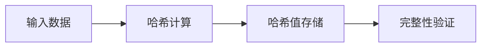
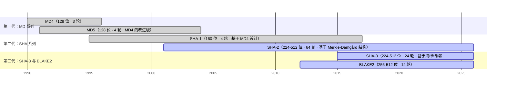
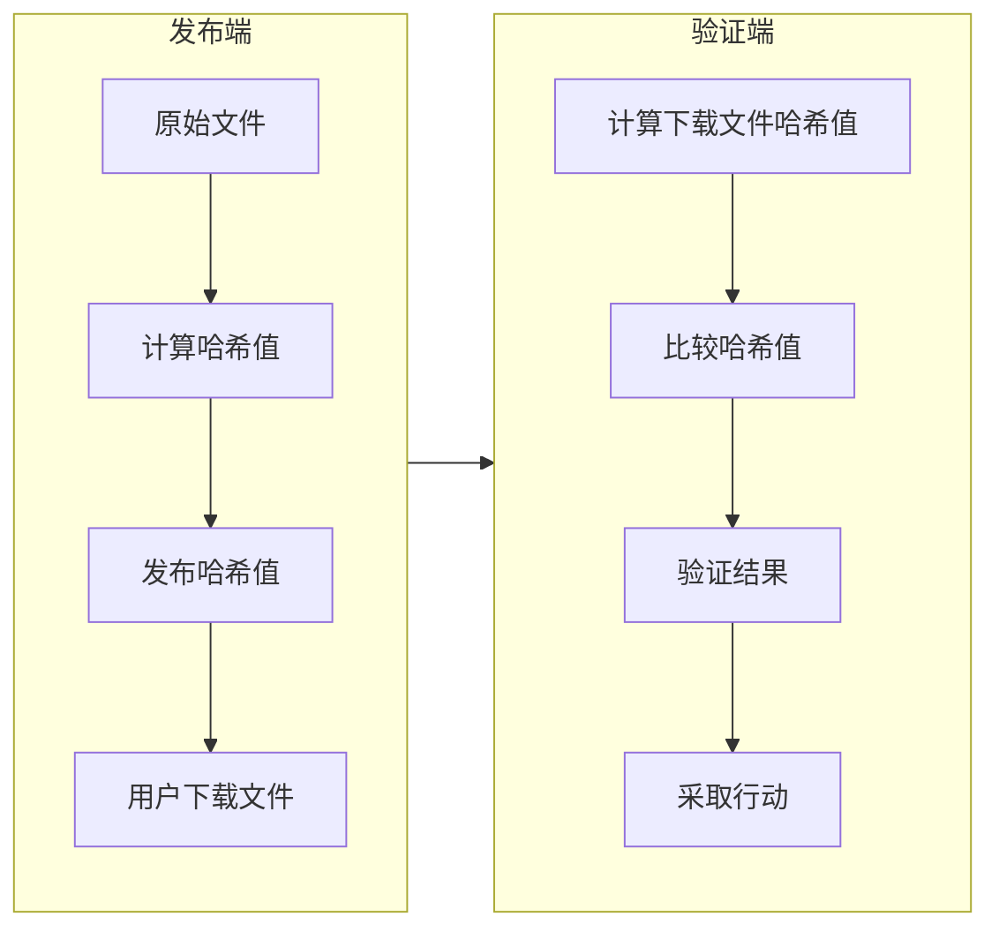

# 哈希函数与数据完整性验证

[[toc]]

哈希函数把任意长度的输入映射为固定长度的输出，且过程不可逆。它不用于加密数据，只用于判断数据是否被改动。

本文覆盖哈希函数的特性、从 MD5 到 SHA-3 的算法演进、主流算法的参数与安全强度，以及文件校验、密码存储、HMAC 三类应用。

## 哈希函数的本质

哈希函数（Hash Function）是将任意长度的输入数据映射为固定长度输出的单向函数。与加密算法不同，哈希函数不可逆，主要用于验证数据是否被篡改。

### 核心特性

安全哈希函数应具备五个特性：

1. 确定性：相同的输入始终产生相同的输出
2. 单向性：从输出难以推导出原始输入
3. 抗碰撞性：难以找到两个不同的输入产生相同的输出
4. 抗第二预图像攻击：给定输入 x 和哈希值 h(x)，难以找到另一个输入 y≠x，使得 h(y)=h(x)
5. 雪崩效应：输入的微小变化会导致输出的显著变化

::: tip
哈希值相当于数据的数字指纹。输入只要有微小改动，算出的哈希值就会完全不同。
:::

::: info 抗碰撞性与抗第二预图像攻击的区别
**抗碰撞性**用于防止攻击者在数字签名过程中伪造文件。攻击者先构造两个哈希值完全相同的文件：

- 文件 A：正常的软件更新包（看起来合法）
- 文件 B：包含后门的恶意软件

然后诱导软件厂商用私钥对正常的文件 A 签名。由于两者哈希值相同，攻击者可以拿恶意的文件 B 配上这份合法签名一起发布，签名对文件 B 同样有效。

**抗第二预图像攻击**用于防止攻击者在文件完整性验证场景中冒充已有文件。你在网站上公开了一个文件（如软件安装包）和它的 SHA-256 哈希值，攻击者想替换这个文件又不被发现，就要找出另一个不同的文件、使其 SHA-256 哈希值与公开的完全相同——抗第二预图像攻击防止的就是这种情况。

一句话总结：

- 抗碰撞性：防止攻击者主动造两个「双胞胎文件」来欺骗签名者
- 抗第二预图像攻击：防止攻击者冒充你已公开的文件来欺骗验证者
:::

### 基本工作流程

数据完整性验证的工作流程包含四个环节：



- 输入数据：任意长度的原始数据（文件、消息、密码等）
- 哈希计算：使用哈希函数对输入数据进行处理，生成固定长度的哈希值
- 哈希值存储：将生成的哈希值与原始数据分离存储或传输
- 完整性验证：对原始数据重新计算哈希值，并与存储的哈希值进行比较，判断数据是否被篡改

### 应用场景分类

哈希函数的应用可分为四类：

| 应用场景       | 核心价值                                                 | 典型应用                          |
| -------------- | -------------------------------------------------------- | --------------------------------- |
| 数据完整性验证 | 检测数据是否被篡改                                       | 文件校验、软件更新验证、区块链    |
| 密码存储       | 保护用户密码安全                                         | 网站登录系统、身份认证服务        |
| 数字签名       | 将签名与消息内容强绑定，防止内容篡改和基于碰撞的伪造     | SSL/TLS 证书、代码签名、电子合同  |
| 数据结构优化   | 提高数据访问效率                                         | 哈希表、布隆过滤器、负载均衡      |

## 从 MD5 到 SHA-3 的演进

各代算法的迭代，都是在安全性、性能与可实现性之间重新权衡。



### 第一代：MD 系列

#### MD4

- 发布时间：1990 年由 Ron Rivest 设计
- 核心特点：128 位哈希值，3 轮运算，设计简洁高效
- 安全现状：1996 年被证明存在碰撞漏洞，不再适用于安全场景

#### MD5

- 发布时间：1991 年，MD4 的改进版
- 核心特点：128 位哈希值，4 轮运算，速度快
- 应用历史：曾经广泛用于文件校验、密码存储
- 安全现状：2004 年被证明存在碰撞漏洞，不再适用于安全场景

### 第二代：SHA 系列

#### SHA-1

- 发布时间：1995 年，美国国家安全局（NSA）设计
- 核心特点：160 位哈希值，基于 MD4 设计，但更安全
- 应用历史：长期用于数字签名、SSL/TLS 证书
- 安全现状：2017 年被证明存在碰撞漏洞，已被主流浏览器和 CA 机构弃用

#### SHA-2 系列

- 发布时间：2001 年，SHA-1 的继任者
- 核心成员：
  - SHA-224：224 位哈希值
  - SHA-256：256 位哈希值（应用最广泛）
  - SHA-384：384 位哈希值
  - SHA-512：512 位哈希值（适合 64 位系统）
  - SHA-512/224、SHA-512/256：截断版本
- 核心特点：基于 Merkle-Damgård 结构，设计更复杂，安全强度更高
- 安全现状：目前被广泛使用，未发现有效碰撞攻击

### 第三代：SHA-3 与 BLAKE2

#### SHA-3 系列

- 发布时间：2015 年，NIST 哈希函数竞赛获胜算法
- 核心成员：SHA3-224、SHA3-256、SHA3-384、SHA3-512
- 核心特点：基于海绵结构（Sponge Construction），与 SHA-2 完全不同的设计
- 优势：抗长度扩展攻击，可灵活输出任意长度的哈希值
- 应用现状：逐渐被采用，作为 SHA-2 的补充和未来替代

#### BLAKE2

- 发布时间：2012 年。前身 BLAKE 是 SHA-3 竞赛的五个决赛方案之一，2012 年输给 Keccak 后，设计者把它改造成 BLAKE2，目标不再是参赛，而是把速度做上去
- 核心成员：
  - BLAKE2b：面向 64 位平台，输出 1-64 字节
  - BLAKE2s：面向 8-32 位平台，输出 1-32 字节
  - BLAKE2bp / BLAKE2sp：4 路 / 8 路并行版本
- 核心特点：沿用 Merkle–Damgård 式的链值接力，但把计数器与末块标志写进压缩函数，因此天生抗长度扩展
- 优势：比 SHA-2 / SHA-3 更快；内置密钥哈希（可直接当 MAC 用，不需要 HMAC）、盐、个人化和树哈希
- 规范：RFC 7693（2015），属于 Informational 文档，不是 FIPS 标准
- 原理与参数详见[《BLAKE2 原理》](./hash-blake2-principle.md)

#### 特殊用途哈希函数

- Argon2：2015 年密码哈希竞赛获胜算法，专为密码存储设计
- Scrypt：内存密集型哈希函数，用于比特币挖矿和密码存储
- Poly1305：高效的消息认证码算法，与 ChaCha20 配合使用

## 主流哈希函数

三个算法的核心参数对比：

| 指标         | SHA-256                               | SHA-3-256     | BLAKE2b                                                 |
| ------------ | ------------------------------------- | ------------- | ------------------------------------------------------- |
| 哈希值长度   | 256 位                                | 256 位        | 1-512 位（可配置）                                      |
| 安全强度     | 碰撞 2^128<br>预图像 2^256<br>第二预图像 2^256 | 碰撞 2^128<br>预图像 2^256<br>第二预图像 2^256 | 碰撞 2^(n/2)<Tip>摘要 n 位</Tip><br>预图像 2^n<br>第二预图像 2^n |
| 块大小       | 512 位                                | —             | 1024 位                                                 |
| 内部状态大小 | —                                     | 1600 位       | —                                                       |
| 速率 / 容量  | —                                     | 1088 / 512 位 | —                                                       |
| 轮数         | 64                                    | 24            | 12                                                      |
| 性能         | 约 100-300 MB/s（取决于 CPU）         | —             | 在 Skylake 英特尔 CPU 上优于 MD5、SHA-1、SHA-2 和 SHA-3 |
| 硬件加速     | 现代 CPU 有 SHA-NI 指令集直接加速     | —             | —                                                       |
| 特性         | —                                     | —             | 支持密钥哈希、树哈希、并行计算                          |

三种攻击方式的含义如下，后面三个算法的「安全强度」都按这个口径读：

<Cards>
  <Card title="碰撞攻击">找到两个完全不同的输入，却产生相同的哈希值</Card>
  <Card title="预图像攻击">给定一个哈希值，找到生成它的那个输入</Card>
  <Card title="第二预图像攻击">给定输入 A 和它的哈希值，找到另一个输入 B（≠A）具有相同的哈希值</Card>
</Cards>

### SHA-256

SHA-256 是 SHA-2 系列中应用最广泛的哈希函数，其核心设计基于 Merkle-Damgård 结构。

#### 技术原理

1. 预处理阶段：

   - 填充输入数据，使其长度模 512 等于 448
   - 添加 64 位长度字段，表示原始数据的长度
   - 将填充后的数据分割为 512 位的消息块

2. 压缩函数阶段：

   - 使用 8 个 32 位初始哈希值（H0-H7）
   - 对每个 512 位消息块进行 64 轮压缩运算
   - 每轮使用不同的常量和消息调度函数
   - 输出 8 个 32 位哈希值，共 256 位

3. 输出阶段：

   - 将 8 个 32 位哈希值连接起来，形成最终的 256 位哈希值

<!-- @include: ./hash-sha256-structure.md -->

#### 安全强度

- 碰撞攻击：理论安全强度为 2^128
- 预图像攻击：理论安全强度为 2^256
- 第二预图像攻击：理论安全强度为 2^256

#### 优势与特点

- 兼容性最好：TLS、操作系统、各类语言标准库默认都支持，拿起来就能用
- 有硬件加速：现代 CPU 的 SHA-NI 指令集直接加速，不用额外指令也能跑到约 100-300 MB/s
- 至今没有被攻破：SHA-2 自 2001 年发布以来，没有公开的有效碰撞攻击

#### 应用场景

- 证书与 TLS：HTTPS 证书签名、握手过程中的完整性校验
- 代码签名与软件分发：安装包、固件的校验和
- 文件完整性校验：下载校验、备份比对、去重
- 消息认证：HMAC-SHA-256
- 区块链：比特币用双重 SHA-256 做工作量证明

内部构造与参数详见[《SHA-256 原理》](./hash-sha256-principle.md)。

### SHA-3

SHA-3 是 NIST 在 2015 年标准化的新一代哈希函数，其设计与 SHA-2 完全不同，基于海绵结构。

#### 技术原理

海绵结构由两部分组成：

1. 吸收阶段：

   - 将输入数据分割为固定大小的块（SHA-3 中为 1088 位，即速率段长度）
   - 与内部状态进行 XOR 运算，逐步吸收输入数据

2. 挤压阶段：

   - 从内部状态提取输出数据
   - 可根据需要输出任意长度的哈希值

<!-- @include: ./hash-sha3-structure.md -->

#### 安全强度

- 碰撞攻击：以 SHA3-256 为例，理论安全强度为 2^128（256 位摘要的生日界）
- 预图像攻击：理论安全强度为 2^256
- 第二预图像攻击：理论安全强度为 2^256
- 摘要更长则更强：SHA3-512 的碰撞强度是 2^256

#### 优势与特点

- 抗长度扩展攻击：海绵结构天然免疫此类攻击
- 灵活输出长度：可根据需要生成任意长度的哈希值
- 并行计算支持：吸收阶段的块处理可以并行化
- 可证明安全性：基于置换的设计提供了更强的安全保证

#### 应用场景

- 作为 SHA-2 的备用骨架：与 SHA-2 并列写进 NIST 标准，互为备份
- 需要可扩展输出：SHAKE128 / SHAKE256 能指定任意长度输出，常用于派生密钥和伪随机数
- 需要消息认证码：KMAC 直接建在海绵结构上，不必再套一层 HMAC
- 后量子签名：SPHINCS+ 这类哈希基签名方案用 SHA-3 / SHAKE 作底层哈希

内部构造与参数详见[《SHA-3 原理》](./hash-sha3-principle.md)。

### BLAKE2

BLAKE2 的设计目标是在提供高安全性的同时，实现比 SHA-2 / SHA-3 更高的性能。它沿用 SHA-2 那套链值接力结构，但把长度信息和末块标记都写进了压缩函数，因此不需要 HMAC 就能做 MAC，也不怕长度扩展攻击。

#### 技术原理

结构上分三步：预处理把消息补 0 切块，压缩阶段每块过一遍 12 轮混合、链值一路接力，输出阶段从最后的链值截取摘要。和 SHA-2 的差别集中在中间那步——计数器（已处理的字节数）和末块标志（这一块是不是最后一块）每块都跟着一起进压缩函数。

<!-- @include: ./hash-blake2-structure.md -->

#### 安全强度

- 摘要取 n 位时：碰撞攻击 2^(n/2)，预图像攻击与第二预图像攻击 2^n
- BLAKE2b 取满 512 位输出，碰撞强度是 2^256；取常用的 256 位输出，碰撞强度是 2^128
- BLAKE2s 最长输出 256 位，碰撞强度上限是 2^128

#### 优势与特点

- 快：在 Skylake 上比 MD5、SHA-1、SHA-2、SHA-3 都快
- 不需要 HMAC 就能做 MAC：内置密钥哈希，可以直接当消息认证码用
- 支持盐、个人化和树哈希：能派生子密钥，也能拆成多路并行计算
- 规范是 RFC 7693（2015），属于 Informational 文档，不是 FIPS 标准

#### 应用场景

- 网络协议：WireGuard 用 BLAKE2s 做哈希和 MAC；Noise 协议（WireGuard、WhatsApp 使用）用 BLAKE2s / BLAKE2b
- 系统组件：Linux 内核的随机数发生器用 BLAKE2s 做熵提取
- 密码库：libsodium 的默认哈希是 BLAKE2b；OpenSSL、Botan、WolfSSL、Crypto++、BouncyCastle 都内置
- 密码哈希：Argon2（密码哈希竞赛冠军）内部用 BLAKE2b 作原语
- 高性能校验：librsync 的默认哈希是 BLAKE2b，WinRAR 的 RAR 5.0 用 BLAKE2sp 做可选校验和

内部构造与参数详见[《BLAKE2 原理》](./hash-blake2-principle.md)。

## 数据完整性验证的应用

### 文件完整性验证

文件完整性验证用于确保文件在传输或存储过程中没有被篡改。

#### 实现流程



#### 最佳实践

- 选择合适的哈希函数：对于文件验证，推荐使用 SHA-256 或 BLAKE2b
- 安全发布哈希值：哈希值应通过安全渠道发布（如 HTTPS 网站、PGP 签名）
- 避免使用弱哈希函数：禁止使用 MD5 和 SHA-1 进行文件验证
- 考虑使用校验和文件：如 SHA256SUMS 文件，包含多个文件的哈希值

### 密码存储

密码存储遵循单向性原则，确保即使数据库泄露，攻击者也难以获取用户的原始密码。

#### 演进历程

1. 明文存储：极其不安全，已被淘汰
2. 简单哈希存储：使用 MD5 / SHA-1 直接哈希密码，易受彩虹表攻击
3. 加盐哈希存储：为每个密码添加随机盐值，再进行哈希运算
4. 慢哈希算法：使用 Argon2、Scrypt 等内存密集型算法，增加暴力破解难度

#### 现代密码存储方案

```
密码 + 随机盐值 → Argon2（参数：时间成本、内存成本、并行度） → 存储哈希值和盐值
```

#### 方案建议

- 选择专门的密码哈希算法：优先使用 Argon2id，其次是 Scrypt 或 bcrypt
- 配置适当的参数：根据硬件性能调整时间成本、内存成本和并行度
- 定期更新算法：随着计算能力的提升，定期评估和更新密码哈希方案
- 使用成熟的库：避免自行实现密码哈希算法，使用经过验证的库（如 libsodium）

### 消息认证码（MAC）

消息认证码是基于哈希函数的认证机制，用于确保消息的完整性和真实性。

#### HMAC

HMAC 是最广泛使用的消息认证码算法，其设计基于现有的哈希函数（如 SHA-256）。

```
HMAC(K, M) = H((K' XOR opad) || H((K' XOR ipad) || M))
```

其中：

- K 是密钥，K' 是经过处理的密钥
- M 是消息
- H 是底层哈希函数
- ipad 和 opad 是内部和外部填充常量

K' 的生成逻辑如下：

1. 如果密钥 K 的长度大于哈希函数的块大小，则先对 K 进行哈希处理，得到哈希值作为新的密钥
2. 如果密钥 K 的长度小于哈希函数的块大小，则用 0 字节填充 K 直到达到块大小
3. 如果密钥 K 的长度正好等于哈希函数的块大小，则直接使用 K 作为 K'

不同哈希函数的块大小参考：

- SHA-256 / SHA-384 / SHA-512：64 字节
- SHA-1：64 字节
- BLAKE2b：128 字节
- MD5：64 字节

#### HMAC 应用场景

- API 认证：确保 API 请求的完整性和真实性
- 消息队列：防止消息被篡改或伪造
- TLS 协议：用于记录层的消息认证

#### HMAC 最佳实践

- 选择强哈希函数：推荐使用 HMAC-SHA-256 或 HMAC-BLAKE2b
- 密钥管理：使用足够长度的随机密钥，并安全存储
- 避免密钥重用：为不同的应用或用户使用不同的密钥
- 定期轮换密钥：根据安全策略定期更换 HMAC 密钥

## 安全挑战与实现优化

### 常见安全威胁

1. 碰撞攻击：找到两个不同的输入产生相同的哈希值

   - MD5 和 SHA-1 已被证明存在碰撞攻击
   - SHA-2 和 SHA-3 目前未发现有效碰撞攻击

2. 预图像攻击：给定哈希值，找到对应的输入

   - 理论安全强度为 2^n，其中 n 是哈希值长度
   - 目前没有针对 SHA-2 / SHA-3 的有效预图像攻击

3. 长度扩展攻击：利用哈希函数的内部状态，构造新的哈希值

   - 影响基于 Merkle-Damgård 结构的哈希函数（如 SHA-1 / SHA-2）
   - SHA-3 和 BLAKE2 天然免疫此类攻击

4. 彩虹表攻击：预计算的哈希值与明文的映射表，用于破解密码哈希

   - 通过加盐可以有效防御此类攻击

### 技术实现优化

1. 性能优化：

   - 使用硬件加速：现代 CPU 支持 AES-NI、AVX2 等扩展，可显著提升哈希计算速度
   - 并行计算：对于大文件或批量数据，使用并行计算提高效率
   - 内存优化：合理设置缓冲区大小，减少 I/O 操作

2. 安全实现细节：

   - 输入验证：对输入数据进行验证，防止拒绝服务攻击
   - 安全编码实践：避免使用已废弃的哈希函数实现
   - 错误处理：安全地处理哈希计算中的错误，避免信息泄露

### 未来发展方向

1. 后量子哈希函数：

   - 设计能够抵抗量子计算机攻击的哈希函数
   - NIST 正在进行后量子密码学标准化工作

2. 轻量级哈希函数：

   - 为物联网设备和资源受限环境设计的哈希函数
   - 如 PHOTON、SPONGENT 等算法

3. 可验证计算哈希函数：

   - 支持外包计算的正确性验证
   - 如 zk-SNARKs 中使用的哈希函数

## 总结

1. 分层哈希策略：

   - 安全层：使用 SHA-3 或 SHA-256 处理敏感数据
   - 性能层：使用 BLAKE2 处理非敏感但需要高性能的数据
   - 密码层：使用 Argon2id 或 Scrypt 专门处理密码存储

2. 安全生命周期管理：

   - 定期评估哈希函数的安全性
   - 制定算法迁移计划，及时淘汰不安全的哈希函数
   - 建立哈希函数使用的安全规范

3. 防御深度策略：

   - 结合多种安全机制：哈希函数 + 数字签名 + 访问控制
   - 实施安全监控：检测异常的哈希计算模式
   - 建立应急响应计划：应对哈希函数被破解的情况

MD5 和 SHA-1 已不能用于安全场景，新系统应直接使用 SHA-256 或 SHA-3。需要更高性能、且不涉及对抗性攻击的场景（如文件分发、备份）可以用 BLAKE2b。密码存储不要用通用哈希函数，应使用 Argon2id 这类专门的慢哈希算法。
