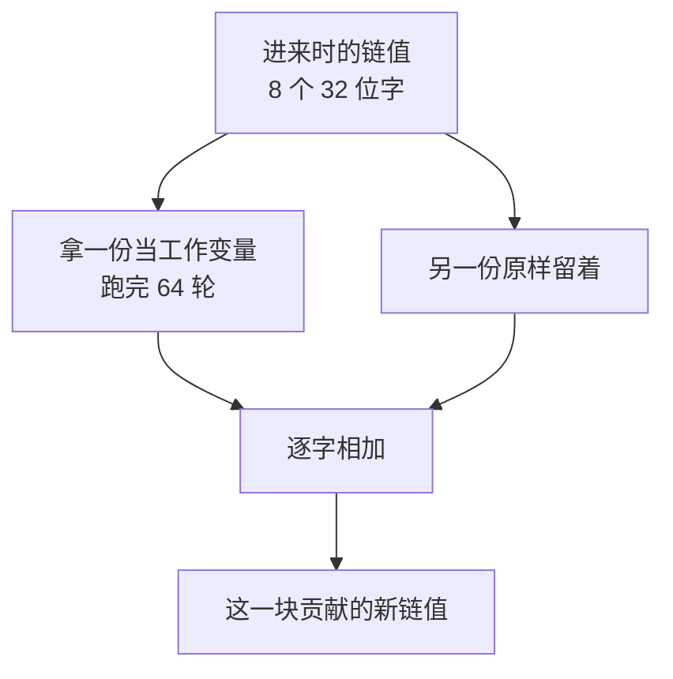
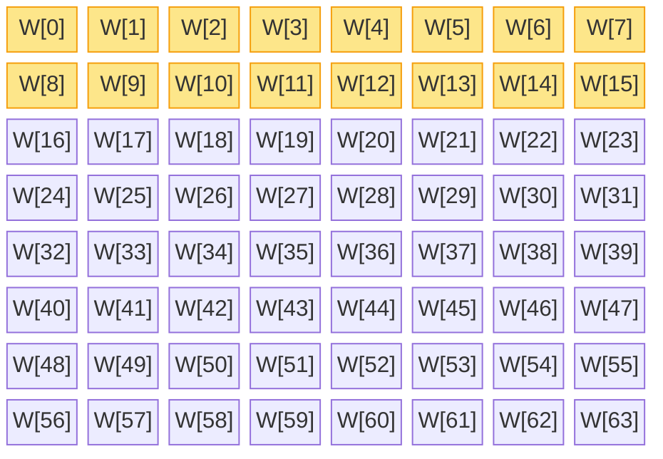
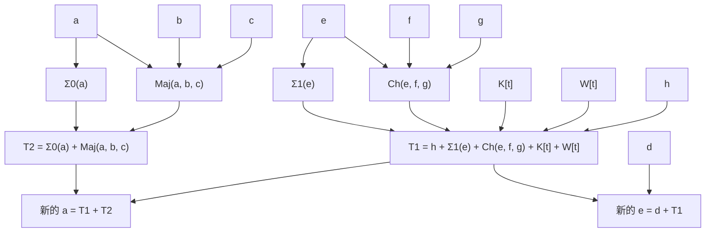
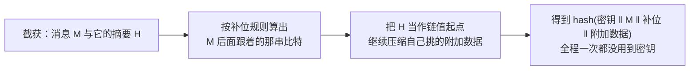

# SHA-256 原理

[[toc]]

SHA-256 属于 SHA-2 家族，2001 年随 FIPS 180-2 一起发布，到今天仍是使用最广的哈希算法。它走的是 Merkle–Damgård 这条路：消息补位后切成 512 位一块，每块都过一遍同样的 64 轮运算，算出来的结果作为下一块的起点传下去。

本文是[《哈希函数与数据完整性验证》](./hash-function-integrity.md)里 SHA-256 那一节的展开，把它的内部构造从零拆开讲。

## 哈希函数的三个要求

哈希函数把任意长度的输入压成固定长度的一串比特。它不加密数据，也没法从摘要还原出原文，只用来判断数据有没有被动过。文件校验、密码存储、数字签名、区块链，底下都是它。

判断一个哈希函数能不能用，看三条：

- 单向：从输出反推输入，除了一个个试没有更快的方法
- 抗碰撞：找不到两个不同的输入，输出却一样
- 抗第二预图像：已知输入 A 和它的输出，找不出另一个 B（≠A）能给出同样的输出

SHA-256 的设计，就是围绕这三条展开的。

## SHA-256 的出身

它往前能追到 MD4。这一族算法的迭代脉络是这样的：

| 算法 | 发布 | 输出长度 | 结构 | 现状 |
| --- | --- | --- | --- | --- |
| MD4 | 1990 | 128 位 | Merkle–Damgård，3 轮 | 1996 年被找到碰撞 |
| MD5 | 1991 | 128 位 | Merkle–Damgård，4 轮 | 2004 年被找到碰撞 |
| SHA-1 | 1995 | 160 位 | Merkle–Damgård，4 轮 | 2017 年被 Google 找到碰撞 |
| SHA-256 | 2001 | 256 位 | Merkle–Damgård，64 轮 | 至今没有被攻破 |
| SHA-3 | 2015 | 224–512 位 | 海绵结构 | 与 SHA-2 并列的备用骨架 |

前四行共用一套骨架：消息补位切块，逐块压缩，前一块的输出喂给后一块。差别全在压缩函数里——轮数、消息扩展方式、常数表，一代比一代厚。MD5 和 SHA-1 相继被攻破，是压缩函数本身被差分分析打穿；而这套骨架还有一个绕不开的结构性问题，加多少轮都补不掉，[具体见后文](#为什么-merkle–damgard-结构怕长度扩展攻击)。

一套骨架被攻破过一次，就不该再把所有系统都压在它上面。于是 NIST 在 2007 年公开征集替代方案，2012 年选出 Keccak，2015 年把它定为 SHA-3 标准。所以 SHA-3 不是用来替换 SHA-256 的——SHA-256 没坏，它是另一套备用的骨架，[内部构造完全不同](./hash-sha3-principle.md)。

## Merkle–Damgård 结构总览

三个阶段的流水线：先把消息整理成 512 位的整数倍，再让每块消息走一遍压缩函数，最后拼出摘要。

<!-- @include: ./hash-sha256-structure.md -->

图里有两条线索，分开看：

- 上面那条：消息补位后切成 512 位一块，其中**每块各有实线连到自己那次压缩**
- 下面那条：链值从 8 个固定常数起，一块接一块接力，最后拼成 256 位摘要

「链值」（chaining value）是 256 位，也就是 8 个 32 位字。它每一块都被整体换一次，上一块的输出就是下一块的输入，像链条一样传下去，所以叫链值。第一次压缩的输入没有上一块，就用 8 个写死的常数打头。

## 补位：把消息凑成 512 的整数倍

压缩函数一次只吃 512 位，所以先把消息整理成 512 的整数倍。

规则是：先在末尾补一个 `1`，再补若干个 `0`，最后补上 **64 位的原始消息长度**。

补多少个 `0` 不是固定的，要补到「补完之后、还没写长度字段之前」的总长度模 512 等于 448。留出 448 而不是 512，正是为了给最后那 64 位长度字段腾地方：`448 + 64 = 512`。


为什么不反过来写「先写长度再补零」？因为长度字段放最后，消息从前往后读的时候不用先知道总长。

长度字段是必须的，这一点和 SHA-3 不一样。SHA-3 的补位规则本身就把边界编进去了（最后那个 `1` 标记真正的结尾），不需要额外的长度字段；SHA-256 靠这个 64 位字段来区分长度不同的消息。

有个容易疑惑的点：如果消息长度正好卡在边界上呢？比如 `l` 已经满足 `l mod 512 = 448`，补一个 `1` 之后就到了 449，还得继续补零到 448——也就是再补一整块。SHA-256 里同样不存在「长度刚好、不用补」的情况，**补位至少要补一个 `1`，所以永远会补**。

## 压缩函数：每块跑 64 轮

压缩函数一次吃一个块（512 位），吐出 256 位的新链值。一进一出之间有三步。

**扩字**：块本身只有 16 个 32 位字，却要跑 64 轮，所以先由消息调度把它扩成 64 个字 `W[0]…W[63]`。

**混合**：64 个字逐个喂进 64 轮。每一轮取一个字 `W[t]`，加上这一轮专属的常数 `K[t]`，去改动压缩函数内部的 8 个工作变量。

**加回**：64 轮跑完，把改动过的 8 个变量和进来时的 8 个链值逐字相加，得到的才是这一块贡献的新链值。

工作变量记作 `a b c d e f g h`，每个 32 位，八个合起来正好 256 位。开跑之前它们被赋成进来时的 8 个链值，所以进来时的链值在压缩函数里头存在两份：一份被 64 轮一路改，一份原样留着，最后用来相加。



最后那个「加回」的动作叫前馈（feed-forward）。它看起来只是顺手加一下，其实是整个函数单向性的来源，后面单独说。

### 消息调度：16 个字扩成 64 个

扩出来的 64 个字记作 `W[0]…W[63]`，前 16 个是搬，后 48 个是算：



- `W[0]` 到 `W[15]`（图中标底色的前 16 格）就是块本身，这 16 个 32 位字原样搬过来
- `W[16]` 到 `W[63]` 由公式递推出来

公式是：

```
W[t] = σ1(W[t−2]) + W[t−7] + σ0(W[t−15]) + W[t−16]
```

拿第 17 个字 `W[16]` 举例，它由 `W[14]`、`W[9]`、`W[1]`、`W[0]` 这四个字算出来——四个来源分散在一块的头、中、尾，不是挨着的。

这么做的目的是扩散：如果没有调度，一块 16 个字只用一次，消息里改动一个比特只能影响到那几轮；有了递推，一个字会被后面十几轮反复用到，改一个比特很快就撒满 64 轮。

### 一轮里到底算了什么

64 轮做的是同一件事，每轮只换 `W[t]` 和 `K[t]` 这两个输入：

```
T1 = h + Σ1(e) + Ch(e, f, g) + K[t] + W[t]
T2 = Σ0(a) + Maj(a, b, c)
```

拿到 T1、T2 之后，8 个变量整体往下挪一格：



公式里的 `+` 全是 32 位加法——两个 32 位数相加可能到 33 位，最高位那一位直接丢掉，只留低 32 位。这是哈希函数里的常规做法，不保留进位。

变量怎么挪：

| 这一轮结束后 | a | b | c | d | e | f | g | h |
| --- | --- | --- | --- | --- | --- | --- | --- | --- |
| 值 | T1 + T2 | 原来的 a | 原来的 b | 原来的 c | 原来的 d + T1 | 原来的 e | 原来的 f | 原来的 g |

八个变量像一条流水线，每轮整体往前推一格，只有 `a` 和 `e` 是重新算出来的。`a` 和 `e` 各有两条输入路径：`a` 的一条来自 `Σ0`/`Maj`（只跟 a、b、c 有关），`e` 的一条来自 `Σ1`/`Ch`（跟 e、f、g 有关），另一条则是从 `d` 或 `h` 这些更靠后的变量传过来的。

这样安排的结果是：`W[t]` 从 `e` 这一侧进来，经过一轮就影响到 `a`，再经过若干轮就会波及全部 8 个变量。

### 那些位运算各管什么

公式里出现了四个带希腊字母的函数：`Σ0`、`Σ1`、`σ0`、`σ1`，还有两个按位函数 `Ch` 和 `Maj`。

::: tip 循环移位
把一串比特整体往一个方向平移，移出去的那几位不丢弃，从另一端接回来。

```
右移 2 位：  b0 b1 b2 b3 b4 … b31
变成：      b30 b31 b0 b1 b2 … b29
             └─ 移出去的两位绕到了左端
```

普通右移会丢掉移出去的比特，循环右移一个不少，所以这一步是可逆的。SHA-256 里的记号：`ROTR n` 是循环右移 n 位，`SHR n` 是普通的右移，丢掉的位不再接回来。
:::

| 函数 | 定义 | 作用 |
| --- | --- | --- |
| Σ0(a) | ROTR 2 ⊕ ROTR 13 ⊕ ROTR 22 | 把 a 的比特错开三个距离，扩散 |
| Σ1(e) | ROTR 6 ⊕ ROTR 11 ⊕ ROTR 25 | 同上，作用在 e 上 |
| σ0(x) | ROTR 7 ⊕ ROTR 18 ⊕ SHR 3 | 消息调度里用，作用在 W[t−15] 上 |
| σ1(x) | ROTR 17 ⊕ ROTR 19 ⊕ SHR 10 | 消息调度里用，作用在 W[t−2] 上 |
| Ch(e, f, g) | (e ∧ f) ⊕ (¬e ∧ g) | 按 e 的每一位，从 f 和 g 里挑一个 |
| Maj(a, b, c) | (a ∧ b) ⊕ (a ∧ c) ⊕ (b ∧ c) | a、b、c 三个比特里取多数 |

`∧` 是按位与（两个都是 `1` 才得 `1`），`¬` 是按位取反，`⊕` 是异或。

`Ch` 的读法：e 的某一位是 `1`，结果就取 f 对应那一位；是 `0`，就取 g 的。名字来自 choose（选择）。`Maj` 是 majority（多数）——三个比特里两个是 `1`，结果就是 `1`。

四个希腊字母函数全是循环移位和异或的叠加，属于线性运算；只有 `Ch` 和 `Maj` 里的按位与是非线性的，整个 SHA-256 的混乱程度追根溯源都来自这两个函数。

::: tip 为什么非线性这么关键
全是异或、循环移位这类线性操作的话，整个算法就退化成一次方程组，给了输出就能解出输入，密码学上叫「可用线性代数攻破」。

`&`（按位与）不一样：

| a | b | a ⊕ b | a & b |
| --- | --- | --- | --- |
| 0 | 0 | 0 | 0 |
| 0 | 1 | 1 | 0 |
| 1 | 0 | 1 | 0 |
| 1 | 1 | 0 | 1 |

按位与只有两个比特都是 `1` 才输出 `1`，这个条件凑不出等价的加减法。混进它之后，方程组由一次升到高次，就没有捷径可解了。
:::

### 为什么每一轮可逆，整个函数却不可逆

一轮里的运算——32 位加法、循环移位、异或、按位与——没有一个是不可逆的。给定这一轮的输出和 `W[t]`、`K[t]`，进入这一轮时的 8 个变量能唯一地反推出来：

- 新 `b`、`c`、`d` 是原来的 `a`、`b`、`c`，直接读出来
- 新 `f`、`g`、`h` 是原来的 `e`、`f`、`g`，同样直接读
- 原来的 `d` 就是新 `c`，代入新 `e = 原来的 d + T1` 得到 `T1`
- 新 `a = T1 + T2` 反推出 `T2`，再拿反推出来的 `a b c` 校验一遍 `T2 = Σ0(a) + Maj(a, b, c)` 是否成立

所以 64 轮跑完，整个压缩过程是可以倒着走回去的。真正让 SHA-256 单向的，是最后往前馈的那一步：把进入这一块时的 8 个链值再加回来。

少了这一步，**摘要就等于内部状态**。攻击者随便挑一个想要的结果，一路倒推就能编出一块与之匹配的消息，压缩函数彻底失效。加上前馈之后，摘要里混着「输入链值 + 加工结果」，想倒推就得先知道输入，而这个输入正是他要找的东西，循环堵死。

## 为什么 Merkle–Damgård 结构怕长度扩展攻击

这是 Merkle–Damgård 结构的一个实际弱点。

前提是某个系统拿 `hash(密钥 + 消息)` 当签名（不推荐，但历史上很常见），密钥保密。攻击者截获了消息和它的摘要，不知道密钥。

对 SHA-256 来说，摘要不是别的，就是最后那个 256 位链值——也就是「压缩完所有块之后、内部状态的完整样子」。攻击者手里有了这个内部状态，就能假装自己是算法本身，继续往下压缩：先按规则补位算出消息后面跟着的那串比特，再喂一段自己挑的附加数据。



从头到尾没碰到密钥，攻击者却得到了一条合法的新消息和它的摘要。

这不是 SHA-256 的实现有 bug，是 Merkle–Damgård 结构自带的性质：摘要既然等于整个内部状态，就等于把继续往下算的能力一并交了出去。MD5、SHA-1、SHA-2 全都有这个性质。[SHA-3 的海绵结构](./hash-sha3-principle.md)天然免疫这类攻击——它的摘要是 1600 位内部状态里的一小段，剩下的没公开，接不下去——这也是 SHA-3 相比 SHA-2 最实际的一个优势。

真要给消息做认证，别用 `hash(密钥 + 消息)`。**HMAC** 把哈希套成内外两层，外面那层把长度扩展堵死了，详见[消息认证码技术详解](./message-authentication-code.md)；直接上 SHA-3 系列的 KMAC 也是一种做法。

## 常数的来历

压缩函数里到处都是写死的常数：8 个初始链值、64 个轮常数 `K[t]`。这些数不是随手编的，生成规则公开可查：

| 常数 | 数量 | 来源 |
| --- | --- | --- |
| 初始链值 H0…H7 | 8 个 | 前 8 个质数（2、3、5、7、11、13、17、19）平方根的小数部分，取前 32 位 |
| 轮常数 K[0]…K[63] | 64 个 | 前 64 个质数立方根的小数部分，取前 32 位 |

前几个常数长这样：

| n | 第 n 个质数 | H（平方根） | K（立方根） |
| --- | --- | --- | --- |
| 1 | 2 | 6a09e667 | 428a2f98 |
| 2 | 3 | bb67ae85 | 71374491 |
| 3 | 5 | 3c6ef372 | b5c0fbcf |
| 4 | 7 | a54ff53a | e9b5dba5 |

拿 `H0` 验算：√2 = 1.41421356…，小数部分 0.41421356…，乘 2³² 取整得 1779033703，写成十六进制就是 `6a09e667`。

这种常数在密码学里叫 nothing-up-my-sleeve 数字——生成规则一旦定死，设计者就没法从一堆数里挑一组「看着随机、其实埋着弱点」的常数。用质数的平方根、立方根，图的就是规则简单、谁都能验算。

## 参数与选型

SHA-2 是一个家族，四个常用版本：

| 算法 | 摘要长度 | 块大小 | 字长 | 轮数 | 碰撞攻击安全强度 |
| --- | --- | --- | --- | --- | --- |
| SHA-224 | 224 位 | 512 位 | 32 位 | 64 | 2¹¹² |
| SHA-256 | 256 位 | 512 位 | 32 位 | 64 | 2¹²⁸ |
| SHA-384 | 384 位 | 1024 位 | 64 位 | 80 | 2¹⁹² |
| SHA-512 | 512 位 | 1024 位 | 64 位 | 80 | 2²⁵⁶ |

SHA-256 和 SHA-512 不是「同一套东西取不同长度」，而是两套独立的参数：字长 32 位对 64 位，轮数 64 对 80，常数表也不一样。SHA-224 可以粗略看成 SHA-256 砍掉尾巴，SHA-384 对应 SHA-512。

安全强度那列有个反直觉的点：256 位摘要能提供的碰撞安全强度只有 2¹²⁸，不是 2²⁵⁶。因为找碰撞不用穷举全部输入，生日攻击只需要试 2^(n/2) 次就能撞上——这是所有哈希函数共同的天花板，不是 SHA-256 的设计缺陷。预图像攻击的强度仍然是 2²⁵⁶。

选型时按下面几条往外走：

- 没有特殊要求就选 SHA-256。兼容性最好，现代 CPU 有 SHA-NI 指令集直接加速，各家语言和库的支持也最全
- 需要超过 128 位的安全强度：换 SHA-384 或 SHA-512，别在 SHA-256 上想办法
- 给消息做认证（MAC）：用 HMAC-SHA-256，别自己拼 `hash(密钥 + 消息)`
- 需要可扩展输出（派生密钥、伪随机数）：SHA-256 做不到，换 SHAKE 系列
- 存密码：通用哈希一律不合适，用 Argon2id 这类专门设计得慢的算法

::: warning
MD5 和 SHA-1 已经不能用在任何安全场景里，「只是内部用」也不行。新系统的最低起点是 SHA-256。
:::

## 小结

SHA-256 把「哈希」这件事拆成了一条流水线：

- 骨架是 Merkle–Damgård：消息补位切块，一块接一块接力，上一块的输出就是下一块的输入
- 每块内部跑 64 轮，一轮里 8 个工作变量整体挪一格，只有 a 和 e 是重算的
- 每轮把消息字 `W[t]` 和常数 `K[t]` 混进来，让消息的影响逐轮铺满全部变量
- 混乱来自 `Ch` 和 `Maj` 两个按位函数，其余运算都是可逆的线性操作
- 单向性来自最后的前馈：把输入链值加回去，倒推的回路就被堵死了

它唯一的已知结构性弱点是长度扩展——摘要等于内部状态，拿到摘要就能接着往下压。这不影响它作为哈希函数本身的使用，但决定了不能拿 `hash(密钥 + 消息)` 当认证手段。
