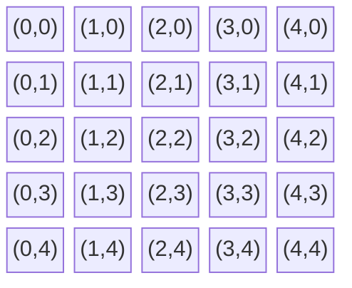
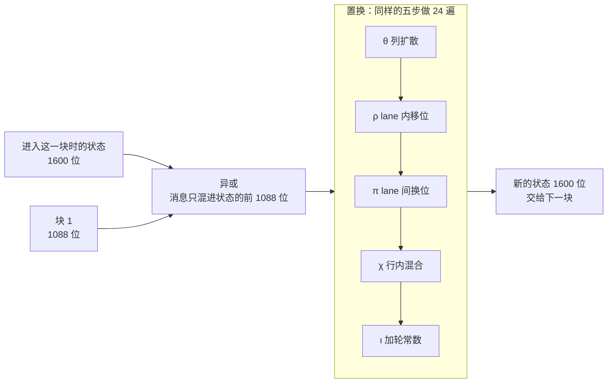
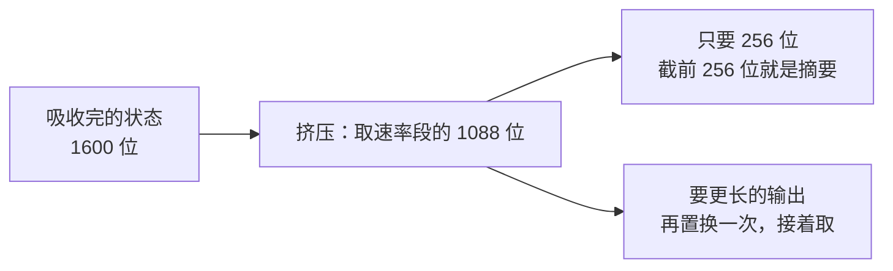
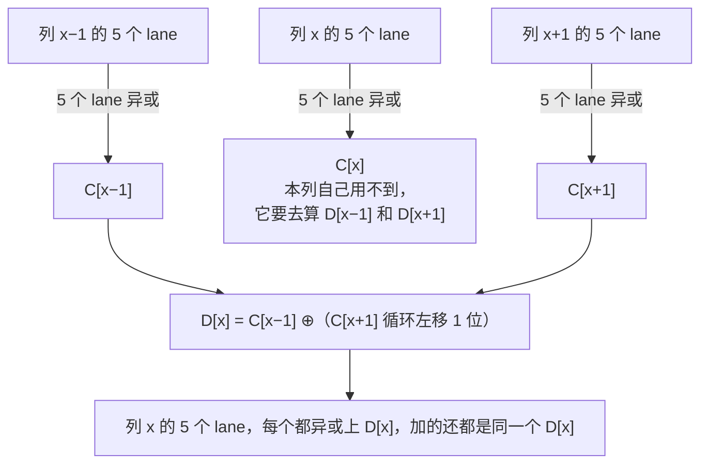
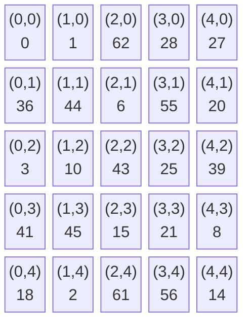
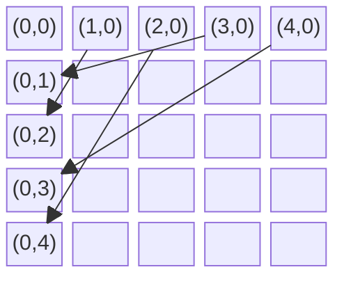
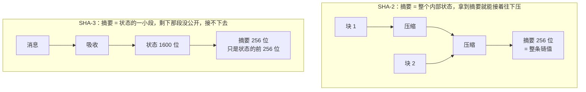

# SHA-3 原理

[[toc]]

SHA-3 是 2015 年定稿的哈希算法标准，和 SHA-256 完全不是一个路子：SHA-256 是「压缩函数一块块接力」，SHA-3 是「把消息揉进一块固定大小的海绵里，再挤出来」。

本文从零讲它的内部构造，需要的背景知识只有三样：二进制位、异或、取模，出现时会当场解释。

## 哈希函数是干什么的

哈希函数把任意长度的输入（一段文字、一个文件、一部电影）压成固定长度的一串比特，通常是 128 到 512 位。同一个输入永远得到同一个输出，稍微改动一个字符，输出就会面目全非。

它要满足三件事：

- 单向：拿输出反推输入，没有比一个个试更快的办法
- 抗碰撞：找不到两个不同的输入，它们的输出相同
- 抗第二预图像：给定输入 A 和它的输出，找不到另一个输入 B（≠A）输出相同

哈希不加密数据、也不能还原数据，它只用来判断数据有没有被动过，以及把任意长的东西压成一把短尺子去比较。文件的完整性校验、密码存储、数字签名、区块链，底下都是它。

## 已经倒下的一代

- MD5（1991）：128 位输出，2004 年找到碰撞，两个不同的文件可以算出同一个 MD5，已经不能用于任何安全场景
- SHA-1（1995）：160 位输出，2017 年被 Google 找到碰撞，主流浏览器和 CA 机构已经弃用
- SHA-2（2001）：输出 224 到 512 位，至今没有被攻破，是目前的主力
- SHA-3（2015）：本文的主角，和 SHA-2 并列，是另一套独立的备用骨架

SHA-2 没坏，SHA-3 也不是用来替换它的。MD5 和 SHA-1 用的都是「Merkle–Damgård 结构」，SHA-2 是同一个结构的加固版，血缘上有关系。密码学界的态度是：同一种骨架被攻破过一次，就不该把鸡蛋全放这一个篮子里。2007 年 NIST 公开征集替代方案，2012 年 Keccak 胜出，2015 年成为 SHA-3 标准。

## 海绵结构总览

SHA-3 的核心叫海绵结构（Sponge Construction）。名字来自它的两步动作：先把消息吸进去，再把结果挤出来。

<!-- @include: ./hash-sha3-structure.md -->

图里有两条线索，分开看：

- 上面那条：消息补位后切成 1088 位一块，每块都有一根线连到自己那一次的吸收
- 下面那条：状态从 1600 位全 0 出发，一块接一块接力，最后取前 256 位当摘要

对比 SHA-256 的结构会更清楚：SHA-256 是每块压进一个 256 位的链值，链值一路接力，最后那个链值就是摘要。SHA-3 只有一个固定大小的状态，消息被异或进去，摘要从里面取——**消息不是「压」进状态，而是「揉」进状态**。

## 内部状态：一个 5×5 的方阵

状态 1600 位，不是一个长条，而是排成 5 行 5 列的方阵，每格 64 位。这个格子里的小单位叫 lane（车道）。



25 个格子 × 64 位 = 1600 位。坐标记作 `(x, y)`，第一个数是列号，第二个是行号，都从 0 数到 4。

## 速率段和容量段

这 1600 位内部还被切成两段，以 SHA3-256 为例：

| 段 | 大小 | 作用 |
| --- | --- | --- |
| 速率段（rate，记作 r） | 1088 位 | 消息就异或在这一段上，输出也从这一段取 |
| 容量段（capacity，记作 c） | 512 位 | 消息永远碰不到它，输出也不取它 |

两段加起来正好 1600 位。容量段是安全余量：它从头到尾没被消息直接碰过，也从不公开，攻击者拿到摘要时，这 512 位的内容完全未知。

速率和容量的大小由摘要长度决定：`c = 2 × 摘要长度`，`r = 1600 − c`。摘要要 256 位，就留 512 位当容量，剩下 1088 位做速率。想要更长的摘要，容量就得留更多，速率就更小，算法也更慢——这是安全强度和速度之间的换算。

## 预处理：补位与切块

吸收是一块一块做的，所以先要把消息整理成 1088 位的整数倍。

规则叫 `pad10*1`：末尾先补一个 `1`，再补若干个 `0`，最后再补一个 `1`，补到总长度正好是 1088 的整数倍。

为什么这样就能还原出原消息？因为最后一个 `1` 标记了消息的真正结尾，往前数到上一个 `1` 之间的那串 `0` 是为凑长度补的。补位规则本身就把长度信息编进去了，不需要再像 SHA-2 那样额外写一个长度字段。

有个容易疑惑的点：如果消息长度正好是 1088 的整数倍呢？那也要补，补一整块新的——因为 `pad10*1` 至少要追加两个 `1`，正好填满时必然溢出到下一块。SHA-3 里不存在「长度刚好、不用补」的情况。

## 吸收：把消息揉进状态

每一块消息做一件事：先把这块 1088 位与状态的速率段逐位异或，然后对整个 1600 位做一次置换。

::: tip 异或（XOR）
两个比特相同得 `0`，不同得 `1`。

```
0 ⊕ 0 = 0    0 ⊕ 1 = 1
1 ⊕ 0 = 1    1 ⊕ 1 = 0
```

它的关键性质是**自己就是自己的逆运算**：`a ⊕ b ⊕ b = a`。加密和解密用同一步，不需要另设一套反向操作。
:::

用异或的原因就在这：它是可逆的。如果某一步用了不可逆的运算，信息就丢了，同一个摘要可能对应多个消息，算法立刻失去意义。



这里有个细节值得注意：异或只发生在速率段的 1088 位上，容量段的 512 位一个比特都没碰。所谓「消息被吸收进状态」，准确说是「消息被异或进状态的前 1088 位」。

## 挤压：把摘要取出来

所有消息块吸收完之后，状态里已经混着整条消息的痕迹，接下来把它取出来。



从速率段取出内容当输出。SHA3-256 只要 256 位，取一次就够了（256 < 1088）。如果要的输出比速率段还长，就把整个状态再置换一次，继续取下一段，如此反复，想取多长取多长。

这个特性催生了 SHAKE 系列。`SHAKE128` 和 `SHAKE256` 的输出长度是可以任意指定的：想生成一个 4096 位的密钥，就一路挤压到 4096 位。同一套海绵，换个挤法就能当伪随机数发生器用。

## 置换（Keccak-f）里到底做了什么

整个算法最核心的部分就是那个「置换」——一个把 1600 位彻底搅乱、但可逆的函数，代号 Keccak-f[1600]。

它对状态做 24 轮，每一轮都重复下面五步，顺序固定：

| 步骤 | 一句话 |
| --- | --- |
| θ (theta) | 列与列之间互相扩散 |
| ρ (rho) | 每个 lane 内部错位 |
| π (pi) | lane 之间换位置 |
| χ (chi) | 同一行内做非线性混合 |
| ι (iota) | 加上这一轮专属的常数 |

五步各管一个方向，下面逐个展开。

### 先约定怎么读这个方阵

五步都作用在前面那个 5×5 阵列上。坐标 `(x, y)`：x 相同的 5 个 lane 算一列，y 相同的 5 个算一行，每个 lane 内部是 64 个比特。

### θ 列扩散

先把每一列的 5 个 lane 异或起来，得到一个 64 位的「列奇偶值」；再让每个 lane 异或上「左邻列的奇偶值」与「右邻列奇偶值循环左移 1 位」的异或结果。

以列 x 为例，这两件事分别是这样：



注意两处反直觉的地方：列 x 加回去的 D[x] 跟自己的 C[x] 没关系，用的是左右邻列的 C；而且加的是同一个 64 位值 D[x]，列里 5 个 lane 加的东西一样，区别只在于各自原来的内容不同。5 列都按这个方式走一遍。

扩散效果由此而来：改动列 x−1 里的一个比特，会让 C[x−1] 变，进而让 D[x] 和 D[x−2] 都变，波及两整列共 10 个 lane。这是五步里唯一跨列的动作，扩散主要靠它。

### ρ lane 内移位

25 个 lane 各自在内部做循环移位，比特只在 lane 里动，不跨 lane。每个 lane 移多少位是定死的，25 个值合起来就是一张固定表：



格子里的数字是循环左移的位数：`(0,0)` 是 0，也就是不动；最大的 62 位相当于反过来移 2 位。

::: tip 循环移位
把一串比特整体往一个方向挪，挪出去的比特不丢弃，从另一端接回来。

```
左移 2 位：  b0 b1 b2 b3 b4 … b63
变成：      b2 b3 b4 … b63 b0 b1
                          └─ 移出去的两位绕到了右端
```

普通移位会丢掉移出去的比特，循环移位一个不少，所以这一步是可逆的。
:::

「循环」这两个字是重点——64 位一个不丢，所以这一步可逆。它的用处是让各 lane 里的比特错开位置：如果 25 个 lane 都移同样的量，后面 χ 在各行做的就是同一件事，对称性消不掉。

### π lane 间换位

把 25 个 lane 从 `(x, y)` 整体搬到 `(y, 2x+3y mod 5)`。搬的只是 lane 本身，lane 内部那 64 位的顺序完全不变。

::: tip 取模（mod）
`a mod b` 是 a 除以 b 的余数。`7 mod 5 = 2`，`12 mod 5 = 2`。

在坐标里用它，是为了把结果压回 0 到 4：`5 mod 5 = 0`，第 5 列绕回第 0 列，整个方阵像一个左右接起来的圆筒。
:::

25 条路径全画出来太乱，只画第 0 行，其余格子空着。

出发点是 `(x, y)`，落地是 `(y, 2x+3y mod 5)`。看这两个坐标：第一个直接就是源 lane 的 y，跟 x 无关——也就是源的行号原样变成目的地的列号，**第 y 行的 5 个 lane 全部落到第 y 列**。需要算的只有第二个坐标。



同一行里 x 从 0 数到 4，第二个坐标按 `2x+3y mod 5` 走。为什么这 5 个数正好把 0 到 4 各占一次？拿 y = 0 那行直接算：

| x | 0 | 1 | 2 | 3 | 4 |
| --- | --- | --- | --- | --- | --- |
| 2x | 0 | 2 | 4 | 6 | 8 |
| 2x mod 5 | 0 | 2 | 4 | 1 | 3 |

得到 `0, 2, 4, 1, 3`，五个数一个不重一个不漏。可以把它想成在 0 到 4 围成的一圈上，每次往前跨 2 格：`0 → 2 → 4 → 1 → 3 →（回到 0）`，走满 5 步才回到起点，路上踩的 5 个位置自然各不相同。

要跨 5 步才回来，是因为 2 和 5 互质。换个步长试试：步长 5 的话 `5x mod 5` 是 `0, 0, 0, 0, 0`，五步全原地，一个位置都没多占。

至于那个 `+3y`：它跟 x 无关，是个常数。给 5 个互不相同的数同时加同一个常数，只是把这串数在圈上整体转个角度，不会让任何两个数变得相等，也不会跑出 0 到 4。所以 5 个 lane 一个不多一个不少地铺满第 y 列，没有两个撞进同一格。

`(0,0)` 是 π 的固定点，原位不动，所以图里没有它的箭头。

说白了 π 交换了行和列的角色：原来同一行的 5 个 lane 被摊到同一列上，下一轮 χ 碰到的就是另一批 lane。没有 π 的话「哪些 lane 会凑到同一行」永远固定，一轮之内换不出新组合。

### χ 行内混合

同一行的 5 个 lane 互相牵连，每个 lane 异或上「右边第一个 lane 取反」与「右边第二个 lane」的按位与（下标对 5 取模，行首行尾接得上），写成公式是 `A[x,y] ^= ~A[x+1,y] & A[x+2,y]`。

这一步是五步里**唯一的非线性操作**，也是整个置换的关键所在。前四步——异或、循环移位、换位置、加常数——在数学上都属于线性操作，也就是「输出的每个比特都是输入的某些比特加起来」。

线性操作可以整批解掉。举个最小的例子，如果只有异或，`a ⊕ b = c` 这种式子，给了 c、知道其中一个，另一个立刻算得出来；成千上万个这样的式子摆在一起，也就是解一个一次方程组，计算机几秒钟就能出结果。密码学上管这叫「可用线性代数攻破」。

`&`（按位与）不一样。看两个比特的与运算：

| a | b | a ⊕ b | a & b |
| --- | --- | --- | --- |
| 0 | 0 | 0 | 0 |
| 0 | 1 | 1 | 0 |
| 1 | 0 | 1 | 0 |
| 1 | 1 | 0 | 1 |

`a & b` 只有在「两个都是 1」时才得 1，这个「都要满足」的条件没法用加减拼出来。含了它，方程组就从一次变成了高次，解不动了。整个 SHA-3 的混乱程度，追根溯源都来自这一步。

### ι 加轮常数

把第 i 轮专属的一个 64 位常数异或进 `(0,0)` 这一个 lane。常数由 LFSR（线性反馈移位寄存器）生成，24 轮各不相同。

只加在一个 lane 上是因为紧接着的 θ 会把它扩散到全场。

少了这一步，24 轮就是同一个函数的 24 次幂：每一轮做的完全一样，轮与轮之间的对称性还在。密码分析里有一种攻击叫滑动攻击，专门找这种「前后两轮长得一模一样」的结构下手——它可以把 24 轮的强度换算成 1 轮加一点零头。每轮塞一个不同的常数，等于给每轮打上编号，让它们互不相同。

### 为什么是 24 轮

一轮之内，一个比特能走到的地方有限：

- χ 只在一行内混，最多碰 5 个 lane
- ρ 和 π 只搬位置、不混内容
- θ 跨列，但也只跨相邻的两列

轮数够多，任意一个比特的影响才能铺满整个 25 × 64 位的状态。轮数取多少由状态大小定：`12 + 2ℓ`，1600 位对应的 `ℓ = 6`（因为 `1600 = 25 × 2⁶`），代入得 24。

## 为什么海绵结构不怕长度扩展攻击

这是 SHA-3 相比 SHA-2 最实际的一个优势。

先看这种攻击怎么打的。假设有个系统用 `hash(密钥 + 消息)` 当签名（这不是推荐做法，但历史上很常见），密钥是保密的。攻击者截获了消息和它的摘要，但不知道密钥。

对 SHA-2 来说，摘要就是最后那个 256 位链值，也就是「压缩完所有块之后，内部状态的完整样子」。攻击者手里有了这个内部状态，就能假装自己是算法本身，继续往下压缩：先按规则补位，再喂一段自己挑的附加数据，算出来的结果正好是 `hash(密钥 + 消息 + 补位 + 附加数据)`。

整个过程一次都不需要知道密钥，却得到了一条合法的新消息和它的摘要。



SHA-3 挡掉它的原因在右图：摘要是 1600 位状态里的前 256 位，剩下的 1344 位攻击者完全不知道。想接着「喂」数据，得先重建出整个状态，而这件事做不到。海绵结构天然免疫这类攻击，不是靠打补丁。

## 参数与选型

各个标准版本的参数：

| 算法 | 摘要长度 | 速率 r | 容量 c | 轮数 |
| --- | --- | --- | --- | --- |
| SHA3-224 | 224 位 | 1152 位 | 448 位 | 24 |
| SHA3-256 | 256 位 | 1088 位 | 512 位 | 24 |
| SHA3-384 | 384 位 | 832 位 | 768 位 | 24 |
| SHA3-512 | 512 位 | 576 位 | 1024 位 | 24 |
| SHAKE128 | 任意长度 | 1344 位 | 256 位 | 24 |
| SHAKE256 | 任意长度 | 1088 位 | 512 位 | 24 |

容量越大越安全、速率越小越慢。SHAKE 后面的数字是安全强度（容量的一半），不是摘要长度——`SHAKE256` 意味着 256 位的安全强度，跟你挤多少位输出没关系。

选型的几条实用判断：

- 通用场景（文件校验、数字签名、证书）：SHA-256 或 SHA3-256 都行。SHA-256 兼容性好、有硬件加速，SHA3-256 在不需要兼容新硬件的场合更稳妥
- 需要可扩展输出（派生密钥、伪随机数）：SHAKE128 / SHAKE256
- 需要消息认证码（MAC）：SHA-3 系列有专门的 KMAC，比套 HMAC 更直接，因为海绵本身不怕长度扩展
- 追求极致性能、且不涉及对抗性攻击（备份、分发）：BLAKE2b
- 存密码：不要用任何通用哈希，用 Argon2id 这类专门的慢哈希

::: warning
MD5 和 SHA-1 不能再用于任何安全场景，包括「只是内部用」。新系统起步就该是 SHA-256 或 SHA-3。
:::

## 小结

SHA-3 把「哈希」这件事换了一种提问方式：

- SHA-2 的思路是「想个好的压缩函数，让它一块接一块地把消息压扁」
- SHA-3 的思路是「准备一块足够大的海绵，让消息揉进去，然后从里面挤」

整条链路是：消息补位切块 → 每块异或进状态的速率段 → 24 轮置换彻底搅乱 → 重复到消息用完 → 从速率段挤出来当摘要。

而 24 轮置换里，θ 负责跨列扩散、ρ 负责 lane 内错位、π 负责把行变成列、χ 提供唯一的非线性、ι 让每一轮互不相同。五步各管一个方向，缺一个都会留下可被利用的结构。
