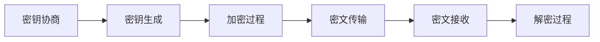
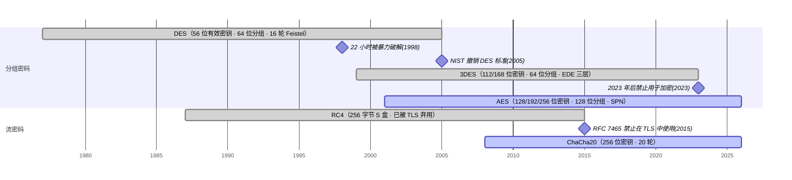
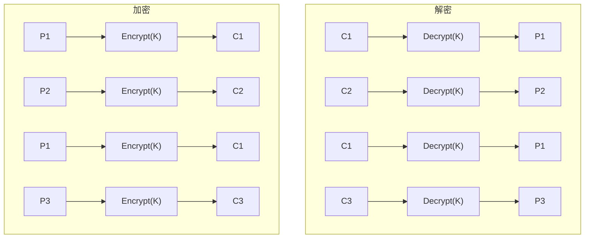
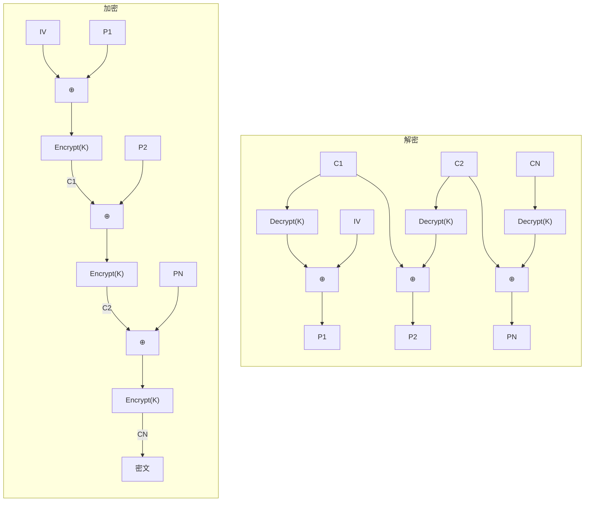
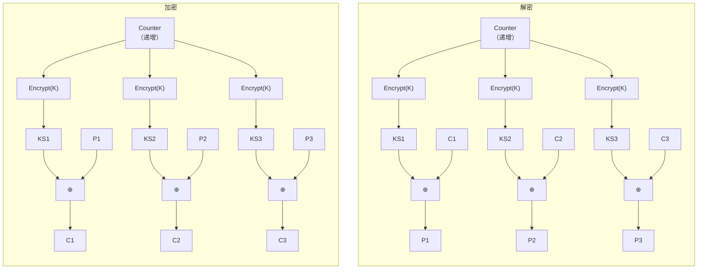

# 对称加密算法

[[toc]]

对称加密从早期的 DES 演进到如今的 AES-GCM。本文整理对称加密的技术原理、算法演进、加密模式与密钥管理。

## 对称加密的本质

对称加密算法加密和解密使用同一个密钥。与非对称加密相比，它的性能优势明显，因此成为大批量数据加密的首选方案。

### 基本工作流程

对称加密的完整流程包含六个环节：



- 密钥协商：建立安全通信时进行，用于交换或生成共享密钥
- 密钥生成：基于协商结果生成实际用于加密的会话密钥
- 加密过程：使用会话密钥对明文进行加密转换
- 密文传输：通过网络或存储介质传输加密后的密文
- 密文接收：接收方获取并准备解密密文
- 解密过程：使用相同的会话密钥将密文还原为明文

### 核心设计权衡

对称加密算法的设计需要在安全性与性能之间做取舍，三个核心要素构成权衡的三角关系：

| 要素 | 安全维度 | 性能维度 | 架构决策建议 |
|------|----------|----------|--------------|
| 密钥长度 | 越长→暴力破解难度指数级增长 | 越长→密钥管理复杂度增加，内存占用提升 | 企业级应用建议使用256位密钥（如AES-256），兼顾长期安全性与工程实现复杂度 |
| 分组大小 | 越大→统计分析难度增加 | 越大→内存占用增大，缓存效率降低 | 固定128位分组（AES标准）已被证明足够安全，且与现代CPU缓存行大小（64字节）匹配良好 |
| 加密轮数 | 越多→差分攻击/线性攻击难度增加 | 越多→CPU周期消耗增加，吞吐量降低 | AES-128使用10轮，AES-256使用14轮，这是密码学家经过严格分析后确定的安全-性能平衡点 |

大数据加密系统中，针对不同数据类型可以采用差异化策略：

- 核心交易数据：AES-256-GCM（256位密钥）
- 日志数据：AES-128-GCM（128位密钥）
- 临时缓存数据：ChaCha20（无硬件加速时性能更好）

权衡的结论是：没有绝对安全的算法，只有在特定场景下足够安全的方案。

## 对称加密的演进：从 DES 到 AES

对称加密算法的演进史，是应对计算能力增长与安全威胁变化的过程。每一次算法迭代，都是对"安全-性能-可实现性"三角关系的重新平衡。



在演进过程中，Feistel 网络结构是许多经典块密码算法（如 DES）的核心设计基础。

### Feistel 网络结构

Feistel 网络是一种迭代式对称结构，由 Horst Feistel 于 1973 年提出，为块密码算法提供了统一的设计框架。其核心思想是通过多轮简单操作的组合，实现复杂的非线性变换。

#### 基本原理

Feistel 网络的工作流程可以概括为以下几个步骤：

1. 分块处理：将输入明文分成左右两个等长的部分（L₀和R₀）
2. 轮变换：每一轮包含三个核心操作：
   - 对右半部分(Rᵢ)应用轮函数F：`F(Rᵢ, Kᵢ)`
   - 将轮函数结果与左半部分(Lᵢ)进行XOR操作
   - 交换左右两部分（最后一轮除外）

数学表达式：
```
Lᵢ₊₁ = Rᵢ
Rᵢ₊₁ = Lᵢ ⊕ F(Rᵢ, Kᵢ)
```

3. 多轮迭代：重复上述轮变换过程（DES使用16轮，3DES使用48轮）
4. 输出组合：最后一轮结束后，直接组合左右两部分得到密文

#### 结构优势

Feistel 网络的几个特点使其成为经典设计：

- 对称性：加密和解密过程几乎完全相同，仅轮密钥顺序相反，简化了实现复杂度
- 安全性：通过多轮迭代和轮函数的非线性变换，抵抗差分攻击和线性攻击
- 灵活性：轮函数F的设计可以调整，无需严格证明可逆性
- 可扩展性：支持不同的密钥长度、分组大小和轮数配置

#### 应用范围

Feistel 网络不仅应用于 DES 和 3DES，还用于其他经典密码算法：

- Blowfish
- Twofish
- RC5
- RC6

::: tip
Feistel 网络的设计体现了密码学"简单组件构建复杂系统"的思想：通过组合简单操作（XOR、置换、非线性变换）实现密码算法。这种分层设计思想也被广泛应用于现代软件架构中。
:::

### DES 与 3DES

#### DES (Data Encryption Standard)

- 历史背景：1977年由美国国家标准局(NBS)发布，是第一个面向公众的加密标准，标志着密码学从军事领域走向民用
- 技术架构：Feistel网络结构，56位有效密钥长度（64位总长度，8位用于奇偶校验），64位分组大小
- 设计局限：
  - 56位密钥长度在1998年已被证明可在22小时内暴力破解
  - S盒设计存在争议（疑似嵌入了美国国家安全局NSA的后门）
- 历史意义：首次将加密算法标准化，推动了密码学的学术研究与工业应用

#### 3DES (Triple DES)

- 设计思路：采用"加密-解密-加密"(EDE)的三层DES操作，用于向后兼容旧系统
- 密钥架构：支持112位（两密钥）或168位（三密钥）有效密钥长度
- 性能瓶颈：计算效率仅为AES的1/3左右，无法满足现代高并发系统需求
- 应用现状：主要用于遗留系统兼容场景，如金融行业的旧支付终端

### AES 与流密码

#### AES (Advanced Encryption Standard)

- 技术背景：2001年由美国国家标准与技术研究院(NIST)发布，经过全球密码学家3年多的评审，从15个候选算法中选出
- 架构设计：
  - 采用SPN(Substitution-Permutation Network)结构，而非传统的Feistel网络
  - 固定128位分组大小，适配现代CPU的数据处理能力
  - 支持128/192/256位密钥长度，满足不同安全等级需求
  - 硬件友好：可充分利用CPU的SIMD指令集和专用硬件加速（如AES-NI指令集）
- 性能数据：
  - 使用AES-NI加速的AES-128吞吐量可达10Gbps以上
  - 延迟可低至1微秒以下，适合高并发低延迟场景
- 应用生态：当前最广泛使用的加密算法，是TLS 1.2/1.3、IPsec、SSH等网络协议的核心，也是磁盘加密（如BitLocker）、数据库加密等场景的首选

#### RC4 与 ChaCha20

- RC4：Ron Rivest于1987年设计，是应用最广泛的传统流密码
  - 优点：实现简单（仅需要256字节的S盒）、软件运行速度极快
  - 缺陷：存在密钥调度漏洞（如BEAST攻击、LUCKY13攻击），安全性已被证明不足
  - 现状：已被TLS 1.3完全弃用

- ChaCha20：Daniel J. Bernstein于2008年设计的现代流密码
  - 安全特性：256位密钥长度，128位nonce，经过严格的密码学分析
  - 性能优势：
    - 软件实现速度超过AES（尤其是在不支持AES-NI的设备上）
    - 抗侧信道攻击能力强（无需依赖硬件防护）
  - 应用现状：
    - TLS 1.3的推荐加密算法之一（与AES-GCM并列）
    - 广泛应用于移动设备、物联网和嵌入式系统
    - 是Google等公司的首选流密码算法

::: tip
现代系统设计中，优先考虑 AES-GCM（块密码模式）或 ChaCha20-Poly1305（流密码+认证码），这两种组合都提供加密与认证的双重保障。

边缘计算平台按硬件环境选择：服务器端（支持AES-NI）用 AES-256-GCM，边缘设备（无硬件加速）用 ChaCha20-Poly1305，移动客户端根据设备能力动态选择。
:::

### 技术演进的设计哲学

对称加密算法的演进中，几条设计思想也适用于系统架构决策：

1. Kerckhoffs原则：算法公开，安全依赖密钥
   - 核心思想：加密系统的安全性不应依赖于算法的保密性，而应仅依赖于密钥的安全性
   - 工程实践：微服务架构中遵循"算法公开、密钥保密"原则，加密算法配置可在代码中明文查看，密钥通过专门的密钥管理服务(KMS)存储和分发

2. 硬件友好性：算法设计应与硬件能力协同
   - 核心思想：现代加密算法必须充分利用CPU指令集和专用硬件加速，才能在保证安全的同时满足性能需求
   - 实践案例：云存储加密方案优先选择支持AES-NI指令集的AES-GCM算法，相比软件实现性能提升4倍以上

3. 可扩展性：安全等级应支持动态调整
   - 核心思想：算法应支持不同密钥长度和安全参数，以适应不同业务场景和威胁模型的需求
   - 架构建议：实现"安全等级与密钥长度"的映射机制，业务方只需指定安全等级（如"高"/"中"/"低"），系统自动选择对应的加密参数

4. 形式化安全证明：从经验主义到科学验证
   - 核心思想：现代加密算法不仅要通过大量测试，还需经过严格的数学证明，确保其在理论上可抵抗已知的所有攻击方式
   - 决策指导：选择加密算法时，优先考虑经过形式化安全证明的算法（如AES-GCM、ChaCha20-Poly1305），而非仅依赖实践检验的算法

5. 最小化信任原则：减少系统中的信任假设
   - 核心思想：加密系统应尽量减少对外部实体的信任假设，降低安全风险
   - 实践应用：零信任架构中，所有通信都采用端到端加密，不依赖网络层的安全保证，实现"网络不可信，通信仍安全"的目标

这些原则不仅用于算法设计，也是系统安全架构设计的依据。

## 加密模式

加密模式定义了如何将块密码算法扩展到处理任意长度的数据。选择合适的加密模式，是实现安全加密的关键。

### ECB (Electronic Codebook)



- 架构特点：每个明文分组独立加密，相同明文产生相同密文
- 安全缺陷：
  - 泄露数据模式（如相同的密文分组揭示相同的明文内容）
  - 易受重放攻击和分组重排序攻击
  - 缺乏完整性保护
- 适用场景：仅适用于加密固定长度、高熵值的数据（如随机数生成），不可用于加密普通数据

### CBC、CTR、CFB 与 OFB

#### CBC (Cipher Block Chaining)



- 架构特点：
  - 引入初始化向量(IV)和链状结构，每个明文分组与前一个密文分组进行XOR运算
  - 相同明文产生不同密文，有效隐藏数据模式
  - 加密过程具有顺序依赖性，无法并行处理
- 安全特性：
  - 解决了ECB模式的数据模式泄露问题
  - 提供较高的安全性，但仍缺乏完整性保护
  - IV 必须随机生成且不可重复，否则会削弱整个模式的安全性
- 初始化向量(IV)要求：
  - 必须使用加密安全的随机数生成器生成
  - 同一密钥下IV绝对不能重复
  - 推荐使用CSPRNG（加密安全伪随机数生成器）
- 适用场景：适用于对安全性要求较高但对并行性能要求不高的场景，如文件加密、数据存储加密

#### CTR (Counter)



- 架构特点：
  - 将块密码转换为流密码使用，通过加密递增计数器生成密钥流
  - 加密和解密过程完全独立，支持高度并行化处理
  - 不需要填充，避免了明文长度泄露问题
  - 支持随机访问，便于处理大型数据集
- 安全特性：
  - 相同明文产生不同密文，有效隐藏数据模式
  - 安全性依赖于计数器的唯一性和不可预测性
  - 建议使用加密安全的随机数作为计数器的初始值（Nonce）
- 性能优势：
  - 支持硬件加速（如AES-NI），性能接近理论极限
  - 并行化能力强，在多核处理器上可获得线性性能提升
  - 与其他模式性能对比：CTR模式吞吐量通常比CBC模式高30-50%
- 适用场景：
  - 高性能网络通信（如TLS 1.3中的AEAD模式基础）
  - 大数据加密和存储（如分布式文件系统）
  - 实时视频/音频流加密

#### CFB (Cipher Feedback Mode)

- 架构特点：
  - 将块密码转换为自同步流密码使用
  - 前一个密文块作为下一个加密操作的输入
  - 支持以小于块大小的单位进行加密（如8位），适合处理任意长度数据
- 安全特性：
  - 相同明文产生不同密文，隐藏数据模式
  - 自同步特性：即使丢失部分密文，也能在接收完整块后重新同步
  - 安全性依赖于IV的唯一性和不可预测性
- 性能优势：
  - 无需填充，可处理任意长度数据
  - 适合实时通信场景
- 适用场景：
  - 面向字符的数据流加密
  - 低速网络通信
  - 需要自同步能力的系统

#### OFB (Output Feedback Mode)

- 架构特点：
  - 将块密码转换为同步流密码使用
  - 通过加密IV生成密钥流，密钥流与明文XOR得到密文
  - 加密过程与明文无关，密钥流可独立生成
- 安全特性：
  - 相同明文产生不同密文
  - 加密和解密使用相同的密钥流，简化实现
  - 对密文的修改会直接影响对应的明文块
- 性能优势：
  - 无需填充，可处理任意长度数据
  - 密钥流可预先生成，提高性能
  - 加密和解密速度相同
- 适用场景：
  - 实时视频/音频流加密
  - 需要抗干扰的通信系统
  - 低带宽环境

### GCM、CCM 与 ChaCha20-Poly1305

传统加密模式只提供机密性，不提供完整性和认证。认证加密(Authenticated Encryption, AE)模式同时提供机密性(Confidentiality)、完整性(Integrity)和认证性(Authentication)，解决了传统模式的这一缺陷。

#### GCM (Galois/Counter Mode)

- 技术原理：结合了CTR模式的高效性和Galois域乘法的认证能力
- 架构特点：
  - 同时提供加密和认证
  - 支持并行处理
  - 认证标签长度可变（通常128位）
  - 支持额外的认证数据(Additional Authenticated Data, AAD)，可用于认证元数据而不需要加密
- 应用现状：TLS 1.2+的默认加密模式，是现代应用的首选

#### CCM (Counter with CBC-MAC)

- 技术原理：结合了CTR模式的加密功能和CBC-MAC的认证功能
- 架构特点：
  - 先使用CBC-MAC对明文和附加数据进行认证
  - 再使用CTR模式对明文进行加密
- 应用场景：适用于需要低开销认证加密的场景，如无线通信(WPA2)

#### ChaCha20-Poly1305

- 技术组合：使用ChaCha20流密码进行加密，Poly1305 MAC进行认证
- 架构特点：
  - 设计简洁，实现容易
  - 在软件实现中性能优异，特别是在没有硬件加速的平台上
  - 安全性高，抗侧信道攻击能力强
- 应用现状：TLS 1.3的推荐加密模式，广泛用于现代网络通信

## 算法与模式的选择

选择合适的算法与模式组合，是系统设计的重要环节。以下是基于实践经验的建议。

### 算法与模式的对应关系

| 加密算法 | 支持的加密模式 | 架构建议 |
|---------|---------------|---------|
| DES | ECB、CBC、CFB、OFB、CTR | 避免使用，安全性不足 |
| 3DES | ECB、CBC、CFB、OFB、CTR | 仅用于遗留系统兼容 |
| AES | ECB、CBC、CFB、OFB、CTR、GCM、CCM、XTS | 现代应用的首选 |
| RC4 | 流密码模式 | 避免使用，存在安全漏洞 |
| ChaCha20 | 流密码模式 | 适合移动设备和低功耗环境 |
| Blowfish | ECB、CBC、CFB、OFB | 不推荐，性能和安全性不如AES |
| Twofish | ECB、CBC、CFB、OFB、CTR | 可作为AES的替代方案 |

::: tip
Blowfish 是 Bruce Schneier 设计的早期块密码算法，Twofish 是其继任者且为 AES 竞赛的最终候选算法之一，二者均采用 Feistel 网络结构。
:::

### 基于场景的选择

#### Web 应用与 API 通信

- 推荐组合：AES-256 + GCM
- 理由：提供机密性和认证，防止中间人攻击和数据篡改
- 实施建议：在TLS 1.3中默认使用，确保密钥安全管理

#### 高性能数据处理

- 推荐组合：AES-128 + CTR
- 理由：支持并行处理，适合大数据和实时流处理
- 实施建议：结合硬件加速（如AES-NI指令集）

#### 移动应用与 IoT 设备

- 推荐组合：ChaCha20
- 理由：对硬件要求低，抗侧信道攻击能力强
- 实施建议：在iOS和Android的最新版本中已内置支持

#### 磁盘加密

- 推荐组合：AES-256 + XTS
- 理由：专门为块设备设计，支持随机访问
- 实施建议：用于全磁盘加密和数据库加密

### 从旧系统迁移的路径

某大型银行的加密系统升级项目将遗留的DES-CBC系统迁移到AES-GCM，分三个阶段：

1. 兼容性阶段：同时支持新旧两套加密系统，逐步迁移流量
   - 架构设计：双写双读机制，确保数据一致性
   - 关键挑战：密钥管理的平滑过渡

2. 优化阶段：完全切换到新系统，优化性能和安全性
   - 架构设计：引入硬件安全模块(HSM)管理密钥
   - 关键挑战：性能调优，确保满足业务SLA

3. 创新阶段：利用新算法的特性，提升业务能力
   - 架构设计：引入端到端加密，增强数据隐私保护
   - 关键收益：满足GDPR等合规要求

## 密钥管理

算法本身再强，密钥管理始终是对称加密系统的主要薄弱环节。从系统设计角度看，密钥管理需要考虑以下几个方面。

### 密钥生命周期管理

- 生成：使用密码学安全的随机数生成器(CSPRNG)
- 存储：采用硬件安全模块(HSM)或密钥管理服务(KMS)
- 分发：使用安全的密钥协商协议（如DH、ECDH）
- 轮换：定期轮换密钥，限制密钥泄露的影响范围
- 销毁：安全删除密钥，确保无法恢复

### 密钥管理实践

1. 密钥分层架构：
   - 主密钥：存储在HSM中，用于加密数据密钥
   - 数据密钥：用于实际加密数据，定期轮换

2. 最小权限原则：
   - 密钥访问需要严格的身份认证和授权
   - 实施密钥使用审计，确保可追溯

3. 灾难恢复设计：
   - 密钥备份和恢复机制
   - 多区域密钥管理，确保高可用性

## 演进方向

对称加密算法后续的演进集中在几个方向：

1. 后量子加密的准备：虽然量子计算机对对称加密的威胁相对较小，但需要为后量子时代做好准备

2. 轻量化加密算法：随着IoT和边缘计算的普及，需要更适合资源受限设备的轻量化加密算法

3. 可证明安全的设计：形式化方法在加密算法设计中的应用将越来越广泛

4. 硬件与软件的深度融合：专用加密硬件（如Intel SGX、ARM TrustZone）与软件的结合将提供更强的安全保障

## 总结

- 对称加密加密和解密使用同一密钥，性能优于非对称加密，适合大批量数据加密。
- 设计上需要在密钥长度、分组大小、加密轮数三个维度做安全性与性能的取舍。
- DES 的 56 位密钥已可被暴力破解，3DES 效率低，新系统应使用 AES 或 ChaCha20。
- 加密模式决定块密码如何扩展到任意长度数据：ECB 泄露数据模式，CBC 需要唯一 IV 且不能并行，CTR/CFB/OFB 转为流密码，GCM/CCM/ChaCha20-Poly1305 额外提供认证。
- 只有机密性没有完整性的模式无法抵御密文篡改，新系统优先选择认证加密模式。
- 密钥管理是对称加密的主要薄弱环节，需要覆盖生成、存储、分发、轮换、销毁全生命周期。