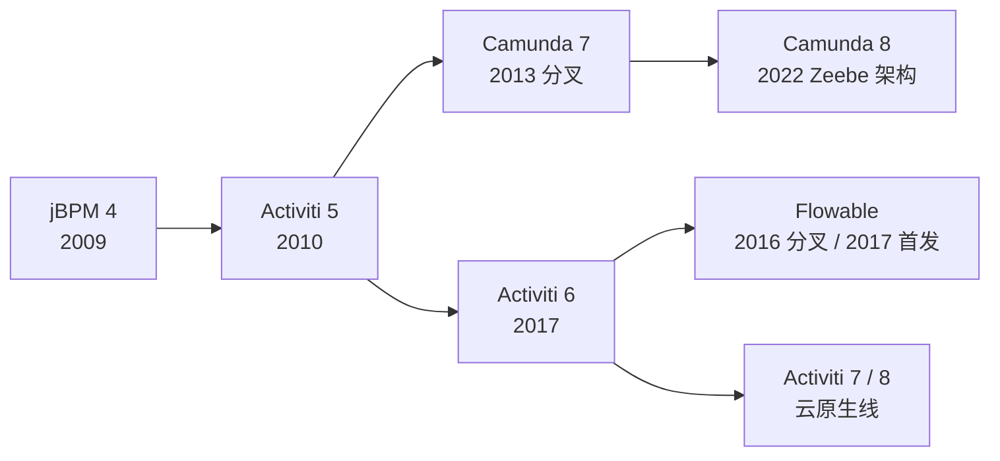

# Activiti 与 Flowable：同源、分叉与迁移

[[toc]]

Flowable 和 Activiti 的包名、表名、Service API 都很像，不是巧合：它们来自同一套代码。理解分叉关系和版本线，才能判断「换个依赖」能不能完成迁移，还是必须重做流程。

本文以 Flowable 8.0.0、Activiti 8.8.1 为准；Activiti 5.x / 6.x 的存量差异单独标注。

## 家族谱系

几个引擎的源头都可以追到 jBPM：



| 引擎 | 出身 | 当前主线 | 架构特点 |
| --- | --- | --- | --- |
| Activiti | jBPM 团队，2010 | 8.8.x | 经典嵌入式引擎 + 云原生扩展 |
| Flowable | Activiti 核心团队分叉，2016 | 8.0.x | 与 Activiti 6 同源，迭代活跃 |
| Camunda | 从 Activiti 5 分叉，2013 | 7.x / 8.x | 7.x 同源；8.x 换成 Zeebe 架构 |
| jBPM | Red Hat | 7.x | 与 Drools 规则引擎生态结合 |

分叉时间点解释了代码相似度：

- Activiti 5 是共同祖先，Camunda 7 在 2013 年从它分叉
- Activiti 6 是 Activiti 的下一代内核，Flowable 在 2016 年从这条线分叉
- Flowable 和 Activiti 6 共享 `ACT_` 表前缀、Service API、命令模式和 agenda 执行机制
- Activiti 7/8 转向云原生，但保留了经典引擎内核；Camunda 8 换成了完全不同的 Zeebe 架构

## 为什么表名和 API 这么像

Flowable 8 和 Activiti 8.8 的核心 API 几乎是同一套：

| 能力 | Activiti 8.8 | Flowable 8 |
| --- | --- | --- |
| 流程运行时 | `org.activiti.engine.RuntimeService` | `org.flowable.engine.RuntimeService` |
| 任务 | `org.activiti.engine.TaskService` | `org.flowable.engine.TaskService` |
| 流程定义 | `org.activiti.engine.RepositoryService` | `org.flowable.engine.RepositoryService` |
| 历史 | `org.activiti.engine.HistoryService` | `org.flowable.engine.HistoryService` |
| 命令实现 | `org.activiti.engine.impl.cmd.CompleteTaskCmd` | `org.flowable.engine.impl.cmd.CompleteTaskCmd` |
| 表前缀 | `ACT_` | `ACT_` |

数据库表名也基本一致：`ACT_RE_PROCDEF`、`ACT_RU_EXECUTION`、`ACT_RU_TASK`、`ACT_HI_PROCINST` 这些在两边都叫同一个名字。原因是它们共享 Activiti 6 的内核设计，Flowable 的分叉没有重写持久化模型。

差异主要在包名、BPMN 命名空间和扩展属性：

```xml
<!-- Activiti -->
<definitions xmlns:activiti="http://activiti.org/bpmn">
    <userTask id="approve" activiti:assignee="${manager}"/>
</definitions>

<!-- Flowable -->
<definitions xmlns:flowable="http://flowable.org/bpmn">
    <userTask id="approve" flowable:assignee="${manager}"/>
</definitions>
```

`flowable:` 和 `activiti:` 这些扩展属性不属于 BPMN 标准，是引擎私有的。迁移时只改 import 不改 XML，流程部署会失败或属性不生效。

## 版本线与运行基线

截至 2026-10，两条线的当前版本和运行环境差别很大：

| 引擎 | 当前版本 | Java | Spring Boot | 依赖仓库 |
| --- | --- | --- | --- | --- |
| Flowable | 8.0.0 | 17+ | 4.x | Maven Central |
| Flowable | 7.2.0 | 17+ | 3.x | Maven Central |
| Activiti | 8.8.1 | 21 | 3.5.7 | Alfresco 公共仓库 |
| Activiti | 6.0.0 | 8 | 1.2.x | Maven Central |

最容易踩的坑是仓库：**Activiti 8.8.1 不在 Maven Central**。只写依赖不配仓库，Maven 会直接报找不到 `activiti-spring-boot-starter:8.8.1`。

Flowable 8 的依赖：

```xml
<dependency>
    <groupId>org.flowable</groupId>
    <artifactId>flowable-spring-boot-starter-process</artifactId>
    <version>8.0.0</version>
</dependency>
```

Activiti 8.8 的依赖和仓库：

```xml
<repositories>
    <repository>
        <id>alfresco-public</id>
        <url>https://artifacts.alfresco.com/nexus/content/groups/public</url>
    </repository>
</repositories>

<dependency>
    <groupId>org.activiti</groupId>
    <artifactId>activiti-spring-boot-starter</artifactId>
    <version>8.8.1</version>
</dependency>
```

Activiti 8.8.1 的父 POM 固定 Java 21、Spring Boot 3.5.7；Flowable 8 基于 Spring Framework 7 / Spring Boot 4。两者不能塞进同一个 Spring Boot 应用，迁移时运行基线要先统一。

## 迁移：哪些能复用，哪些不能

### 可以直接复用的部分

- BPMN 2.0 的流程结构：事件、任务、网关、连线的组织方式一致
- 核心概念：流程定义、流程实例、执行实例、任务、变量
- 大部分 Service 方法名：`startProcessInstanceByKey`、`createTaskQuery`、`claim`、`complete`、`createHistoricProcessInstanceQuery`
- 表前缀和大部分表名

### 必须改的部分

| 项目 | Activiti 8.8 | Flowable 8 | 迁移动作 |
| --- | --- | --- | --- |
| Java 包名 | `org.activiti.*` | `org.flowable.*` | 全局替换 import |
| BPMN 命名空间 | `http://activiti.org/bpmn` | `http://flowable.org/bpmn` | 改 XML 命名空间和扩展属性 |
| Spring Boot starter | `activiti-spring-boot-starter` | `flowable-spring-boot-starter-process` | 换依赖 |
| 运行基线 | Java 21 / Boot 3.5.7 | Java 17+ / Boot 4 | 统一 JDK 和 Boot |
| 运行时改节点 | `RuntimeService` 没有 `createChangeActivityStateBuilder` | 有 | 重写退回 / 跳转逻辑 |
| 表结构 | `ACT_*` 同名 | `ACT_*` 同名 | 做 schema diff，不能只看表名 |

最后一行最关键：**表名相同不代表表结构相同**。两个引擎分叉多年，字段、索引、历史表补充字段都可能不同。把 Activiti 的库直接指给 Flowable，轻则启动校验失败，重则数据写坏。

### 三种迁移方式

| 方式 | 做法 | 适用 | 风险 |
| --- | --- | --- | --- |
| 并行运行 | 旧引擎跑完存量实例，新流程部署到新引擎 | 存量流程可自然结束 | 双引擎运维成本 |
| 同库迁移 | 改表结构、迁数据、切流量 | 历史数据必须保留 | 高，需完整回滚方案 |
| 重建流程 | 只迁业务数据，流程在新引擎重新发起 | 历史流程不需要继续 | 低，但历史轨迹断开 |

大多数项目适合「并行运行 + 新流程新引擎」：旧实例让它们在原引擎自然跑完，新业务切换到新引擎。这样不需要把运行时数据在两种表结构之间搬运，风险最小。

### 迁移检查清单

- 盘点所有 `org.activiti` import 和 `activiti:` XML 属性
- 对比两边 `ACT_*` 表的字段、索引、历史表
- 确认定时器、异步作业、事件订阅能否在新引擎重建
- 确认用户 / 组 / 候选人数据怎么同步
- 确认历史数据保留多久、是否需要迁移
- 准备回滚：旧引擎不能立刻下线，至少保留一个完整业务周期
- 在测试环境用真实 BPMN 跑通通过、驳回、撤回、会签、定时器

## Camunda 在这个谱系里的位置

Camunda 7 从 Activiti 5 分叉，API 和表结构也很像，常被拿来和 Flowable / Activiti 比较。它和 Flowable 不是同一条分叉线：Camunda 7 更早，Flowable 来自 Activiti 6。

Camunda 8 是另一套架构：基于 Zeebe，流程编排走 gRPC，状态存储在 Elasticsearch，不再使用 `ACT_*` 关系表。它不是 Camunda 7 的平滑升级，也不能把 Camunda 7 的 `ACT_*` 数据直接搬过去。选型时要把 7 和 8 当成两个产品看。

许可也要单独确认：Flowable 和 Activiti 是 Apache 2.0；Camunda 8 的许可与 Camunda 7 不同，商业使用前要确认条款。

## 怎么选

| 场景 | 建议 |
| --- | --- |
| 新项目，Spring Boot 4，嵌入式流程 | Flowable 8 |
| 必须留在 Spring Boot 3 | Flowable 7.2.x |
| 已有 Activiti 体系，必须用 8.8 | Activiti 8.8.1，配 Alfresco 仓库 |
| 存量 Activiti 5/6 稳定运行 | 不急着换，先评估维护状态和安全补丁 |
| 需要成熟商业支持 / Camunda 生态 | Camunda 7；云原生再评估 Camunda 8 |
| 流程简单、几乎不变 | 自研状态机，不必引入引擎 |

对国内存量系统，最常见的现实是 Activiti 5.22 / 6.0 仍在跑。这类项目迁移的第一判断不是「哪个引擎更新」，而是「旧流程还要不要继续跑、历史数据要不要保留」。如果旧实例能自然结束，新流程直接用 Flowable 8 起新引擎，比原地升级稳得多。

下一篇把视角落到生产：异步事务、变量序列化、历史膨胀、作业锁和选型，都是上线后才会暴露的问题。
