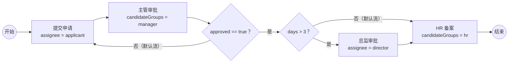

# 实战：一个请假审批流程

[[toc]]

最小工程只验证了「能跑」。真实审批里还有四件事：任务该给谁、驳回后怎么重走、申请人怎么撤回、多个人怎么同时审批。这一篇把这几件事放进同一个请假流程，每一段都给出可运行的 BPMN 或 API。

本文以 Flowable 8.0.0、Spring Boot 4.1.1 为准。

## 流程设计

在最小工程的基础上加三处变化：

- 主管审批不再写死处理人，改成候选组 `manager`，由组内成员认领
- 主管驳回时不结束流程，而是回到「提交申请」，让申请人修改后重提
- 增加一个独立的会签流程，演示多实例任务

完整流程图：



BPMN 文件：

```xml
<?xml version="1.0" encoding="UTF-8"?>
<definitions xmlns="http://www.omg.org/spec/BPMN/20100524/MODEL"
             xmlns:xsi="http://www.w3.org/2001/XMLSchema-instance"
             xmlns:flowable="http://flowable.org/bpmn"
             targetNamespace="http://example.com/leave">

    <process id="leaveApproval" name="请假审批（可驳回）" isExecutable="true">

        <startEvent id="start" name="开始"/>

        <userTask id="apply" name="提交申请" flowable:assignee="${applicant}"/>

        <userTask id="managerReview" name="主管审批" flowable:candidateGroups="manager"/>

        <exclusiveGateway id="managerDecision" name="主管是否通过" default="toApply"/>

        <exclusiveGateway id="daysDecision" name="请假天数" default="toHr"/>

        <userTask id="directorReview" name="总监审批" flowable:assignee="${director}"/>

        <userTask id="hrRecord" name="HR 备案" flowable:candidateGroups="hr"/>

        <endEvent id="end" name="结束"/>

        <sequenceFlow id="flow1" sourceRef="start" targetRef="apply"/>
        <sequenceFlow id="flow2" sourceRef="apply" targetRef="managerReview"/>
        <sequenceFlow id="flow3" sourceRef="managerReview" targetRef="managerDecision"/>
        <sequenceFlow id="toDays" sourceRef="managerDecision" targetRef="daysDecision">
            <conditionExpression xsi:type="tFormalExpression"><![CDATA[${approved == true}]]></conditionExpression>
        </sequenceFlow>
        <sequenceFlow id="toApply" sourceRef="managerDecision" targetRef="apply"/>
        <sequenceFlow id="toDirector" sourceRef="daysDecision" targetRef="directorReview">
            <conditionExpression xsi:type="tFormalExpression"><![CDATA[${days > 3}]]></conditionExpression>
        </sequenceFlow>
        <sequenceFlow id="toHr" sourceRef="daysDecision" targetRef="hrRecord"/>
        <sequenceFlow id="flow4" sourceRef="directorReview" targetRef="hrRecord"/>
        <sequenceFlow id="flow5" sourceRef="hrRecord" targetRef="end"/>

    </process>
</definitions>
```

`managerDecision` 的默认流指回 `apply`。主管完成任务时传 `approved = false`，条件不成立，走默认流，流程回到申请人；申请人重新提交后，再走一遍主管审批。

## 候选人任务与认领

`flowable:candidateGroups="manager"` 表示这个任务属于 `manager` 组。任务创建时 `ASSIGNEE_` 是空的，组内成员都能在候选任务里看到它；谁先 `claim`，任务就归谁。

查询候选任务并认领：

```java
Task task = taskService.createTaskQuery()
        .processInstanceId(instance.getId())
        .taskCandidateGroup("manager")
        .singleResult();

System.out.println(task.getAssignee());   // null
taskService.claim(task.getId(), "lisi");
System.out.println(task.getAssignee());   // lisi
```

实际运行输出：

```text
主管任务 assignee=null
  identityLink type=candidate user=null group=manager
claim 后 assignee=lisi
```

`claim` 之后，`ACT_RU_TASK.ASSIGNEE_` 变成 `lisi`，候选组链接仍然保留在 `ACT_RU_IDENTITYLINK` 里。候选人还可以 `unclaim` 退回候选池，或者用 `delegateTask` 委派给别人。

`assignee` 和候选人的选择标准：

| 场景 | 写法 | 是否需要认领 |
| --- | --- | --- |
| 明确知道由谁处理 | `flowable:assignee="${userId}"` | 否 |
| 一个岗位或组都能处理 | `flowable:candidateGroups="manager"` | 是 |
| 指定几个具体的人竞争 | `flowable:candidateUsers="zhangsan,lisi"` | 是 |

## 驳回与重提

驳回有两种常见做法：在模型里画回去，或者用运行时 API 把执行实例移回指定节点。两者的代价不一样。

### 模型回退

上面的 BPMN 用的就是模型回退：`managerDecision` 的默认流指回 `apply`。主管完成任务时传 `approved = false`：

```java
taskService.complete(task.getId(), Map.of("approved", false));
```

流程不会结束，而是回到「提交申请」。实际输出：

```text
驳回后回到：提交申请
```

申请人修改后重新完成 `apply` 任务，流程再次进入主管审批。整个过程在历史表里留下两轮完整的任务和活动记录，审计时能看清「谁驳回、谁重提」。

### 运行时退回

如果流程图上没有画回退线，可以用 `moveActivityIdTo` 把当前执行实例移到目标节点：

```java
runtimeService.createChangeActivityStateBuilder()
        .processInstanceId(instance.getId())
        .moveActivityIdTo("managerReview", "apply")
        .changeState();
```

实际运行结果：

```text
退回前待办：主管审批
退回后待办：提交申请 / zhangsan
```

这个 API 直接改运行时执行树，不经过中间的连线和网关判断，也不会自动触发目标节点之前的监听器。它适合做运维手段或临时补救，不适合当成常规业务流程。能让流程模型表达清楚的，优先画回退线。

### 撤回

撤回是申请人主动终止，不是「退回给谁」。用 `deleteProcessInstance`：

```java
runtimeService.deleteProcessInstance(instance.getId(), "申请人撤回");
```

实际结果：

```text
历史流程：endTime=...，deleteReason=申请人撤回
运行时任务数=0
```

流程实例的历史记录还在，`ACT_HI_PROCINST` 会写入结束时间和删除原因；运行时执行、任务、变量全部清理。如果撤回后还要保留「重新发起」的入口，通常由业务系统新建一个流程实例，而不是复活旧实例。

三种操作的语义：

| 操作 | API / 模型 | 流程是否继续 | 历史记录 |
| --- | --- | --- | --- |
| 驳回 | 网关 + 回退线 | 继续，回到申请人 | 保留两轮记录 |
| 运行时退回 | `moveActivityIdTo` | 继续，执行树被改 | 保留，但轨迹可能不完整 |
| 撤回 | `deleteProcessInstance` | 终止 | 保留实例，写删除原因 |

## 会签：多实例任务

会签是一个任务同时生成多份待办，所有人都处理完才继续。BPMN 里用 `multiInstanceLoopCharacteristics`：

```xml
<userTask id="countersign" name="会签审批" flowable:assignee="${approver}">
    <multiInstanceLoopCharacteristics isSequential="false"
                                     flowable:collection="${approvers}"
                                     flowable:elementVariable="approver"/>
</userTask>
```

启动时传一个审批人列表：

```java
Map<String, Object> variables = Map.of(
        "applicant", "zhangsan",
        "approvers", List.of("alice", "bob", "carol")
);
ProcessInstance instance = runtimeService.startProcessInstanceByKey(
        "leaveCountersign", "LEAVE-2026-003", variables);
```

流程到达会签节点后，引擎按 `approvers` 生成三条任务：

```text
会签任务数=3
  会签审批 / alice
  会签审批 / bob
  会签审批 / carol
```

三条都完成后，流程才继续到结束事件。`isSequential="false"` 是并行会签；改成 `true` 会按顺序逐个生成任务。

会签和「候选组认领」解决的不是一个问题：

| 模式 | 任务数量 | 完成条件 | 适用场景 |
| --- | --- | --- | --- |
| 候选组 + claim | 1 条 | 任意一人完成 | 或签，谁有空谁处理 |
| 多实例会签 | N 条 | 全部完成（默认） | 需要每个人都表态 |

多实例还支持 `completionCondition`，例如完成 60% 就通过。这个条件会改变「全部完成」的默认语义，使用前要确认业务上允许。

## 业务表与流程实例关联

流程引擎不应该接管业务表。请假单的申请人、天数、状态仍然放在业务表里，流程实例只负责「走到哪、该谁处理」。

关联靠 `businessKey`：

```java
ProcessInstance instance = runtimeService.startProcessInstanceByKey(
        "leaveApproval",
        String.valueOf(leaveId),
        variables
);
```

`businessKey` 是业务主键，不是流程实例 ID。按业务主键查流程：

```java
ProcessInstance instance = runtimeService.createProcessInstanceQuery()
        .processInstanceBusinessKey(String.valueOf(leaveId))
        .singleResult();
```

业务表可以只存 `business_key`，不必存 `process_instance_id`：

```sql
create table leave_request (
    id            bigint primary key,
    applicant     varchar(64),
    days          int,
    status        varchar(32),
    business_key  varchar(64)
);
```

几条实践建议：

- `businessKey` 用业务主键，不要用自增流程实例 ID
- 一个业务单据只允许一个在跑的流程实例，唯一性在业务层保证
- 业务状态和流程状态分开：业务状态表示「单据是否有效」，流程状态表示「走到哪个节点」
- 需要事务一致时，把业务表更新和 `taskService.complete` 放在同一个事务里；跨库时用 outbox 或补偿

## 测试用例

把上面的场景整理成测试清单，能覆盖大部分审批流回归：

| 场景 | 输入 / 动作 | 期望 |
| --- | --- | --- |
| 三天以内 | `days = 2`，主管通过 | 提交 → 主管 → HR → 结束 |
| 超过三天 | `days = 5`，主管通过 | 提交 → 主管 → 总监 → HR → 结束 |
| 主管驳回 | `approved = false` | 回到提交申请，可重新提交 |
| 申请人撤回 | 主管审批中调用删除 | 运行时任务为 0，历史保留删除原因 |
| 会签 | 3 个审批人，全部完成 | 生成 3 条任务，全部完成后结束 |
| 或签 | 候选组 1 条任务，任意一人认领完成 | 任务完成，流程继续 |

这些场景都在 Flowable 8 上实际跑过。下一篇往引擎内部走：一次 `complete` 调用，到底经过了哪些组件，执行树和事务是怎么配合的。
