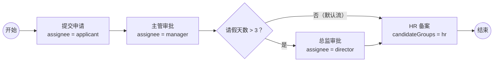

# BPMN 2.0 入门：看懂一张流程图

[[toc]]

流程引擎读的是一张图。图用 BPMN 2.0 描述，保存成 XML，部署到引擎里就能执行。这一篇不背符号表，用一张请假流程图把最常用的元素串起来，最后给出可以直接跑的 XML。

本文讲的是 BPMN 2.0 的通用元素，不绑定具体引擎版本。

## 一张请假流程图

先看完整流程：员工提交申请，主管审批；请假超过 3 天，再加一道总监审批；最后 HR 备案。



这张图里有四类东西：圆形是事件，圆角矩形是活动，菱形是网关，箭头是连线。BPMN 的元素很多，日常业务里九成场景只用到这四类中的少数几个。

## 四类元素

| 类别 | 常用元素 | 作用 | 图中的例子 |
| --- | --- | --- | --- |
| 事件 | `startEvent` / `endEvent` | 流程的起点和终点 | 开始、结束 |
| 活动 | `userTask` | 等人处理的任务 | 提交申请、主管审批 |
| 活动 | `serviceTask` | 自动调用 Java 方法或 HTTP 接口 | 发送通知 |
| 活动 | `subProcess` / `callActivity` | 把一段流程包成子流程复用 | 多级审批子流程 |
| 网关 | `exclusiveGateway` | 多条出路里只选一条 | 请假天数判断 |
| 网关 | `parallelGateway` | 所有出路都走，汇合时等齐 | 并行审批 |
| 连线 | `sequenceFlow` | 连接两个节点，决定流转方向 | 图中所有箭头 |

此外还有定时器、消息、信号、错误等事件，以及包容网关、事件网关。它们不是入门必需，遇到时再查即可。

## 用户任务：引擎里的等待点

`userTask` 是流程里「停下来等人」的节点。它不等于页面，也不等于表单。引擎只负责创建一条待办记录，页面和表单由业务系统自己实现。

任务交给谁，常用三种写法：

```xml
<!-- 直接指定一个人，值可以是表达式 -->
<userTask id="managerApprove" name="主管审批" flowable:assignee="${manager}"/>

<!-- 指定候选人，谁先认领谁处理 -->
<userTask id="hrRecord" name="HR 备案" flowable:candidateUsers="zhangsan,lisi"/>

<!-- 指定候选组，组内成员都能看到 -->
<userTask id="financeApprove" name="财务审批" flowable:candidateGroups="finance"/>
```

`assignee` 是直接负责人；`candidateUsers` / `candidateGroups` 是候选人，需要先 `claim` 认领才会变成自己的待办。什么时候用哪种：

- 明确知道由谁处理：`assignee`
- 一个岗位或一组人都能处理：`candidateGroups`
- 指定几个具体的人竞争处理：`candidateUsers`

候选任务和认领的细节在核心概念篇展开。

## 网关：决定走哪条路

网关是分支和汇合的地方。入门先掌握两种：排他网关和并行网关。

### 排他网关

排他网关（`exclusiveGateway`）按顺序判断条件，走第一条成立的分支。请假天数超过 3 天走总监，否则走 HR：

```xml
<exclusiveGateway id="decision" name="请假天数" default="toHr"/>

<sequenceFlow id="toDirector" sourceRef="decision" targetRef="directorApprove">
    <conditionExpression xsi:type="tFormalExpression"><![CDATA[${days > 3}]]></conditionExpression>
</sequenceFlow>

<sequenceFlow id="toHr" sourceRef="decision" targetRef="hrRecord"/>
```

`default="toHr"` 指定默认流：所有条件都不成立时走这条。默认流上不要写条件表达式。

条件表达式用 UEL，`${days > 3}` 里的 `days` 是流程变量。变量由启动流程或完成任务时传入，下一篇文章会讲它的作用域。

排他网关的两个常见错误：

- 条件不互斥：两个分支都成立，引擎只会走第一条，另一条永远不执行
- 没有默认流：所有条件都不成立时，引擎抛「没有可用的外出连线」

### 并行网关

并行网关（`parallelGateway`）不判断条件：所有外出连线都走，汇合时等所有进入的分支都到达才继续。它适合「几个部门同时审批、全部通过才往下走」这类场景。

并行网关不要求分支数量对称，但汇合点必须能等到所有实际激活的分支。分支里再有排他网关时，汇合逻辑会更复杂，入门阶段先用最简单的对称结构。

### 一个容易踩的坑

一个活动节点如果有多条外出连线，又没有网关，BPMN 的语义是**全部并行执行**，不是「选一条」。想让引擎做选择，必须显式加排他网关。

## BPMN XML 长什么样

下面这份 XML 就是开头那张请假图，可以直接放进 Flowable 的 `processes/` 目录运行。

```xml
<?xml version="1.0" encoding="UTF-8"?>
<definitions xmlns="http://www.omg.org/spec/BPMN/20100524/MODEL"
             xmlns:xsi="http://www.w3.org/2001/XMLSchema-instance"
             xmlns:flowable="http://flowable.org/bpmn"
             targetNamespace="http://example.com/leave">

    <process id="leaveProcess" name="请假审批" isExecutable="true">

        <startEvent id="start" name="开始"/>

        <userTask id="apply" name="提交申请" flowable:assignee="${applicant}"/>

        <userTask id="managerApprove" name="主管审批" flowable:assignee="${manager}"/>

        <exclusiveGateway id="decision" name="请假天数" default="toHr"/>

        <userTask id="directorApprove" name="总监审批" flowable:assignee="${director}"/>

        <userTask id="hrRecord" name="HR 备案" flowable:assignee="hr"/>

        <endEvent id="end" name="结束"/>

        <sequenceFlow id="flow1" sourceRef="start" targetRef="apply"/>
        <sequenceFlow id="flow2" sourceRef="apply" targetRef="managerApprove"/>
        <sequenceFlow id="flow3" sourceRef="managerApprove" targetRef="decision"/>
        <sequenceFlow id="toDirector" sourceRef="decision" targetRef="directorApprove">
            <conditionExpression xsi:type="tFormalExpression"><![CDATA[${days > 3}]]></conditionExpression>
        </sequenceFlow>
        <sequenceFlow id="toHr" sourceRef="decision" targetRef="hrRecord"/>
        <sequenceFlow id="flow4" sourceRef="directorApprove" targetRef="hrRecord"/>
        <sequenceFlow id="flow5" sourceRef="hrRecord" targetRef="end"/>

    </process>
</definitions>
```

几个关键点：

- `process` 的 `id` 是流程定义 key，启动流程时用它找定义
- `isExecutable="true"` 表示这份流程可以被引擎执行
- `sequenceFlow` 的 `sourceRef` / `targetRef` 指向节点 id，箭头方向由它决定
- `flowable:` 是引擎扩展命名空间，`assignee`、`candidateGroups` 这些属性不属于 BPMN 标准
- 画图工具导出的 XML 通常还带 `BPMNDiagram` 坐标信息；引擎执行不依赖坐标，手写时可以省略

## 建模自检清单

提交一份 BPMN 之前，按下面几条过一遍：

- 每条分支都能走到结束事件，没有断头路
- 排他网关有条件分支，也有默认流
- 分支条件互斥，不会出现两条同时成立
- 每个用户任务都有 `assignee` 或候选人 / 候选组
- 条件表达式里用到的变量，在到达网关前已经赋值
- 没有「一个节点多条外出连线、却没加网关」的隐式并行
- 定时器、边界事件这类高级元素，确认引擎版本支持

下一篇讲引擎怎么把这些元素跑起来：流程定义、流程实例、执行实例和任务，四种对象之间是什么关系。
