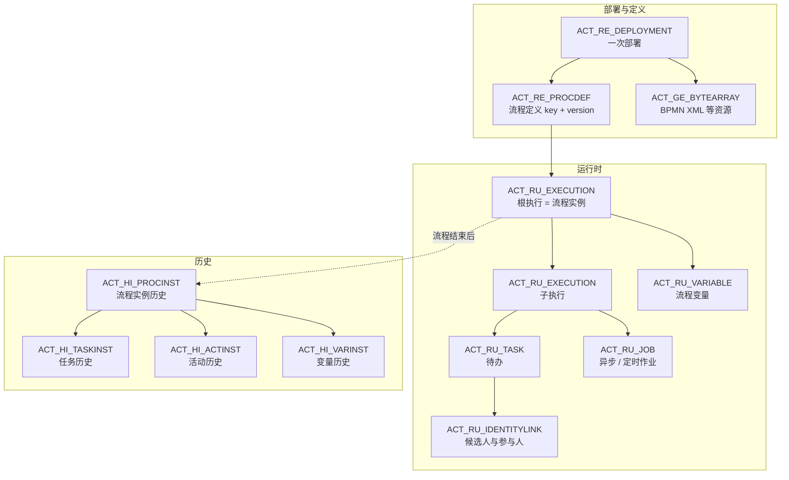

# 引擎表结构：ACT_* 五类表与数据流转

[[toc]]

流程引擎把「走到哪、谁在处理、带了什么变量」都写进数据库，所以服务重启后还能接着跑。这一篇按「部署 → 启动 → 审批 → 结束」看这些数据落在哪些表、每张表怎么变，最后讲历史级别和清理策略。

本文以 Flowable 8.0.0 为准；Activiti 与它同源，`ACT_` 表名和字段基本一致。

## 表按前缀分五类

Flowable 的 30 多张 `ACT_` 表可以按前缀分成五组：

| 前缀 | 用途 | 常用表 |
| --- | --- | --- |
| `ACT_RE_` | 部署与流程定义 | `ACT_RE_DEPLOYMENT`、`ACT_RE_PROCDEF`、`ACT_RE_MODEL` |
| `ACT_RU_` | 运行时数据 | `ACT_RU_EXECUTION`、`ACT_RU_TASK`、`ACT_RU_VARIABLE`、`ACT_RU_IDENTITYLINK`、`ACT_RU_JOB` |
| `ACT_HI_` | 历史数据 | `ACT_HI_PROCINST`、`ACT_HI_TASKINST`、`ACT_HI_ACTINST`、`ACT_HI_VARINST` |
| `ACT_ID_` | 用户与组 | `ACT_ID_USER`、`ACT_ID_GROUP`、`ACT_ID_MEMBERSHIP` |
| `ACT_GE_` | 通用数据 | `ACT_GE_BYTEARRAY`、`ACT_GE_PROPERTY` |

另外还有 `ACT_EVT_LOG`、`ACT_PROCDEF_INFO`、`ACT_RU_TIMER_JOB`、`ACT_RU_DEADLETTER_JOB` 等扩展表。入门先掌握上面这些，遇到问题时再按前缀查。

## 核心表关系



几条关系先记牢：

- 部署一次，`ACT_RE_DEPLOYMENT` 一行；部署里的每个流程定义，`ACT_RE_PROCDEF` 一行
- 同一个流程 key 重新部署，`VERSION_` 加一；老实例继续用旧版本
- 一个流程实例对应 `ACT_RU_EXECUTION` 的根执行；子执行停在当前节点
- 用户任务、变量、候选人链接都挂在执行实例或流程实例上
- 流程结束后，`ACT_RU_*` 清空，数据转成 `ACT_HI_*`

## 一次请假流程的表变化

用第二篇的请假流程实际跑一遍，每一步查各表行数：

| 阶段 | RU_EXECUTION | RU_TASK | RU_VARIABLE | RU_IDENTITYLINK | HI_PROCINST | HI_TASKINST | HI_ACTINST | HI_VARINST |
| --- | --- | --- | --- | --- | --- | --- | --- | --- |
| 启动后 | 2<br/><small>root + apply</small> | 1<br/><small>提交申请</small> | 3<br/><small>applicant / director / days</small> | 1<br/><small>发起人 participant</small> | 1 | 1<br/><small>提交申请</small> | 3<br/><small>start / flow1 / apply</small> | 3 |
| 提交申请后 | 2<br/><small>root + managerReview</small> | 1<br/><small>主管审批（候选）</small> | 3 | 2<br/><small>+ 候选组 manager</small> | 1 | 2 | 5<br/><small>+ flow2 / managerReview</small> | 3 |
| 主管认领后 | 2<br/><small>root + managerReview</small> | 1<br/><small>assignee=lisi</small> | 3 | 3<br/><small>+ participant lisi</small> | 1 | 2 | 5 | 3 |
| 主管通过后 | 2<br/><small>root + directorReview</small> | 1<br/><small>总监审批</small> | 4<br/><small>+ approved</small> | 3<br/><small>participant zhangsan / lisi / wangwu</small> | 1 | 3 | 11<br/><small>+ 网关 / 连线</small> | 4 |
| 总监通过后 | 2<br/><small>root + hrRecord</small> | 1<br/><small>HR 备案（候选）</small> | 4 | 4<br/><small>+ 候选组 hr</small> | 1 | 4 | 13<br/><small>+ flow4 / hrRecord</small> | 4 |
| 流程结束后 | 0<br/><small>运行时清空</small> | 0 | 0 | 0 | 1<br/><small>保留</small> | 4 | 15<br/><small>start 到 end 全链路</small> | 4 |

逐段看：

- **启动**：创建根执行和停在 `apply` 的子执行，共 2 条；创建 1 条待办；3 个启动变量；1 条发起人参与链接
- **提交申请**：子执行的 `ACT_ID_` 从 `apply` 移到 `managerReview`；旧任务删除，新任务创建；历史任务加一条
- **主管认领**：任务行的 `ASSIGNEE_` 从 `null` 变成 `lisi`；`ACT_RU_IDENTITYLINK` 增加一条候选组链接
- **主管通过**：`ACT_RU_VARIABLE` 增加 `approved`；执行树移到 `directorReview`；经过网关和连线，历史活动记录从 5 增加到 11
- **总监通过**：执行树移到 `hrRecord`；HR 任务创建，等待认领
- **结束**：`ACT_RU_*` 全部清零；`ACT_HI_PROCINST` 写入结束时间；历史任务和活动保留

关于数量，有两点容易误解：

- 这次 demo 部署了 4 个流程，所以 `ACT_RE_PROCDEF = 4`、`ACT_GE_BYTEARRAY = 4`；只部署一个流程时都是 1
- `ACT_HI_ACTINST` 的数量包含开始/结束事件、网关、连线等活动实例，不等于「用户处理了几次」

流程结束时的 15 条活动历史，具体是：

```text
start            startEvent
flow1            sequenceFlow
apply            userTask
flow2            sequenceFlow
managerReview    userTask
flow3            sequenceFlow
managerDecision  exclusiveGateway
toDays           sequenceFlow
daysDecision     exclusiveGateway
toDirector       sequenceFlow
directorReview   userTask
flow4            sequenceFlow
hrRecord         userTask
flow5            sequenceFlow
end              endEvent
```

## 关键表的字段

### ACT_RU_EXECUTION

| 字段 | 含义 |
| --- | --- |
| `ID_` | 执行实例 ID；根执行的 ID 等于流程实例 ID |
| `PARENT_ID_` | 父执行 ID；根执行为 `null` |
| `PROC_INST_ID_` | 所属流程实例 |
| `ACT_ID_` | 当前停留的节点 id；根执行为 `null` |
| `IS_ACTIVE_` | 是否活跃；并行汇合时等待中的分支为 `false` |
| `IS_SCOPE_` | 是否是作用域执行；根执行和子流程为 `true` |
| `BUSINESS_KEY_` | 业务主键 |

顺序流程里通常是两行：根执行 + 当前节点上的子执行。并行网关会多出兄弟执行。

### ACT_RU_TASK

| 字段 | 含义 |
| --- | --- |
| `ID_` | 任务 ID |
| `EXECUTION_ID_` | 所属执行实例 |
| `PROC_INST_ID_` | 所属流程实例 |
| `TASK_DEF_KEY_` | BPMN 里 userTask 的 id |
| `NAME_` | 任务名称 |
| `ASSIGNEE_` | 当前处理人；候选任务为 `null` |
| `OWNER_` | 任务所有者，委派场景使用 |
| `CREATE_TIME_` | 创建时间 |

`ASSIGNEE_` 和 `ACT_RU_IDENTITYLINK` 是两套信息：前者是「已经认领的人」，后者是「哪些人 / 组有资格处理」。

### ACT_RU_VARIABLE

| 字段 | 含义 |
| --- | --- |
| `NAME_` | 变量名 |
| `TYPE_` | 变量类型，如 `string`、`integer`、`boolean` |
| `EXECUTION_ID_` | 变量挂在哪条执行上 |
| `TASK_ID_` | 任务局部变量才有值 |
| `SCOPE_TYPE_` | 作用域类型；流程变量通常为 `null` |
| `TEXT_` / `LONG_` / `DOUBLE_` | 按类型存放的值 |

实际运行时，启动变量和任务完成时传入的变量都挂在根执行上，所以 `EXECUTION_ID_` 等于流程实例 ID，`TASK_ID_` 为 `null`。只有 `setVariableLocal` 才会产生任务局部变量。

### ACT_RU_IDENTITYLINK

| 字段 | 含义 |
| --- | --- |
| `TYPE_` | `candidate` 表示候选，`participant` 表示参与人 |
| `USER_ID_` / `GROUP_ID_` | 候选人 / 候选组 |
| `TASK_ID_` | 任务级链接；候选组链接有值 |
| `PROC_INST_ID_` | 流程级链接；发起人、已认领参与人有值 |

实测中，候选组链接的 `TASK_ID_` 有值、`PROC_INST_ID_` 为 `null`；认领人和发起人的 `participant` 链接则挂在流程实例上。这解释了一个常见疑问：为什么按流程实例查候选人链接查不到，因为它是任务级的。

### ACT_RU_JOB

| 字段 | 含义 |
| --- | --- |
| `TYPE_` | 作业类型，如 `message`、`timer` |
| `HANDLER_TYPE_` | 处理器，如 `async-continuation` |
| `ELEMENT_ID_` | 对应的流程节点 id |
| `RETRIES_` | 剩余重试次数，默认 3 |
| `DUEDATE_` | 定时作业的执行时间 |
| `PROCESS_INSTANCE_ID_` | 所属流程实例 |
| `EXCLUSIVE_` | 是否独占执行 |

异步服务任务、定时器、异步历史都会在这里留下记录。作业表堆积通常说明异步执行器没开、执行器卡住，或者某个 delegate 一直失败。

### 历史表

| 表 | 记录什么 | 常用查询 |
| --- | --- | --- |
| `ACT_HI_PROCINST` | 每个流程实例一行 | 按 `BUSINESS_KEY_`、`START_TIME_`、`END_TIME_` 查 |
| `ACT_HI_TASKINST` | 每个任务实例一行 | 查谁在什么时候处理了什么任务 |
| `ACT_HI_ACTINST` | 每个活动实例一行 | 还原流程走过的节点和耗时 |
| `ACT_HI_VARINST` | 变量历史 | 查流程结束时的变量快照 |

历史表的 `END_TIME_` 为空表示还在运行；`DELETE_REASON_` 有值表示实例被删除或撤回。

## 历史级别怎么选

`flowable.history-level` 控制写多少历史。级别越高，排查越方便，表也越大：

| 级别 | 记录内容 | 实测（流程结束） |
| --- | --- | --- |
| `none` | 不记录 | 未实测 |
| `instance` | 流程实例 | 未实测 |
| `task` | 流程实例 + 任务实例 | 未实测 |
| `activity` | 流程实例 + 活动实例 + 变量实例，不记录任务实例 | `HI_PROCINST=1`、`HI_TASKINST=0`、`HI_ACTINST=15`、`HI_VARINST=4` |
| `audit` | 在 `activity` 基础上增加任务实例和身份链接 | 未实测 |
| `full` | 在 `audit` 基础上记录变量更新明细 | `HI_PROCINST=1`、`HI_TASKINST=4`、`HI_ACTINST=15`、`HI_VARINST=4` |

选级别的判断标准：

- 只需要知道流程有没有跑完：`instance` 或 `task`
- 需要查「谁在什么时候处理了哪个节点」：`audit`
- 需要还原变量变化、做审计或排查数据问题：`full`
- 历史表已经很大、又没有审计要求：降级到 `activity` 或 `task`

`task` 和 `activity` 不是简单的包含关系：`task` 记录任务实例但不记录活动实例；`activity` 记录活动和变量但不记录任务实例。两者都想要，用 `audit` 或 `full`。

`activity` 下 `HI_TASKINST` 为 0，表示查不到任务历史；这不是 bug，是级别没到。`full` 和 `activity` 的 `HI_VARINST` 行数可能相同，差异在变量更新明细等其他历史表。

## 清理与索引

运行时表不需要手工清理：流程结束后，`ACT_RU_EXECUTION`、`ACT_RU_TASK`、`ACT_RU_VARIABLE` 等记录会被引擎删除。需要关注的是历史表：

- 按时间归档：把 `END_TIME_` 早于 N 个月的 `ACT_HI_*` 迁到归档库或冷表
- 按业务维度保留：只保留需要审计的流程类型，其余降低历史级别
- 不要直接删 `ACT_GE_BYTEARRAY`：流程定义还在被历史实例引用，删了会破坏部署
- 不要随意改引擎表结构或删索引；需要加速查询时，先看现有索引，再评估加自定义索引
- 监控运行时表大小：`ACT_RU_JOB` 堆积通常比历史表膨胀更紧急

Flowable 8 自带历史清理相关配置（如 `enable-history-cleaning`、清理周期和保留天数），可以用它做基础清理；有合规要求时，仍然建议自己做归档，保留可追溯的副本。

## 小结

看表结构的目的不是背字段，而是建立三个判断：

- 流程卡住了，先看 `ACT_RU_EXECUTION` 的 `ACT_ID_` 和 `IS_ACTIVE_`
- 任务找不到，先看 `ACT_RU_TASK` 的 `ASSIGNEE_` 和 `ACT_RU_IDENTITYLINK` 的候选链接
- 流程跑完了但查不到记录，先看历史级别是不是太低

下一篇把视角拉到引擎之外：Activiti 和 Flowable 到底是什么关系，存量系统迁移时哪些 API 和表结构会变。
