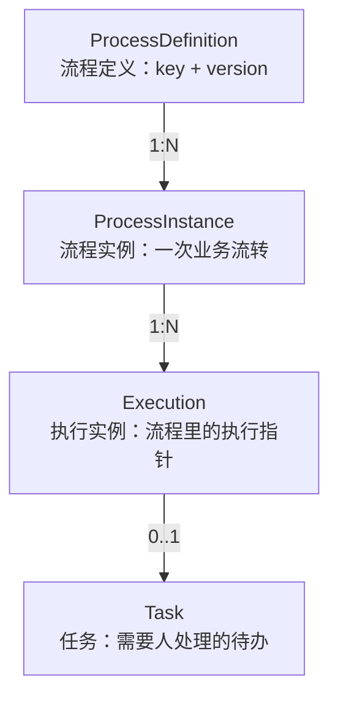
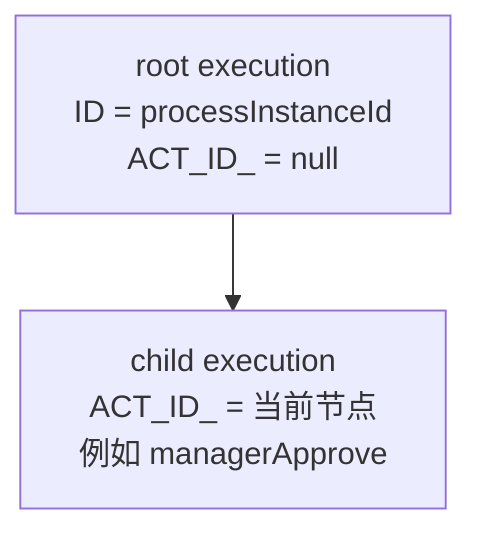
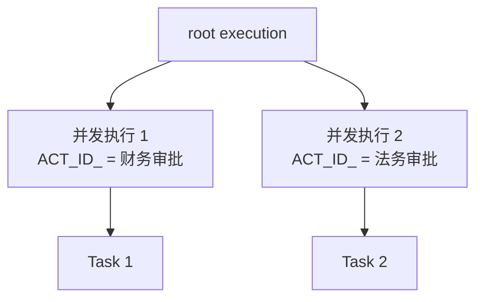
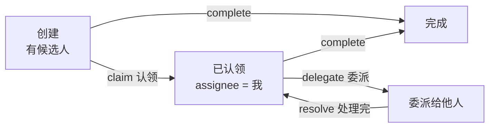

# 引擎核心概念：定义、实例、执行与任务

[[toc]]

流程引擎的 API 看起来很多，核心其实围绕四个对象转：流程定义、流程实例、执行实例、任务。把这四者的关系理清，后面看 API、看表、看源码都不会迷路。

本文讲的是 Flowable 8.0.0 与 Activiti 8.8.x 共有的运行模型；两者在这些概念上基本一致。

## 四个对象

- **流程定义**：一份部署到引擎里的 BPMN 模型，用 `key` 和 `version` 标识。同一个 key 每部署一次，版本号加一。
- **流程实例**：业务发起一次流程，就创建一个实例。请假单 `LEAVE-2026-001` 对应一个实例，`LEAVE-2026-002` 对应另一个。
- **执行实例**：引擎内部的「执行指针」，记录当前走到哪个节点。一个流程实例至少有一个根执行实例，分支或子流程会产生子执行实例。
- **任务**：用户任务节点上创建的待办记录。任务被完成后，执行实例继续往下走。

四者里最容易混的是流程实例和执行实例。可以这样记：流程实例是给业务看的，执行实例是给引擎看的。流程实例的 ID 同时也是根执行实例的 ID，但一个流程实例可以有很多条执行实例。

## 流程定义与版本

部署一份 BPMN，引擎会往 `ACT_RE_PROCDEF` 写一条记录：

| 字段 | 含义 |
| --- | --- |
| `KEY_` | 流程定义 key，对应 BPMN 里 `<process id="...">` |
| `VERSION_` | 版本号，同一个 key 每部署一次加一 |
| `DEPLOYMENT_ID_` | 这次部署的 ID，一次部署可以包含多个流程定义 |
| `RESOURCE_NAME_` | BPMN 文件名 |
| `SUSPENSION_STATE_` | 是否挂起 |

版本机制解决的是「流程改了，老单据怎么办」：

- 重新部署同一个 key，生成 version 2；已经运行的实例继续用 version 1 的定义
- `startProcessInstanceByKey("leaveProcess")` 默认启动最新版本
- `startProcessInstanceById(processDefinitionId)` 可以指定某个版本
- 挂起流程定义后，不能再启动新实例；挂起流程实例后，已有实例不能继续推进

这也是流程引擎和硬编码状态机的一个关键差别：流程定义是有版本的，历史实例不会被新图影响。

## 流程实例与执行实例

发起一个顺序流程，运行时表里会出现两条执行记录：

根执行实例代表整个流程，子执行实例停在当前活动节点上。任务完成后，引擎删除旧任务，把子执行实例移到下一个节点，再创建新任务。流程结束时，运行时表里的执行记录和任务记录都会被清理。

遇到并行网关，执行树会分叉：

汇合时，引擎等所有并发执行到达，再合并回一条执行继续往下走。

执行实例不是线程，也不是内存里的对象。它是一条持久化记录，引擎每推进一步都会更新它。服务重启后，流程还能从上次停下的地方继续。

## 任务的生命周期

用户任务是流程里的等待点。一条任务从创建到完成，通常经历这几个状态：

- **创建**：执行实例到达 `userTask`，引擎创建任务记录
- **候选**：任务有 `candidateUsers` / `candidateGroups`，符合条件的人都能查到
- **认领**：候选人调用 `claim`，任务变成自己的待办；也可以 `unclaim` 退回候选池
- **完成**：调用 `complete`，任务删除，执行实例继续往下走
- **委派**：把任务临时交给别人处理，处理完再 `resolve` 回原处理人

任务上常见字段：

| 字段 | 含义 |
| --- | --- |
| `ID_` | 任务 ID |
| `NAME_` | 任务名称，对应 BPMN 的 `name` |
| `ASSIGNEE_` | 当前处理人 |
| `PROC_INST_ID_` | 所属流程实例 |
| `EXECUTION_ID_` | 所属执行实例 |
| `TASK_DEF_KEY_` | BPMN 里 userTask 的 id |
| `CREATE_TIME_` | 创建时间 |

任务不等于页面。引擎只存「该谁处理、处理哪个节点」，表单、附件、审批意见这些业务数据要么放流程变量，要么放业务表，用 `businessKey` 关联。

## 变量与作用域

流程变量是引擎和业务代码之间的数据通道。BPMN 里的条件表达式、任务分配表达式、服务任务参数，都从变量里取值。

| 作用域 | 设置方式 | 生命周期 |
| --- | --- | --- |
| 流程实例 / 执行实例 | `runtimeService.setVariable(...)` | 流程结束前一直存在 |
| 任务局部 | `taskService.setVariableLocal(...)` | 任务完成即删除 |
| 启动时传入 | `startProcessInstanceByKey(key, businessKey, vars)` | 写入流程实例作用域 |
| 完成时传入 | `taskService.complete(taskId, vars)` | 写入当前执行作用域 |

同一份数据放哪个作用域，要按「流程结束前还要不要用」判断。只在当前任务里用的临时字段放任务局部；网关条件、后续任务分配要用的放流程作用域。

变量类型上，字符串、数字、布尔、日期这些基础类型没有问题。自定义对象默认走 Java 序列化，升级类结构后容易出现反序列化失败，生产环境更推荐存 JSON 字符串或拆成基础字段。这个问题在最后一篇会展开。

## 六个核心 Service

Flowable 和 Activiti 都按职责拆了一组 Service：

| Service | 负责什么 | 常用方法 |
| --- | --- | --- |
| `RepositoryService` | 流程定义的部署、查询、挂起 | `createDeployment()`、`createProcessDefinitionQuery()` |
| `RuntimeService` | 启动流程、查执行、设变量、发信号 | `startProcessInstanceByKey()`、`createExecutionQuery()` |
| `TaskService` | 查待办、认领、完成、委派 | `createTaskQuery()`、`claim()`、`complete()` |
| `HistoryService` | 查历史流程、历史任务、历史活动 | `createHistoricProcessInstanceQuery()` |
| `ManagementService` | 作业、表结构、执行命令 | `createJobQuery()`、`executeCommand()` |
| `IdentityService` | 用户和组 | `createUserQuery()`、`createGroupQuery()` |

国内项目通常不把用户体系交给 `IdentityService`，而是接自己的组织架构，任务分配时直接传用户 ID 或组 ID。`IdentityService` 只在需要引擎内置用户表时使用。

## 一次流转发生了什么

把四个对象串起来，一次「发起 → 审批 → 结束」大约是这样：

| 动作 | 执行树 | 任务 | 历史 |
| --- | --- | --- | --- |
| 启动流程 | 创建根执行 + 子执行，停在第一个节点 | 创建第一个待办 | 写流程实例、活动实例 |
| 完成第一个任务 | 删除旧任务，子执行移到下一个节点 | 创建下一个待办 | 更新活动、写任务历史 |
| 完成任务到结束 | 执行记录逐节点推进，最后清理 | 任务逐条完成、删除 | 流程实例写入结束时间 |

这里只讲对象层面的变化。表里具体写了哪些字段、一次 `complete` 在引擎内部走了哪些步骤，分别在表结构和内部原理两篇展开。

下一篇进入动手环节：用 Flowable 8 和 Spring Boot 4 搭一个最小工程，把这张请假图真正跑起来。
