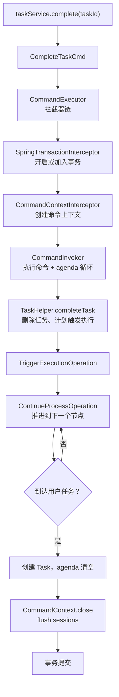
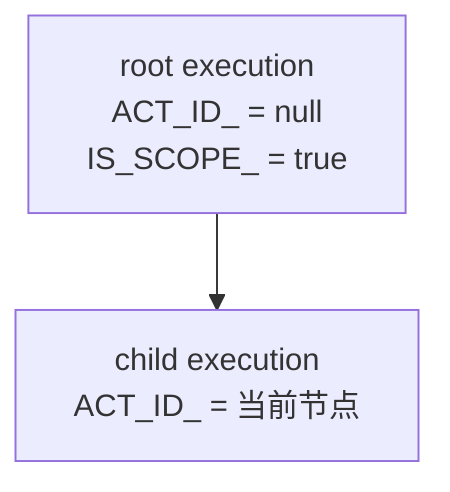

# 引擎内部原理：一次 complete 背后发生了什么

[[toc]]

上一篇讲的是怎么用。这一篇拆开一次 `taskService.complete()`，看引擎内部经过哪些组件：命令怎么进、任务怎么删、执行树怎么动、事务什么时候提交。理解这条链路，才能解释为什么流程能断点续跑，为什么异步任务会破坏事务一致性。

本文以 Flowable 8.0.0 为准；Activiti 与它同源，类名和结构高度相似。

## 一次 complete 的调用链

从 API 到数据库，一次任务完成大致经过这些步骤：



可以把它分成四段：

- **命令入口**：`TaskService` 把调用包装成一个 `Command`，交给命令执行器
- **拦截器链**：日志、事务、命令上下文依次套在命令外面
- **agenda 循环**：命令本身只做「删除任务、计划下一步」，真正的节点推进由 agenda 上的操作逐个执行
- **收尾**：命令上下文 flush 所有 session，事务提交

## 命令模式与拦截器链

Flowable 的 Service 方法几乎都对应一个 `Command` 实现。`taskService.complete` 对应 `CompleteTaskCmd`，`runtimeService.startProcessInstanceByKey` 对应启动流程的命令。命令模式的好处是：所有操作都走同一条执行管道，事务、日志、上下文管理只需要在管道上做一次。

默认拦截器链的关键几层：

| 拦截器 | 作用 |
| --- | --- |
| `LogInterceptor` | 记录命令执行的调试日志 |
| `SpringTransactionInterceptor` | 用 Spring 的 `TransactionTemplate` 包住命令；已有事务时按传播级别决定是否加入 |
| `CommandContextInterceptor` | 创建或复用 `CommandContext`，命令结束时关闭并 flush |
| `BpmnOverrideContextInterceptor` | 支持 BPMN 覆盖等扩展 |
| `CommandInvoker` | 链尾，执行命令和 agenda 操作 |

`CommandInvoker` 必须是最后一个拦截器，它的 `setNext` 直接抛异常。命令返回后，控制权回到 `CommandContextInterceptor`，它在 `finally` 里调用 `CommandContext.close()`；只有 `close()` 里没有异常，事务才会提交。

`CommandContext` 是可以复用的。一个命令内部再调用另一个 Service 时，默认复用同一个上下文，避免嵌套命令各自开一套 session。这也意味着：嵌套调用里的异常会把整个命令上下文标记为失败，最终由最外层统一回滚。

## 任务完成时做了什么

`CompleteTaskCmd` 本身很短，核心逻辑在 `TaskHelper.completeTask`：

1. 把传入的变量写到任务所属的执行实例上
2. 触发任务的 `complete` 监听器
3. 记录完成人，供历史表使用
4. 删除运行时任务记录
5. 调用 `planTriggerExecutionOperation`，把「触发执行」放到 agenda 上

第 5 步是关键。任务删除后，流程不会立刻在同一个方法里递归推进，而是把一个操作放进 agenda：

```text
TaskHelper.completeTask
  → 删除 Task
  → agenda.planTriggerExecutionOperation(execution)
```

`CommandInvoker` 随后循环取出 agenda 上的操作。`TriggerExecutionOperation` 调用当前节点的 `TriggerableActivityBehavior.trigger()`；用户任务的 behavior 接着计划 `ContinueProcessOperation`，由它找到外出连线、判断条件、移动执行实例。

到达下一个用户任务时，`UserTaskActivityBehavior.execute` 创建新的 Task，agenda 清空，命令结束。整个过程没有递归调用栈，而是「一个操作产生下一个操作」的循环。这就是为什么执行树可以很深、流程可以很长，栈不会爆。

任务删除、变量写入、执行树移动都在同一个 `CommandContext` 里完成，最后由同一个事务提交。这解释了三个现象：

- 任务完成后，运行时任务立即消失，历史任务出现
- 任务完成时写入的变量，要么全部生效，要么全部不生效
- 即使节点推进过程中抛异常，任务不会被删掉一半

## 执行树与令牌

引擎用 `ACT_RU_EXECUTION` 表示执行实例。顺序流程只有两条记录：根执行和当前节点上的子执行。



遇到并行网关，执行树分叉。实际跑一个「财务审批 + 法务审批」并行流程，启动后表里是：

```text
root   PARENT_ID_=null  ACT_ID_=null         IS_ACTIVE_=true   IS_SCOPE_=true
child1 PARENT_ID_=root  ACT_ID_=financeTask  IS_ACTIVE_=true
child2 PARENT_ID_=root  ACT_ID_=legalTask    IS_ACTIVE_=true
```

财务审批完成后，财务那条执行实例并没有消失，而是移到汇合网关并变成非活跃：

```text
root   ACT_ID_=null         IS_ACTIVE_=true
child1 ACT_ID_=join         IS_ACTIVE_=false
child2 ACT_ID_=legalTask    IS_ACTIVE_=true
```

`IS_ACTIVE_=false` 表示它在等兄弟分支。法务也完成后，两条子执行都到达汇合点，引擎合并回一条执行继续往下走；流程结束后，运行时执行记录全部清理。

「令牌」是理解执行树的一个比喻：令牌沿连线移动，遇到并行网关分裂，遇到汇合网关等待。但在数据库里没有单独的令牌表，令牌就是执行实例上的 `ACT_ID_` 和 `IS_ACTIVE_`。服务重启后，引擎从这些行恢复执行位置，所以流程能断点续跑。

## 异步任务与作业表

同步服务任务在当前命令的事务里执行。把服务任务标记为异步：

```xml
<serviceTask id="asyncTask" name="异步处理"
             flowable:async="true"
             flowable:delegateExpression="${demoDelegate}"/>
```

`ContinueProcessOperation.executeAsynchronous` 不会立刻调用 delegate，而是创建一个作业：

```text
ACT_RU_JOB
  TYPE_          = message
  HANDLER_TYPE_  = async-continuation
  ELEMENT_ID_    = asyncTask
  RETRIES_       = 3
  EXCLUSIVE_     = true
```

异步执行器轮询作业表，取到作业后在**新的事务**里执行 delegate。执行成功，作业删除，流程继续；执行失败，重试次数减一，超过阈值后进死信表。

这次验证时把异步执行器关掉，手动执行作业：

```java
Job job = managementService.createJobQuery()
        .processInstanceId(instance.getId())
        .singleResult();
managementService.executeJob(job.getId());
```

输出：

```text
作业数=1
  elementId=asyncTask, jobType=message, retries=3
async delegate executed: processInstanceId=..., activityId=asyncTask
执行后：endTime=...
剩余作业数=0
```

异步的意义是把耗时操作从事务里拿出去，代价是「创建作业」和「执行作业」不在同一个事务里。作业执行失败时，流程会停在原地重试，不会自动回滚已经提交的业务数据。

## 事务边界

`SpringTransactionInterceptor` 的判断很关键：

- 当前没有事务：用 `TransactionTemplate` 开一个新事务
- 当前已有事务，且传播级别是 `REQUIRED`：不再开新事务，直接加入

所以把引擎调用和业务更新放在同一个 Spring 事务里，它们会一起提交、一起回滚。验证代码：

```java
transactionTemplate.executeWithoutResult(status -> {
    jdbcTemplate.update("update leave_request set status = 'APPROVED' where id = 1");
    taskService.complete(managerTask.getId(), Map.of("approved", true));
    throw new IllegalStateException("模拟业务异常");
});
```

任务完成已经把运行时任务删掉、执行树移到下一个节点，但随后抛出的异常让整个事务回滚。实际查询结果：

```text
捕获异常：模拟业务异常
业务状态=DRAFT
事务回滚后待办数=1
```

业务状态和流程推进都回到了操作前。这是「引擎表和业务表同库」时最省心的用法。

反过来，跨库或异步场景就没有这个保证：

- 业务库和引擎库分开，本地事务只能保证一边，另一边要靠 outbox 或补偿
- 异步服务任务在新事务里执行，业务已经提交，作业失败只能重试或人工处理
- 在任务监听器里调用外部 HTTP / 发消息，外部副作用无法随事务回滚

## 三个工程结论

- **同库同事务最稳**：业务表更新和 `taskService.complete` 放进同一个事务，异常时一起回滚
- **不要在监听器里做不可回滚的外部调用**：邮件、HTTP、消息发送放到异步任务或事务提交后的事件里
- **异步任务要幂等**：作业会重试，delegate 可能执行多次；用业务唯一键或状态判断挡住重复执行

下一篇看数据落点：这些执行实例、任务、变量、历史记录，分别存在哪些表里，一次流转中每张表怎么变。
