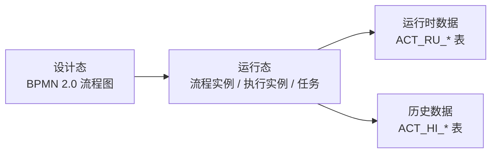
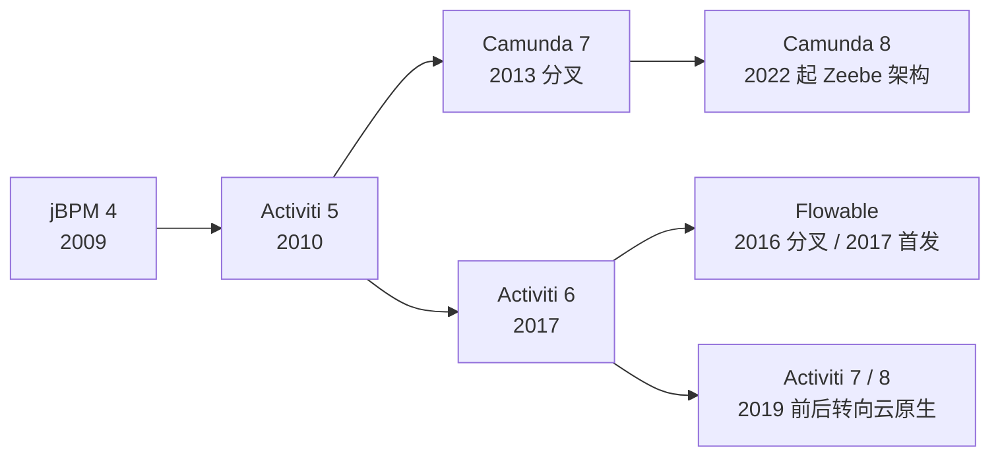
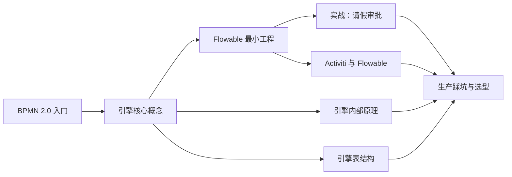

# 流程引擎：从审批流到可执行模型

[[toc]]

请假审批、报销、合同会签，这类「有人参与、按步骤往下走」的业务，最常见的起点是一串状态判断。流程短的时候没问题；流程一长、分支一多、审批人一变，状态和判断就会散到多个方法、多张业务表里。

流程引擎把「流程怎么走」从代码里抽出来，变成一份可执行的模型。引擎负责按模型推进、创建待办、记录每一步；业务代码只处理「这个节点要做什么」。

本组文章以 Flowable 8.0.0、Activiti 8.8.x 为准；存量版本（Activiti 5.22 / 6.0、Flowable 6.8）的差异在对照文章中单独说明。

## 流程引擎解决什么问题

先看一段常见的审批代码。

```java
public void approve(Long leaveId, boolean approved) {
    Leave leave = leaveMapper.selectById(leaveId);
    if (leave.getStatus() == 1) {
        if (!approved) {
            leave.setStatus(4);          // 主管驳回
        } else if (leave.getDays() <= 3) {
            leave.setStatus(2);          // 待 HR 备案
        } else {
            leave.setStatus(3);          // 待总监审批
        }
    } else if (leave.getStatus() == 3) {
        leave.setStatus(2);
    }
    leaveMapper.updateById(leave);
}
```

这段代码能跑，问题出在流程变长以后：

- 状态用数字表示，具体含义只能靠注释和调用方约定
- 分支写死在代码里，加一个「金额超过 5000 走财务」就要改方法、重新发版
- 待办列表要自己拼 SQL，候选人和已认领的任务还得额外建表
- 审批记录要另写日志表，查「谁在什么时候处理过」很费劲
- 会签、并行分支、超时提醒，每一项都要自己实现并发和定时逻辑

流程引擎把这五件事各自收进一个固定位置：

| 关注点 | 硬编码 | 流程引擎 |
| --- | --- | --- |
| 流程怎么走 | if-else 分支 | BPMN 2.0 模型 |
| 当前走到哪 | 业务表里的 status 字段 | 运行时执行实例和任务表 |
| 待办查询 | 自己拼 SQL | `TaskService` 按人、按组查询 |
| 审批历史 | 自己写日志表 | 历史表自动记录 |
| 会签 / 并行 | 自己写并发逻辑 | 多实例任务、并行网关 |

## 三层结构

流程引擎可以按三层理解：



- **设计态**：用 BPMN 2.0 画出流程，保存为 XML。流程图本身不执行，它是引擎读的配置。
- **运行态**：每发起一次业务，就创建一个流程实例；引擎用执行实例记录当前停在哪个节点，用任务记录该谁处理。
- **数据态**：运行中的数据放 `ACT_RU_*`，流程结束后清理；历史数据放 `ACT_HI_*`，长期保留。

这三层是后面所有文章的骨架。BPMN 讲设计态，核心概念讲运行态，表结构讲数据态。

## 家族谱系

Java 生态里常见的几个流程引擎，源头都可以追到 jBPM。理解它们的分叉关系，能解释为什么包名、表名、API 都长得差不多。



| 引擎 | 出身 | 当前主线 | 主要特点 |
| --- | --- | --- | --- |
| Activiti | jBPM 团队，2010 | 8.8.x | 国内存量系统多，5.22 / 6.0 仍在大量使用 |
| Flowable | Activiti 核心团队分叉，2016 | 8.0.x | 与 Activiti 同源，社区迭代活跃 |
| Camunda | 从 Activiti 5 分叉，2013 | 7.x / 8.x | 7.x 与 Activiti 同源；8.x 换成 Zeebe 新架构 |
| jBPM | Red Hat | 7.x | 与 Drools 规则引擎生态结合 |

这几个引擎共享同一套 BPMN 2.0 模型、同样的 `ACT_` 表前缀和高度相似的 Service API。学会其中一个，迁到另一个主要是查 API 和配置差异，不是从零开始。

## 这一组文章怎么读



| 顺序 | 文章 | 解决的问题 | 前置 |
| --- | --- | --- | --- |
| 1 | [BPMN 2.0 入门](./bpmn-basics.md) | 看懂一张流程图，能写出合法的 BPMN | 无 |
| 2 | [引擎核心概念](./engine-core-concepts.md) | 分清定义、实例、执行、任务和变量 | BPMN 入门 |
| 3 | [Flowable 8 最小工程](./flowable-quickstart.md) | 跑通部署、启动、查待办、完成、看历史 | 核心概念 |
| 4 | [实战：一个请假审批流程](./approval-process-in-practice.md) | 候选人认领、驳回重提、撤回、会签 | 最小工程 |
| 5 | [引擎内部原理](./engine-internals.md) | 一次 `complete` 背后发生了什么 | 核心概念 |
| 6 | [引擎表结构](./database-tables.md) | `ACT_*` 五类表与数据流转 | 核心概念 |
| 7 | [Activiti 与 Flowable](./activiti-and-flowable.md) | 同源关系、API 差异、迁移步骤 | 跑通过一个流程 |
| 8 | [生产踩坑与选型](./production-pitfalls-and-selection.md) | 异步事务、变量序列化、历史膨胀、选型 | 全部 |

前六篇按顺序读，能建立「模型 → 运行 → 落地 → 原理 → 数据」的完整链路；最后两篇分别做横向对照和生产选型，可以按需查。

## 什么时候该用流程引擎

流程引擎不是所有状态流转都该上。判断标准是「流程是否经常变、是否有人工参与、是否需要留下完整轨迹」。

适合：

- 审批、会签、工单这类人机混合流程
- 流程会随业务规则调整，改流程不应该改代码发版
- 需要查「谁在什么时候处理过」的审计场景
- 有并行分支、超时提醒、驳回重走等复杂流转

不适合：

- 纯自动、毫秒级完成的短任务，引入引擎只会多一层表和事务
- 流程十年不变，一个状态字段就能说清楚
- 极高吞吐的异步任务编排，消息队列或编排框架更合适

状态机、规则引擎、编排框架和流程引擎的边界，留到最后一篇展开。下一篇先从 BPMN 2.0 开始：引擎读的那张图，到底由哪些元素组成。
