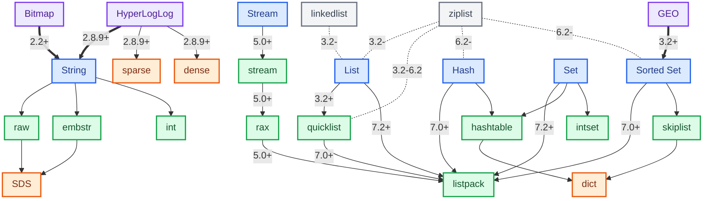

<!--
编辑备注（不对外展示）：本文仍有以下事实未完全核实，修改表格或版本前请先确认。

【版本依据：源码优先，不是官方文档】
本文的编码版本号以 Redis 官方仓库的 release tag 源码和 Git 提交为主，官方文档只作辅助。
原因：
1. 官方 object-encoding 文档只给粗略范围，不区分“对象编码”和“对象编码内部的结构”。
   例如它写“List 的 listpack：Redis >= 7.0”，但 7.0 实际只是 quicklist 节点内部把 ziplist 换成 listpack；
   List 对象本身以 listpack 作为 OBJECT ENCODING 返回值，按源码是 7.2 才有（提交 2168ccc661）。
   本文与官方文档在这点上口径不同，采用源码口径 7.2。
2. 官方文档对早期编码（hashtable、intset、skiplist、linkedlist、ziplist）没有标注首次引入版本，
   只写“normal encoding”“old encoding”“no longer used”，无法据此写成 X+。
3. 命令页的 Available since 说明的是“命令/能力从哪个版本可用”。本文表格的版本号口径是
   “该数据类型下，该编码/内部结构从哪个版本开始使用”。
   - GEO 能力是 3.2.0，但 GEO 的 listpack 编码要等到 Sorted Set 支持 listpack（7.0+）才可用，
     不能写成“GEO listpack 3.2.0+”，只能写 7.0+。
4. Redis 本身没有一张“编码首次引入版本”的官方表；tag 源码和带 PR 编号的提交是能追溯到的第一手依据。
   能从源码确认存在的版本，只能表述为“至晚在该版本已出现/可用”，不等于首次引入。

【各版本结论的依据】
- embstr 3.0+：源码对比。Redis 2.6 的 object.c 没有 embstr，Redis 3.0 已有。
- quicklist 3.2+：源码对比 + 提交。3.0 源码没有 quicklist.c，3.2 有；提交 5e362b84abf（Add quicklist implementation）。
- quicklist 节点 listpack 7.0+：提交 4512905961（Replace ziplist with listpack in quicklist）。
- List 直接 listpack 7.2+：提交 2168ccc661（Add listpack encoding for list）；7.0 只改节点内部。
- Hash / Sorted Set 的 ziplist 2.6-6.2：源码对比。2.4 的 Hash 仍走 zipmap，2.6 出现 ziplist 编码；2.4→2.6 之间未逐 tag 核对。
- intset 2.2+：源码快照。只能确认 Redis 2.2 已存在。
- int / raw 2.0+：源码快照。只能确认 Redis 2.2 已存在。
- hashtable / skiplist / linkedlist：源码快照只能确认 2.2 / 2.4 已存在，官方文档无首次版本，表中不写版本号。
- Stream 5.0+：官方命令元数据（XADD Available since 5.0.0）+ 源码 OBJ_ENCODING_STREAM。
- Bitmap 的 raw（Bitmap 能力 2.2.0+）：按“Bitmap 从 2.2.0 起使用 raw 作为外层编码”写；
  raw 本身早于 2.2.0，这里不是 raw 的首次引入版本。
- HLL 的 raw（HLL 能力 2.8.9+）：同上，表示 HLL 从 2.8.9 起使用 raw 外层编码。
- GEO 的 listpack 7.0+：不能沿用 GEO 能力 3.2.0，因为 GEO 要到 Sorted Set 支持 listpack（7.0+）后才可能使用该编码；
  依据是官方文档“GEO 复用 Sorted Set”+“Sorted Set listpack 7.0+”，未单独核对 GEO 自身引入版本。

【图中已有版本锚点（前一轮 agent 核对，未二次验证）】
图中标了版本的边可以直接当作核对入口。若在这些版本的源码/官方命令元数据中确认存在，
至少可以写明“至晚在该版本已出现/可用”；但不要把“某版本已存在”写成“首次引入版本”。
可用的锚点：
- Bitmap → String：2.2+；HyperLogLog → String / sparse / dense：2.8.9+
- Stream → stream / rax / listpack：5.0+
- List → linkedlist / ziplist：3.2-；List → quicklist：3.2+
- quicklist 节点 ziplist：3.2-6.2；quicklist 节点 listpack：7.0+
- List 直接 listpack：7.2+
- Hash / Sorted Set 的 ziplist：6.2-；Hash / Sorted Set 的 listpack：7.0+
- Set 的 listpack：7.2+；GEO → Sorted Set：3.2+
- 图中未标版本的边（Hash/Set 的 hashtable、Set 的 intset、Sorted Set 的 skiplist）目前没有可用锚点。

【待核对项】
1. String 的 int / raw 首次引入版本：现标 Redis 2.0+，仅能确认 Redis 2.2 已存在，未找到官方首次版本依据。
   embstr 已核对：Redis 2.6 源码没有，Redis 3.0 源码已有，故标 3.0+。
2. hashtable、intset、skiplist、linkedlist 的首次引入版本：官方文档未标注，只能确认 2.2 / 2.4 源码已存在；
   表中目前不写这些编码的版本号，不要把“某版本已存在”当成首次引入。
   可优先用图中 3.2- 的 linkedlist / ziplist 锚点、以及 3.2+ 的 quicklist 锚点倒推 3.0–3.2 之间的边界。
3. ziplist 作为 Hash / Sorted Set 对象编码的版本按 Redis 2.6-6.2 写：2.6 源码已存在；
   2.4 的 Hash 仍走 zipmap，未继续核对 2.4→2.6 之间的 tag。图中锚点是 6.2-（结束边界）。
5. GEO 使用 listpack 的起始版本未单独核实，表中 7.0+ 是由“GEO 复用 Sorted Set、Sorted Set listpack 为 7.0+”推得；
   可用图中 GEO → Sorted Set 3.2+ 与 Sorted Set → listpack 7.0+ 两个锚点交叉核对。
6. quicklist 首次版本按 Redis 3.2+ 写，依据是 3.0 源码没有 quicklist、3.2 源码有；
   官方提交为 5e362b84abf（Add quicklist implementation）。
7. List 对象在 Redis 7.2+ 可直接使用 listpack，依据官方提交 2168ccc661（Add listpack encoding for list）；
   Redis 7.0/7.1 仅 quicklist 节点内部使用 listpack。
8. Mermaid 图实测宽度约 1188px，正文容器约 672px，会出现横向滚动；是否收窄布局尚未决定。

【本文映射表规则（从项目 CLAUDE.md 移入，仅适用于本文）】
1. 表格固定四列「类型与编码分类 / 说明 / 编码 / 内部结构」；第三列写 `OBJECT ENCODING key` 的返回值，
   第四列只写编码使用的内部结构、触发条件和默认阈值。
2. 两列语义不能混：第四列不重复写对象编码名；`ziplist` / `listpack` 按当前行“它是什么”归列。
3. 内部结构用源码结构名（`SDS`、`linked list`、`ziplist`、`listpack`、`dict`、`intset`、`rax`）；
   只有 `skiplist` 因为编码与结构同名，内部结构写“跳表 + `dict`”。
4. 编码列版本号 = 该数据类型开始使用该编码的版本，不是编码首次引入版本，也不是命令的 Available since。
5. 表格下方保留一行版本口径备注（`>` 引用块）。
6. 官方文档与源码冲突时以源码 / 提交为准，依据写在本注释。
7. 图下说明写“部分早期编码省略版本标签”。
-->

# Redis 数据结构与底层编码
[[toc]]

Redis 的性能和内存占用，常常与同一数据类型所采用的内部表示有关。本文先建立数据类型、对象编码和底层数据结构三层之间的关系，再分别展开各类结构和它们的适用场景。

## 对象类型、编码与底层结构

Redis 的数据结构可以从三层理解：对外数据类型、对象编码和底层数据结构。

- **对外数据类型（`type`）**：Redis 面向用户提供的抽象类型，例如 `String`、`Hash`、`List`、`Set` 和 `Sorted Set`。
- **对象编码（`encoding`）**：Redis 为某个 key 选择的当前内部表示，例如 `int`、`embstr`、`quicklist`、`hashtable` 或 `skiplist`。同一种数据类型可以对应多种对象编码，具体选择取决于 Redis 版本、元素数量、元素大小和配置阈值。
- **底层数据结构**：对象编码内部使用的实现结构，例如 `SDS`、`dict`、`rax`、`ziplist` 和 `listpack`。一个对象编码可能组合多个底层结构；同一个底层结构也可能被多个对象编码复用。例如，`skiplist` 编码同时使用跳跃表和 `dict`，而 `dict` 也被 `hashtable` 编码复用。

可以通过命令查看一个 key 的对外类型和当前对象编码：

```text
TYPE key
OBJECT ENCODING key
```

`TYPE key` 只回答“这个 key 对外是什么类型”，`OBJECT ENCODING key` 才回答“当前实例为这个对象选择了什么编码”。底层数据结构属于实现细节，没有一个统一命令可以直接完整列出，通常需要结合 Redis 版本、源码和对象编码来理解。

这张图按“数据类型 → 对象编码 → 底层数据结构”展开。Bitmap、GEO 和 HyperLogLog 作为能力节点单独标出，历史结构用虚线表示。



<span class="redis-encoding-legend type"></span>外部数据类型 &nbsp; <span class="redis-encoding-legend capability"></span>基于数据类型的能力 &nbsp; <span class="redis-encoding-legend encoding"></span>对象编码 / 内部结构 &nbsp; <span class="redis-encoding-legend history"></span>历史对象编码 / 内部结构 &nbsp; <span class="redis-encoding-legend hll-encoding"></span>数据类型内部表示 / 底层数据结构  

<span class="redis-encoding-legend relation"></span>当前归属 / 使用关系（Hash → hashtable）  
<span class="redis-encoding-legend capability-relation"></span>能力视图关系（Bitmap → String）  
<span style="display:inline-block;width:1.5rem;height:0;border-top:2px dashed #333;vertical-align:0.3rem"></span>历史编码关系（ziplist -.-> List）

> 图中边上的版本号表示该关系适用的 Redis 版本范围；部分早期编码省略版本标签。
>
> Redis 的正式版本从 6.2 直接进入 7.0，没有 6.3～6.9 的正式版本。

## 基础数据结构

本节逐项说明图中的底层结构及其用途。下面用文字颜色标签区分两类内容：<GreenText>编码相关表示</GreenText>、<OrangeText>底层数据结构</OrangeText>；历史底层结构使用<GrayText>灰色文字</GrayText>。

- <OrangeText>简单动态字符串（`SDS`）</OrangeText>：`embstr` / `raw` 表示保存字符串值时使用的底层结构。
- <GrayText>双向链表</GrayText>：Redis 3.2- 的历史 List 直接使用这种链表；它也可以作为外层结构连接多个紧凑列表节点。
- <OrangeText>快速列表（`quicklist`）</OrangeText>：由双向链表连接多个节点，每个节点保存一段紧凑列表；Redis 6.2- 的节点使用压缩列表，Redis 7.0+ 的节点使用紧凑列表。Redis 7.2+ 的小 List 可以直接使用紧凑列表。
- <OrangeText>字典（`dict`）</OrangeText>：通用的哈希映射实现。
  - <OrangeText>哈希表</OrangeText>：Hash 和 Set 保存 field、value 或 member 映射的结构，使用 `dict` 管理这些映射。
  - <OrangeText>跳跃表</OrangeText>：按 score 维护有序成员，并与 `dict` 配合建立 `member → score` 索引。
- <OrangeText>整数集合（`intset`）</OrangeText>：Set 保存小规模整数成员的连续数组结构。
- <OrangeText>基数树（`rax`）</OrangeText>：Stream 按消息 ID 索引消息块的结构；消息块内部使用 `listpack`。
- **紧凑结构**：用于连续保存多个小元素，减少额外的指针和内存分配开销；Hash、List、Sorted Set 和 Stream 都可能使用这类结构。
- <GrayText>压缩列表（`ziplist`）</GrayText>：Redis 2.6–6.2 用于紧凑保存 Hash 和 Sorted Set 的元素；Redis 3.2–6.2 的 List 节点也使用它保存多个元素。
  - <OrangeText>紧凑列表（`listpack`）</OrangeText>：Redis 7.0 起替代压缩列表，用于紧凑保存 Hash、Sorted Set、List 节点和 Stream 消息块；Redis 7.2 起也用于 Set 的紧凑表示。

### 简单动态字符串（SDS）

SDS（simple dynamic string，简单动态字符串）是 Redis 保存字符串值时使用的底层结构。SDS 记录已使用长度和已分配空间，因此有几个直接收益：

- 获取长度只需读取长度字段，不需要从头扫描，复杂度为 `O(1)`。
- 修改前可以根据可用空间判断是否需要扩容，减少频繁的内存重分配。
- 长度字段决定数据边界，不依赖 `\\0`，因此可以保存包含空字节的二进制数据。
- 在内容末尾保留空字符，仍能与部分 C 字符串函数协作。

SDS 通常采用空间预分配和惰性空间释放：扩容时适当多分配空间，缩短后不立即归还全部空闲空间。这样可以降低反复追加和截断造成的内存分配次数，但也意味着需要关注大字符串和碎片。

### 链表（linked list）

Redis 的 `linked list` 通过前后指针连接节点，适合在已知节点位置进行插入、删除以及在两端追加元素。它的代价是每个节点需要额外的指针，并且按索引查找通常需要从头或尾逐步移动。Redis 3.2- 的历史 List 使用这种双向链表；在较新的 List 实现中，它用于连接多个紧凑列表节点。

### 快速列表（quicklist）

Redis 7.2+ 的 List 默认先使用 `listpack` 编码；当元素数量或占用大小超过 `list-max-listpack-size` 的限制时，再转换为 `quicklist`。转换为 `quicklist` 后，节点内部仍使用 `listpack`。Redis 7.0/7.1 的 List 对象仍使用 `quicklist`，节点内部改用 `listpack`；Redis 6.2- 的 List 节点使用 `ziplist`。

`quicklist` 节点的大小由 `list-max-ziplist-size` <History>Redis 6.2-</History> 或 `list-max-listpack-size` <Current>Redis 7.0+</Current> 等配置控制。Redis 7.0+ 这里指节点的紧凑列表参数，而不是 List 直接使用紧凑列表。它把多个紧凑节点连接起来，兼顾了紧凑存储和两端操作。

### 字典（dict）

字典（`dict`）是 Redis 中多种数据结构都会使用的通用索引结构。它通过哈希函数把键转换为哈希值，再根据哈希值定位哈希桶；哈希桶中的条目保存具体的键和值。

Hash 和 Set 的字典结构保存 field-value 或 member 映射。

字典的平均查找、插入和删除复杂度为 `O(1)`；但在扩容、哈希冲突严重或一次操作处理大量成员时，实际耗时仍可能上升。

`dict` 内部通过哈希表管理键值映射。多个键映射到同一个哈希桶时，会产生哈希冲突。Redis 通过链式结构组织同一桶中的多个条目，再逐个比较键来找到目标条目。随着映射数量增加，字典会进行扩容和渐进式 rehash，将旧表中的条目逐步迁移到新表，避免一次性迁移大量数据造成长时间阻塞。

### 哈希表（hashtable）

`hashtable` 是 Redis 用来保存键或成员映射关系的内部结构。

- Hash 采用字典结构保存 field 和 value。
- Set 采用字典结构保存 member。

这样，Redis 可以根据 field 或 member 快速找到对应的条目，平均查找、插入和删除复杂度为 `O(1)`。

### 跳跃表（skiplist）

跳跃表由多层有序链表组成。底层保存全部元素，上层通过较少的节点提供“跳跃”路径；查找时从高层开始向前移动，必要时下降到下一层。

Sorted Set 在采用跳跃表和字典的组合结构时：

- 字典提供从 member 到 score 的快速查找。
- 跳跃表按 score 有序保存 member，支持范围查询和排名操作。

这是一种空间换时间的组合：按成员查分数和按分值范围读取都能保持较好的性能，但每个成员需要维护两份索引结构，内存占用会高于单一集合。GEO 直接复用 Sorted Set，因此会间接使用同一套跳跃表。

### 整数集合（intset）

整数集合（`intset`）按整数升序连续保存成员。它不为每个成员单独分配节点，而是把成员放在连续数组中，并用编码字段记录每个整数占用的宽度。查找时可以利用有序关系进行二分查找；插入或删除中间成员时，后续整数可能需要移动。

当新元素超出当前宽度时，整数集合会分配更宽的存储空间并转换已有成员。它通常只升级、不降级，这样可以避免删除元素后又降级、再次插入大整数时反复转换，代价是集合在升级后会保留更宽的表示。

### 基数树（rax）

基数树（`rax`）是一种压缩前缀树，按字节序组织键。它会合并具有相同前缀的路径，减少节点数量；查找和范围遍历都沿着键的字节逐层进行。

Stream 使用 `rax` 按消息 ID 管理消息块；每个消息块内部再使用 `listpack` 保存多条消息。这样，`rax` 负责组织消息块的有序索引，`listpack` 负责紧凑保存消息内容。

### 压缩列表（ziplist）

`ziplist` 是 Redis 2.6–6.2 使用的压缩结构。它把多个 entry 连续存放在一段内存中，每个 entry 记录前一个 entry 的长度、当前 entry 的编码方式和实际数据，因此不需要为每个元素单独分配节点和指针。

这种布局可以减少小集合的内存开销，但在中间位置插入或删除 entry 时，后续数据可能需要整体移动；当前一个 entry 的长度跨越编码边界时，还可能触发后续 entry 更新长度字段。因此，`ziplist` 适合元素数量少、元素较短的场景。

### 紧凑列表（listpack）

`listpack` 是 Redis 7.0 起用于替代压缩列表的紧凑结构。它把多个 entry 连续存放，每个 entry 自身记录编码和数据，entry 末尾记录自身长度；向前遍历时不依赖前一个 entry 的长度字段，因此避免了压缩列表可能出现的级联更新。

`listpack` 通常用于 quicklist 节点，也可以作为 Hash、Set 和 Sorted Set 的紧凑结构；Redis 7.2+ 的小 List 也可直接使用紧凑列表。元素数量较少、元素较短时，它可以减少指针和单独内存分配带来的额外开销；但在中间位置插入或删除时，后续数据仍可能需要移动。

## 各数据类型的内部实现

这一部分从 Redis 的对外数据类型切入，说明每种类型如何组合前面的基础结构。Bitmap、GEO 和 HyperLogLog 的内部表示也放在对应类型下说明。

### String

String 是 Redis 对外提供的字符串类型，内部主要使用 SDS 保存字符串值：

- 内容可以直接表示为整数时，使用 `int` 编码。
- 字符串长度不超过 44 字节时，使用 `embstr` 编码，由 Redis 对象和 SDS 一次性分配。
- 字符串长度超过 44 字节时，使用 `raw` 编码，Redis 对象和 SDS 分开分配。

### Hash

Hash 保存 field-value 字段集合。小 Hash 使用紧凑编码，大 Hash 或包含较长 field / value 时使用 `hashtable`：

- Redis 6.2- 使用 `ziplist`；Redis 7.0+ 使用 `listpack`。
- 默认阈值是字段数不超过 512，且每个 field / value 不超过 64 字节；对应配置项为 `hash-max-ziplist-entries` / `hash-max-ziplist-value`<History>Redis 6.2-</History>和 `hash-max-listpack-entries` / `hash-max-listpack-value`<Current>Redis 7.0+</Current>。
- 超过任一阈值后，Hash 转为 `hashtable`。

### List

List 是 Redis 对外提供的有序字符串序列。Redis 7.2+ 新建的 List 默认先采用紧凑列表；当元素数量或占用大小超过 `list-max-listpack-size` 的限制时，才转换为由双向链表连接多个紧凑列表节点的结构。Redis 7.0/7.1 的 List 仍使用双向链表连接紧凑列表节点。

Redis 6.2- 的 List 使用双向链表连接压缩列表节点；更早的 List 直接使用双向链表。

### Set

Set 是不重复的无序成员集合。Redis 7.2+ 会按成员内容和数量在三种表示之间选择：

- 所有成员都是十进制 64 位有符号整数，且成员数不超过 `set-max-intset-entries`（默认 512）时，使用 `intset`。
- 不满足 `intset` 条件、但成员数不超过 `set-max-listpack-entries`（默认 128），且每个成员长度不超过 `set-max-listpack-value`（默认 64 字节）时，使用 `listpack`。
- 超过 `listpack` 的数量或成员长度限制时，使用 `hashtable`；它由 `dict` 管理 member 映射。

### Sorted Set

Sorted Set 保存带 score 的有序成员集合。小集合使用紧凑编码，大集合使用两套索引：

- Redis 6.2-，成员数不超过 128 且每个 member 不超过 64 字节时使用 `ziplist`；Redis 7.0+ 使用 `listpack`。
- 默认阈值对应 `zset-max-ziplist-entries` / `zset-max-ziplist-value`<History>Redis 6.2-</History>以及 `zset-max-listpack-entries` / `zset-max-listpack-value`<Current>Redis 7.0+</Current>。
- 超过任一紧凑结构阈值后，使用跳跃表和字典：跳跃表维护按 score 的顺序，字典提供 member 到 score 的快速查找。

### Stream

Stream 是 Redis 提供的、带消息 ID 的追加日志数据类型。对 Stream key 执行 `OBJECT ENCODING` 时，返回的对象编码是 `stream`；该编码内部使用 `rax` 按消息 ID 组织消息块，每个消息块内部使用 `listpack` 保存多条消息。消息块按 `stream-node-max-bytes`（默认 4096 字节）和 `stream-node-max-entries`（默认 100）等配置条件切分。

### HyperLogLog

HyperLogLog 在 Redis 中以 String 作为外层对象，内部使用专用的 HLL 载荷：

- 初始或数据量较少时使用 `sparse`。
- 超过 `hll-sparse-max-bytes`（默认 3000 字节，含 16 字节头部）后转为 `dense`。

因此，HyperLogLog 复用了 String 的对象外壳，但 `sparse` / `dense` 是 HLL 自身的内部表示。

### Bitmap 与 GEO

Bitmap 与 GEO 复用已有对象的存储能力：

- Bitmap 把 String 的值视为位数组，使用 String 的对象存储和 SDS。
GEO 使用 Sorted Set 保存经纬度对应的 score 与 member，沿用 Sorted Set 的紧凑结构或跳跃表 + 字典（底层使用跳跃表和字典）。

## 类型与编码分类

前面的章节按“基础结构”和“数据类型内部实现”分别说明原理，下面用表格汇总两者的映射关系。表中的默认阈值对应相关版本的默认配置，实际实例仍应以版本、配置和 `OBJECT ENCODING key` 的结果为准。

| 类型与编码分类 | 说明 | 编码 | 内部结构 |
| --- | --- | --- | --- |
| String | 字符串、整数或二进制安全值 | `int` <Current>Redis 2.0+</Current><br>`embstr` <Current>Redis 3.0+</Current><br>`raw` <Current>Redis 2.0+</Current> | `SDS`：Redis 自定义的简单动态字符串，`embstr` / `raw` 编码的内部实现<br>`int`：整数以直接值保存<br>`embstr`：Redis 对象和 SDS 一次性分配，长度不超过 44 字节<br>`raw`：Redis 对象和 SDS 分开分配，长度超过 44 字节 |
| List | 有序字符串序列 | `linkedlist` <History>Redis 3.2-</History><br>`ziplist` <History>Redis 3.2-6.2</History><br>`quicklist` <Current>Redis 3.2+</Current><br>`listpack` <Current>Redis 7.2+</Current> | `linked list`：Redis 3.2- 的历史 List 直接使用<br>`ziplist`：Redis 3.2-6.2 的 quicklist 节点使用<br>`listpack`：Redis 7.0+ 的 quicklist 节点使用<br>&nbsp;Redis 7.2+ 的小 List 也直接使用，超过配置限制后由 `linked list` 连接多个 `listpack` 节点 |
| Hash | field-value 字段集合 | `ziplist` <History>Redis 2.6-6.2</History><br>`listpack` <Current>Redis 7.0+</Current><br>`hashtable` | `ziplist`：Redis 2.6-6.2 使用，字段数不超过 512 且每个 field / value 不超过 64 字节<br>`listpack`：Redis 7.0+ 使用，字段数不超过 512 且每个 field / value 不超过 64 字节<br>`dict`：`hashtable` 编码的内部结构，超过任一紧凑结构阈值后使用，保存 field-value 映射 |
| Set | 不重复的无序成员集合 | `intset` <History>Redis 2.2+</History><br>`listpack` <Current>Redis 7.2+</Current><br>`hashtable` | `intset`：成员均为十进制 64 位有符号整数，且成员数不超过 512<br>`listpack`：不满足 `intset` 条件，成员数不超过 128 且每个成员不超过 64 字节<br>`dict`：`hashtable` 编码的内部结构，超过紧凑结构阈值后兜底，保存 member 映射 |
| Sorted Set | 带 score 的有序成员集合 | `ziplist` <History>Redis 2.6-6.2</History><br>`listpack` <Current>Redis 7.0+</Current><br>`skiplist` | `ziplist`：Redis 2.6-6.2 使用，成员数不超过 128 且每个 member 不超过 64 字节<br>`listpack`：Redis 7.0+ 使用，成员数不超过 128 且每个 member 不超过 64 字节<br>跳表：超过任一紧凑结构阈值后使用，按 score 维护成员顺序<br>`dict`：与跳表共同组成 `skiplist` 编码，提供 `member → score` 的快速查找 |
| Stream | 带消息 ID 的追加日志 | `stream` <Current>Redis 5.0+</Current> | `rax`：按消息 ID 管理消息块<br>`listpack`：保存消息块内容，按配置限制切分 |
| Bitmap | String 的位操作视图 | `raw` <Current>Redis 2.2.0+</Current> | `SDS`，将 String 的值视为位数组 |
| HyperLogLog | 以 String 为外层对象的概率基数统计结构 | `raw` <Current>Redis 2.8.9+</Current> | `sparse`：未超过 3000 字节阈值（含 16 字节头部）时使用<br>`dense`：超过该阈值后使用 |
| GEO | 基于 Sorted Set 的地理位置能力 | `ziplist` <History>Redis 3.2-6.2</History><br>`listpack` <Current>Redis 7.0+</Current><br>`skiplist` <Current>Redis 3.2+</Current> | 复用 Sorted Set 的内部结构，切换条件及默认阈值同 Sorted Set |

> 编码列的版本号表示该数据类型从哪个版本开始使用该编码，历史编码则写成结束范围（如 `3.2-`、`2.6-6.2`）。它指该类型使用该编码的版本，不是编码本身的首次引入版本，也不是命令的 `Available since`。例如 Bitmap 的 `raw` 标 2.2.0+，表示 Bitmap 从 2.2.0 起使用 `raw` 作为外层编码。

## 如何把实现知识用于排查

底层编码不是为了背结构体名称，而是为了帮助定位问题：

1. 先确认命令对键的访问方式，是单键操作还是一次处理大量成员。
2. 再观察键的大小、成员数量和增长趋势，检查是否从紧凑编码转换成了通用编码。
3. 对延迟敏感的路径，避免把超大 Hash、List 或 Set 当作一个普通小键使用。
4. 用 `MEMORY USAGE key`、慢查询日志和延迟监控验证判断，不凭 `OBJECT ENCODING` 一个字段推断全部性能。

Redis 版本升级后，内部编码名称和转换实现可能变化。文章中的结构用于理解设计取舍；具体阈值和线上行为应以当前版本文档、配置和实测为准。
