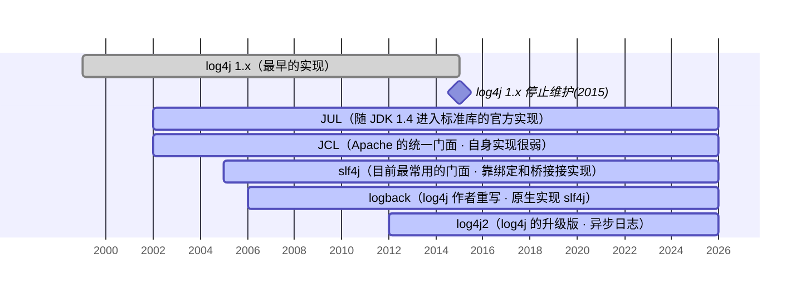
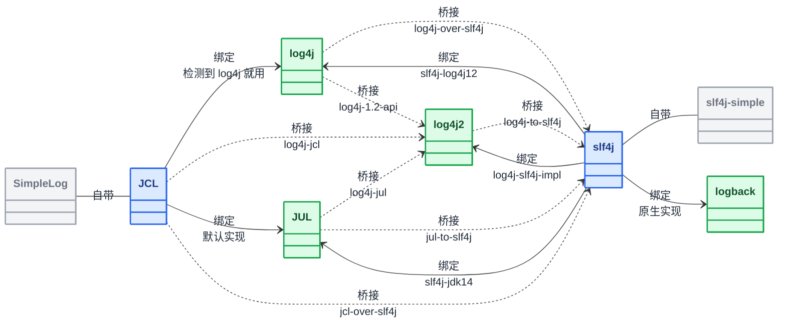

# Java 日志体系

[[toc]]

Java 的日志生态分成门面和实现两层，每层都有多个选择：门面有 JCL、slf4j，以及 Hibernate、Undertow 这类框架在用的 jboss-logging；实现有 JDK 自带的 JUL，以及第三方的 log4j、logback、log4j2。实际项目用的是「一个门面 + 一个实现」的组合，Spring Boot 默认选的就是 slf4j + logback。

本组文章讲的是跨版本稳定的机制，不绑定具体版本。

两层分开是为了让调用方稳定、实现可换。业务代码只依赖门面的 API，背后用哪个实现由依赖和配置在运行时决定，换实现时业务代码不用动。这个目标历史上没有一次就位：JCL 想做统一门面，但自带的实现太弱；log4j 早期既是门面又是实现；直到 slf4j 才把「只提供接口」这件事定下来。

两层的组合关系也是不少问题的来源。一个项目里同时出现两三套日志、同一条日志打印两遍、配置改了不生效，多数出在依赖里共存了多个实现、或者桥接包装错，而不是某个 API 用错。本系列按门面 / 实现分组讲，具体用法见各分篇。

<Cards>
  <Card title="门面">JCL（Jakarta Commons Logging，现名 Apache Commons Logging）：Apache 的统一 API slf4j（Simple Logging Facade for Java）：目前最常用的门面 jboss-logging（JBoss Logging）：Hibernate、Undertow 这类框架在用</Card>
  <Card title="实现">JUL（java.util.logging）：JDK 1.4 起自带 log4j：最早的实现，已停止维护 logback：原生实现 slf4j log4j2：log4j 的升级版，异步日志</Card>
  <Card title="门面自带的弱实现">JCL 的 SimpleLog slf4j 的 slf4j-simple slf4j 的 slf4j-nop</Card>
</Cards>

## 出现顺序

## 门面与实现的关系

门面和实现的关系，以及实际项目里常见的搭配。

- 门面
- 实现
- 门面自带的弱实现
- **绑定**（实线）：门面把日志交给实现。
- **桥接**（虚线）：老 API 的调用被重定向到另一套 API 上（多数转到 slf4j，log4j2 自带的适配器则转到 log4j2）。

log4j2 在图上被归在实现一侧，是因为它主要当实现用。它本身也提供门面 API——`log4j-api` 是 API 模块、`log4j-core` 是实现，但生态里各框架对 slf4j 的适配更齐全，一般还是把 log4j2 看作日志实现，配 slf4j 当门面使用。

桥接有两种做法——**替换**：桥接 jar 把原 API 的类自己实现一份；**挂接**：靠**原框架自己的扩展点**被发现，**原来的 jar 必须留着**。

| artifact | 谁在干活 | 谁提供 | 含义 | artifact | 谁在干活 | 谁提供 | 含义 |
|---|---|---|---|---|---|---|---|
| `log4j-to-slf4j` <CategoryTag2>挂接</CategoryTag2> | slf4j | log4j2 | log4j2 的 API 调用转到 slf4j | `log4j-slf4j-impl` | log4j2 | log4j2 | slf4j 绑定到 log4j2 |
| `log4j-over-slf4j` <CategoryTag1>替换</CategoryTag1> | slf4j | slf4j | log4j 1.x 的 API 调用转到 slf4j | `log4j-slf4j2-impl` | log4j2 | log4j2 | slf4j 2.x 绑定到 log4j2 |
| `jul-to-slf4j` <CategoryTag2>挂接</CategoryTag2> | slf4j | slf4j | JUL 的 API 调用转到 slf4j | `log4j-jul` <CategoryTag2>挂接</CategoryTag2> | log4j2 | log4j2 | JUL 的 API 调用转到 log4j2 |
| `jcl-over-slf4j` <CategoryTag1>替换</CategoryTag1> | slf4j | slf4j | JCL 的 API 调用转到 slf4j | `log4j-jcl` <CategoryTag2>挂接</CategoryTag2> <Warning>少见</Warning> | log4j2 | log4j2 | JCL 的 API 调用转到 log4j2 |
| `slf4j-log4j12` | log4j | slf4j | slf4j 绑定到 log4j | `log4j-1.2-api` <CategoryTag1>替换</CategoryTag1> <Warning>少见</Warning> | log4j2 | log4j2 | log4j 1.x 的 API 调用转到 log4j2 |
| `slf4j-jdk14` <Warning>少见</Warning> | JUL | slf4j | slf4j 绑定到 JUL |  |  |  |  |

::: tip 桥接的两种做法
- **替换**：桥接 jar 把原 API 的类自己实现一份——里面就有 `org.apache.commons.logging.LogFactory`、`org.apache.log4j.Logger` 这类同名类。代价是**原来的 jar 必须从依赖里排除**（同名类只能留一个），而且**原框架的内部类大多是空壳**：以 `log4j-over-slf4j` 为例，`org.apache.log4j.PropertyConfigurator`、Appender、Filter 这些类名都还在，但方法体是空的、调了也不干活，真正在走新实现的只剩 Logger 这条入口（换 `log4j-1.2-api` 时给的是完整实现）；从替换 jar 里彻底消失的，是 `jdbc`、`net`、`lf5`、`nt` 这批子包（`log4j-over-slf4j` 里连 `varia` 也没有）。属这一类的有：
    - `jcl-over-slf4j`
    -  `log4j-over-slf4j`
    - `log4j-1.2-api`
- **挂接**：原框架的类一个不动。桥接 jar 只有自己的几个类，靠**原框架自己的扩展点**被发现，**原来的 jar 必须留着**，依赖、配置、内部 API 全都照旧，只是日志的出口改了道：
    - `log4j-to-slf4j` 注册 log4j-api 的 `Provider`
    - `log4j-jcl` 注册 JCL 的 `LogFactory`
    - `jul-to-slf4j` 装一个 JUL 的 Handler
    - `log4j-jul` 把 `java.util.logging.manager` 指向自己的 `LogManager`。
:::

::: tip 谁在干活
- `slf4j-xxx`、`xxx-to-slf4j`、`xxx-over-slf4j` 这三种名字，干活的都是**后面那个**
- `log4j-jul`、`log4j-1.2-api`、`log4j-jcl`、`log4j-slf4j-impl` / `log4j-slf4j2-impl` 反过来，`log4j` 写在前、干活的却是 log4j2——它们都是 log4j2 自己提供的适配器，前缀 `log4j-` 标的是提供方，不是干活的那个。
:::

::: warning log4j-over-slf4j 和 log4j-to-slf4j 只差一个词
`log4j-over-slf4j` 是给 **log4j 1.2** 的桥接，把 log4j 1.x 的 API 重定向到 slf4j；`log4j-to-slf4j` 是给 **log4j2** 的桥接，把 log4j2 的 API 重定向到 slf4j。项目里用的是哪个版本，就得用哪个。
:::

同一对框架的绑定和桥接**不能同时出现**，否则调用会绕成环（这也是 `log4j-over-slf4j` 和 `slf4j-log4j12` 不能共存的原因）。
::: info JUL 接给谁
JUL 相关的适配有三条：`jul-to-slf4j`（JUL 的 API 调用转到 slf4j）、`log4j-jul`（JUL 的 API 调用转到 log4j2），这两条方向都是 JUL → 别的实现；`slf4j-jdk14` 方向相反，是 slf4j 绑定到 JUL。前两条里 `jul-to-slf4j` 在实践中更常见，`log4j-jul` 由 log4j2 自带（`org.apache.logging.log4j:log4j-jul`）。
:::

一个门面同时只能绑定一个实现（多个时取依赖里第一个），换实现改的是依赖和配置。不过「取依赖里第一个」只对 slf4j 成立：slf4j 按依赖顺序取第一个、发现多个绑定还会打一条警告；JCL 不看依赖顺序，由 `LogFactory` 按固定顺序 `Log4JLogger → Jdk14Logger → Jdk13LumberjackLogger → SimpleLog` 逐个探测，命中即止，也不打多绑定警告。

## 六个框架对比

把六个框架的定位、组件叫法、配置方式和现状放在一起看：

| 框架 | 定位 | 组件叫法 | 配置方式 | 可直接调用的 API | 当前状态 |
|---|---|---|---|---|---|
| JCL | 门面 | `Log` / `LogFactory` | `commons-logging.properties`（仅用于指定 `Log` 实现） | 有（自身即门面） | Apache 的通用 API，Spring 5 起由 `spring-jcl` 接手 |
| slf4j | 门面 | `Logger` / `LoggerFactory` | 无自己的配置文件 | 有（自身即门面） | 最主流 |
| JUL | 实现 | Logger / Handler / Formatter | `logging.properties` | 有（`java.util.logging.Logger`） | JDK 1.4 起自带，多作兜底 |
| log4j | 实现 （1.x 早期兼门面） | Logger / Appender / Layout | `log4j.properties` | 有（`org.apache.log4j.Logger`） | 2015 年停止维护 |
| logback | 实现 | Logger / Appender / Layout （Layout 封装进 encoder） | `logback.xml` | 无（直接用 slf4j API） | Spring Boot 默认 |
| log4j2 | 门面 + 实现 | Logger / Appender / Layout | `log4j2.xml` | 有（`log4j-api` 门面 + `log4j-core` 实现） | 主流，异步见长 |
