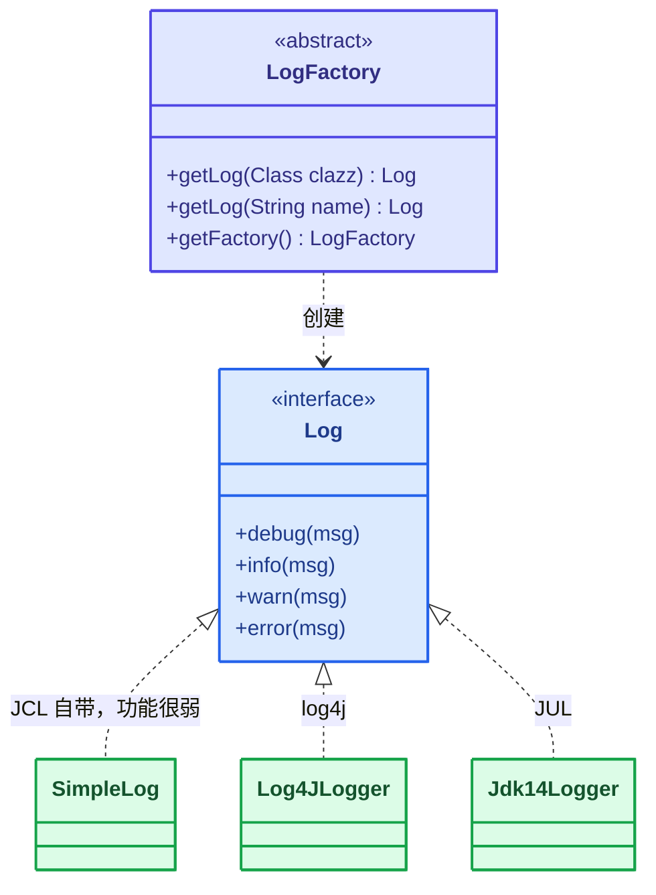
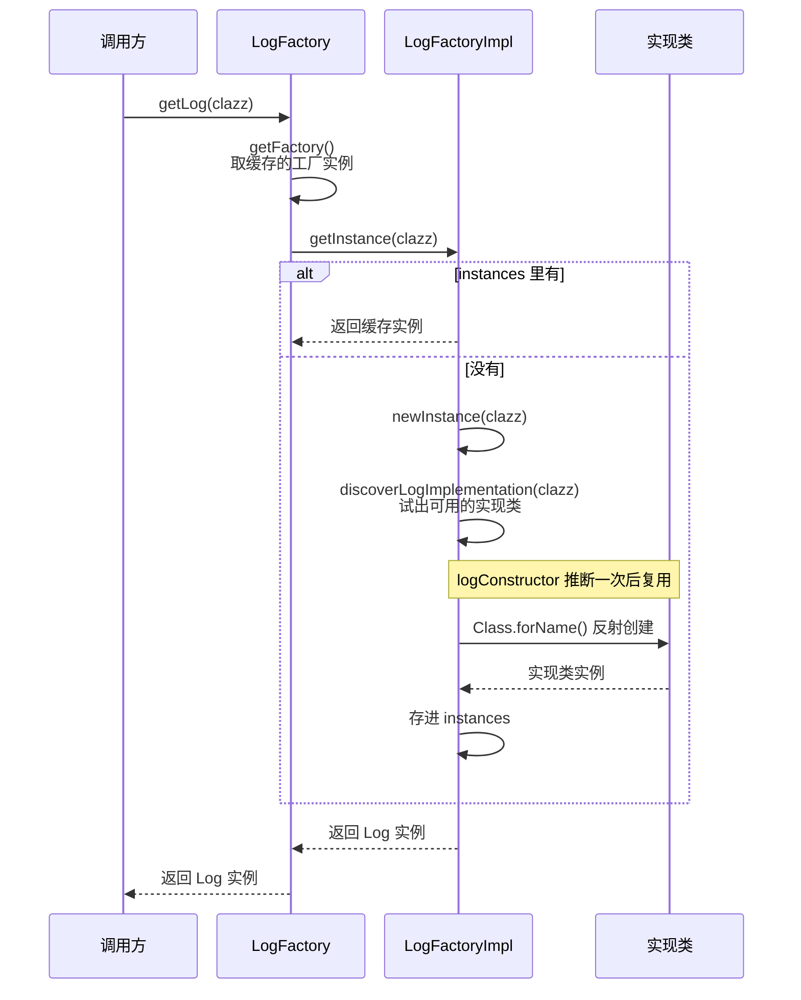

# JCL（Apache 的统一 API）

[[toc]]

JCL 全称 Jakarta Commons Logging，现名 Apache Commons Logging，是 Apache 提供的一个通用日志 API。它为各种 Java 日志实现提供统一接口，自身也带一个实现（`SimpleLog`），但功能非常弱。它允许开发人员在不同实现之间切换：log4j、JDK 自带的 JUL 等。

JCL 本身是个门面，日志最终走哪条线由「探测」决定。项目里能碰到的探测有两套，来自两个不同的 jar、探测的对象也不同，容易混起来看。

第一套探测来自Apache `commons-logging` 自己的，`LogFactory` 挑的是自己 `Log` 接口的实现类，按固定顺序试下来，命中即止。

1. 系统属性 `org.apache.commons.logging.Log` 指定的类
2. `Log4JLogger`（log4j）
3. `Jdk14Logger`（JUL）
4. `Jdk13LumberjackLogger`
5. `SimpleLog`（JCL 自带，兜底）

JDK 1.4 起 JUL 必然在 classpath 上，兜底那一步几乎走不到——所以单独用 JCL 时日志走的是 JUL，自带的 `SimpleLog` 基本用不上。

第二套探测来自 `spring-jcl`。Spring 项目里也会看到 `org.apache.commons.logging.*`，但那不是 Apache 的 `commons-logging`：Spring Framework 5 起，`spring-core` 依赖一个同包名、同 API 的替代实现 `spring-jcl`（`org.springframework:spring-jcl`），它按 classpath 上有什么来转接：

1. 类路径上有 log4j2 的 API（`org.apache.logging.log4j.spi.ExtendedLogger`，在 `log4j-api` 里）时：
   1. 同时还有 `log4j-to-slf4j`（`org.apache.logging.slf4j.SLF4JProvider`）和 slf4j 的 SPI（`org.slf4j.spi.LocationAwareLogger`）→ 改接到 slf4j
   2. 否则 → 直连 log4j2
2. 没有 log4j2 的 API、但有 slf4j 时 → 接到 slf4j（有 slf4j SPI 走带位置信息的实现，只有 slf4j API 也能接上）
3. 都没有时才退回 JUL

关键在第 1 条里的分支：判断依据不是「有没有 log4j2」，而是「log4j2 是不是经 `log4j-to-slf4j` 接进来的」。**Spring Boot 默认依赖正是这种情况**——`spring-boot-starter-logging` 带了 `log4j-to-slf4j`，所以日志最终走的是 slf4j，相关说明见 [Spring Boot 的日志体系](./spring-boot-logging.md)。

两套机制对着看，差别在「谁在探、探什么」：

| | Apache `commons-logging` 的 `LogFactory` | Spring 的 `spring-jcl` |
|---|---|---|
| 出处 | `commons-logging`（Apache） | `spring-jcl`（Spring 5 起随 `spring-core` 进入项目） |
| 探测对象 | 自己 `Log` 接口的实现类 | 日志后端 |

JCL 的两个基本类型是 `Log`（基本记录器，接口）和 `LogFactory`（负责创建 Log 实例，抽象类）。`Log` 的方法只接收 `Object` 类型的参数，没有 slf4j 那样的 `{}` 占位符，要带参数只能自己拼接（`log.info("a" + b)`）——拼接在调用前就已经发生，即使这条日志最终不输出，开销也已经产生。



- <span class="spring-legend interface"></span>接口
- <span class="spring-legend abstract"></span>抽象基类
- <span class="spring-legend implementation"></span>实现类

## 使用

### 依赖

JCL 是门面，本身只需要 `commons-logging` 一个依赖；要让它把日志转接到 log4j，再补上 log4j 的依赖。下面两种都列出来，按需取用——类路径上有没有 log4j 直接决定上面那套探测的落点。

```xml
<dependencies>
	<!-- 单独使用：classpath 上没有 log4j，探测依次往下试，最终落到 JUL -->
	<dependency>
		<groupId>commons-logging</groupId>
		<artifactId>commons-logging</artifactId>
		<version>1.2</version>
	</dependency>
	<!-- 结合log4j使用 -->
	<dependency>
		<groupId>log4j</groupId>
		<artifactId>log4j</artifactId>
		<version>1.2.17</version>
	</dependency>
</dependencies>
```

### 配置文件

结合 log4j 使用需添加配置文件 `log4j.properties`，写法见 [log4j 的配置文件](./log4j.md#配置文件)。

### Java 代码

业务代码只认 JCL 的 `Log` 和 `LogFactory`，底层换成哪个实现，代码都不需要改。示例用 JUnit 的 `@Test` 运行，依赖片段里没有单独列出 JUnit，需要另行引入。

```java
package com.example;

import org.apache.commons.logging.Log;
import org.apache.commons.logging.LogFactory;
import org.junit.Test;

public class JCLTest {

	@Test
	public void testQuick()throws Exception{
		// 获取 log日志记录器对象
		Log log = LogFactory.getLog(JCLTest.class);
		// 日志记录输出
		log.info("hello jcl");
	}
}
```

## 源码结构

`LogFactory.getLog()` 拿到的不是直接 new 出来的对象，而是一路查缓存、推断实现类、反射创建：



## 总结

- JCL 是 Apache 提供的通用日志 API，靠 `LogFactory` 在运行时探测 classpath 上的实现（log4j、JUL 等）并转接，自身只带一个功能很弱的 `SimpleLog`。
- 它的方法只接收 `Object` 类型的参数，不支持 `{}` 占位符，参数只能自己拼接，这是它和 slf4j 的关键差别。
- Spring Framework 5 起，`spring-core` 依赖同包名、同 API 的 `spring-jcl` 替代实现，Spring / Spring Boot 项目里看到的 `org.apache.commons.logging.*` 走的是它，不是 Apache 的 `commons-logging`。
