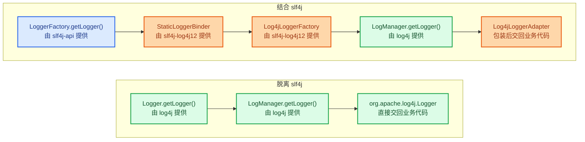

# log4j（最早的实现）

[[toc]]

log4j 1.x 是出现最早的一套日志实现，后来被 logback 和 log4j2 取代。它的核心概念（Logger / Appender / Layout 三层结构）被后面几套实现沿用，理解它之后，logback 和 log4j2 的配置会容易很多。

::: warning log4j 1.x 已停止维护
log4j 1.x 于 2015 年 8 月宣布 EOL，官方不再发布修复版本，不要在新项目中使用；新项目选 logback 或 log4j2。已公布的漏洞里，CVE-2022-23305 是 JDBCAppender 的 SQL 注入——`Sql` 里用 `%m` 拼接日志内容即本文示例的写法；另有 CVE-2019-17571（SocketServer 反序列化 RCE）与 CVE-2021-4104（JMSAppender）。本文示例只为说明 1.x 的配置模型，存量项目若一时无法迁移，至少不要把 JDBC、Socket、JMS 这几类 Appender 暴露在不可信输入下。
:::

## 三大组件

一条日志从代码里产生到落盘，依次经过这三个组件，各自的职责不重叠：

<Cards>
  <Card title="Logger">日志的入口，业务代码通过它写日志<br>级别过滤也在这里：低于设定级别的日志不会往下传</Card>
  <Card title="Appender">日志的出口，决定日志写到哪里<br>一个 Logger 可以挂多个 Appender，同一条日志能同时进控制台和文件</Card>
  <Card title="Layout">日志的格式，决定写出来的那一行由哪些字段拼成<br>时间、级别、类名、消息怎么排由它定</Card>
</Cards>

### Logger

日志记录器，日志记录的核心类，用于输出不同日志级别的消息。

每个 Logger 都有一个日志级别（log level），用来控制日志信息的输出。级别从高到低分为：

- `fatal`：严重的错误事件，会导致应用程序退出
- `error`：发生错误事件，但仍不影响系统的继续运行
- `warn`：表明会出现潜在的错误情形
- `info`：一般用在粗粒度级别上，强调应用程序的运行全程
- `debug`：一般用于细粒度级别上，对调试应用程序非常有帮助
- `trace`：程序追踪，可以用于输出程序运行中的变量，显示执行的流程

还有两个特殊的级别：`OFF`（关闭日志记录）、`ALL`（启用所有消息的日志记录）。

::: tip
一般只使用 4 个级别，优先级从高到低为 ERROR > WARN > INFO > DEBUG。
:::

### Appender

日志输出目标，用于指定日志输出的目的地。

- `ConsoleAppender`：控制台
- `FileAppender`：文件
- `RollingFileAppender`：文件，按大小滚动
- `DailyRollingFileAppender`：文件，按时间滚动
- `WriterAppender`：写到 `Writer`
- `AsyncAppender`：先收下日志事件，由单独的后台线程转发给它挂着的其他 appender，用来异步写日志
- `org.apache.log4j.jdbc.JDBCAppender`：写入数据库
- `org.apache.log4j.rewrite.RewriteAppender`：先按策略改写日志事件，再转给另一个 appender
- `org.apache.log4j.net.JMSAppender` <Warning>少见</Warning>：发布到 JMS Topic
- `org.apache.log4j.net.SMTPAppender`：出错时把缓冲区里的最近若干条日志发邮件
- `org.apache.log4j.net.SocketAppender`：把日志事件发给远程日志服务器
- `org.apache.log4j.net.SocketHubAppender` <Warning>少见</Warning>：与 `SocketAppender` 相反，由远程日志服务器连过来
- `org.apache.log4j.net.SyslogAppender` <Warning>少见</Warning>：发给远程 syslog 守护进程
- `org.apache.log4j.net.TelnetAppender` <Warning>少见</Warning>：开一个只读 telnet 端口，供人远程看日志
- `org.apache.log4j.lf5.LF5Appender` <Warning>少见</Warning>：输出到基于 Swing 的图形日志控制台
- `org.apache.log4j.nt.NTEventLogAppender` <Warning>少见</Warning>：写入 Windows 事件日志
- `org.apache.log4j.varia.ExternallyRolledFileAppender` <Warning>少见</Warning>：收到 socket 上的 RollOver 消息时滚动文件
- `org.apache.log4j.varia.NullAppender` <Warning>少见</Warning>：什么也不输出

### Layout

日志格式化器，用于指定日志按照什么格式输出。

- `org.apache.log4j.helpers.DateLayout`：抽象基类，提供按日期拆分的能力，不能直接配置使用
- `EnhancedPatternLayout`：`PatternLayout` 的增强版，官方建议优先于 `PatternLayout` 使用
- `HTMLLayout`：以 HTML 表格形式布局
- `PatternLayout`：可以灵活指定布局模式
- `SimpleLayout`：包含日志信息的级别和信息字符串
- `TTCCLayout`：包含日志产生的时间、线程、类别等信息
- `org.apache.log4j.xml.XMLLayout`：把事件输出成一系列 `log4j:event` 元素，本身不是一份完整的 XML 文件

## 配置文件

配置自定义 Logger，可以把各自服务内的日志记在日志文件里，而系统和开源框架中的日志只在控制台输出。

```properties
# 指定顶级父元素 RootLogger 配置信息
# 指定日志级别=trace，appender=console
log4j.rootLogger = trace,console

# 自定义 logger 对象设置
# 指定日志级别=info,appender=rollingFile
log4j.logger.com.example = info,rollingFile
# 指定日志级别=error,appender使用顶级父元素配置console
log4j.logger.org.apache = error

# 指定控制台日志输出的 appender
log4j.appender.console = org.apache.log4j.ConsoleAppender
# 指定消息格式 layout
log4j.appender.console.layout = org.apache.log4j.PatternLayout
# 指定消息格式的内容
log4j.appender.console.layout.conversionPattern = [%-10p]%r  %l %d{yyyy-MM-dd HH:mm:ss.SSS} %m%n

# 指定日志文件输出的 appender 对象
log4j.appender.file = org.apache.log4j.FileAppender
# 指定消息格式 layout
log4j.appender.file.layout = org.apache.log4j.PatternLayout
# 指定消息格式的内容
log4j.appender.file.layout.conversionPattern = [%-10p]%r  %l %d{yyyy-MM-dd HH:mm:ss.SSS} %m%n
# 指定日志文件保存路径
log4j.appender.file.file = logs/log4j.log
# 指定日志文件的字符集
log4j.appender.file.encoding = UTF-8

# 指定按照文件大小拆分的 appender 对象
log4j.appender.rollingFile = org.apache.log4j.RollingFileAppender
# 指定消息格式 layout
log4j.appender.rollingFile.layout = org.apache.log4j.PatternLayout
# 指定消息格式的内容
log4j.appender.rollingFile.layout.conversionPattern = [%-10p]%r  %l %d{yyyy-MM-dd HH:mm:ss.SSS} %m%n
# 指定日志文件保存路径
log4j.appender.rollingFile.file = logs/log4j.log
# 指定日志文件的字符集
log4j.appender.rollingFile.encoding = UTF-8
# 指定日志文件内容的大小
log4j.appender.rollingFile.maxFileSize = 1MB
# 指定日志文件的数量
log4j.appender.rollingFile.maxBackupIndex = 10

# 指定按照时间规则拆分的 appender 对象
log4j.appender.dailyFile = org.apache.log4j.DailyRollingFileAppender
# 指定消息格式 layout
log4j.appender.dailyFile.layout = org.apache.log4j.PatternLayout
# 指定消息格式的内容
log4j.appender.dailyFile.layout.conversionPattern = [%-10p]%r  %l %d{yyyy-MM-dd HH:mm:ss.SSS} %m%n
# 指定日志文件保存路径
log4j.appender.dailyFile.file = logs/log4j.log
# 指定日志文件的字符集
log4j.appender.dailyFile.encoding = UTF-8
# 指定日期拆分规则
log4j.appender.dailyFile.datePattern = '.'yyyy-MM-dd-HH-mm

## 指定数据库输出的 appender 对象
log4j.appender.logDB=org.apache.log4j.jdbc.JDBCAppender
log4j.appender.logDB.layout=org.apache.log4j.PatternLayout
log4j.appender.logDB.Driver=com.mysql.jdbc.Driver
log4j.appender.logDB.URL=jdbc:mysql://localhost:3306/test
log4j.appender.logDB.User=your_user
log4j.appender.logDB.Password=your_password
log4j.appender.logDB.Sql=INSERT INTO log(project_name,create_date,level,category,file_name,thread_name,line,all_category,message) values('com.example','%d{yyyy-MM-dd HH:mm:ss}','%p','%c','%F','%t','%L','%l','%m')

log4j.logger.org.springframework = warn
log4j.logger.org.activiti = info
```

::: tip
上面 `file`、`dailyFile`、`logDB` 三个 appender 只做了定义，没有被任何 `log4j.logger.*` 或 `log4j.rootLogger` 的 appender 列表引用，因此不会被实例化——日志文件不会建，也不会去连数据库。只有被 logger 引用到的 appender 才会生效。
:::

## Layout 的格式

log4j 采用类似 C 语言 `printf` 函数的打印格式来格式化日志信息，占位符及其含义：

| 占位符 | 含义 |
|---|---|
| `%m` | 输出代码中指定的日志信息 |
| `%p` | 输出优先级，即 DEBUG、INFO 等 |
| `%n` | 换行符 |
| `%r` | 输出自 log4j 启动到产生该日志事件经过的毫秒数。官方 javadoc 写的是「自 layout 构造起算」，实现取的是 `LoggingEvent` 类加载时刻（`getStartTime()`），两者并不一致 |
| `%c` | 输出 category，即 logger 的名字（用 `Logger.getLogger(类)` 取 logger 时，它正好是该类的全名） |
| `%C` | 输出发起日志请求的调用者的全限定类名 |
| `%t` | 输出产生该日志的线程名 |
| `%d` | 输出服务器当前时间，默认为 ISO8601，也可以指定格式，如 `%d{yyyy年MM月dd日 HH:mm:ss}` |
| `%l` | 输出日志发生的位置，包括类名、方法名、源文件名与行号，如 `Test.main(Test.java:10)` |
| `%F` | 输出日志消息产生时所在的文件名称 |
| `%L` | 输出代码中的行号 |
| `%M` | 输出发起日志请求的方法名 |
| `%x` | 输出与产生日志的线程关联的 NDC（嵌套诊断上下文） |
| `%X` | 输出与产生日志的线程关联的 MDC（映射诊断上下文），必须跟上 map 的 key，如 `%X{traceId}` |
| `%sn` | 输出事件序号，只有 `EnhancedPatternLayout` 支持，且 log4j 1.2 里恒为 `0` |
| `%%` | 输出一个 `%` 字符 |

日志里的异常栈不需要写占位符：`PatternLayout` 自己不渲染 throwable，格式化那一行之后由 appender 自动补上异常栈。

`PatternLayout` 只认单字符转换符；`%class`、`%method`、`%ndc`、`%properties`、`%sequenceNumber` 这些长名字和 `%throwable` 都只有 `EnhancedPatternLayout` 认。在 `PatternLayout` 里写 `%class` 会被解析成 `%c` 再跟上字面量 `lass`（实测输出 `com.example.PLTestlass`），不会报错。

还可以在 `%` 与字符之间加修饰符来控制最小宽度、最大宽度和文本的对齐方式：

| 写法 | 含义 |
|---|---|
| `%5c` | 输出 category 名称，最小宽度是 5，不足 5 默认右对齐 |
| `%-5c` | 同上，`-` 号指定左对齐，会有空格 |
| `%.5c` | 输出 category 名称，最大宽度是 5，超过 5 会把左边多出的字符截掉 |
| `%20.30c` | category 名称不足 20 补空格并右对齐，超过 30 就从左边截掉多出的字符 |

## 案例

配置方式见上文[配置文件](#配置文件)一节，下面给出依赖与代码。示例用 JUnit 的 `@Test` 运行，依赖片段只列日志相关依赖，JUnit 需要另行引入。

### 依赖

案例用 slf4j 做门面、log4j 做实现，所以依赖里要同时有 slf4j 的 API、把两者接起来的适配器 `slf4j-log4j12`，以及 log4j 本体：

```xml
<dependencies>
	<!-- 结合slf4j使用所需依赖 -->
	<!--slf4j core 使用slf4j必须添加-->
	<dependency>
		<groupId>org.slf4j</groupId>
		<artifactId>slf4j-api</artifactId>
		<version>1.7.30</version>
	</dependency>
	<!-- log4j适配器-->
	<dependency>
		<groupId>org.slf4j</groupId>
		<artifactId>slf4j-log4j12</artifactId>
		<version>1.7.30</version>
	</dependency>

	<!-- log4j具体日志实现-->
	<dependency>
		<groupId>log4j</groupId>
		<artifactId>log4j</artifactId>
		<version>1.2.17</version>
	</dependency>
</dependencies>
```

### Java 代码

log4j 可以和 slf4j 结合使用，也可以脱离 slf4j 单独使用。两条路径的入口不同，业务代码持有的类型也不同，但底层日志对象都出自 log4j 自己的 `LogManager.getLogger()`：



- <span class="log4j-legend facade"></span>门面
- <span class="log4j-legend adapter"></span>适配器
- <span class="log4j-legend core"></span>log4j 自身

两种写法的差异只在业务代码这一侧：

| 写法 | 业务代码 import 哪个包 | 取 logger 的入口 | 业务代码持有的类型 |
|---|---|---|---|
| 结合 slf4j | `org.slf4j` | `LoggerFactory.getLogger()` | `org.slf4j.Logger`，实际由 `Log4jLoggerAdapter` 实现 |
| 脱离 slf4j | `org.apache.log4j` | `Logger.getLogger()` | `org.apache.log4j.Logger` |

两种写法各自的 logger 字段声明如下（节选，不能单独编译；`LoggerFactory` 来自 `org.slf4j.LoggerFactory`）：

```java
// 结合 slf4j：业务代码只依赖 org.slf4j 的接口
private org.slf4j.Logger logger = LoggerFactory.getLogger(getClass());

// 脱离 slf4j：业务代码直接用 log4j 的入口
private org.apache.log4j.Logger log4jLogger = org.apache.log4j.Logger.getLogger(getClass());
```

### 独立使用

脱离 slf4j 时的完整例子如下，用 `BasicConfigurator.configure()` 做最简初始化，业务代码直接拿 log4j 自己的 `Logger` 打日志：

```java
package com.example;

import org.apache.log4j.BasicConfigurator;
import org.apache.log4j.Logger;
import org.apache.log4j.helpers.LogLog;
import org.junit.Test;

public class Log4jTest {
	@Test
	public void testQuick()throws Exception{
		// 1 开启 log4j 内置日志记录
		LogLog.setInternalDebugging(true);

		// 2 初始化配置信息
		BasicConfigurator.configure();

		// 3 获取当前类日志记录器对象
		Logger logger = Logger.getLogger(Log4jTest.class);
		logger.fatal("fatal"); // 严重错误，一般会造成系统崩溃并终止运行
		logger.error("error"); // 错误信息，不会影响系统运行
		logger.warn("warn");   // 警告信息，可能会发生问题
		logger.info("info");   // 运行信息，数据连接、网络连接、IO 操作等等
		logger.debug("debug"); // 调试信息，一般在开发中使用，记录程序变量参数传递信息等等
		logger.trace("trace"); // 追踪信息，记录程序所有的流程信息

		// 4 获取Logger类的日志记录器对象
		Logger logger1 = Logger.getLogger(Logger.class);
		logger1.fatal("fatal logger1"); // 严重错误，一般会造成系统崩溃并终止运行
		logger1.error("error logger1"); // 错误信息，不会影响系统运行
		logger1.warn("warn logger1");   // 警告信息，可能会发生问题
		logger1.info("info logger1");   // 运行信息，数据连接、网络连接、IO 操作等等
		logger1.debug("debug logger1"); // 调试信息，一般在开发中使用，记录程序变量参数传递信息等等
		logger1.trace("trace logger1"); // 追踪信息，记录程序所有的流程信息
	}
}
```

上面的示例用 `BasicConfigurator.configure()` 初始化，root logger 沿用默认的 DEBUG 级别，只往控制台输出（`trace` 不会打印）。改用 `PropertyConfigurator.configure()` 加载上文[配置文件](#配置文件)之后，控制台上 logger 和 logger1 对象的日志都有输出，而日志文件中只有 logger 对象的日志记录——因为 logger1 属于 `org.apache.log4j`，只配置了日志级别 error、没有配置输出目标，走的是顶级父类 rootLogger 的 console。

## 总结

- log4j 1.x 的 Logger / Appender / Layout 三层结构被后来的 logback、log4j2 沿用，先看懂这套模型，再读后面两篇会快很多。
- Appender 只有被 logger 或 rootLogger 的 appender 列表引用后才会实例化。只在配置文件里定义、没有任何引用的 appender 不产生任何输出，也不会去连数据库。
- 级别决定输出哪些日志，`conversionPattern` 里的占位符决定日志长什么样，两者在配置文件里分开设置，不要混在一起理解。
- 1.x 已停止维护，新项目直接用 logback 或 log4j2；存量项目若继续使用，先照开头的警告检查几个已知有问题的 Appender。
