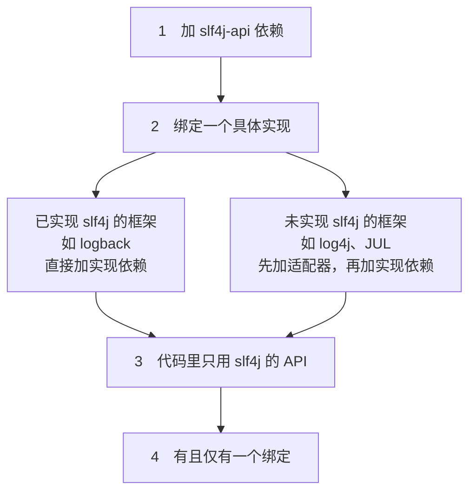
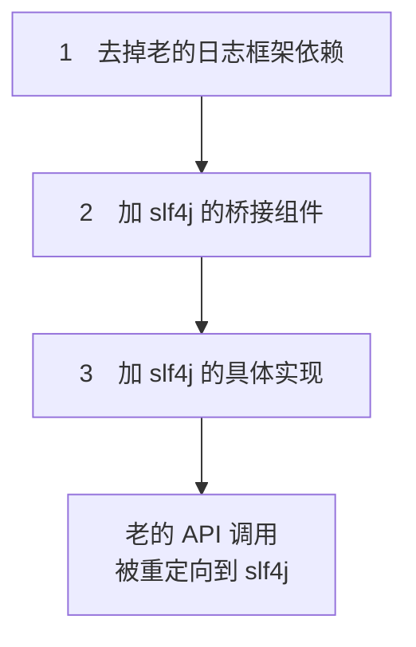
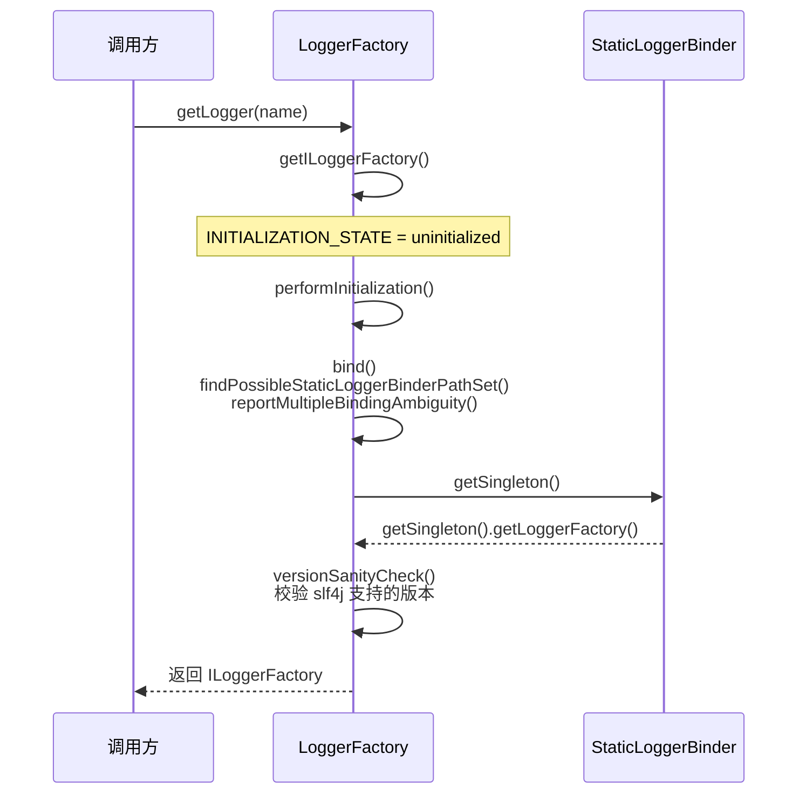
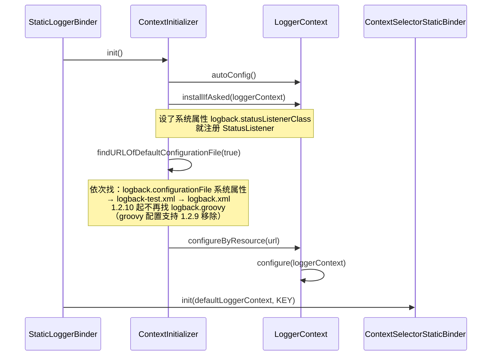

# slf4j（目前最常用的门面）

[[toc]]

slf4j 全称 Simple Logging Facade for Java，主要为了给 Java 日志访问提供一套标准、规范的 API 框架。它的意义在于只提供接口，具体实现交给其他日志框架（log4j、logback 等）。slf4j 自己也带了一个功能较简单的实现（`slf4j-simple`），但一般很少用到。通常在项目里用 `slf4j-api` 作门面，配上具体的实现框架，中间用绑定组件完成绑定。

slf4j 是使用最广的日志门面，提供两大功能：**日志框架的绑定**和**日志框架的桥接**。

使用 slf4j 作为门面的好处：

1. 可以在部署时迁移到所需的日志记录框架。
2. 提供了对所有流行日志框架的绑定，如 `slf4j-log4j12`、`slf4j-jdk14`、`slf4j-simple` 和 `slf4j-nop`，因此可以在部署时切换。
3. 无论用哪种绑定，都支持参数化日志记录消息。由于 slf4j 把应用程序和日志记录框架分离，可以写出独立于日志框架的应用程序。
4. 提供了一个简单的 Java 工具，称为迁移器，可以把现有项目的日志框架（如 JCL、log4j、JUL 等）迁移到 slf4j。

## 日志框架的绑定



classpath 上出现多个绑定时，slf4j 只负责打一条多绑定警告，并不自己挑：真正生效的是类加载器解析 `org/slf4j/impl/StaticLoggerBinder.class` 时命中的第一个，通常是 classpath 上排在前面的那个 jar，约等于依赖顺序，但不保证等于「第几个声明的依赖」。

## 日志框架的桥接

slf4j 附带了几个桥接模块，这些模块把对 log4j、JCL 和 JUL API 的调用重定向，就好像它们是对 slf4j API 一样。

桥接解决的是项目中日志的遗留问题：当系统中存在之前的日志 API 时，可以通过桥接转换到 slf4j 的实现。



## 用法

### 简单应用

添加依赖：

```xml
<!-- slf4j 日志门面 -->
<dependency>
    <groupId>org.slf4j</groupId>
    <artifactId>slf4j-api</artifactId>
    <version>1.7.30</version>
</dependency>

<!-- slf4j 内置的简单实现。只有门面没有实现时并不会抛异常：slf4j 打印 Failed to load class "org.slf4j.impl.StaticLoggerBinder"，然后退化为 NOP 实现 -->
<dependency>
    <groupId>org.slf4j</groupId>
    <artifactId>slf4j-simple</artifactId>
    <version>1.7.30</version>
</dependency>
```

Java 代码（下文示例统一用 lombok 的 `@Slf4j` 生成 `log` 变量、用 JUnit 的 `@Test` 运行，依赖片段里只列 slf4j 相关的部分；lombok 和 JUnit 需要另行引入）：

```java
package com.example;

import org.junit.Test;
import org.slf4j.Logger;
import org.slf4j.LoggerFactory;
import lombok.extern.slf4j.Slf4j;
// 方式一：使用lombok注解，引入log变量，可直接调用
@Slf4j
public class Slf4jTest {

	// 方式一：传入class
	private final static Logger logger = LoggerFactory.getLogger(Slf4jTest.class);
	// 方式二：传入className
	private final static Logger logger2 = LoggerFactory.getLogger(Slf4jTest.class.getName());

	// 快速入门
	@Test
	public void test01()throws Exception{
		// 日志输出
		logger.error("error");
		logger.warn("wring");
		logger.info("info"); // 默认级别
		logger.debug("debug");
		logger.trace("trace");

		// 使用占位符输出日志信息
		String name = "test";
		Integer age = 14;
		logger.info("用户：{},{}",name,age);

		// 将系统的异常信息输出
		try {
			int i = 1/0;
		} catch (Exception e) {
			// e.printStackTrace();
			logger.error("出现异常：",e);

		}
		// 直接调用lombok注解引入的log变量
		log.error("lombok");
	}
}
```

### 绑定具体实现

下面按目标框架列出常用的绑定/适配器依赖。**这些依赖按需选其一，不要全加**——classpath 上同时出现多个绑定，slf4j 会打多绑定警告，最终生效的只是类加载器命中的第一个。

```xml
<!--slf4j core 使用slf4j必须添加-->
<dependency>
	<groupId>org.slf4j</groupId>
	<artifactId>slf4j-api</artifactId>
	<version>1.7.30</version>
</dependency>

<!-- log4j-->
<!-- log4j适配器-->
<dependency>
	<groupId>org.slf4j</groupId>
	<artifactId>slf4j-log4j12</artifactId>
	<version>1.7.30</version>
</dependency>
<!-- log4j具体日志实现-->
<dependency>
	<groupId>log4j</groupId>
	<artifactId>log4j</artifactId>
	<version>1.2.17</version>
</dependency>

<!-- jul -->
<!-- jul适配器，由于jul是jdk默认实现的，因此不需要导入jul具体实现 -->
<dependency>
	<groupId>org.slf4j</groupId>
	<artifactId>slf4j-jdk14</artifactId>
	<version>1.7.30</version>
</dependency>

<!-- slf4j 绑定到 JCL：slf4j 的调用交给 JCL，由 JCL 再探测实现。方向少见，实际项目里几乎不用 -->
<dependency>
	<groupId>org.slf4j</groupId>
	<artifactId>slf4j-jcl</artifactId>
	<version>1.7.30</version>
</dependency>

<!-- nop -->
<dependency>
	<groupId>org.slf4j</groupId>
	<artifactId>slf4j-nop</artifactId>
	<version>1.7.30</version>
</dependency>

<!--logback 日志实现，出现的比slf4j迟，所以不需要适配器，直接日志实现就行-->
<dependency>
	<groupId>ch.qos.logback</groupId>
	<artifactId>logback-classic</artifactId>
	<version>1.2.11</version>
</dependency>
```

::: tip
用起来是 slf4j 的接口，实现换成哪一个，Java 代码都不变。
:::

`slf4j-jcl` 这条只有适配器、没有实现依赖，是因为它的方向是 slf4j 绑定到 JCL：slf4j 的调用交给 JCL 后，由 JCL 自己上 classpath 探测实现（log4j / JUL）。JCL 本身就是门面，所以这里不存在单独的「JCL 实现」可以加。

它的场景在 slf4j 官方文档里写得很具体：**你的组件自己按 slf4j 写代码，但它要嵌进去的那个宿主环境规定必须走 JCL**。这时用 `slf4j-jcl` 把 slf4j 的调用交回 JCL，宿主那套日志配置一行都不用动——你对 slf4j 的依赖对整个应用是透明的。官方原话是「useful after you have already adopted the SLF4J API for your component which needs to be embedded in a larger application environment where JCL is a formal requirement」。它跟 `slf4j-api` 同版本一起发布，装上就能用，不是废弃产物，也不是为了凑齐绑定列表才留着的。

要不要用它，看一个问题就够了：**这个环境里 JCL 是不是必须存在的**。是，就轮到它；不是，就别为它多绕一层——JCL 自己就是门面，拿它当 slf4j 的后端等于在 slf4j 后面再套一层探测，要 log4j 直接用 `slf4j-log4j12`、要 JUL 直接用 `slf4j-jdk14`。从 JCL 迁往 slf4j 的老项目里，干迁移的是反方向的 `jcl-over-slf4j`，不是它。

### 桥接遗留日志 API

换成 slf4j 之后，项目里原先用 log4j、JUL、JCL 写的代码不用逐行改：加上对应的桥接组件，这些老 API 的调用会被重定向到 slf4j。

```xml
<!-- log4j-->
<dependency>
    <groupId>org.slf4j</groupId>
    <artifactId>log4j-over-slf4j</artifactId>
    <version>1.7.30</version>
</dependency>

<!-- jul -->
<dependency>
    <groupId>org.slf4j</groupId>
    <artifactId>jul-to-slf4j</artifactId>
    <version>1.7.30</version>
</dependency>

<!--jcl -->
<dependency>
    <groupId>org.slf4j</groupId>
    <artifactId>jcl-over-slf4j</artifactId>
    <version>1.7.30</version>
</dependency>
```

::: warning 桥接与绑定不能混用成对
1. `jcl-over-slf4j.jar` 和 `slf4j-jcl.jar` 不能同时部署。前一个让 JCL 把日志系统的选择委托给 slf4j，后一个让 slf4j 把选择委托给 JCL，会形成无限循环。
2. `log4j-over-slf4j.jar` 和 `slf4j-log4j12.jar` 不能同时出现。
3. `jul-to-slf4j.jar` 和 `slf4j-jdk14.jar` 不能同时出现。
4. 所有的桥接都只对 Logger 日志记录器对象有效。如果程序中调用了内部的配置类或 Appender、Filter 等对象，桥接无法产生效果。
:::

## MDC（Mapped Diagnostic Context）

MDC 是 slf4j 提供的一组静态方法，用来往**当前线程**上挂一批 key-value，打日志时由实现决定要不要输出。它不参与级别过滤，只给日志附加一段上下文（traceId、userId 之类）。

- `MDC.put(key, value)`、`get(key)`、`remove(key)`、`clear()`，key 和 value 都是 String。这四个方法在 1.7 和 2.x 上没有差别。
- 数据按线程隔离。slf4j 自己不存，转发给实现：logback 用 `LogbackMDCAdapter`，log4j2 用 `ThreadContext`。绑定没有 MDC 能力时，行为还分两种：`slf4j-jdk14` 的 `StaticMDCBinder` 返回 `BasicMDCAdapter`，值真存在 `InheritableThreadLocal` 里，只是 JUL 的 pattern 取不到它，得自己取；`slf4j-simple`、`slf4j-nop` 返回 `NOPMDCAdapter`，`put` 是空实现，值直接丢掉。
- 输出由实现的 pattern 完成，取值写法：

| 实现 | pattern 里取值 |
|---|---|
| logback | `%X{traceId}`；不写 key 则输出全部，格式 `k1=v1, k2=v2`；取不到时输出空串，也可以写默认值 `%X{traceId:-unknown}` |
| log4j2 | `%X{traceId}`，别名 `%mdc{traceId}` |

```java
package com.example;

import org.junit.Test;
import org.slf4j.MDC;
import lombok.extern.slf4j.Slf4j;

@Slf4j
public class MdcTest {

	@Test
	public void testMdc() {
		// 放进当前线程，pattern 里的 %X{traceId} 就能取到
		MDC.put("traceId", "8f2a1c");
		try {
			log.info("下单开始");
		} finally {
			// 用完清除，否则线程被复用时下一个任务会带上这个 traceId
			MDC.remove("traceId");
		}
		log.info("下单结束"); // traceId 已清掉，这行不带上下文
	}
}
```

::: warning 线程池复用线程，MDC 必须清
MDC 挂在当前线程上，线程池的线程是复用的。任务里 `put` 了没清，同一个线程跑下一个任务时，`%X{key}` 会把上一个任务的值一起打出来，日志对不上人。放和清要成对：入口 `put`，`finally` 里 `clear()`（清掉当前线程的全部 key）或逐个 `remove()`。

反过来，提交任务时 MDC 也不会跟过去，子线程不继承父线程的 MDC。要让任务线程带上提交方的上下文，在提交前 `MDC.getCopyOfContextMap()` 存一份，在任务开头 `MDC.setContextMap()` 设回去。
:::

## 源码结构

slf4j 相当于一个抽象接口，它会判断 classpath 下是否存在 `StaticLoggerBinder` 类，并针对此类做相应处理，从而被其他日志 API 接入（比如 logback）。具体过程：

1. slf4j 通过 `LoggerFactory` 加载日志具体的实现对象。
2. `LoggerFactory` 在初始化过程中，会通过 `performInitialization()` 方法绑定具体的日志实现。
3. 绑定时通过类加载器加载 `org/slf4j/impl/StaticLoggerBinder.class`。
4. 所以，只要一个日志实现框架在 `org.slf4j.impl` 包中提供自己的 `StaticLoggerBinder` 类，并在其中提供具体日志实现的 `LoggerFactory`，就可以被 slf4j 加载。

`LoggerFactory` 首次 `getLogger()` 时的初始化过程：



`INITIALIZATION_STATE` 决定最终返回哪个工厂：

| 状态 | 返回 |
|---|---|
| `SUCCESSFUL_INITIALIZATION` | `StaticLoggerBinder.getSingleton().getLoggerFactory()` |
| `NOP_FALLBACK_INITIALIZATION` | `NOP_FALLBACK_FACTORY`（什么都不做）|
| `FAILED_INITIALIZATION` | 抛 `IllegalStateException(UNSUCCESSFUL_INIT_MSG)` |
| `ONGOING_INITIALIZATION` | `SUBST_FACTORY`（初始化期间的临时工厂）|

再往里一步，logback 的 `StaticLoggerBinder` 被 slf4j 加载后，会顺着 `ContextInitializer` 去找配置文件：



logback 配置文件的查找顺序与 groovy 支持的移除，详见 [logback 篇](./logback.md)。

## slf4j 2.x 的差异

::: warning 上文的机制是 1.7.x 的
`org.slf4j.impl.StaticLoggerBinder`、`getSingleton()`、`versionSanityCheck()` 以及上面那张状态常量表，都是 1.7.x 的实现。slf4j 2.x 换了一套查找机制，两边不能混着看。
:::

查找方式变了：1.7.x 靠类加载器找 `org/slf4j/impl/StaticLoggerBinder.class`；2.x 改用 JDK 的 `ServiceLoader` 找 `SLF4JServiceProvider` 实现（实现方在 jar 里放 `META-INF/services/org.slf4j.spi.SLF4JServiceProvider`）。1.7.x 把它叫绑定，2.x 把它叫 provider。取工厂的方法也随之从 `StaticLoggerBinder.getSingleton().getLoggerFactory()` 换成 `SLF4JServiceProvider.getLoggerFactory()`。

初始化状态常量没有变，`SUCCESSFUL_INITIALIZATION`、`NOP_FALLBACK_INITIALIZATION`、`FAILED_INITIALIZATION`、`ONGOING_INITIALIZATION` 在 2.x 里仍是这几个，`reportMultipleBindingAmbiguity()` 也还在，只是文案从 `Class path contains multiple SLF4J bindings.` 变成 `Class path contains multiple SLF4J providers.`。

::: warning 升 slf4j-api 不换实现，日志会直接消失
2.x 仍会扫 classpath 上的 `StaticLoggerBinder`，但只用来提示，不再拿它绑定：扫到就打 `Class path contains SLF4J bindings targeting slf4j-api versions 1.7.x or earlier.`，然后忽略。如果 slf4j-api 升到 2.x、实现却留在 1.7 那条线（logback 1.2.x、log4j-slf4j-impl 等），结果是找不到 provider，打印 `No SLF4J providers were found.`，退化成 NOP，日志一条都不出。

api 与 provider 的大版本、小版本必须一致：2.0.x 的 api 配 2.0.x 的 provider（patch 号可以不同）；用 2.0.x 的 provider 配 1.7.x 的 api，报的则是找不到绑定。2.0.9 起可以用系统属性 `slf4j.provider` 直接写 provider 类名，跳过 ServiceLoader 扫描。
:::

绑定 artifact 的对应关系：

| 1.7.x（绑定） | 2.x（provider） | 说明 |
|---|---|---|
| `slf4j-simple`<br>`slf4j-jdk14`<br>`slf4j-nop` | 同名，版本换成 2.0.x | 换版本即可 |
| `slf4j-log4j12` | `slf4j-reload4j` | reload4j 是 log4j 1.2 的维护分支；2.0.x 的 `slf4j-log4j12` 只剩一个 relocation POM，依赖会自动转到 `slf4j-reload4j` |
| `log4j-slf4j-impl` | `log4j-slf4j2-impl` | 前者 jar 里放的是 `StaticLoggerBinder`，后者是 provider（`org.apache.logging.slf4j.SLF4JServiceProvider`），从 log4j2 2.19.0 起提供 |
| `logback-classic` 1.2.x | `logback-classic` 1.3+ | 1.2.x 提供 `StaticLoggerBinder`，1.3 起改成 `META-INF/services` 方式（`ch.qos.logback.classic.spi.LogbackServiceProvider`） |

照着哪一套对照，看项目用的 Spring Boot：Spring Boot 3.0 起是 slf4j 2.x（3.0.0 配 `slf4j-api` 2.0.4 + logback 1.4.5，3.3.4 配 2.0.16 + logback 1.5.8），Spring Boot 2.7 还是 1.7.x（1.7.36 + logback 1.2.12）。换实现的 starter 也跟着换：`spring-boot-starter-log4j2` 在 2.7 里带 `log4j-slf4j-impl`，3.x 里带 `log4j-slf4j2-impl`。

2.0.0 起 `Logger` 增加了 fluent API：`atTrace()` / `atDebug()` / `atInfo()` / `atWarn()` / `atError()` 返回 `LoggingEventBuilder`，可以逐个 `addArgument()` / `addKeyValue()` / `setCause()`，最后必须调用 `log()` 系列方法，不调用就什么都不输出。默认实现下 `logger.atInfo().log("msg")` 与 `logger.info("msg")` 输出相同；级别被关掉时返回的是空实现，不额外产生开销。

## 总结

- 业务代码只依赖 `slf4j-api`，具体实现由绑定（2.x 叫 provider）决定，classpath 上有且只能有一个；出现多个时 slf4j 只用一个并打警告。
- 桥接与绑定方向相反，同一对框架不能同时出现（`jcl-over-slf4j` 与 `slf4j-jcl`、`log4j-over-slf4j` 与 `slf4j-log4j12`、`jul-to-slf4j` 与 `slf4j-jdk14`），否则调用绕成环；桥接只对 Logger 的调用有效，配置类、Appender、Filter 不受影响。
- 1.7.x 与 2.x 的绑定机制不同：前者找 `StaticLoggerBinder`，后者用 `ServiceLoader` 找 `SLF4JServiceProvider`，artifact 和版本要求都不一样。Spring Boot 2.x 用 slf4j 1.7，Spring Boot 3.x 用 slf4j 2.x，读依赖先分清自己属于哪一套。
- MDC 挂在当前线程上，线程池复用线程时必须清（`clear()` 或 `remove()`），否则串日志；要跨线程传递，得在提交前取一份 `getCopyOfContextMap()`，到任务线程里再 `setContextMap()` 设回去。

