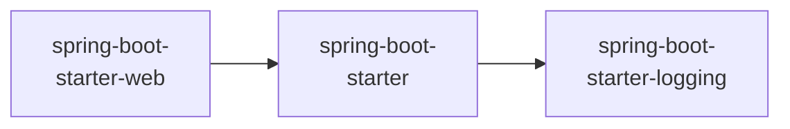
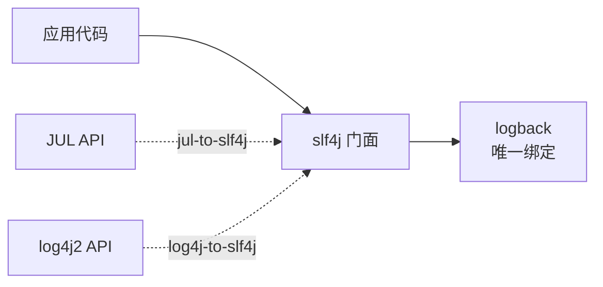
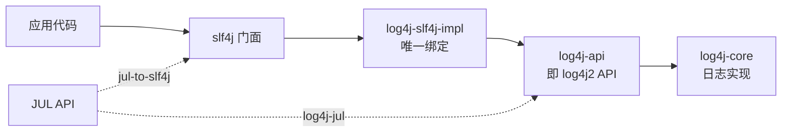

# Spring Boot 的日志体系

[[toc]]

Spring Boot 默认使用 slf4j 作为日志门面、logback 作为日志实现来记录日志。这套组合由 `spring-boot-starter-logging` 提供，而它并没有直接写在项目依赖里，是随 web starter 一起被带进来的：



所以项目只要引入 web starter，日志就已经能用了，不必再单独声明日志依赖。这套组合包含哪几个包、怎么整体换掉，见下文[日志依赖组合](#日志依赖组合)。

本文以 Spring Boot 4.1.1 为准。

## 日志依赖组合

这套组合是可换的：默认是 slf4j + logback，也可以整体换成 slf4j + log4j2。两种状态的差别只在「哪个实现被绑到 slf4j 上」——换的时候只改依赖，日志代码不动。

### 默认组合（slf4j + logback）

`spring-boot-starter-logging` 的依赖声明就一行：

```xml
<dependency>
  <artifactId>spring-boot-starter-logging</artifactId>
  <groupId>org.springframework.boot</groupId>
</dependency>
```



Spring 项目里还会看到 JCL 的 API（`org.apache.commons.logging.*`）。那一路由 `spring-core` 依赖的 `spring-jcl` 提供，它按 classpath 上的实现转接：`LogAdapter` 先看 log4j-api 在不在（`org.apache.logging.log4j.spi.ExtendedLogger`），若在、且 `log4j-to-slf4j` 的 `org.apache.logging.slf4j.SLF4JProvider` 也在，就刻意走 slf4j（完整的转接顺序见 [JCL 篇](./jcl.md)）——默认这套依赖下落到 slf4j 上。**但它不在 `spring-boot-starter-logging` 的依赖里**，所以上图画的是这个 starter 实际带的三样东西（`logback-classic`、`jul-to-slf4j`、`log4j-to-slf4j`；`slf4j-api` 是经 `logback-classic` 传递带入的）。

### 切换成 log4j2

以换成 log4j2 为例：需要从 `spring-boot-starter-web` 依赖中排除 `spring-boot-starter-logging`，然后加上 `spring-boot-starter-log4j2` 依赖。换完之后 slf4j 绑到的不再是 logback，而是 log4j2 的绑定 jar：



`log4j-slf4j-impl` 是 Spring Boot 2.x 里这个绑定 jar 的名字，3.x 起换成 `log4j-slf4j2-impl`（配 slf4j 2.x）；`jul-to-slf4j` 只在 2.x 的 starter 里，3.x 去掉了它，只留 log4j2 自己的 `log4j-jul`。

```xml
<dependency>
    <groupId>org.springframework.boot</groupId>
  	<artifactId>spring-boot-starter-web</artifactId>
    <exclusions>
<!--排除logback-->
      <exclusion>
            <artifactId>spring-boot-starter-logging</artifactId>
            <groupId>org.springframework.boot</groupId>
        </exclusion>
    </exclusions>
</dependency>

<!-- 添加log4j2 -->
<dependency>
    <groupId>org.springframework.boot</groupId>
    <artifactId>spring-boot-starter-log4j2</artifactId>
</dependency>
```

如果不排除 `spring-boot-starter-logging`，类路径上会同时出现两个绑定：

- `log4j-slf4j-impl`（由 `spring-boot-starter-log4j2` 带来）：slf4j → log4j2
- `log4j-to-slf4j`（`spring-boot-starter-logging` 里带的）：log4j2 API → slf4j

这一组合由 Apache log4j2 自己拦截：`log4j-slf4j-impl` 的 `Log4jLoggerFactory.validateContext()` 一旦发现类路径上存在 `log4j-to-slf4j` 的 `org.apache.logging.slf4j.SLF4JLoggerContext`，就直接抛出 `LoggingException`，异常信息原文是 "log4j-slf4j-impl cannot be present with log4j-to-slf4j"。所以症状不能简单归结为「配置改了但日志行为不变」——相关问题见 [log4j2 常见问题](./log4j2.md#log4j2-不输出日志)。

## 日志配置项

不写日志框架自己的配置文件时，日志行为由 Spring Boot 的 `logging.*` 配置项控制，日常最常改的调级别、落文件都用它们完成：

| 配置项 | 作用 |
|---|---|
| `logging.level.<logger-name>` | 设置指定 logger 的级别，`logging.level.root` 对应根 logger |
| `logging.file.name` | 日志文件名，绝对路径或相对当前目录 |
| `logging.file.path` | 日志文件目录，文件名固定为 `spring.log` |
| `logging.pattern.console` | 控制台输出格式 |
| `logging.pattern.file` | 文件输出格式 |
| `logging.config` | 日志配置文件的位置 |

```yaml
logging:
  level:
    root: warn
    org.springframework.web: debug
    org.hibernate: error
  file:
    name: logs/app.log
  pattern:
    console: "%d{HH:mm:ss.SSS} %-5level %logger{36} - %msg%n"
```

`logging.level.*` 在日志配置文件加载完之后才被应用——Spring Boot 先加载配置文件，再按这些属性逐个 `setLogLevel`——所以它总是覆盖配置文件里写的级别，与有没有自定义配置文件无关。

::: tip
`logging.file.name` 与 `logging.file.path` 是 Spring Boot 2.2 起的名字，之前是 `logging.file` 与 `logging.path`。两者同时配置时以 `logging.file.name` 为准；只配 `logging.file.path` 时，文件名固定为 `spring.log`。
:::

::: warning
`logging.file.*` 和 `logging.pattern.*` 只在没有自定义配置文件、走 Spring Boot 默认配置时才会自动落到输出上。一旦放上自己的 `logback-spring.xml`（或 `log4j2-spring.xml`），Spring Boot 就不再创建文件 appender，这些属性只是把值写进 `LOG_FILE`、`LOG_PATH`、`CONSOLE_LOG_PATTERN`、`FILE_LOG_PATTERN` 等属性，配置文件里要显式引用才会生效。
:::

## 指定配置

在类路径下放上每个日志框架自己的配置文件，Spring Boot 就不再使用默认配置：

| 日志框架 | 配置文件 |
|---|---|
| logback | `logback-spring.xml`<br>`logback.xml` |
| log4j2 | `log4j2-spring.xml`<br>`log4j2.xml` |
| JUL | `logging.properties` |

带 `-spring` 后缀的版本由 Spring Boot 加载，支持 Spring 特有的扩展（如按 profile 激活的 `<springProfile>`）；不带后缀的由日志框架自己加载。

::: warning
`logback.xml` 和 `logback-spring.xml` 同时存在时，生效的是前者。Spring Boot 先按标准位置查找 `logback-test.xml` / `logback.xml`，一旦命中就直接用它，根本不会去看 `logback-spring.xml`——于是 `<springProfile>` / `<springProperty>` 静默失效，配置看起来写了却没生效。这通常是「`<springProfile>` 不生效」的根因，想用它就只留 `logback-spring.xml` 一个文件。
:::

## 总结

- 默认组合是 slf4j + logback，由 `spring-boot-starter` 间接引入的 `spring-boot-starter-logging` 提供。这个 starter 的直接依赖有三样：`logback-classic`、`log4j-to-slf4j`、`jul-to-slf4j`；后两者是把 JUL、log4j2 API 的调用转接到 slf4j 上的桥接包，`slf4j-api` 则经 `logback-classic` 传递带入。
- 改级别、落文件、改格式这些常规调整用 `logging.*` 配置项就够了，不需要自己写日志配置文件；自己写配置文件时优先用 `-spring` 后缀的那份。
- 换实现改的是依赖：排除 `spring-boot-starter-logging` 再换入对应的 starter。不排除会让两个方向相反的绑定同时留在类路径上，日志会丢，甚至完全不输出。
- 放了 `logback-spring.xml` 就不要再留一个 `logback.xml`，后者会先被找到并直接生效，前者的 `<springProfile>` / `<springProperty>` 静默失效。
