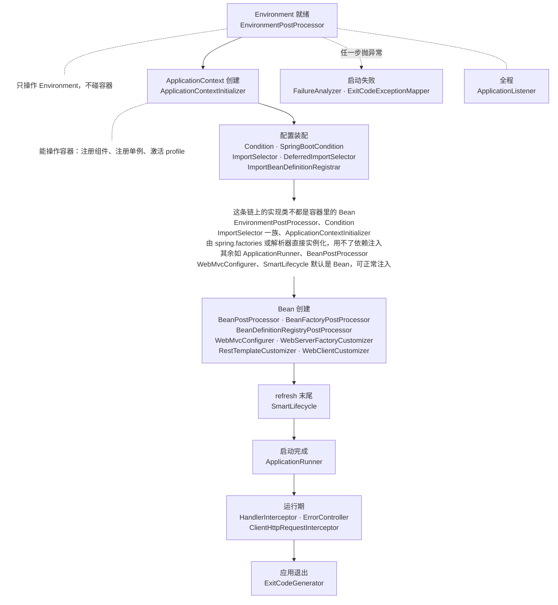

::: tip 这一组里混着两个项目定义的接口
其中一部分是 **Spring Framework** 定义的（包名 `org.springframework.*`，如 `BeanPostProcessor`、`SmartLifecycle`、`HandlerInterceptor`），另一部分是 **Spring Boot** 的（`org.springframework.boot.*`，如 `ApplicationRunner`、`FailureAnalyzer`、`EnvironmentPostProcessor`）。

放在一起讲，是因为写 Spring Boot 应用时它们是同一条启动链上的插口：整条链大半由 Framework 驱动，Boot 在几个关键位置补了自己的扩展点。这两类接口的用法完全一样——实现、注册、等框架回调——区别只在包名和归属。

下面表格的每一行都标了归属（`Spring` / `Boot`）。文章本体按归属分两处：标 `Spring` 的在 **Spring Framework → 回调接口** 分组下，标 `Boot` 的在 **Spring Boot → 回调接口** 分组下。
:::

Spring Boot 把启动流程切成固定的几个阶段，每个阶段都留了回调接口。这一组文章每篇讲一个扩展点：多数是一个接口，紧密相关的几个接口合在一篇。重点是它插在哪个位置、能拿到什么、写错了会怎样。

本组文章以 Spring Boot 3.5（Spring Framework 6.2）为准；归属 Spring Framework 的几篇，正文里另有各自的版本标注。

## 文章索引

| 阶段 | 接口 | 用途 | 时机 |
| --- | --- | --- | --- |
| Environment 就绪 | [EnvironmentPostProcessor](./environment-post-processor.md)<CategoryTag2>Boot</CategoryTag2> | 往 `Environment` 里加自定义属性源 | 容器创建之前 |
| 容器初始化 | [ApplicationContextInitializer](../../spring-framework/framework-callbacks/application-context-initializer.md)<CategoryTag1>Spring</CategoryTag1> | 定制刚创建出来的 `ApplicationContext` | 容器创建之后、refresh 之前 |
| refresh 容器 | [Condition](../../spring-framework/framework-callbacks/condition.md)<CategoryTag1>Spring</CategoryTag1> | 决定一个 Bean 要不要注册 | 解析配置类时 |
|  | [SpringBootCondition](./spring-boot-condition.md)<CategoryTag2>Boot</CategoryTag2> | 让条件的判断原因可读、能被条件评估报告记录 | 解析配置类时 |
|  | [ImportSelector<br/>DeferredImportSelector<br/>ImportBeanDefinitionRegistrar](../../spring-framework/framework-callbacks/import-selector.md)<CategoryTag1>Spring</CategoryTag1> | 按条件批量导入配置类 | 处理 `@Import` 时 |
|  | [WebServerFactoryCustomizer](./web-server-factory-customizer.md)<CategoryTag2>Boot</CategoryTag2> | 定制内嵌容器：端口、线程、访问日志 | 创建 WebServer 时 |
|  | [RestTemplateCustomizer<br/>WebClientCustomizer](./http-client-customizer.md)<CategoryTag2>Boot</CategoryTag2> | 定制出站 HTTP 客户端 | 客户端 Bean 创建时 |
|  | [BeanPostProcessor<br/>BeanFactoryPostProcessor<br/>BeanDefinitionRegistryPostProcessor](../../spring-framework/framework-callbacks/bean-post-processor.md)<CategoryTag1>Spring</CategoryTag1> | 在 Bean 初始化的前后插手，修改或包装 Bean 实例 | 实例化 Bean 时 |
|  | [WebMvcConfigurer](../../spring-framework/framework-callbacks/web-mvc-configurer.md)<CategoryTag1>Spring</CategoryTag1> | 向 Spring MVC 提交配置：拦截器、跨域、格式化器、参数解析器 | 收集 MVC 配置时 |
| refresh 末尾 | [SmartLifecycle](../../spring-framework/framework-callbacks/smart-lifecycle.md)<CategoryTag1>Spring</CategoryTag1> | 需要按顺序启停的后台组件 | 启动（早于 Runner）/ 关闭时 |
| 启动完成 | [ApplicationRunner](./application-runner.md)<CategoryTag2>Boot</CategoryTag2> | 启动后执行一次：缓存预热、建连、加载初始数据 | refresh 完成之后、`ApplicationReadyEvent` 之前 |
| 全程 | [ApplicationListener](../../spring-framework/framework-callbacks/application-listener.md)<CategoryTag1>Spring</CategoryTag1> | 监听应用事件 | 事件发布时，不固定在某个节点 |
| 启动失败 | [FailureAnalyzer](./failure-analyzer.md)<CategoryTag2>Boot</CategoryTag2> | 启动失败时给出可读的排查提示 | 启动过程抛异常时 |
|  | [ExitCodeExceptionMapper](./exit-code-generator.md)<CategoryTag2>Boot</CategoryTag2> | 把启动异常映射成退出码 | 启动过程抛异常时 |
| 运行期 | [HandlerInterceptor](../../spring-framework/framework-callbacks/handler-interceptor.md)<CategoryTag1>Spring</CategoryTag1> | 请求进入 Controller 前后的处理 | 每次请求 |
|  | [ErrorController](./error-controller.md)<CategoryTag2>Boot</CategoryTag2> | 统一的错误响应 | 请求处理出错时 |
|  | [ClientHttpRequestInterceptor](../../spring-framework/framework-callbacks/client-http-request-interceptor.md)<CategoryTag1>Spring</CategoryTag1> | 出站请求的拦截 | 每次出站调用 |
| 应用退出 | [ExitCodeGenerator](./exit-code-generator.md)<CategoryTag2>Boot</CategoryTag2> | 定制进程退出码 | 退出时 |

## 共同点：框架调你，你不调它

这组接口的用法一致：实现接口，交给框架在固定时机回调。你的代码里找不到对它的调用——**调用方向是反的**。不同接口的注册途径分两种：一部分注册成容器里的 Bean（`ApplicationRunner`、`BeanPostProcessor`、`WebMvcConfigurer` 等），另一部分不由容器管理，靠 `spring.factories` 或解析器直接实例化（`EnvironmentPostProcessor`、`FailureAnalyzer`、`Condition`、`ApplicationContextInitializer`）。下图标出了哪些实现类是 Bean、哪些不是。

```java
@Component
public class CacheWarmUpRunner implements ApplicationRunner {

    @Override
    public void run(ApplicationArguments args) {
        // 不需要在任何地方调它，Spring Boot 启动到这一步会自己来
    }
}
```

判断一个接口属不属于这一类，看**它的方法由谁触发**就够了：框架在固定时机回来调你，就是回调；由业务代码主动调用就不是。注册途径（交给容器，还是靠 `spring.factories`）只是实现细节，不改变它是不是回调——`Binder` 那种就不是回调，因为它由业务代码主动调用，交不交给容器都无所谓。

## 为什么要有它们

框架的启动流程、请求处理流程、Bean 的生命周期都是定死的。回调接口把这套固定流程和「你要插进去的逻辑」解开：不需要继承框架的类去覆写方法，也不需要改配置挂钩子，实现接口 + 注册即可，框架走到对应节点会找到你。

代价是**时机由框架定**。你只能选「在哪一类接口上实现」，通常没法微调它被调用的精确位置——少数接口留了顺序控制，比如 `@Order`、`getPhase()`。

## 各接口插在流程的哪个位置

下面这条线的顺序不是随便排的，它跟着 Spring Boot 启动流程本身的推进走：先准备环境、再建容器、接着装配配置、然后创建 Bean，直到应用启动完成、进入运行期，最后退出。接口排在哪一段，就决定了它在哪个阶段拿到控制权：



越靠前的接口能改的东西越底层，出错的代价也越大：在 `EnvironmentPostProcessor` 里抛异常，容器还没建起来，应用直接启动失败且错误信息有限；到了 `ApplicationRunner`，容器已经完整，至少能拿到日志和依赖。

