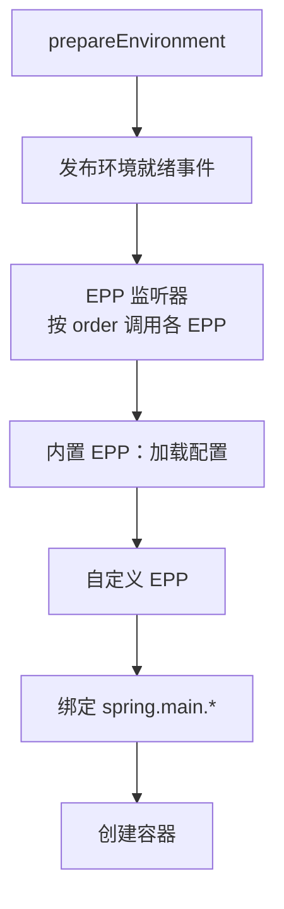

# EnvironmentPostProcessor
[[toc]]

`EnvironmentPostProcessor` 的回调点很靠前：`Environment` 已经就绪（命令行参数、系统属性、环境变量这类默认属性源都在里面），`ApplicationContext` 还没创建。在这一步往 `Environment` 里加属性源，后面所有读配置的环节——`logging.*`、`spring.main.*`、`@ConfigurationProperties` 绑定——都能看到它。至于 `application.yml` 的内容在不在，取决于你的实现排在配置加载之前还是之后，见「执行顺序」一节。

本文以 Spring Boot 3.5 为准。

它的实现类不是 Bean。你在任何配置类里都注入不到它，容器也管不到它：它由 `META-INF/spring.factories` 注册，由 Spring Boot 在容器存在之前反射实例化。

## 什么时候需要它

它的回调点靠前、又只对 `Environment` 动手，所以适合处理「配置本身还没定下来」的事。几个典型场景：

**从外部系统取配置。** 配置的源头不在文件里，而在配置中心、数据库的配置表、密钥管理服务里，应用启动时得把它们取回来。这类值没法写进 `application.yml`，`@PropertySource` 又太晚——在这个回调点把取回来的配置作为属性源加进去，后续所有读配置的环节都能看到。

**解密配置文件里的敏感值。** 数据库密码、API 密钥以密文形式写在配置里，需要在使用之前解出来。做这件事的实现要排在配置加载**之后**（否则 `application.yml` 的内容还没进 `Environment`，没有东西可解），解出的明文覆盖回属性源即可。

**加载 classpath 之外的配置文件。** 配置文件在哪由部署时的环境变量给出，jar 里不知道，启动时才能确定。官方文档里 `EnvironmentPostProcessor` 的示例演示的是从 classpath 指定路径读入、再用 `addLast` 兜底；把它换成由环境变量给出的位置，就是本场景。

**给公共库或 starter 补默认配置。** 你写的库要被多个项目引用，希望对方不做任何配置就能跑起来，可以在这一步补一组默认值。用 `addLast` 加在属性源末尾，优先级最低——使用者只要自己配了同名属性，覆盖的仍然是他的值。

**强制覆盖或校验关键配置。** 有些属性不该被误改，比如把 `spring.jpa.hibernate.ddl-auto` 锁死在 `validate`，防止有人顺手写成 `update` 改了生产表结构；也可以用于合并散落多处的同一个值，比如把几个来源里的 `spring.flyway.locations` 拼成一个列表。

::: warning 别用 `@PropertySource` 替代
`@PropertySource` 挂上去的属性源要等容器 refresh 才进 `Environment`，晚于 `logging.*`、`spring.main.*` 的读取时机，也晚于 `spring.config.*` 驱动的配置加载。Spring Boot 文档在讲 `EnvironmentPostProcessor` 的地方明确不推荐拿它加载自定义资源。
:::

## 接口定义

整个接口只有一个方法：

```java
@FunctionalInterface
public interface EnvironmentPostProcessor {

    void postProcessEnvironment(ConfigurableEnvironment environment, SpringApplication application);

}
```

两个参数分工明确：`environment` 是要改的目标；`application` 是本次启动的 `SpringApplication` 实例，可以从它那里取 `getResourceLoader()`、`getAdditionalProfiles()` 这类上下文。

方法没有 `throws` 子句，要报错只能抛非受检异常。接口自 Spring Boot 1.3.0 起存在，包名 `org.springframework.boot.env`。

## 注册方式

写在 `META-INF/spring.factories` 里，key 用接口全限定名：

```properties
org.springframework.boot.env.EnvironmentPostProcessor=\
com.example.config.ExternalConfigEnvironmentPostProcessor
```

文件放在 `src/main/resources/META-INF/spring.factories`。同一份文件可以承载多个 key，值过长时用反斜杠续行。把这个文件打进一个公共依赖 jar，则所有依赖该 jar 的应用都会执行它——这是「统一给多个应用加一段配置逻辑」的常规做法。

::: tip Spring Boot 3 没有换注册文件
`META-INF/spring/<FQN>.imports` 这套新格式覆盖的是自动配置（`AutoConfiguration.imports`）、`ManagementContextConfiguration` 和测试切片注解，**不覆盖 `EnvironmentPostProcessor`**。Boot 3.5 里自带的那批 EPP 仍然写在 `spring.factories`，加载入口 `EnvironmentPostProcessorsFactory.fromSpringFactories` 读的也还是 `META-INF/spring.factories`。所以 2.x 和 3.x 写法完全一致，升级时这一项不用动。
:::

::: warning Boot 4 换了包
`org.springframework.boot.env.EnvironmentPostProcessor` 自 Boot 4.0.0 起标记为废弃（计划 4.2.0 移除），替代品是挪到 `org.springframework.boot` 包下的同名接口，方法签名不变，注册方式也没变。跨大版本升级时留意 import 语句。
:::

## 一个完整的例子

读一个由属性 `external.config.location` 指定的 YAML 文件，把它加成属性源。加载顺序上选了 `addLast`：

```java
package com.example.config;

import java.io.IOException;
import java.util.List;

import org.apache.commons.logging.Log;
import org.springframework.boot.SpringApplication;
import org.springframework.boot.env.EnvironmentPostProcessor;
import org.springframework.boot.env.YamlPropertySourceLoader;
import org.springframework.boot.logging.DeferredLogFactory;
import org.springframework.core.env.ConfigurableEnvironment;
import org.springframework.core.env.PropertySource;
import org.springframework.core.io.DefaultResourceLoader;
import org.springframework.core.io.Resource;
import org.springframework.core.io.ResourceLoader;
import org.springframework.util.StringUtils;

public class ExternalConfigEnvironmentPostProcessor implements EnvironmentPostProcessor {

    private final YamlPropertySourceLoader loader = new YamlPropertySourceLoader();

    private final Log log;

    public ExternalConfigEnvironmentPostProcessor(DeferredLogFactory logFactory) {
        this.log = logFactory.getLog(getClass());
    }

    @Override
    public void postProcessEnvironment(ConfigurableEnvironment environment, SpringApplication application) {
        String location = environment.getProperty("external.config.location");
        if (!StringUtils.hasText(location)) {
            this.log.info("未配置 external.config.location，跳过外部配置加载");
            return;
        }
        ResourceLoader resourceLoader = application.getResourceLoader() != null ? application.getResourceLoader()
                : new DefaultResourceLoader();
        List<PropertySource<?>> propertySources = load(resourceLoader.getResource(location));
        propertySources.forEach(propertySource -> environment.getPropertySources().addLast(propertySource));
        this.log.info("已加载外部配置：" + location);
    }

    private List<PropertySource<?>> load(Resource resource) {
        try {
            return this.loader.load("external-config", resource);
        }
        catch (IOException ex) {
            throw new IllegalStateException("加载外部配置失败：" + resource, ex);
        }
    }
}
```

三点值得留意。

- **属性源的位置是自己定的。** `addLast` 表示优先级最低，`application.yml`、命令行参数、环境变量都能覆盖它，适合「给默认值兜底」；反过来要让外部配置说了算就换 `addFirst`。文档示例用的是 `addLast`，理由相同。
- **文件位置从 `environment` 里读。** 能这么做是因为这个 EPP 排在配置加载之后（见下一节），`application.yml` 里的值此时已经在 `Environment` 中。
- **构造器注入了 `DeferredLogFactory`。** 这是 Boot 2.4 起对 EPP 的额外支持，原因见「坑」一节。

## 执行顺序

顺序用 `Ordered` 接口或 `@Order` 注解声明，没声明就等价于 `Ordered.LOWEST_PRECEDENCE`。排序发生在 `SpringFactoriesLoader` 把类实例化出来之后（统一走 `AnnotationAwareOrderComparator`），注解写在类上即生效，不需要在 `spring.factories` 里做任何手脚。

内置的几个 EPP 用 order 值划出了自己的位置：

| 实现 | order | 负责什么 |
| --- | --- | --- |
| `RandomValuePropertySourceEnvironmentPostProcessor` | `Ordered.HIGHEST_PRECEDENCE + 1` | 把 `random.*` 属性源加进 `Environment` |
| `SpringApplicationJsonEnvironmentPostProcessor` | `Ordered.HIGHEST_PRECEDENCE + 5` | 解析 `spring.application.json` / `SPRING_APPLICATION_JSON` 里的 JSON，作为属性源加进去，优先级高于系统属性 |
| `ConfigDataEnvironmentPostProcessor` | `Ordered.HIGHEST_PRECEDENCE + 10` | 加载并应用 ConfigData——`application.properties`、`application.yml`，以及 `spring.config.*` 驱动的那些配置文件 |

自定义 EPP 用默认 order 时排在 `ConfigDataEnvironmentPostProcessor` 后面，所以文件里的配置可用；反过来，要影响 `spring.config.*` 这类控制配置加载自身的开关，order 得取比 `+10` 更小（优先级更高）的值——Boot 自己的 JSON 属性源取 `+5` 就是这个位置。

## 执行时机



承接 EPP 的是 `EnvironmentPostProcessorApplicationListener`（Spring Boot 2.4.0 起），它监听 `ApplicationEnvironmentPreparedEvent`，默认 order 为 `Ordered.HIGHEST_PRECEDENCE + 10`。同一个监听器还兼管 `ApplicationPreparedEvent` 和 `ApplicationFailedEvent`，用途是把延迟日志切到真正的 logger。

它和 [`ApplicationContextInitializer`](../../spring-framework/framework-callbacks/application-context-initializer.md) 的分界线就是「容器有没有创建」：EPP 面对的是一个还没有容器的 `Environment`；再往后的回调点是 [`ApplicationRunner`](./application-runner.md)。

## 坑

- **日志要用 `DeferredLog`。** 日志级别的配置由 `LoggingApplicationListener` 处理，它的 order 是 `HIGHEST_PRECEDENCE + 20`，排在 EPP 监听器之后——EPP 执行时日志系统还没按 `logging.*` 配好。直接 `LoggerFactory.getLogger(...)` 打出来的内容要么被丢掉、要么走默认配置。做法是构造器注入 `DeferredLogFactory`，拿到的 `Log` 会先把消息攒着，等 `ApplicationPreparedEvent` 或 `ApplicationFailedEvent` 到达时再补发。不接收注入、自己 `new DeferredLog()` 也可以，但要记得在合适的时机调 `replayTo(YourClass.class)`。
- **拿不到 Bean。** 没有容器，`@Autowired`、`@Value`、`@PostConstruct` 全都无效，EPP 实例是反射造出来的，不是容器里的 Bean。
- **构造器有要求。** 要么无参构造器，要么构造器参数只声明 `DeferredLogFactory`、`ConfigurableBootstrapContext` 这两类 Boot 能提供的类型（`BootstrapContext` / `BootstrapRegistry` 也可以）。声明了别的类型会在实例化阶段直接失败。
- **key 写错是静默失效。** `spring.factories` 里的 key 拼错、类名写错（不存在的类名会报错，但 key 写错不会），结果都是「什么都没发生」，启动照常成功。
- **抛异常直接中断启动。** 此时容器还没建起来，`FailureAnalyzer` 手里的信息有限，报错信息通常不如 refresh 阶段的异常可读。

## 与其他回调的取舍

| 回调 | 容器状态 | 能改什么 | 注册方式 |
| --- | --- | --- | --- |
| `EnvironmentPostProcessor` | 尚未创建 | 只有 `Environment` | `spring.factories` |
| `ApplicationContextInitializer` | 已创建、未 refresh | `Environment` + 容器本身 | `spring.factories`<br/>`addInitializers`<br/>`context.initializer.classes`（≤3.3） |
| `ApplicationRunner` | 已 refresh、Bean 就绪 | 随便改，但抛异常会中断启动 | 交给容器管理即可 |

选哪个取决于要改的东西什么时候必须生效：改 `logging.*`、`spring.main.*` 只能选 EPP，因为那两个属性的读取时机早于容器创建；能给容器注册东西（监听器、后处理器、单例）就已经不是 EPP 的职责范围了。
