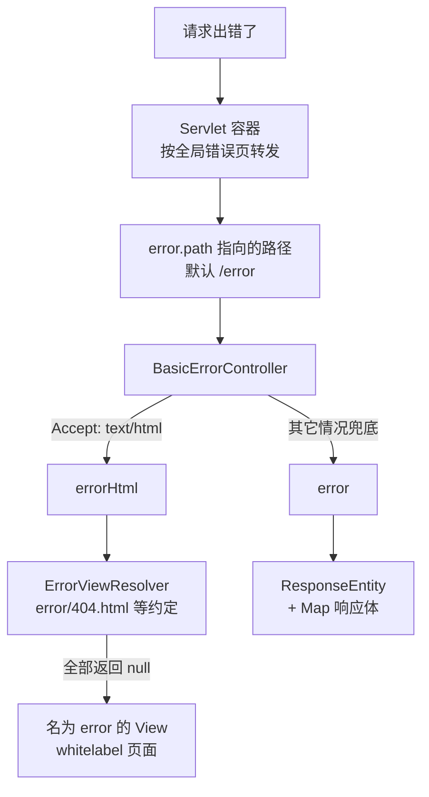

# ErrorController
[[toc]]

`ErrorController` 是个标记接口，它自己没有任何方法——Javadoc 只有一句「Marker interface used to identify a `@Controller` that should be used to render errors」。真正干活的是它背后的那条链路：Spring Boot 把一个 `/error` 路径注册成 Servlet 容器的**全局错误页**，容器在出错时把请求转发过来，由 `BasicErrorController` 接住，再从 `ErrorAttributes` 里取字段拼出响应体。

本文以 Spring Boot 3.x 为准（含 3.3 起新增的 ?path 参数）。

这条链路的价值在于「兜底」：它处理的是所有没被更早处理的错误，包括 MVC 异常解析器管不到的那些。理解它的关键是搞清楚请求是怎么走到 `/error` 的。

## 什么时候需要它

它站在错误链路的末端，处理的是「没有别的地方认领」的错误，所以需要它的场合基本都跟「统一」有关：

**ErrorAttributes：前端要一套固定结构的错误体。** 默认响应体是 `timestamp` / `status` / `error` / `path` 那套，前端要么逐个接口判字段在不在，要么自己写一层兼容。换成约定的 `code` / `message` / `data` 之后，前端只写一处解析。前提是这套结构得覆盖所有出错路径——只在一个接口、一种异常上改，等于把兼容逻辑又推回给调用方。

**ErrorAttributes：错误响应里要带上追踪号或业务错误码。** 这两样都不在 `ErrorAttributes` 的字段清单里，得自己实现 `ErrorAttributes` 把它们补进 Map：业务错误码从异常对象上取，追踪号从当前线程的 MDC 里取（就是日志关联用的 `%X{traceId}` 那几个键）。前提是错误发生时这些东西还在——异常本身已经被 `DefaultErrorAttributes` 存进了请求属性，它同时也是拼这些字段时能拿到的输入。

**ErrorController：MVC 之外的错误也要同一套格式。** Filter 里抛出的异常、`response.sendError()` 发出的响应，都不经过 `DispatcherServlet`，`@ExceptionHandler` 和 `@ControllerAdvice` 都拿不到；这类错误由容器按全局错误页转发到 `/error`。想让「所有出错的响应」真的是所有，就得在这里收口。

**ErrorController：浏览器看到的错误页要换成自己的。** 应用同时给人看页面、给程序调接口时，接口侧是 JSON，浏览器侧拿到的是那张 whitelabel 白页。换掉它不用写 Java：往静态资源目录或模板目录放 `error/404.html`、`error/5xx.ftlh` 就行，文件名按状态码或状态码段匹配；要按请求内容决定才用 `ErrorViewResolver`。

**ErrorAttributes：排查线上问题时想临时看到异常信息。** `message` 和 `trace` 默认都不返回（`include-message` / `include-stacktrace` 都是 `never`），线上报错时只能去翻日志。改成 `on_param` 后可以用 `?trace`、`?message` 这类请求参数临时打开，代价是开关落在调用方手里——外网可达的服务不要这么配。

## 请求是怎么走到 /error 的



对应到具体组件，每一步都是可查的：

| 步骤 | 由谁完成 |
| --- | --- |
| 把 `/error` 注册成容器的全局错误页 | `ErrorMvcAutoConfiguration.ErrorPageCustomizer`，它实现了 `ErrorPageRegistrar`，注册时只给了路径、没给状态码，因此 `ErrorPage#isGlobal()` 为 `true`，匹配所有未被单独处理的错误 |
| 出错时转发到 `/error` | Servlet 容器的错误页机制（`DispatcherType.ERROR` 的一次转发） |
| 接住 `/error` | `BasicErrorController` 的类上写着 `@RequestMapping("${server.error.path:${error.path:/error}}")`，占位符里保留了一个更老的属性名 `error.path` 作后备 |
| 组装响应体 | `ErrorAttributes`（默认实现 `DefaultErrorAttributes`）配合 `ErrorAttributeOptions` |

路径本身可以改：`server.error.path` 的默认值是 `/error`，改这个属性就能换掉错误页路径，`BasicErrorController` 的映射会跟着走。

`ErrorAttributes` 的默认实现还被注册成了**最高优先级的异常解析器**——`DefaultErrorAttributes` 同时实现 `ErrorAttributes`、`HandlerExceptionResolver` 和 `Ordered`，`getOrder()` 返回 `Ordered.HIGHEST_PRECEDENCE`，它的 `resolveException` 只做一件事：把异常存进请求属性后返回 `null`。返回 `null` 表示「我不处理这个异常」，继续交给后面的解析器——但字段已经存好了，等请求转发到 `/error` 时 `DefaultErrorAttributes` 就有东西可读。这就是「错误信息不会因为异常被别的解析器接走而丢失」的原因。

## BasicErrorController 的两个入口

它用两个方法区分「给人看」和「给程序看」，靠的是 `produces`：

| 方法 | 匹配条件 | 返回 | 做什么 |
| --- | --- | --- | --- |
| `errorHtml` | `produces = text/html` | `ModelAndView` | 把状态码写回响应，然后用 `ErrorViewResolver` 找错误视图，找不到就用名为 `error` 的默认视图 |
| `error` | 无 `produces`，兜底其余所有请求 | `ResponseEntity<Map<String, Object>>` | 拿 `ErrorAttributes` 的 Map 当响应体，状态码取当前错误的状态码 |

`error` 还有一个不显眼的分支：状态码是 `204` 时，它直接返回只有状态码、没有响应体的结果（`errorHtml` 里没有这个判断）。

状态码从哪来？`AbstractErrorController#getStatus` 的取值顺序是：先读请求属性 `RequestDispatcher.ERROR_STATUS_CODE`，拿不到默认为 500；读到但解析不成 `HttpStatus` 时，同样退回 500。

## ErrorAttributes 提供哪些字段

`DefaultErrorAttributes` 的类注释列出了一份字段清单，「when possible」指的是受 `ErrorAttributeOptions` 控制——`server.error.include-*` 系列属性最终就落到这个选项对象上。

| 字段 | 内容 | 默认是否出现 |
| --- | --- | --- |
| `timestamp` | 错误被提取的时间 | 有（不在可过滤的枚举里） |
| `status` | HTTP 状态码；请求属性里没有时是 `999`、`error` 为 `None` | 有 |
| `error` | 状态码对应的原因短语 | 有 |
| `path` | 出错请求的路径（属性 `RequestDispatcher.ERROR_REQUEST_URI`） | 有（`server.error.include-path` 默认 `always`） |
| `exception` | 根异常的类名 | 默认不出现（`server.error.include-exception` 默认 `false`） |
| `message` | 异常消息，取值顺序：`RequestDispatcher.ERROR_MESSAGE` 属性 → `ex.getMessage()` → `No message available` | 默认不出现（`server.error.include-message` 默认 `never`） |
| `trace` | 异常堆栈的字符串 | 默认不出现（`server.error.include-stacktrace` 默认 `never`） |
| `errors` | 校验错误，来自异常里的 `BindingResult` | 默认不出现（`server.error.include-binding-errors` 默认 `never`） |

控制这些可选字段的属性有两种形态：

- `include-stacktrace`、`include-message`、`include-binding-errors`、`include-path` 是枚举 `IncludeAttribute`，取值三态 `never` / `always` / `on_param`。
- `include-exception` 是布尔值，只有开和关两种取值。

选 `on_param` 的那几类可以靠请求参数临时打开：`?trace`、`?message`、`?errors`，以及 Boot 3.3.0 起支持的 `?path`（`AbstractErrorController#getPathParameter`）。参数值为 `false` 视为关闭，其它任何值都算打开。这个口子方便排查线上问题，但等于把开关交给了调用方，别在生产环境用它暴露堆栈。

## server.error 下的配置项

| 属性 | 默认值 | 作用 |
| --- | --- | --- |
| `server.error.path` | `/error` | 错误页路径，同时决定 `BasicErrorController` 的映射 |
| `server.error.include-exception` | `false` | 是否带 `exception` 字段 |
| `server.error.include-message` | `never` | 是否带 `message` 字段 |
| `server.error.include-stacktrace` | `never` | 是否带 `trace` 字段 |
| `server.error.include-binding-errors` | `never` | 是否带 `errors` 字段 |
| `server.error.include-path` | `always` | 是否带 `path` 字段 |
| `server.error.whitelabel.enabled` | `true` | 是否启用内置的 whitelabel 错误页 |

HTML 分支的视图解析走约定：先在模板目录找 `error/<状态码>.<后缀>`，再找静态资源目录下的 `error/<状态码>.html`，然后按状态码段找 `4xx` / `5xx`，最后才落到 whitelabel 页面。也就是说，把 `404.html` 放进 `src/main/resources/static/error/` 就能替换掉默认的 404 页面，不需要写任何 Java 代码。whitelabel 那一层还有条件：不仅 `server.error.whitelabel.enabled` 要为 `true`，还得没找到任何错误模板，两个条件都满足才会注册名为 `error` 的那个 `View`。

## 两种自定义方式

请求链路里有两个角色可以替换：接住 `/error` 的控制器，和拼响应字段的属性对象。

### 替换 ErrorController

官方文档给的说法是「To replace the default behavior completely, you can implement `ErrorController` and register a bean definition of that type」。可行是因为默认的那个 Bean 上带条件是 `@ConditionalOnMissingBean(ErrorController.class)`——只要容器里已经有你自己的 `ErrorController` Bean，`BasicErrorController` 就不会注册。

实现有两条路：

- 直接实现标记接口。
- 继承 `BasicErrorController` 复用它的两个入口再加自己的。

加一种新的响应格式（比如 `produces = application/problem+json`）属于后者：

```java
@Controller
public class CustomErrorController extends BasicErrorController {

    public CustomErrorController(ErrorAttributes errorAttributes, ErrorProperties errorProperties) {
        super(errorAttributes, errorProperties);
    }

    @RequestMapping(produces = MediaType.APPLICATION_PROBLEM_JSON_VALUE)
    public ResponseEntity<Map<String, Object>> errorJson(HttpServletRequest request) {
        HttpStatus status = getStatus(request);
        Map<String, Object> body = getErrorAttributes(request, ErrorAttributeOptions.defaults());
        return new ResponseEntity<>(body, status);
    }
}
```

`@Controller` 不能省：`ErrorController` 只是让 Spring Boot 认出「哪些 Bean 是错误控制器」的标记，真正让这个 Bean 能被请求命中的，是 MVC 对 `@Controller` / `@RequestMapping` 的类型判断。

::: tip AOP 代理下的一个隐性处理
`ErrorMvcAutoConfiguration` 里还注册了一个 `PreserveErrorControllerTargetClassPostProcessor`，它在所有 `ErrorController` 的 Bean 定义上设置 `AutoProxyUtils.PRESERVE_TARGET_CLASS_ATTRIBUTE`。作用是：这些 Bean 被 AOP 代理时，代理类保留目标类的类型信息，MVC 才能正常识别出控制器、并正确读取方法上的 `@RequestMapping`。
:::

### 替换 ErrorAttributes

只想改响应内容、保留现有链路时，注册一个自己的 `ErrorAttributes` Bean 即可——默认实现同样带 `@ConditionalOnMissingBean(ErrorAttributes.class)`，容器里已有你自己的 `ErrorAttributes` 时它就不再注册。两种做法：

- 实现接口从零拼 Map。
- 继承 `DefaultErrorAttributes` 覆写 `getErrorAttributes` / `getMessage`，在默认字段基础上增删。

## 和 @ControllerAdvice 怎么选

这是同一件事的两种粒度，官方文档的原话是「You can also use regular Spring MVC features such as `@ExceptionHandler` methods and `@ControllerAdvice`. The ErrorController then picks up any unhandled exceptions」——先 MVC 层处理，处理不了的交 `ErrorController` 兜底。

| 对比项 | 替换 ErrorController | `@ControllerAdvice` + `@ExceptionHandler` |
| --- | --- | --- |
| 生效位置 | 容器的全局错误页，转发到 `/error` 之后 | `DispatcherServlet` 内部，异常解析器链上 |
| 覆盖范围 | 所有走到容器错误页的错误，包括 MVC 之外的来源（Filter 里抛的异常、`sendError` 调用） | 仅在 `DispatcherServlet` 处理请求过程中产生、且没被更早的解析器接走的异常 |
| 粒度 | 一个入口统一处理 | 按异常类型、按包（`basePackageClasses`）细分，可写多个方法 |
| 响应体来源 | `ErrorAttributes` 拼出的 Map | 自己决定，不再走 `ErrorAttributes` |
| 典型用途 | 统一所有接口的错误响应格式（含 404、容器级错误） | 按业务异常映射状态码和响应体，做细粒度区分 |

两者不冲突，实际项目里常见的组合是：`@ControllerAdvice` 处理业务异常（能精确控制状态码和外层结构），`ErrorController` 负责剩下的不知道该怎么办的错误。

## 几个容易踩的点

- **默认 JSON 里没有 `message` 和 `trace`**。`include-message` 和 `include-stacktrace` 默认都是 `never`，排查时先确认是不是压根没开，再去找代码问题。
- **自定义 `ErrorPage` 交给 Filter 处理时要显式声明 ERROR 分发**。如果你用 `ErrorPageRegistrar` 注册了别的错误页路径，而那个路径由一个非 Spring 的 Filter（官方举例 Jersey、Wicket）处理，必须把这个 Filter 注册成 `DispatcherType.ERROR` 也生效（`FilterRegistrationBean#setDispatcherTypes`），否则错误页分支根本不会打到它。
- **`server.error.path` 是路径，不是前缀**。改它只改错误页地址，不影响任何业务路由；但如果改成一个被 Controller 占用的路径，会变成两边抢映射。
- **`errors` 字段的类型要留意**。它来自异常里的 `BindingResult`，序列化成 JSON 时 `DefaultErrorAttributes` 会做包装以保证安全；自己实现 `ErrorAttributes` 时若直接透传原始对象，可能出现序列化报错。
