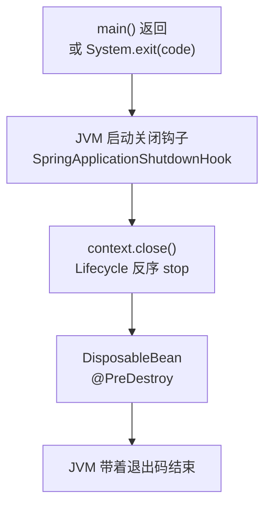

# ExitCodeGenerator
[[toc]]

命令行应用和 Web 应用的一大差别是**退出码有语义**。定时任务跑完和被调度系统调用时，`0` 表示成功、非 `0` 表示失败，上层靠这个数字判断要不要重试、要不要告警。`ExitCodeGenerator` 就是让 Bean 参与决定这个数字的接口：你实现它、交给容器，`SpringApplication.exit()` 会来问你，框架自己从不主动调它。

本文讲的是跨版本稳定的机制，不绑定具体版本。

它有个容易搞混的地方：**`SpringApplication.exit()` 并不调用 `System.exit()`**，它只负责算出数字。真正设退出码的是调用方（见「和 System.exit 的关系」）。

## 什么时候需要它

退出码的读者不是人，是把这个进程拉起来的那个程序：shell 脚本、CI 流水线、调度平台。它们不读日志，只看 `main` 的退出码决定下一步。所以需要用它的场合都有一个共同点——这一次运行的结果要由进程外面来判定。常驻的 Web 应用没有「跑完」这一步，退出码基本没人读，这一节面向的是会结束的进程。几个典型处境：

**ExitCodeGenerator：调度平台或 CI 需要知道这次跑成功没有。** 定时任务被 crontab、CI 流水线、集群的任务调度（K8s Job 这类）拉起时，那一步判成败的依据就是退出码：非 `0` 才触发重试或告警，`0` 就直接进下一步。前提是 `main` 里真的把算出来的数字交给了 JVM——`System.exit(SpringApplication.exit(ctx))` 这一句不能省，省了就是「任务失败但上游以为成功」，比直接报错更难发现。这种场景通常不需要区分失败原因，有个非零值就够，用 lambda 报一个固定的 `1` 也可以。

**ExitCodeGenerator：一次运行里有好几种失败，上游要分开处理。** 全量同步里「数据校验没过」和「下游依赖连不上」的处置完全不同：前者重试没用，后者重试可能就过了。要让调度平台按原因分别处理，判据只能落到不同的数字上，这时才需要自己定一套码值表并写进运维文档。代价有两处：

- 取值范围是有限的，shell 能看到的退出状态在 `0`–`255` 之间，其中 `126`、`127` 和 `128` 以上另有约定含义（[Bash 手册](https://www.gnu.org/software/bash/manual/html_node/Exit-Status.html)），码值表编不了太长。
- 一条链上只有第一个非零码生效，「更严重」的错误得排在前面，见「几个坑」。

**ExitCodeExceptionMapper：启动阶段就挂了，也得给出说得清的码。** 失败发生在绑定配置、建连接池、检查环境这些时候，进程根本走不到「正常跑完」那一步，`SpringApplication.exit()` 这条「跑完再问 Bean」的路径没机会执行——收业务结果的那个生成器从头到尾不会被调用。这类失败要么让自定义异常自己实现 `ExitCodeGenerator`（这条路径看的是异常对象，不是 Bean），要么注册一个 `ExitCodeExceptionMapper` Bean 按异常类型分类。后者有个前提：上下文此时必须仍是 active 状态，否则它不会被调用。

**ExitCodeGenerator：作业状态已经能定码，别再造一套。** 用 Spring Batch 的应用，框架已经把这件事做了：`JobExecutionExitCodeGenerator` 同时监听 `JobExecutionEvent`、实现 `ExitCodeGenerator`，把作业状态的序号当退出码交出去。要注意它的注册条件——`@ConditionalOnMissingBean(ExitCodeGenerator.class)`：你一旦声明了任何 `ExitCodeGenerator` Bean，Boot 这个就不再注册，退出码只剩你说了算。想在作业状态之外再叠加别的判断，得自己实现一个并把作业状态也纳进去。

## 两个接口和一个事件

`ExitCodeGenerator` 是只有一个返回 `int` 方法的函数式接口；`ExitCodeExceptionMapper` 同样是函数式接口，入参换成异常；`ExitCodeEvent` 则是退出码定为非 `0` 时对外发布的事件对象。三个定义都很短：

```java
@FunctionalInterface
public interface ExitCodeGenerator {

    int getExitCode();
}

@FunctionalInterface
public interface ExitCodeExceptionMapper {

    int getExitCode(Throwable exception);
}

public class ExitCodeEvent extends ApplicationEvent {

    public int getExitCode() {
        // ...
    }
}
```

| 类型 | 起始版本 | 用途 |
| --- | --- | --- |
| `ExitCodeGenerator` | 1.0.0 | 由 Bean 或异常实现，直接给出退出码 |
| `ExitCodeExceptionMapper` | 1.3.2 | 把异常映射成退出码，返回 `0` 表示「这个异常不归我管」 |
| `ExitCodeEvent` | 1.3.2 | 退出码定为非 `0` 时发布，供监听器做记录 |

三个都在 `org.springframework.boot` 包下，是 Spring Boot 自己的接口。

## 典型用法

官方文档给命令行应用的写法是这样：

```java
@SpringBootApplication
public class MyApplication {

    public static void main(String[] args) {
        System.exit(SpringApplication.exit(SpringApplication.run(MyApplication.class, args)));
    }
}
```

`SpringApplication.exit(...)` 返回算好的退出码，外面再交给 `System.exit(...)`。要定制码值就注册一个 `ExitCodeGenerator` Bean：

```java
@SpringBootApplication
public class MyApplication {

    @Bean
    public ExitCodeGenerator exitCodeGenerator(BatchResult result) {
        return () -> result.hasFailure() ? 2 : 0;
    }

    public static void main(String[] args) {
        System.exit(SpringApplication.exit(SpringApplication.run(MyApplication.class, args)));
    }
}
```

它是函数式接口，所以直接 lambda 就行。「跑完之后才知道结果」这件事交给别的 Bean 承载，`ExitCodeGenerator` 只负责在**被问的那一刻**报出数字——所以它的 `getExitCode()` 是懒求值的，不要在构造时就把结果固定下来。

## 退出码是怎么算出来的

`SpringApplication.exit()` 的内部逻辑是：

1. 收齐所有生成器：方法参数里显式传进来的，加上容器里所有 `ExitCodeGenerator` 类型的 Bean。
2. 逐个调用 `getExitCode()`，**返回第一个非 `0` 的值**，后面的不再问。
3. 结果为非 `0` 时发布 `ExitCodeEvent`。
4. 关闭 `ApplicationContext`，把数字返回给调用方。

排序由 `Ordered` 接口或 `@Order` 注解决定（`ExitCodeGenerators` 每次添加后都会用 `AnnotationAwareOrderComparator` 重排）。这条规则在「多个生成器都想报错」时才体现出意义：谁排前面谁的数字生效。

调用过程中如果某个 `getExitCode()` 抛异常，Bean 那边会把退出码记成 `1` 并打一份堆栈；`SpringApplication.exit()` 自身也不抛异常，它捕获之后打堆栈，返回 `1`（除非之前已经算出非 `0` 的值）。

这里要跟上面的「第一个非 `0` 的值生效」对上：`ExitCodeGenerators` 捕获异常之后只是把退出码记成 `1`，**并不终止循环**——它继续往下问生成器，后面再有一个返回非 `0` 的值就会把这个 `1` 盖掉，并按第一条非零码生效的规则定下来。所以这个 `1` 是「这一轮没人给出更好答案时的暂定值」，不是最终结果；一路问下来都没有非零值，才留下它。

::: tip `ExitCodeExceptionMapper` 不在这条路上
`SpringApplication.exit()` 只收 `ExitCodeGenerator` 类型的 Bean，不看 `ExitCodeExceptionMapper`。异常映射是**启动失败**那条独立路径上用的，见下一节。
:::

## 启动失败时的退出码

启动过程中抛异常，Spring Boot 走的是另一套逻辑，由 `SpringApplication#handleRunFailure` 触发：

1. 先找容器里所有的 `ExitCodeExceptionMapper` Bean，把异常交给它们映射；要求上下文此时仍处于 active 状态。
2. 上一步结果为 `0` 时，再沿着异常的 `cause` 链逐层找**实现了 `ExitCodeGenerator` 的异常**，取它的 `getExitCode()`。注意这一步看的是异常对象，不是 Bean。
3. 得到非 `0` 的值后，一是发布 `ExitCodeEvent`，二是把码值登记到 `SpringBootExceptionHandler`。

第 3 步登记之后不会立刻退出。启动异常最终会从 `main` 抛出去，JVM 随即调用主线程的 `UncaughtExceptionHandler`——也就是 `SpringBootExceptionHandler`——它才在这里执行 `System.exit(exitCode)`。

所以两条路径的分工是**互不重叠**的：

| 场景 | 参与的类型 | 谁来调 `System.exit` |
| --- | --- | --- |
| 正常跑完、主动退出 | `ExitCodeGenerator`（Bean + 参数） | 调用方自己写 |
| 启动失败 | `ExitCodeExceptionMapper`（Bean）+ 异常自带的 `ExitCodeGenerator` | `SpringBootExceptionHandler` |

`ExitCodeExceptionMapper` 的返回值语义是「映射结果，或 `0` 表示放弃」：

```java
@Bean
public ExitCodeExceptionMapper exitCodeExceptionMapper() {
    return (exception) -> {
        if (exception instanceof DataAccessException) {
            return 3;
        }
        if (exception instanceof IllegalArgumentException) {
            return 4;
        }
        return 0;
    };
}
```

## 和 System.exit 的关系

退出码要生效，最终必须有谁调 `System.exit(code)`——这是 JVM 的规矩，`SpringApplication.exit()` 不做这件事。完整链路：



`SpringApplication` 默认会给 JVM 注册一个关闭钩子（`spring.main.register-shutdown-hook=false` 可以关掉，代码里对应 `setRegisterShutdownHook(false)`），钩子里做的事是关闭应用上下文。所以 `System.exit()` 不是「直接杀掉进程」，它触发的是这套优雅关闭流程——`SmartLifecycle` 的 `stop()`、`@PreDestroy`、`DisposableBean#destroy()` 都会跑到。

`System.exit(SpringApplication.exit(ctx))` 这种写法会关两次上下文：`SpringApplication.exit()` 里关一次，随后 `System.exit()` 触发关闭钩子时再关一次。`AbstractApplicationContext#close()` 用 `AtomicBoolean` 做了幂等，重复调用直接返回，不会重复执行销毁逻辑。

## 几个坑

- **忘了在外面写 `System.exit`，退出码永远是 0**。`SpringApplication.exit()` 算得再对，没人交给 JVM 就等于没算。
- **把启动异常 `try/catch` 吞掉，退出码也会丢**。失败路径的 `System.exit` 挂在主线程的未捕获异常处理器上；异常被你自己接住，处理器就不会被触发，进程照样以 0 退出。
- **非主线程启动不生效**。`SpringBootExceptionHandler` 只在当前线程是 `main` 或 `restartedMain`（且线程组是 `main`）时才装配。把 `SpringApplication.run()` 放到自定义线程里跑，失败时不会有任何退出码。
- **同一个生成器链上只有第一个非零码生效**。想报「更严重」的错误就得排到前面，或者让前面的返回 `0`。`0` 在这里的语义是「我不报错」，不是「我成功」。
- **`ExitCodeExceptionMapper` 返回 `0` 是放弃，不是映射成成功**。所有 mapper 都返回 `0` 时，框架会继续走第二步——去异常的 `cause` 链里找 `ExitCodeGenerator`。

## 一个真实例子：Spring Batch

Spring Boot 自己也这么用。Spring Batch 的 `JobExecutionExitCodeGenerator` 同时是 `ApplicationListener<JobExecutionEvent>` 和 `ExitCodeGenerator`：监听器收集所有 `JobExecution`，`getExitCode()` 返回第一个非 `COMPLETED` 的状态序号。

它在 `BatchAutoConfiguration` 里注册，条件是 `@ConditionalOnMissingBean(ExitCodeGenerator.class)`——也就是说，一旦你自己声明了任何 `ExitCodeGenerator` Bean，Boot 这个就不会注册，`SpringApplication.exit()` 问的是你的。在 Batch 应用里加自定义生成器时，这一点要先想清楚。
