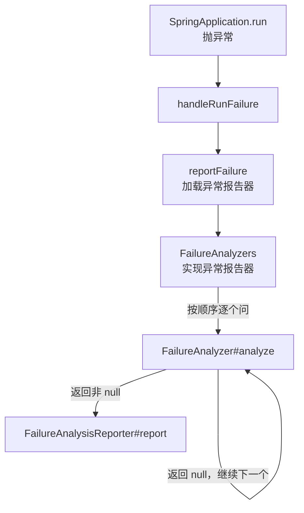

# FailureAnalyzer
[[toc]]

`FailureAnalyzer` 只在启动失败之后被调用——此时容器还没关闭，但分析器能拿到的只有 `BeanFactory` 和 `Environment`，取不到业务 Bean、也改不了配置，能做的只有一件事：把一堆堆栈换成「哪错了 + 该怎么办」。端口被占用、配置项绑不上、Bean 循环依赖这些提示，都是它输出的。

本文以 Spring Boot 3.5 为准。

## 什么时候需要它

判断标准其实很简单：这次的失败**认得出来是哪一类**，而你**对「该看哪里、大概怎么修」有话可说**。两条都满足，就值得给它配一条提示。几类典型处境：

**自己写的库启动失败时，得能自己解释。** 你的库或内部框架在启动阶段读配置、连外部资源、做校验，抛出的异常是给代码看的，不是给使用者看的——它被 Spring 包了几层，底下跟一大段容器刷新的堆栈，别人不知道哪一句是重点、该改哪里。给这类失败配一个分析器，输出就变成一句说明加一条动作，提示随库一起发出去，不需要使用者做任何事；没有分析器认领这类失败的话，使用者看到的仍然是原始堆栈。

**同一类配置错误在团队里反复出现。** 新人漏配某个必填项、两个开关互相冲突、编译没开 `-parameters` 导致绑定拿不到参数名——每次都要有人来解释一遍。把排查步骤写进 `Action`，错误信息本身就带上了「下一步做什么」。Boot 自带的 `MissingParameterNamesFailureAnalyzer`、`HikariDriverConfigurationFailureAnalyzer` 都是这个思路：提示里给的不是现象，是改法。前提是这类失败能从一个明确的异常类型上认出来。

**异常里带着业务标识，默认提示展示不出来。** 失败的原因常常是一个代码之外的标识——哪个渠道、哪个租户、哪份配置文件——异常类型名对使用者毫无意义。分析结果里的 `Description` 可以把这个标识拼进去，`Action` 指出该改哪个配置项。另一种更常见的情形是「配置改了却不生效」：值被另一个 profile 的文件、命令行参数或环境变量盖住了，光看堆栈永远看不出来；这类分析器可以要求注入 `Environment`，把生效值来自哪个属性源一并写出来（Boot 自带的 `InvalidConfigurationPropertyValueFailureAnalyzer` 就是干这个的）。这条路只在失败发生在容器建起来之后时走得通，更早的阶段解析不到 `Environment`。

**上游库的提示太差，而你改不了它。** 项目里用了某个第三方 SDK 或别的团队的内部库，启动失败时抛一个泛型异常、消息里什么都没有，但修法是固定的（补一个依赖、设一个系统属性、换一个 endpoint）。分析器不要求异常类型是你自己定义的——在自己的应用里注册一个认那个异常的分析器，就能把提示补上，不必等上游改。

## 它输出什么

启动失败时看到的那段提示就出自这里：

```text
***************************
APPLICATION FAILED TO START
***************************

Description:

Web server failed to start. Port 8080 was already in use.

Action:

Identify and stop the process that's listening on port 8080 or configure this
application to listen on another port.
```

`Description` 是 `FailureAnalysis#getDescription()`，`Action` 是 `getAction()`。`Action` 为空时整段不输出——所以自己写的时候，`action` 能写就写，那是这条提示里唯一告诉人怎么修的部分。

## 接口与基类

接口本身只有一个方法：

```java
@FunctionalInterface
public interface FailureAnalyzer {

    FailureAnalysis analyze(Throwable failure);

}
```

Spring Boot 1.4.0 引入，返回 `null` 表示「这个失败我不认识，交给下一个」。实际写的时候几乎都用基类 `AbstractFailureAnalyzer<T extends Throwable>`：

```java
public abstract class AbstractFailureAnalyzer<T extends Throwable> implements FailureAnalyzer {

    @Override
    public FailureAnalysis analyze(Throwable failure) {
        T cause = findCause(failure, getCauseType());
        return (cause != null) ? analyze(failure, cause) : null;
    }

    protected abstract FailureAnalysis analyze(Throwable rootFailure, T cause);

    protected Class<? extends T> getCauseType() {
        return (Class<? extends T>) ResolvableType.forClass(AbstractFailureAnalyzer.class, getClass()).resolveGeneric();
    }

    protected final <E extends Throwable> E findCause(Throwable failure, Class<E> type) {
        while (failure != null) {
            if (type.isInstance(failure)) {
                return (E) failure;
            }
            failure = failure.getCause();
        }
        return null;
    }
}
```

三个要点：

- 泛型 `T` 决定它认哪种异常。`findCause` 沿着 `getCause()` 链一路找，所以外面套了几层 `BeanCreationException` 也不影响——传入的 `failure` 通常是包装后的异常。
- `getCauseType()` 默认用 `ResolvableType` 从类声明的泛型解析。用匿名内部类、或者 `T` 是没具体化的类型变量时解析结果为 `null`，`findCause` 里 `type.isInstance` 会直接空指针，这种写法必须覆写 `getCauseType()`。
- 覆盖 `analyze(Throwable)` 是不必要的——基类已经处理了「找 cause」和「找不到就返回 null」。

## FailureAnalysis 的三个字段

`FailureAnalysis` 只有 `description`（出了什么事）、`action`（该怎么处理，可为空）、`cause`（引发失败的那个异常，`LoggingFailureAnalysisReporter` 会在 debug 级别把它打进日志）三个字段，构造器也只提供了一个：`new FailureAnalysis(String description, String action, Throwable cause)`，没有两参数的版本。

## 怎么注册：spring.factories，不是 Bean

`FailureAnalyzer` 不是容器里的 Bean，`@Component` 对它无效。注册位置是 `META-INF/spring.factories`：

```properties
org.springframework.boot.diagnostics.FailureAnalyzer=com.example.notify.NotifyChannelFailureAnalyzer
```

多个实现时照 `spring.factories` 的惯例用 `\` 续行、逗号分隔。Spring Boot 3.x 里自动配置早就搬去了 `META-INF/spring/…AutoConfiguration.imports`，但 `FailureAnalyzer`、`FailureAnalysisReporter` 这类扩展仍然走 `spring.factories`——`.imports` 那套覆盖的是自动配置、`ManagementContextConfiguration`（actuator）和测试切片注解，不含这些扩展。

这个机制对三方库同样开放：每个 jar 都能在自己的 `spring.factories` 里往同一个 key 下追加实现。Spring Boot 自己的 `spring-boot` jar 里声明了 22 个，`spring-boot-autoconfigure` jar 里又追加了 11 个，就是靠这个拼起来的。

## 什么时候被调用

它挂在启动失败的收尾链路上：异常从 `SpringApplication.run` 抛出后，由 `SpringBootExceptionReporter` 接手报告，分析器就在这一步被逐个问到。



`FailureAnalyzers` 这个类本身就是 `SpringBootExceptionReporter`，它从 `spring.factories` 加载所有分析器，然后按顺序问：**第一个返回非 `null` 的分析结果生效，后面的不再问**。加载走的是 `SpringFactoriesLoader#load`，它按 `AnnotationAwareOrderComparator` 排序，所以 `@Order` / `Ordered` 有效——没有声明顺序的实现会落到 `LOWEST_PRECEDENCE`。但 Boot 内置的分析器大多也没有显式声明顺序、同样是 `LOWEST_PRECEDENCE`，所以「不写 `@Order` 就一定排在内置的之后」并不成立：`AnnotationAwareOrderComparator.sort` 是稳定排序，同序时保持它们在 `spring.factories` 里被合并进来的相对次序。

几条容易踩的边界：

- **只对启动失败生效**。运行期某个请求抛异常不会走到这里，那段还是你自己的全局异常处理。
- **分析器自己抛异常会被吞掉**。`FailureAnalyzers#analyze` 里 `catch (Throwable)` 之后只记一条 trace 日志，表现是「提示没出来，也没报错」。
- **构造器可以要求注入 `BeanFactory` 和 `Environment`**，由 `FailureAnalyzers` 装配时解析。失败发生在 context 还没建起来的阶段时，这两个参数解析不了，对应分析器直接跳过——所以别把它们当成一定拿得到。
- **没人认领就退回默认行为**。所有分析器都返回 `null`、或者容器里一个 `FailureAnalysisReporter` 都没有时，`reportException` 返回 `false`，Spring Boot 打出「Application run failed」加原始堆栈收场。

`FailureAnalysisReporter` 也走 `spring.factories`（key 是 `org.springframework.boot.diagnostics.FailureAnalysisReporter`），默认实现是 `LoggingFailureAnalysisReporter`，用 `logger.error` 输出。它可以被追加或替换：想同时把分析结果推到监控系统，加一个自己的 Reporter 即可——所有 Reporter 都会被调一遍，不像分析器那样只取第一个。

## 一个自定义例子

假设应用启动时要连一个通知渠道（短信 / 钉钉之类），配置缺失直接抛异常 `NotifyChannelUnavailableException`（`RuntimeException` 的子类，带一个 `getChannel()`）。分析器只认这一种异常：

```java
public class NotifyChannelFailureAnalyzer extends AbstractFailureAnalyzer<NotifyChannelUnavailableException> {

    @Override
    protected FailureAnalysis analyze(Throwable rootFailure, NotifyChannelUnavailableException cause) {
        String channel = cause.getChannel();
        return new FailureAnalysis(
                "通知渠道 " + channel + " 连接失败，应用无法启动。",
                "检查 notify." + channel + ".url 是否配到了生效的配置源里，确认网络可达后重启；"
                        + "该渠道非必需时把 notify." + channel + ".required 设为 false。",
                cause);
    }
}
```

注册（`src/main/resources/META-INF/spring.factories`）：

```properties
org.springframework.boot.diagnostics.FailureAnalyzer=\
com.example.notify.NotifyChannelFailureAnalyzer
```

几点写法上的说明：

- 想在 `Action` 里带上配置来源之类的信息，可以加一个接收 `Environment`（或 `BeanFactory`）的构造器，`FailureAnalyzers` 装配时会解析注入。
- 类可以不声明为 `public`，构造器也不必是 `public`：`SpringFactoriesLoader` 实例化实现类时会把选定的构造器设为可访问，可见性不受限制。内置分析器里既有包私有的，也有声明为 `public` 的（如 `BeanNotOfRequiredTypeFailureAnalyzer`），所以修饰符这里不构成约束。
- 只在认得出问题时返回 `FailureAnalysis`，其余一律返回 `null`。判断条件写宽了会抢走别人的失败——既然是「第一个命中的赢」，一个过于宽松的分析器会把后面更精确的提示盖掉。

## 内置的分析器

两个 jar 的 `spring.factories` 合计声明了 33 个分析器（`spring-boot` 22 个、`spring-boot-autoconfigure` 11 个），三方库还能往同一个 key 下再追加。下表只列其中常见的 23 个，不是全量清单：

| 分析器 | 认领的异常 | 覆盖的场景 |
| --- | --- | --- |
| `PortInUseFailureAnalyzer` | `PortInUseException` | 端口被占用 |
| `ConnectorStartFailureAnalyzer` | `ConnectorStartFailedException` | Tomcat Connector 启动失败 |
| `MissingWebServerFactoryBeanFailureAnalyzer` | `MissingWebServerFactoryBeanException` | Web 应用没找到 `WebServerFactory` |
| `BeanCurrentlyInCreationFailureAnalyzer` | `BeanCurrentlyInCreationException` | 循环依赖 |
| `BeanDefinitionOverrideFailureAnalyzer` | `BeanDefinitionOverrideException` | Bean 定义重名 |
| `BeanNotOfRequiredTypeFailureAnalyzer` | `BeanNotOfRequiredTypeException` | 注入类型对不上（如拿到 JDK 动态代理） |
| `NoSuchBeanDefinitionFailureAnalyzer` | `NoSuchBeanDefinitionException` | 找不到 Bean，附带候选提示 |
| `NoUniqueBeanDefinitionFailureAnalyzer` | `NoUniqueBeanDefinitionException` | 同类型多个候选 Bean |
| `NotConstructorBoundInjectionFailureAnalyzer` | `NoSuchBeanDefinitionException` | 类标了 `@ConstructorBinding` 却按普通 Bean 注册 |
| `BindFailureAnalyzer` | `BindException` | 配置绑定失败 |
| `BindValidationFailureAnalyzer` | `Throwable` | 绑定后的 `@Validated` 校验失败 |
| `UnboundConfigurationPropertyFailureAnalyzer` | `UnboundConfigurationPropertiesException` | 属性没绑上 |
| `InvalidConfigurationPropertyValueFailureAnalyzer` | `InvalidConfigurationPropertyValueException` | 配置值非法（带 `Environment` 指出取值来源） |
| `MissingParameterNamesFailureAnalyzer` | 参数名丢失 | 编译没开 `-parameters`，绑定拿不到参数名 |
| `NoSuchMethodFailureAnalyzer` | `NoSuchMethodError` | 依赖版本不匹配导致的 `NoSuchMethodError` |
| `ConfigDataNotFoundFailureAnalyzer` | `ConfigDataNotFoundException` | `spring.config.import` 指的文件/目录找不到 |
| `PatternParseFailureAnalyzer` | `PatternParseException` | 路径匹配模式写错 |
| `ValidationExceptionFailureAnalyzer` | `ValidationException` | 类路径有 Bean Validation API 但没实现 |
| `RedisUrlSyntaxFailureAnalyzer` | `RedisUrlSyntaxException` | `spring.data.redis.url` 写法错误 |
| `DataSourceBeanCreationFailureAnalyzer` | `DataSourceBeanCreationException` | 数据源创建失败 |
| `HikariDriverConfigurationFailureAnalyzer` | `CannotGetJdbcConnectionException` | Hikari 用了不支持的 `dataSourceClassName` |
| `NoConnectionFactoryBeanFailureAnalyzer` | `NoSuchBeanDefinitionException` | 没有 R2DBC `ConnectionFactory` |
| `NoDslContextBeanFailureAnalyzer` | `NoSuchBeanDefinitionException` | jOOQ 没被自动配置 |

顺带一句：注册类型为 `NoSuchBeanDefinitionException` 的有 4 个，另有 1 个注册的是它的子类 `NoUniqueBeanDefinitionException`；各自返回不同提示，最后谁生效取决于谁先被问到——`MissingParameterNamesFailureAnalyzer` 干脆用 `@Order(Ordered.LOWEST_PRECEDENCE)` 把自己显式排到最后，`NotConstructorBoundInjectionFailureAnalyzer` 则用 `getOrder() { return 0; }` 排到前面。顺序是这套机制里被认真对待的一件事。

## 坑

- **它拿不到业务 Bean**。容器此时还没关闭，但分析器能读的只有构造时注入的 `BeanFactory` / `Environment`，别想着去取容器里的 Bean。
- **`@Component` 注册不生效**。必须是 `spring.factories`，改了不生效时优先检查这个文件的路径和 key 有没有打错。
- **分析器里抛异常是静默失败**，只有 trace 日志。写完记得用一个真实失败跑一遍，确认提示真的出来了。
- **提示是 `logger.error` 级别**。日志级别被压到 `error` 以上（比如关掉了）时看不到，这不是分析器没生效。
