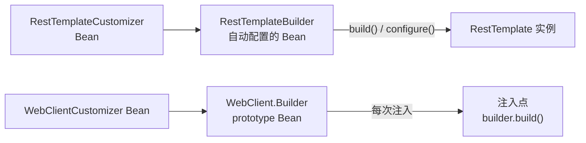

# RestTemplateCustomizer 与 WebClientCustomizer
[[toc]]

出站 HTTP 客户端也要定制：超时、认证头、重试、日志。这两个定制器就是为此存在的回调——`RestTemplateCustomizer` 拿到的是已经 new 出来、还没交给你用的 `RestTemplate` 实例；`WebClientCustomizer` 拿到的是 `WebClient.Builder`。前者同步阻塞，后者响应式，作用对象不同，触发时机也不同。

本文以 Spring Boot 3.5（Spring Framework 6.2）为准。

## 什么时候需要它

两个定制器解决的是同一类问题：出站请求的公共部分不该在每个调用点重复写。几个典型场景：

**RestTemplateCustomizer / WebClientCustomizer：认证头、调用方标识这类东西每个请求都要带。** 调用点散在几十个 service 里，靠每个人记得加，漏一处就是一个 401，或者把 A 租户的头带给了 B 租户。定制器在客户端构建时插一次，所有注入点拿到的客户端都带着；「按 host 决定用哪个 token」这类逻辑写进拦截器。前提是客户端从自动配置的 Builder 造出来——`new RestTemplate()` 和 `WebClient.create()` 都不经过定制器。

**RestTemplateCustomizer / WebClientCustomizer：给所有出站调用一个兜底超时。** Boot 不替你设超时（`ClientHttpRequestFactorySettings` 的连接、读取超时默认都是 `null`），底层 JDK 实现不设就是无限等，一个卡住的下游会把调用线程一个个占满。默认值放全局（`spring.http.client.*` / `spring.http.reactiveclient.*` 属性，或 Builder 的 `connectTimeout` / `readTimeout`）；个别要长等的下游在注入点单独放宽，每次调用 Builder 的方法都返回新实例，只影响这一次。

**出站请求拦截器：要回答「这次调用慢在哪、失败在哪」。** 每个调用点各写各的日志，拼不出全貌；拦截器是唯一同时看得到请求和响应的地方，在这里计一次时、打一条日志或一个点，覆盖面就是全部出站调用。有两件事不用自己做：上了 Micrometer Tracing 之后，标准 trace 头的透传由自动配置的 Builder 负责（前提还是别绕过 Builder）；在拦截器里拿到响应之后抛异常，要先自己把响应 `close()` 掉。

**RestTemplateCustomizer：下游的错误响应要翻成自己的异常。** 默认的 `DefaultResponseErrorHandler` 把 4xx / 5xx 一律当错误，抛框架自带的 `HttpClientErrorException` / `HttpServerErrorException`；上层往往既要统一异常类型，又要把下游返回的错误码和消息带出来。换 `setErrorHandler(...)` 自己翻，或者干脆让它不抛、由调用点判状态码。

**RestTemplateCustomizer / WebClientCustomizer：多个下游需要不同的配置。** 定制器 Bean 是「收集起来、对每个 Builder 都生效」的，天生一刀切：给 A 服务加的头会跟着发到 B 服务去。常见的分层是——公共的那层（认证、日志、兜底超时）放定制器；单个服务特有的（`baseUrl`、更长的超时、它专属的拦截器）在注入点用自动配置的 Builder 逐个设；真正要按服务分叉的判断（同一个头取不同值）写进拦截器里按 host 判。

## 两个定制器分别作用在什么对象上

两个接口都只有一个方法，参数类型不同：

```java
public interface RestTemplateCustomizer {
    void customize(RestTemplate restTemplate);
}

public interface WebClientCustomizer {
    void customize(WebClient.Builder webClientBuilder);
}
```

| 项 | `RestTemplateCustomizer` | `WebClientCustomizer` |
| --- | --- | --- |
| 包 | `org.springframework.boot.web.client` | `org.springframework.boot.web.reactive.function.client` |
| 起始版本 | Spring Boot 1.4.0 | Spring Boot 2.0.0 |
| 回调参数 | `RestTemplate` 实例 | `WebClient.Builder` |
| 注册方式 | 声明成 Bean | 声明成 Bean |
| 触发时机 | 每次 `RestTemplateBuilder#build()` | 每次注入 `WebClient.Builder` |
| 影响范围 | 所有用自动配置的 Builder 构建出来的模板 | 所有注入点拿到的 Builder |
| 排序 | `@Order` / `Ordered` 有效 | `@Order` / `Ordered` 有效 |

关键差别在触发时机，而不是签名。`RestTemplate` 是「建好之后给你改」，`WebClient` 是「改 Builder，再由 Builder 建客户端」。

## 什么时候被调用

两个定制器都不是你自己调的，触发点在客户端构建的那一刻——`RestTemplate` 是每次 `build()`，`WebClient.Builder` 是每次注入：



`RestTemplateBuilder#build()` 的实现是 `configure(new RestTemplate())`，定制器在 `configure` 的最后一步被依次调用——此时请求工厂、消息转换器、拦截器都已经设好，所以定制器里能看到并覆盖它们：

```java
public <T extends RestTemplate> T configure(T restTemplate) {
    // ... setRequestFactory / setMessageConverters / getInterceptors().addAll(...)
    for (RestTemplateCustomizer customizer : this.customizers) {
        customizer.customize(restTemplate);
    }
    return restTemplate;
}
```

这些定制器从哪来？`RestTemplateAutoConfiguration` 把容器里的 `RestTemplateCustomizer` Bean 按序收集起来交给 `RestTemplateBuilderConfigurer`，再由它挂到自动配置的 `RestTemplateBuilder` 上。`WebClientAutoConfiguration` 同理：它注册的 `WebClient.Builder` 是 prototype 作用域，每次注入现造一个 `WebClient.builder()`，然后按序调用所有 `WebClientCustomizer`。

::: warning 换个入口就绕过了定制器
`new RestTemplate()`、`WebClient.create()`、或者自己 `@Bean` 一个 `WebClient.Builder`——这三条路都不经过定制器。自己定义 `RestTemplateBuilder` Bean 时也一样，除非用 `RestTemplateBuilderConfigurer` 配置它，否则 `RestTemplateCustomizer` 全部失效。
:::

## RestTemplate：加超时、拦截器、错误处理

拦截器加到 `restTemplate.getInterceptors()`，错误处理走 `setErrorHandler(...)`（不想让 4xx / 5xx 抛异常时换成 `NoOpResponseErrorHandler` 这个空实现）：

```java
@Component
public class MyRestTemplateCustomizer implements RestTemplateCustomizer {

    @Override
    public void customize(RestTemplate restTemplate) {
        restTemplate.getInterceptors().add(new TraceIdInterceptor());
        restTemplate.setErrorHandler(new NoOpResponseErrorHandler());
    }
}
```

超时不在 `RestTemplate` 上，而在底层 `ClientHttpRequestFactory`，更直接的做法是走 Builder——`connectTimeout(Duration)` 和 `readTimeout(Duration)`，旧的 `setConnectTimeout` / `setReadTimeout` 已标记废弃：

```java
@Bean
public RestTemplate restTemplate(RestTemplateBuilder builder) {
    return builder
            .connectTimeout(Duration.ofSeconds(3))
            .readTimeout(Duration.ofSeconds(5))
            .additionalInterceptors(new TraceIdInterceptor())
            .build();
}
```

注意 `interceptors(...)` 是替换整个列表，`additionalInterceptors(...)` 才是追加。

出站请求还有一层更底层的入口：Spring Framework 的 [`ClientHttpRequestInterceptor`](../../spring-framework/framework-callbacks/client-http-request-interceptor.md)（`org.springframework.http.client`）。上面两段代码里的 `TraceIdInterceptor` 实现的正是它——定制器管的是「把客户端配好」，它管的是「每一次调用怎么发」。

## WebClient：拦截器换成了 ExchangeFilterFunction

`WebClient` 是响应式的，拦截器的对应物是 `ExchangeFilterFunction`（`org.springframework.web.reactive.function.client`），通过 `WebClient.Builder#filter(...)` 挂上去：

```java
@Component
public class AuthWebClientCustomizer implements WebClientCustomizer {

    @Override
    public void customize(WebClient.Builder builder) {
        builder.baseUrl("https://api.example.com")
                .filter(ExchangeFilterFunction.ofRequestProcessor((request) ->
                        Mono.just(ClientRequest.from(request)
                                .header("Authorization", "Bearer " + token())
                                .build())))
                .defaultStatusHandler(HttpStatusCode::isError,
                        (response) -> Mono.error(new IllegalStateException("上游返回 " + response.statusCode())));
    }
}
```

`ExchangeFilterFunction` 只有 `filter(ClientRequest, ExchangeFunction)` 一个抽象方法，加了 `ofRequestProcessor` / `ofResponseProcessor` 两个静态工厂，只关心请求或只关心响应时不用手写完整链路。

`WebClient.Builder` 上**没有**超时方法——超时属于底层连接器的事。两种改法：

- 配置属性：`spring.http.reactiveclient.connect-timeout` / `read-timeout`，由 `ClientHttpConnectorBuilder` 落到具体连接器上。对 Reactor Netty 来说，读超时映射到 `HttpClient#responseTimeout`，连接超时映射到 `ChannelOption.CONNECT_TIMEOUT_MILLIS`。
- 换连接器：`builder.clientConnector(new ReactorClientHttpConnector(reactorResourceFactory, (client) -> client.responseTimeout(Duration.ofSeconds(5))))`。传入 `ReactorResourceFactory` 是为了继续复用 Boot 与内嵌服务器共享的那套连接池和事件循环线程。

## 配置属性能覆盖多少

Spring Boot 3.4 给阻塞客户端留了全局属性（`spring.http.client.*`），3.5 补上了响应式的对应物（`spring.http.reactiveclient.*`），很多原本要写 Java 的事可以直接配：

| 属性 | 作用 | 可选值 |
| --- | --- | --- |
| `spring.http.client.factory` | 阻塞客户端的实现 | `http-components` / `jetty` / `reactor` / `jdk` / `simple` |
| `spring.http.client.connect-timeout`<br/>`spring.http.client.read-timeout` | 阻塞客户端的连接 / 读取超时 | `Duration` |
| `spring.http.client.redirects` | 是否跟随重定向 | `follow-when-possible`<br/>`follow`<br/>`dont-follow` |
| `spring.http.reactiveclient.connector` | 响应式连接器实现 | `reactor` / `jetty` / `http-components` / `jdk` |
| `spring.http.reactiveclient.connect-timeout`<br/>`spring.http.reactiveclient.read-timeout` | 响应式客户端的连接 / 读取超时 | `Duration` |

不指定 `factory` / `connector` 时，Boot 按类路径探测：阻塞侧的顺序是 Apache HttpClient 5 → Jetty → Reactor Netty → JDK `HttpClient` → JDK `HttpURLConnection`（`simple`），响应式侧是 Reactor Netty → Jetty → Apache HttpClient 5 → JDK。所以应用里**额外**引了 Apache HttpClient 5 时，阻塞侧就会挑它；`spring-boot-starter-web` 本身不带这个依赖。WebFlux 侧默认落到 Reactor Netty。

属性表达不了的连接器级设置（换连接池实现、挂 `ChannelOption`），Spring Boot 3.5 另外留了两个更底层的定制器接口，同样按 Bean 注册、按构建器类型匹配：

| 接口 | 定制对象 |
| --- | --- |
| `ClientHttpRequestFactoryBuilderCustomizer<B>` | 阻塞侧的 `ClientHttpRequestFactoryBuilder` |
| `ClientHttpConnectorBuilderCustomizer<B>` | 响应式侧的 `ClientHttpConnectorBuilder` |

## RestTemplate 还是 WebClient

| 项 | RestTemplate | WebClient |
| --- | --- | --- |
| 模型 | 同步阻塞、template 方法（`getForObject` 等） | 响应式、fluent API，返回 `Mono` / `Flux` |
| 所在栈 | `spring-boot-starter-web` 足够用 | 需要 WebFlux（`spring-boot-starter-webflux`） |
| 定制器 | `RestTemplateCustomizer` | `WebClientCustomizer` |
| 拦截器 | `ClientHttpRequestInterceptor` | `ExchangeFilterFunction` |
| 当前定位 | 6.1 起同步侧多了 `RestClient`，新增的高级特性以它为重点；`RestTemplate` 本身**没有被标记废弃** | 异步与流式场景的推荐选择 |

`RestTemplate` 并没有「不能用」——`RestTemplateAutoConfiguration` 照旧工作（条件是类路径上有 `RestTemplate` 且不是纯响应式应用）。Javadoc 里的原话是：自 6.1 起 `RestClient` 提供了更现代的同步 HTTP API，两个类共用同一套基础设施（请求工厂、拦截器、消息转换器），因此这边的改进也是共享的；**只是新增的高级特性以 `RestClient` 为重点**。反过来，如果你的应用已经是 WebFlux，别为了「顺手」把 `RestTemplate` 引进来：`RestTemplateAutoConfiguration` 在 `NotReactiveWebApplicationCondition` 下才生效，混着用会得到一套没有定制器加成、又堵线程的客户端。

## 坑

- **自己定义 `RestTemplateBuilder` 会连带废掉 `RestTemplateCustomizer`**，除非用 `RestTemplateBuilderConfigurer` 包一层。
- **`WebClient.Builder` 是有状态的**，而且是 prototype：在注入点直接改 Builder 只影响这一次；要全局生效才用 `WebClientCustomizer`。需要多次复用时用 `builder.clone()`。
- **`WebClient.Builder` 的连接器由自动配置提供**：`org.springframework.boot.autoconfigure.http.client.reactive.ClientHttpConnectorAutoConfiguration` 按类路径探测并创建 `ClientHttpConnector`，`WebClientAutoConfiguration` 再用一个 `@Order(0)` 的 `WebClientCustomizer` 把它塞进 Builder；条件是类路径上有 `WebClient` 和响应式类型（`Mono`），并不要求应用本身是响应式（WebFlux）应用。自己 `new` 一个连接器并 `clientConnector(...)` 会把它替换掉，注意别把共享资源一起丢了。
