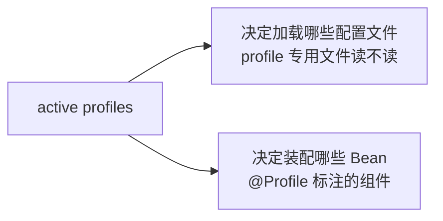
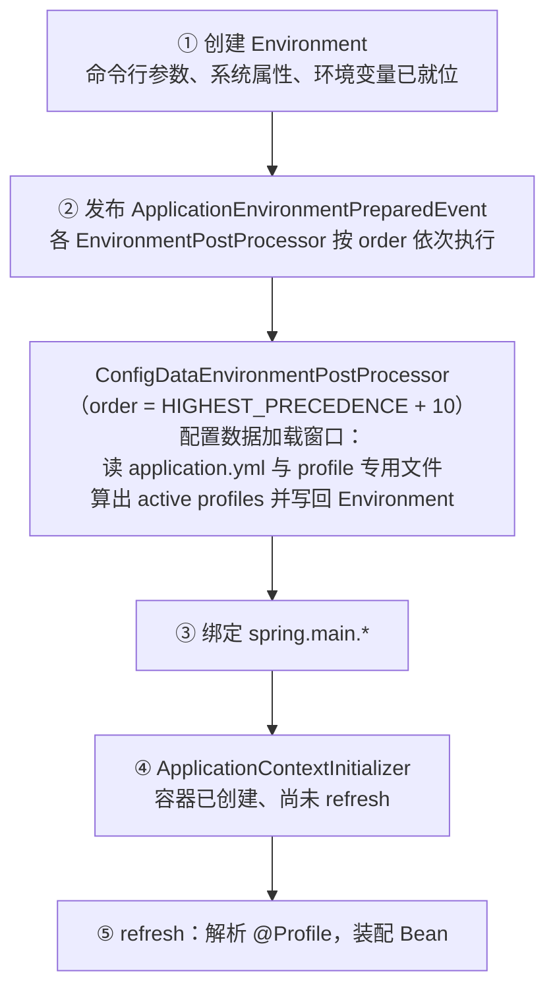

# Spring Boot Profile 机制
[[toc]]

Spring Boot 的 profile 是一套「按环境切换配置和组件」的机制：给一组配置或一组 Bean 起个名字（profile 名），启动时说明哪些名字是激活的，只有名字对上的那部分才生效。

本文以 Spring Boot 3.5 为准。

用法本身不难，难的是**同一个 profile 名会被两类逻辑读走，而这两类逻辑执行的时刻相隔很远**：一类在启动最早期决定读哪些配置文件，另一类在容器 refresh 时决定装配哪些 Bean。中间隔着一整段启动流程——[`ApplicationContextInitializer`](../spring-framework/framework-callbacks/application-context-initializer.md) 就在这段里。后文那些「明明激活了却没生效」的问题，几乎都出在这两个时刻的错位上。

属性来源与优先级（哪个来源覆盖哪个）见[《Spring Boot 配置》](./spring-boot-config.md)，这里不重复。

## 什么时候需要 Profile

Profile 要解决的是「同一份代码，在不同环境要表现出不同样子」。差异有两种形式，对应两种用法。

**差异在配置值上，就拆配置文件。** 本地开发连本机数据库、日志开到 DEBUG；测试环境连测试库、日志降一档；生产连生产库、关掉调试端点。这些差异如果全挤在一份文件里，每次切换环境都得动手改，改完还容易误提交。拆成 `application-dev.yml`、`application-test.yml`、`application-prod.yml` 三个文件，启动时指明用哪个，配置就跟着环境走。

**差异在「有没有这个组件」上，就给组件标 `@Profile`。** 有些差异不是改个值能表达的，而是一整个 Bean 根本不该存在：

- 本地开发时不发真短信、不调真支付，得换成打日志的假实现；生产环境必须换回真的。
- 开发时用内存数据库，生产用真实数据库，两种数据源的装配方式完全不同。
- 只有某个客户环境才需要的功能模块，整块配置类都不该被解析。

这类需求用 `@Profile` 标在组件上，profile 不匹配的组件不会被注册进容器。

**隔开还没验证完的代码。** 新写的实现想先只在自己环境跑，又不想影响别人，就给它和它的配置都标上 `experimental`，不激活就等于不存在。

::: tip Profile 表达的是「环境的种类」，不是「一次性的开关」
dev / test / prod、cn-hz / cn-bj 这类是环境的种类，适合用 profile；「这次启动要不要开启某个功能」是一次性的开关，更适合单个属性开关。两者怎么选见文末的「取舍」一节。
:::

## Profile 被用在两个地方

激活的 profile 名单会流向两个地方，各自独立消费：



这两个消费方共用同一份名单，但工作的时刻完全不同：

| 消费方 | 作用 | 发生在 | 执行次数 |
| --- | --- | --- | --- |
| 配置文件的名字 | 决定 `application-{profile}.yml` 要不要读 | 配置数据加载阶段 | 一次启动只读一次 |
| 组件上的 `@Profile` | 决定标了它的类 / `@Bean` 方法要不要注册 | refresh 阶段 | 每个候选组件评估一次 |

**只有第一项跟「文件」有关，第二项跟「文件」无关。** 这一点是后面所有坑的源头：配置文件读完之后，active profiles 再变，也只会影响第二项。

## 启动时间线：两个时刻相隔多远

把 Spring Boot 的启动流程按顺序摊开，profile 相关的动作落在其中的两处：



图里只画了主干，几处细节补在下面。

**① 创建 Environment。** 命令行参数、JVM 系统属性、操作系统环境变量这几类来源在这一步就进了 `Environment`（命令行参数的属性源后来居上，优先级最高）。此时还没有任何配置文件的内容。

**② EPP 按 order 执行，其中 +10 那一个就是配置加载窗口。** `ApplicationEnvironmentPreparedEvent` 事件由 `EnvironmentPostProcessorApplicationListener`（默认 order 也是 `HIGHEST_PRECEDENCE + 10`）接收，它把 `spring.factories` 里注册的所有 [`EnvironmentPostProcessor`](./boot-callbacks/environment-post-processor.md) 按 order 排好序依次调用。其中 `ConfigDataEnvironmentPostProcessor` 的 order 是 `Ordered.HIGHEST_PRECEDENCE + 10`，负责加载并应用 ConfigData——`application.yml`、`application-{profile}.yml`、`spring.config.*` 驱动的那些文件，全在它手里。自定义 EPP 不声明 order 时取 `Ordered.LOWEST_PRECEDENCE`，排在它后面，所以能读到文件里的配置。

**active profiles 的最终值也是在 +10 这一步算出来并写回 `Environment` 的。** `ConfigDataEnvironment` 先把非 profile 专用文件读进来，据此算出该激活哪些 profile（`spring.profiles.active`、`spring.profiles.include`、`spring.profiles.group` 都在这里参与计算，`SpringApplication.setAdditionalProfiles()` 设的值也一并算进去），然后才去读 profile 专用文件。算完的名单通过 `Environment.setActiveProfiles(...)` 整体写回——写回这个动作本身是**替换**而不是追加；在这之前（比如 order 更早的 EPP 里）已经加进 `Environment` 的 profile，会在计算阶段被合并进来，不会丢。

**③ 绑定 `spring.main.*`。** `SpringApplication.bindToSpringApplication` 把 `spring.main.*` 绑定到 `SpringApplication` 自身的属性对象上。它是配置加载之后的第一个消费者，所以这些属性可以写在 profile 专用文件里。稍后的 `LoggingApplicationListener`（order 为 `HIGHEST_PRECEDENCE + 20`）同理，`logging.*` 也享受同样的待遇。这两个时刻都**早于**下一步。

**④ ApplicationContextInitializer。** `prepareContext` 里依次是 `context.setEnvironment(environment)`、`postProcessApplicationContext`、`applyInitializers`。此时 `Environment` 已经是配置加载完的那个对象，容器也已建好但还没有 refresh。

**⑤ refresh 阶段判断 `@Profile`。** refresh 一开始，`ConfigurationClassPostProcessor`（一个 `BeanDefinitionRegistryPostProcessor`）解析配置类，`@Profile` 由 `ProfileCondition` 评估——它拿 `Environment.matchesProfiles(...)` 的结果决定这条 Bean 定义要不要注册。到这一步，容器里还只有 Bean 定义，没有业务 Bean 实例。

把 ② 到 ⑤ 之间夹了哪些步骤列出来，就能看清「在这段流程里改 active profiles，哪些东西跟得上」：

| 顺序 | 步骤 | active profiles 变了，它还能看到吗 |
| --- | --- | --- |
| 2 | 配置数据加载（读 `application-{profile}.yml`） | 已经过去了 |
| 3 | 绑定 `spring.main.*`、`logging.*` 被读取 | 已经过去了 |
| 4 | `ApplicationContextInitializer` | **改得动**，但只对后面的步骤有效 |
| 5 | refresh 装配 `@Profile` Bean | **改得动** |

## 在两个时刻之间激活 Profile

`ApplicationContextInitializer` 正好落在这两个时刻中间，它是最容易被误解的一步。

### 读得到什么、读不到什么

在这一步调 `environment.addActiveProfile("hz")`，三件事的答案分别是：

- **读得到 `application.yml` 里的值。** 配置数据加载已经完成，`environment.getProperty("app.region")` 能拿到文件里的值。按这个值算出该激活哪个 profile，逻辑上完全成立。
- **来得及影响 `@Profile` 的 Bean。** refresh 还没开始，`ProfileCondition` 还没被调用，这一步改完的名单会原样被后续步骤看到。
- **拿不到 `application-{profile}.yml` 里的配置。** 那个加载窗口在步骤 ② 里已经关闭。Spring Boot 不会因为 `Environment` 里多了一个 profile 名，就回头再跑一遍配置数据加载——它只跑一次，没有任何机制会重新触发它。

::: warning 受影响的不只是业务配置
`spring.main.*`、`logging.*` 也是在第 ② 步之后、第 ④ 步之前读走的。profile 专用文件没被加载，意味着这些属性也一样拿不到——不只是你自己的业务配置。
:::

### 「按配置值激活」的死结

由此可以推出一个容易踩的结论：**「按配置值激活 profile」和「按配置值加载 profile 专用文件」是两件事。**

前者的收益只有「切换装配哪套 Bean」，随时做都行；后者要求判断依据在配置数据加载之前就已知。而如果把判断依据放在配置文件里，就形成一个循环——想读配置文件里的值，来决定该加载哪几个配置文件。

`spring.profiles.active` 写在 `application.yml` 里能用，是因为 `application.yml` 这个名字本身跟 profile 无关，它在任何 profile 被确定之前就会被读，不存在循环。真正卡住的是「判断依据只有运行时才算得出来」的场合：

```yaml
# application.yml
app:
  region: cn-hz
```

这份配置摆在那里没有问题，读它也没问题。问题是接下来的想法：「读到 `app.region` 是 `cn-hz`，就激活 `hz`，让 `application-hz.yml` 也一起生效」。第一件事在任何时刻都能做，第二件做不到——等代码算出 `hz` 时，profile 专用文件那趟车已经开走了。

只要「该激活哪个 profile」这个判断需要运行时代码参与（读某个业务属性再拼名字、查一次配置中心、看一次机器上的文件），判断就只能发生在配置加载之后，而那时 profile 专用文件已经读完了。

### 两条出路

**出路一：把判断依据挪到配置数据加载之前就已知的来源。** 环境变量、JVM 系统属性、命令行参数这几类在步骤 ① 就进了 `Environment`，profile 专用文件还没开始读。比如部署时注入 `APP_REGION=cn-hz`，再自己写一个 EPP 把它翻译成 profile：

```java
// order 必须小于 ConfigDataEnvironmentPostProcessor.ORDER（HIGHEST_PRECEDENCE + 10）
public class RegionProfileEnvironmentPostProcessor implements EnvironmentPostProcessor, Ordered {

    @Override
    public void postProcessEnvironment(ConfigurableEnvironment environment, SpringApplication application) {
        String region = environment.getProperty("APP_REGION");
        if (StringUtils.hasText(region)) {
            environment.addActiveProfile(region.toLowerCase());
        }
    }

    @Override
    public int getOrder() {
        return Ordered.HIGHEST_PRECEDENCE + 5;
    }
}
```

搞对 order 值就够了：此时配置数据还没处理，`ConfigDataEnvironment` 会把 `Environment` 上已有的 active profiles 和 `spring.profiles.active` 绑定的值合并起来一起算，所以 `application-hz.yml` 能正常被加载。

写完别忘注册——`EnvironmentPostProcessor` 不是 Bean，不会自动生效，要在 `src/main/resources/META-INF/spring.factories` 里按 `org.springframework.boot.env.EnvironmentPostProcessor=包名.类名` 登记（详见 [`EnvironmentPostProcessor`](./boot-callbacks/environment-post-processor.md#注册方式)）。

**出路二：绕开 profile 的加载机制，自己读文件、自己加属性源。** 判断依据实在拿不到（比如必须查一次配置中心），就干脆不用 profile 的文件机制：在那个 EPP 或 `ApplicationContextInitializer` 里把配置读回来，作为 `PropertySource` 加进 `Environment`。这样不需要「先激活、再加载」，代价是自己维护覆盖顺序，也失去了 profile 专用文件「自动覆盖非 profile 专用文件」的便利。

::: tip 还有一条更省事的路
把「环境种类」交给部署平台决定，让它在启动命令里带上 `--spring.profiles.active=prod`。这样 profile 的确定完全发生在配置文件之外，两种收益都拿得到，也没有循环。
:::

## 激活 Profile 的方式

按「赶不赶得上配置数据加载窗口」排一下：

| 方式 | 写在 / 调在哪 | 赶得上配置加载？ | 能影响 `@Profile` Bean？ |
| --- | --- | --- | --- |
| `spring.profiles.active` | 非 profile 专用配置文件<br/>环境变量<br/>JVM 系统属性<br/>命令行参数 | 赶上 | 能 |
| `spring.profiles.include`<br/>`spring.profiles.group` | 同上 | 赶上 | 能 |
| `SpringApplication.setAdditionalProfiles()`<br/>`SpringApplicationBuilder.profiles()` | 启动前的 Java 代码 | 赶上 | 能 |
| `ConfigurableEnvironment.addActiveProfile()` | `EnvironmentPostProcessor`（order 早于 `+10`） | 赶上 | 能 |
| `ConfigurableEnvironment.addActiveProfile()` | `ApplicationContextInitializer` | 赶不上 | 能 |
| `@ActiveProfiles` | 测试类上 | 赶上 | 能 |

下面逐条补充不在表里的细节。

### `spring.profiles.active`

值是用逗号分隔的 profile 名单，也可以在 YAML 里写成列表：

```yaml
# application.yml
spring:
  profiles:
    active: "dev,hsqldb"
```

```bash
# 命令行参数
java -jar myapp.jar --spring.profiles.active=prod

# 环境变量：属性名里的点号换成下划线，全大写
SPRING_PROFILES_ACTIVE=prod
```

它遵循和其它属性一样的覆盖规则：**同名属性取优先级更高的那个属性源**。所以在 `application.yml` 里写了一份，命令行参数可以整个替换掉它。

### `spring.profiles.include` 与 `spring.profiles.group`

`spring.profiles.active` 是「设定」名单，`spring.profiles.include` 是「追加」：

```yaml
spring:
  profiles:
    include:
      - common
      - local
```

这样即使启动时用 `--spring.profiles.active=prod` 覆盖了 active，`common` 和 `local` 依然会被激活。**被包含的 profile 排在 `spring.profiles.active` 的 profile 之前。**

profile 组解决的是「profile 太多、每次要写一串」的问题——给一组 profile 起个逻辑名字：

```yaml
spring:
  profiles:
    group:
      production:
        - proddb
        - prodmq
```

之后 `--spring.profiles.active=production` 就会一次性激活 `production`、`proddb`、`prodmq` 三个。组里可以再引用别的组名，会被递归展开。

::: warning 这两个属性有两个反直觉的地方
- `spring.profiles.include` 是**逐个属性源处理**的：普通列表属性在多个来源之间是「优先级最高的那份整体覆盖其余」，`include` 不是——每个属性源里写的那份都会被处理，结果是累加。
- 它们和 `spring.profiles.active` 一样，**只能出现在非 profile 专用的文件或文档里**，见下面的「常见坑」。
:::

### 编程方式激活

`SpringApplication.setAdditionalProfiles(String...)` 在 `run()` 之前调用，效果等同「追加 active profiles」：

```java
SpringApplication application = new SpringApplication(MyApplication.class);
application.setAdditionalProfiles("local");
application.run(args);
```

用 `SpringApplicationBuilder` 构建时对应 `profiles(String...)`，它内部就是往 `setAdditionalProfiles` 里加：

```java
new SpringApplicationBuilder(MyApplication.class)
        .profiles("server")
        .run(args);
```

`ConfigurableEnvironment` 上还有两个方法，区别在覆盖还是追加：

| 方法 | 行为 |
| --- | --- |
| `setActiveProfiles(String...)` | 整体替换已有的 active profiles |
| `addActiveProfile(String)` | 追加一个，已有的保留 |

两个方法都会校验 profile 名：不能为空、不能以 `!` 开头（`!` 是表达式里的取反运算符，只写在 `@Profile` 的取值里，不是名字的一部分）。

### 测试里的 `@ActiveProfiles`

Spring 测试框架提供了这个注解来声明测试要激活哪些 profile：

```java
@SpringBootTest
@ActiveProfiles("test")
class MyServiceTest {
    // ...
}
```

加上它之后，`src/test/resources/application-test.yml` 会被正常加载——因为 Spring Boot 的测试上下文加载器是**往 `Environment` 里塞 `spring.profiles.active[0]=test` 这样的属性**来实现的，位置在配置数据加载之前，所以 profile 专用文件读得到。

两个注意点：

- 注解上有 `value` / `profiles` 两个互为别名的属性，不能同时用。
- 一旦在测试类上声明了 `@ActiveProfiles`，**`spring.profiles.active`（系统属性或环境变量里的那份）就不会再被测试框架考虑**。确实需要「让 `spring.profiles.active` 覆盖 `@ActiveProfiles`」时，得自己实现 `ActiveProfilesResolver` 并通过 `resolver` 属性注册。

## profile 专用文件的加载规则

这类文件官方文档里叫 "profile-specific files"，本文统一写成「profile 专用文件」。文件名换个后缀只是表面，真正要记住的是「从哪儿找」和「谁盖谁」这两件事。

### 名字、位置与覆盖顺序

profile 专用文件的命名约定是 `application-{profile}`，扩展名保持和主文件一致：激活 `prod` 时，`application.yml` 和 `application-prod.yml` 都会被读进来。

位置和 `application.yml` 完全相同（classpath 根、classpath 的 `config/` 包、当前目录、当前目录的 `config/` 子目录等）。覆盖关系有两条：

- **profile 专用文件总是覆盖非 profile 专用的。** `application-prod.yml` 里的同名属性盖掉 `application.yml` 里的。
- **同时激活多个 profile 时，后面的赢。** 激活 `prod,live` 时，`application-prod.yml` 里的值会被 `application-live.yml` 覆盖（按 active 名单里的顺序决定先后）。

::: tip location group 会影响这个顺序
上面「后面的赢」是在**同一个位置组**内部成立的。`spring.config.location` 写成 `classpath:/cfg/,classpath:/ext/` 时，会先把 `/cfg` 下的文件全部处理完再处理 `/ext`；写成 `classpath:/cfg/;classpath:/ext/`（用分号）时，两者被看作同一层级，覆盖顺序会不一样。平时用默认位置不会碰到这个差别。
:::

### 默认 profile

没有显式激活任何 profile 时，默认 profile 生效：名字是 `default`，可以理解为「一份兜底」。这意味着 `application-default.yml` 会被加载——很多项目把本地开发用的配置放在这里，就是利用了这个默认值。

默认 profile 的名字可以用 `spring.profiles.default` 改。

### 导入其它文件时的 profile 变体

`spring.config.import` 引进来文件时，profile 变体会一并被考虑：

```yaml
spring:
  config:
    import: optional:file:./myconfig.properties
```

激活 `prod` 时，这个位置上的 `myconfig.properties` 和 `myconfig-prod.properties` 都会被导入。另外注意 **配置文件只会被加载一次**——如果某个 profile 专用文件已经被直接导入过，它不会因为 profile 匹配而再被导入一遍。

## 多文档文件里的 Profile

把多套配置放在同一个文件里的写法，靠的是「文档」这个 YAML / properties 自带的分段能力，再加上一段激活条件。它和拆成多个文件解决的是同一个问题，取舍不同。

### `spring.config.activate.on-profile`

把多套配置写在一个文件里，用文档分隔符切开，再给每段加激活条件。`.properties` 用 `#---` 或 `!---`，YAML 用标准的 `---`：

```yaml
myprop: always-set
---
spring:
  config:
    activate:
      on-profile: prod
myotherprop: sometimes-set
```

只有 `on-profile` 匹配上的那一段才会生效。可用的激活条件有两个：

| 属性 | 含义 |
| --- | --- |
| `on-profile` | 一个 profile 表达式，或一组表达式（满足任意一个即可） |
| `on-cloud-platform` | 检测到的 `CloudPlatform` 必须匹配 |

同一段里两个都写就是「都要满足」。

### 用表达式做更细的匹配

`on-profile` 的取值支持完整的 profile 表达式，一共三个运算符：

- `!`：取反
- `&`：与
- `|`：或

```yaml
spring:
  config:
    activate:
      on-profile: "prod | staging"
```

::: warning 不能混用 `&` 和 `|`
`"a & b | c"` 不是合法表达式，必须写成 `"(a & b) | c"` 或 `"a & (b | c)"`，用括号显式分组。
:::

::: tip 多文档文件不能用 `@PropertySource` 加载
多文档的 `.properties` 文件不能通过 `@PropertySource` 或 `@TestPropertySource` 加载，这是多文档格式本身的限制。
:::

### 和独立 profile 专用文件的差别

两种写法都能达到「按 profile 切换配置」的目的，差别在这些地方：

| 对比项 | `application-{profile}.yml` | 多文档 + `on-profile` |
| --- | --- | --- |
| 文件数量 | 一个 profile 一个文件 | 一个文件装多套配置 |
| 不激活时 | 整个文件都不读 | 那一段不生效，其它段照旧 |
| 触发条件 | 只能是 profile 名 | profile 表达式，还可以叠加 `on-cloud-platform` |
| 覆盖顺序 | profile 专用文件覆盖非 profile 专用文件 | 后一段覆盖前一段 |

文件多了之后，多文档更适合「一个功能的多套配置放在一起」，独立文件更适合「一个环境的全部配置放在一起」。

## `@Profile` 的用法

前面讲的都是「怎么把 profile 激活」，这一节讲 profile 激活之后，哪些组件会因此改变装配结果。

### 标在哪里、什么时候判断

`@Profile` 可以标在三个位置：

- **任何直接或间接标了 `@Component` 的类上**，包括 `@Configuration` 类。这一点要留意：标在一个没有 `@Component` 的普通类上不起作用，因为它本来就不是候选组件。
- **作为元注解**，用来组合出自己的一套注解。
- **任何 `@Bean` 方法上。**

```java
@Configuration(proxyBeanMethods = false)
@Profile("production")
public class ProductionConfiguration {
    // ...
}
```

如果 `@Configuration` 类上标了 `@Profile`，这个类上的**所有 `@Bean` 方法和 `@Import` 都会被跳过**，只要匹配的 profile 没激活。`@Bean` 方法级的 `@Profile` 只影响这一个方法。

判断发生在 refresh 阶段解析配置类时，即上面时间线里的第 ⑤ 步。`@Profile` 本身不是独立的机制——它由 `@Conditional(ProfileCondition.class)` 实现，是 Spring 的 [`Condition`](../spring-framework/framework-callbacks/condition.md) 体系的一个特例，评估时机与其它条件完全一致。

### profile 表达式

`@Profile` 的取值同样支持 `!`、`&`、`|`：

- `@Profile("!prod")`：只要 `prod` 没激活就装配
- `@Profile("prod & cloud")`：两个都激活才装配
- `@Profile({"p1", "!p2"})`：数组元素之间是「或」——`p1` 激活，或 `p2` 没激活

注意最后一条：`@Profile({"p1", "p2"})` 的语义是「p1 激活**或** p2 激活」，不是「都要满足」；要「都要满足」得写成 `@Profile("p1 & p2")`。

完全不写 `@Profile` 的组件，无论激活了哪些 profile 都会被注册。

::: warning 重载的 `@Bean` 方法有个特殊规则
Java 里同名重载的 `@Bean` 方法，`@Profile` 条件必须在所有重载版本上保持一致。不一致时只有第一个声明的那个条件起作用——也就是说，**不能用 `@Profile` 在重载版本之间做选择**。需要「按 profile 装配不同的 Bean」时，给它们起不同的方法名、指向同一个 bean 名。
:::

### 和 `@Conditional` 的分工

`@Profile` 只是 `@Conditional` 的一个具体用法，能用它的场合也可以用别的条件：

| 想表达的条件 | 用什么 | 判断依据 |
| --- | --- | --- |
| 当前是哪个环境 | `@Profile` | `Environment` 里的 active profiles |
| 某个配置开关的值 | `@ConditionalOnProperty` | 任意配置属性 |
| 类路径上有没有某个依赖 | `@ConditionalOnClass` | classpath |
| 容器里是不是已经有人声明过 | `@ConditionalOnMissingBean` | 已有的 Bean 定义 |

`@ConditionalOnProperty` 的常用属性：`name`（属性名，可用 `value` 简写）、`prefix`（统一前缀）、`havingValue`（期望值，不写时表示「值不等于 `false` 即可」）、`matchIfMissing`（属性没配时是否算匹配，默认 `false`）。

```java
@Bean
@ConditionalOnProperty(name = "app.sms.provider", havingValue = "aliyun")
SmsSender aliyunSmsSender() {
    return new AliyunSmsSender();
}
```

选择依据很简单：**判断依据是「环境的名字」就用 `@Profile`，是「配置里的某个值」就用 `@ConditionalOnProperty`。** 前者换个环境整批生效，后者改一行配置就能单独开关。

## 常见坑

下面这些是实际写代码时最容易撞上的地方，多数可以回溯到前面那两条「时刻」上。

**在 profile 专用文件里写 `spring.profiles.active`。** Spring Boot 有明确限制：`spring.profiles.active`、`spring.profiles.default`、`spring.profiles.include`、`spring.profiles.group` 这四个属性**只能出现在非 profile 专用的文件或文档里**。

- 写在 `application-{profile}.yml` 里，启动阶段直接抛 `InvalidConfigDataPropertyException`，消息形如 `Property 'spring.profiles.active' imported from location '...' is invalid in a profile specific resource [origin: ...]`。这条运行时检查（源码里的 `PROFILE_SPECIFIC_ERRORS`）实际只覆盖 `active`、`default`、`include` 三个属性，`group` 是官方文档单独把它列为受限的，属文档口径。
- 写在多文档文件里由 `spring.config.activate.on-profile` 激活的那一段里，官方文档同样把它列为不允许——那一段本身就是靠 profile 才生效的，再拿它去决定 profile 是个循环依赖。

**`spring.profiles` 这个老写法已经不能用了。** Boot 2.4 之前，多文档文件里可以用 `spring.profiles=<profile 名>` 表示「这一段只在某个 profile 下生效」。这个位置现在被 `spring.config.activate.on-profile` 取代，直接把值给到 `spring.profiles` 会在配置数据加载阶段报错，消息会提示该怎么替换：`Property 'spring.profiles' is invalid and should be replaced with 'spring.config.activate.on-profile'`。

**在 `ApplicationContextInitializer` 里激活 profile，却指望 profile 专用文件生效。** 这是本文重点讲的那条错位：`@Profile` 的 Bean 装得上，`application-{profile}.yml` 里的配置拿不到。要文件也跟上，必须把激活动作提到配置数据加载之前。

**profile 爆炸。** 每加一个「环境 × 功能」的组合就加一个 profile，很快会出现 `prod-db-mq-redis` 这种没人记得住的组合名，以及一份要跟所有组合保持一致的 `@Profile` 标注。缓解办法是拆维度：环境的种类用 active profiles，功能的开关用 `@ConditionalOnProperty`，再用 `spring.profiles.group` 把常一起出现的那几个打包成一个名字。

**profile 名字的字符限制。** Spring Boot 默认只允许字母、数字和 `-`、`_`、`.`、`+`、`@`，且必须以字母或数字开头和结尾。确实需要更宽松的名字，可以设 `spring.profiles.validate=false` 关掉校验（该属性 Boot 3.5+ 才有）——但通常说明名字的设计该调整了。

**`@EnableConfigurationProperties` 和 `@Profile` 的配合。** `@ConfigurationProperties` 的 Bean 如果通过 `@EnableConfigurationProperties` 注册，`@Profile` 要标在带 `@EnableConfigurationProperties` 的那个 `@Configuration` 类上；如果是被扫描到的，才可以标在 `@ConfigurationProperties` 类自己身上。

## 取舍：Profile 还是单个开关

两种做法的边界，可以按「判断依据是什么」来划：判断依据是环境的种类，用 profile；判断依据是某个功能的愿望，用单个属性开关。

| 场景 | 建议 | 理由 |
| --- | --- | --- |
| 多环境的数据库 / 中间件地址、日志级别 | Profile | 一批配置整体切换，一次启动只激活一个环境 |
| 「本地用假实现、生产用真实现」 | Profile + `@Profile` | 差异是「这个 Bean 该不该存在」，不是配置值 |
| 某个功能的开与关 | `@ConditionalOnProperty` | 单个开关，改了立刻生效，不用重新选环境 |
| 一个模块要精细控制，又不想加环境 | `@ConditionalOnProperty` 为主 | 避免 profile 数量随功能维度一起涨 |
| 测试里换一套替身实现 | Profile 或 `@ConditionalOnProperty` 均可 | 测试里用 `@ActiveProfiles` 最省事 |

一条经验：**profile 的数量应该约等于「环境种类的数量」，而不是「功能开关的数量」。** 如果发现自己要给 profile 名做排列组合，多半是某个维度用错了工具——Profile 回答的是「现在跑在哪」，`@ConditionalOnProperty` 回答的是「这个功能想不想开」。
