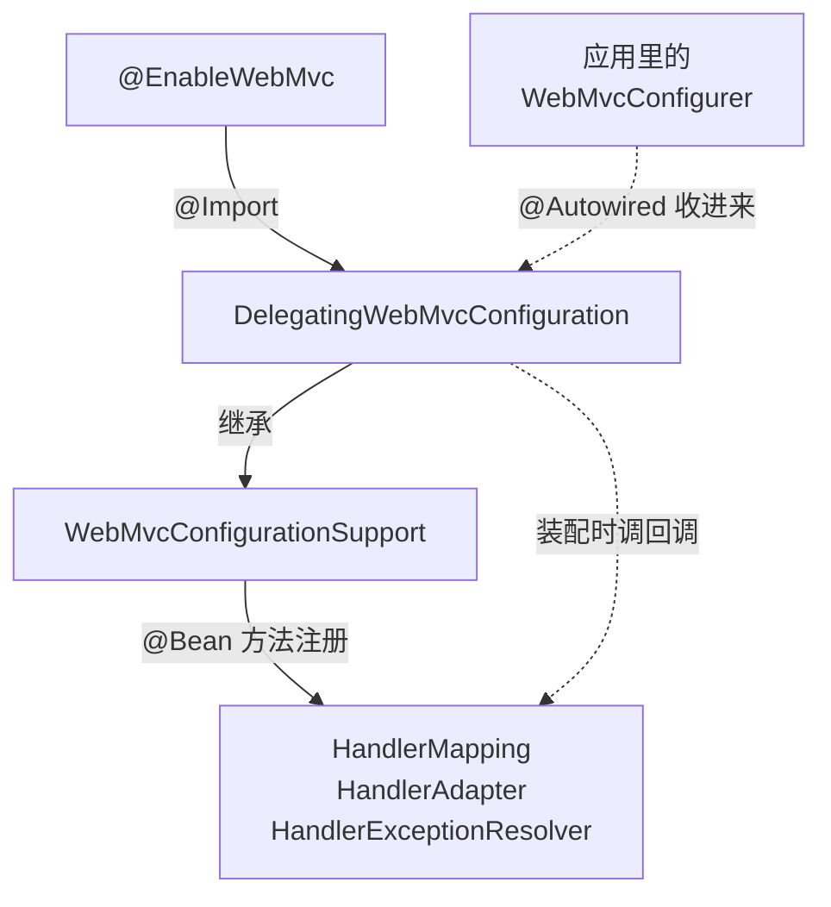

# @Enable 系列注解

[[toc]]

`@EnableXxx` 是 Spring 各模块的装配开关：把它加在一个 `@Configuration` 类上，对应能力的基础设施就被注册进容器。注解体大多是空的，只挂了一行 `@Import`，干活的是被导入的那个类。

本文讲的是跨版本稳定的注解机制，不绑定具体版本。

`@EnableWebMvc` 是这一族里各要素都看全的一个样本：它开的是 Spring MVC 的全套基础设施——`RequestMappingHandlerMapping`、`RequestMappingHandlerAdapter`、`ExceptionHandlerExceptionResolver` 这些。[`@EnableCaching`](../framework-callbacks/import-selector.md#官方就是这么用的-enablecaching)、`@EnableAsync`、`@EnableTransactionManagement`、`@EnableAspectJAutoProxy` 是同一套路，名字都是 `@Enable` 加一个能力名，实现都是「注解上挂一行 `@Import`，由被导入的类完成装配」。读懂一个，其余的读法一样，差别只在 `@Import` 指向的类。

这类注解最容易踩的坑在 Spring Boot 里：加 `@EnableWebMvc` 不是「多开一个功能」，而是会让 Boot 为 MVC 准备的一整套自动配置都不再生效。原因见下文。

## 什么时候会遇到它们

这类注解通常在下面几种场合出现：

- **用纯 Spring Framework（不用 Boot）**。MVC、缓存、异步、事务这些能力默认都不开，只能靠这类注解逐个打开——这是它们原本的用法。
- **在 Boot 项目里看到别人加了一个**。这时要先看它让哪些自动配置失效了。加了 `@EnableWebMvc`，`spring.mvc.*` 那一批配置项就整体失效了。
- **排查「功能没生效」**。`@Scheduled` 不跑、`@Cacheable` 不缓存，第一件事是看对应的 `@EnableXxx` 有没有加上。

## 这类注解是什么

它们的形态高度一致：

- 注解体要么是空的，要么只有几个属性（如 `@EnableCaching` 的 `mode`、`proxyTargetClass`）。
- 注解上有一行 `@Import(...)`，指向真正干活的类。
- 注解自己不被扫描成 Bean，也不注册任何东西——装配全部发生在被导入的类里。

名字的规律是 `@Enable` 加能力名：`@EnableWebMvc` 开 MVC，`@EnableCaching` 开缓存注解，`@EnableAsync` 开异步方法，`@EnableScheduling` 开定时任务。

同一族里还有粒度大得多的成员：Boot 的 `@EnableAutoConfiguration` 也是 `@Enable` 开头，但它导入的是一个 `DeferredImportSelector`，一次决定几十个自动配置类的取舍。它对应下文三种落点里的第二种，只是把「选择」这件事推到了容器装配的最后。

## @EnableWebMvc：一个完整的例子

这一族注解的每个要素，在 `@EnableWebMvc` 上都能看全：空的注解体、一行 `@Import`、一个真正干装配的配置类，以及这行 `@Import` 在 Spring Boot 里引起的连锁反应。

### 注解本身

`@EnableWebMvc` 的注解定义很短，除了几个元注解就只有一行 `@Import`：

```java
@Retention(RetentionPolicy.RUNTIME)
@Target(ElementType.TYPE)
@Documented
@Import(DelegatingWebMvcConfiguration.class)
public @interface EnableWebMvc {
}
```

注解体是空的，唯一的动作就是 `@Import(DelegatingWebMvcConfiguration.class)`。

### @Import 之后发生什么



两个角色分工是清楚的：

- `WebMvcConfigurationSupport` 负责**装配**。MVC 的组件都是它用 `@Bean` 方法注册的，所以只要它进了容器，一整套组件就齐了，跟 Boot 无关。
- `DelegatingWebMvcConfiguration` 负责**聚合**。它继承前者，自己多做的唯一一件事是把应用里所有 `WebMvcConfigurer` Bean 收进来，再把各个环节的回调转发给它们。

链路上这三跳的细节、以及回调在什么时机被调用，见 [WebMvcConfigurer](../framework-callbacks/web-mvc-configurer.md#回调是怎么接上的)。

### 为什么加了它，Boot 的自动配置就不生效

Boot 的 `WebMvcAutoConfiguration` 类上有一个条件：`@ConditionalOnMissingBean(WebMvcConfigurationSupport.class)`。用户加了 `@EnableWebMvc` 之后，容器里就有了 `DelegatingWebMvcConfiguration`——它是 `WebMvcConfigurationSupport` 的子类，条件不成立，整个 `WebMvcAutoConfiguration` 不再生效。

于是那些「本来帮你配好的东西」一起消失：

| 消失的东西 | 平时由谁提供 |
| --- | --- |
| `spring.mvc.*`、`spring.web.*` 配置项 | `WebMvcAutoConfiguration` 读属性后定制各组件 |
| 静态资源映射（classpath 下的 `/static`、`/public` 等）、欢迎页 | 同上 |
| Jackson 按 Boot 属性做的定制 | 同上 |
| 内容协商、日期格式等默认值 | 同上 |

所以 Boot 项目里通常不加它。要改 MVC 的某处配置，实现 `WebMvcConfigurer` 就够了——Boot 的自动配置本来就会收集 `WebMvcConfigurer`，用不着先把自动配置关掉。

## 共同套路：@Import 的三种落点

每个 `@EnableXxx` 都有一行 `@Import`，区别只在被导入的类属于哪一类。三类落点，能力从小到大：

| 落点 | 被导入的是 | 它能做什么 | 例子 |
| --- | --- | --- | --- |
| 配置类 | 一个 `@Configuration` 类 | 把它（连同它自己 `@Import` 的）直接注册进容器 | `@EnableWebMvc`、`@EnableScheduling` |
| `ImportSelector` | 一个选择器类 | 运行时算出一批类名返回，能依注解属性、类路径、环境做判断 | `@EnableCaching`、`@EnableAsync`、`@EnableTransactionManagement` |
| `ImportBeanDefinitionRegistrar` | 一个注册器类 | 拿到 `BeanDefinitionRegistry`，自己往容器里注册定义 | `@EnableAspectJAutoProxy` |

这张表是按「`@EnableXxx` 里 `@Import` 挂的是哪一类回调」来分的，所以只收这三类。`@Import` 的 `value` 其实还接受普通组件类——那种写法只是把一个现成的类注册成 Bean，不构成「一行注解开一整套能力」的装配套路，这里不展开。

三种落点用一句话区分：

- 装配结果**固定**，直接写成一个配置类导入。
- 结果**要看情况**（按注解属性、类路径上有没有某个依赖），写成选择器。
- 要动的**是 Bean 定义本身**，或定义得在运行期才生成得出来，写成注册器。

`@EnableCaching` 是第二种里最常见的样本：注解自己只有 `mode`、`proxyTargetClass`、`order` 三个属性，一个 Bean 都不装配，真正干活的是它导入的 `CachingConfigurationSelector`——它按 `mode` 属性决定装哪一套实现。

三种落点的机制细节、以及 `DeferredImportSelector`（`@EnableAutoConfiguration` 用的就是它）为什么能把时机推到所有配置类解析完之后，见 [ImportSelector](../framework-callbacks/import-selector.md) 与 [ImportBeanDefinitionRegistrar](../framework-callbacks/import-selector.md#importbeandefinitionregistrar)。

## 常见的 @EnableXxx 一览

同一族里你能碰到的成员大致是这些：

| 注解 | 所属模块 | 开关什么 | @Import 的落点 |
| --- | --- | --- | --- |
| `@EnableWebMvc` | spring-webmvc | Spring MVC 的基础设施组件 | 配置类 |
| `@EnableTransactionManagement` | spring-tx | `@Transactional` 的代理支持 | `ImportSelector` |
| `@EnableCaching` | spring-context | `@Cacheable` / `@CacheEvict` 等缓存注解 | `ImportSelector` |
| `@EnableAsync` | spring-context | `@Async` 方法异步执行 | `ImportSelector` |
| `@EnableScheduling` | spring-context | `@Scheduled` 定时任务 | 配置类 |
| `@EnableAspectJAutoProxy` | spring-context | `@AspectJ` 注解风格的自动代理 | `ImportBeanDefinitionRegistrar` |
| `@EnableMBeanExport` | spring-context | 把标注的对象导出成 JMX MBean | 配置类 |
| `@EnableLoadTimeWeaving` | spring-context | AspectJ 加载期织入 | 配置类 |
| `@EnableAutoConfiguration` | spring-boot-autoconfigure | 自动配置总开关 | `DeferredImportSelector` |
| `@EnableConfigurationProperties` | spring-boot | 把 `@ConfigurationProperties` 类注册成 Bean | `ImportBeanDefinitionRegistrar` |
| `@EnableWebSecurity` | spring-security-config | Spring Security 的 Web 过滤链 | 配置类 + `ImportSelector` |

这份清单是「你能碰到的」，不是全集——同一个 `@Enable` 前缀被不同的库各自使用，这一族没有统一的归属，第三方库里按同一形态做的还有很多。遇到没见过的 `@EnableXxx`，判据只有两条：**注解上有没有 `@Import`**、**装配发生在哪个类里**。翻一下那个类的名字和它实现的接口，就知道它属于上表里的哪种落点、会往容器里放什么东西。

## 别用它们的时候

用之前先确认两件事：这个能力在你的环境里是不是已经开了；以及你要做的是「调整某个默认值」还是「打开整个能力」——只有后者才轮到这些注解。

### 在 Spring Boot 里先确认是不是已经自动开了

Boot 的自动配置已经替几个常用模块开好了开关，再手写一遍不会报错，但会让人以为不写它就不生效：

| 注解 | Boot 里要不要手写 | 依据 |
| --- | --- | --- |
| `@EnableAspectJAutoProxy` | 不用 | `AopAutoConfiguration` 的 javadoc 原话是「Equivalent to enabling `@EnableAspectJAutoProxy` in your configuration」 |
| `@EnableTransactionManagement` | 不用 | 事务自动配置里的 `JdkDynamicAutoProxyConfiguration` 上就写着 `@EnableTransactionManagement(proxyTargetClass = false)` |
| `@EnableCaching` | 要 | `CacheAutoConfiguration` 只在 caching is enabled via `@EnableCaching` 时才建 `CacheManager` |
| `@EnableAsync` | 要 | `TaskExecutionAutoConfiguration` 只准备 `TaskExecutor`，不开 `@EnableAsync` |
| `@EnableScheduling` | 要 | `TaskSchedulingAutoConfiguration` 只准备 `TaskScheduler`，不开 `@EnableScheduling` |

后三个是「基础设施」和「开关」分开的典型：Boot 把线程池、调度器、`CacheManager` 都准备好了，但注解处理器的开启仍然要你自己写一行。这也是为什么在 Boot 项目里这三行几乎是必备的。

### 别拿它当调优手段

这类注解的语义是**打开**，不是**调整**。它的作用范围是整个模块，不是某一处配置。

想改某个默认值，先找该模块自己的口子：MVC 是 `WebMvcConfigurer`，事务是 `@Transactional` 的属性与 `PlatformTransactionManager` 的注入，缓存是 `CacheManager` 的定制。只有整个模块的装配方式都要换掉（比如接管 MVC 的全部组件），才轮到 `@EnableWebMvc` 这种整块开关。

`@EnableWebMvc` 是这一条上最容易踩的：它看起来只是「启用 MVC」，实际效果是把 Boot 的 MVC 自动配置整体关掉，`spring.mvc.*` 一并失效。Boot 项目里出现它，多半是想改某处配置但找错了入口。
