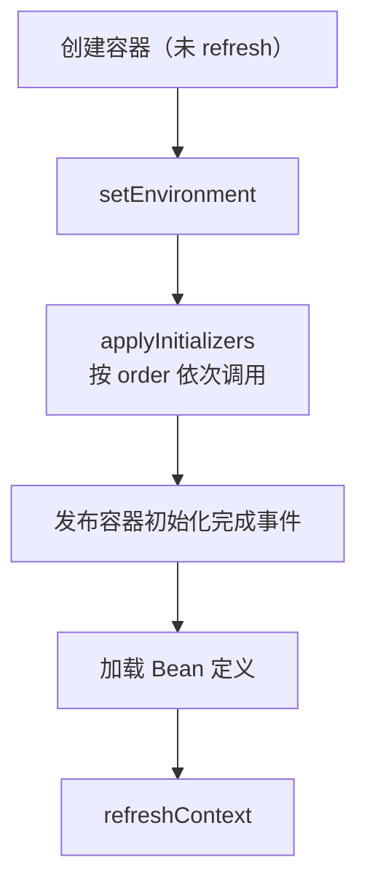

# ApplicationContextInitializer
[[toc]]

`ApplicationContextInitializer` 插在 `ApplicationContext` 已经创建、`refresh()` 还没调用的那一段。此时 `Environment` 是 [`EnvironmentPostProcessor`](../../spring-boot/boot-callbacks/environment-post-processor.md) 处理完的那个对象，容器本身也已经在手上——可以在里面注册后处理器、监听器、单例，这些动作在 refresh 阶段会被正常纳入初始化流程。

本文以 Spring Boot 3.5（Spring Framework 6.2）为准。

接口在 `org.springframework.context` 包下，Spring Framework 3.1 起就有；Spring Boot 把它接进了自己的启动流程。

## 什么时候需要它

容器已经造出来、但还没开始装配，这个窗口能做几件别处做不了的事：

**给 `Environment` 补属性源。** 和 `EnvironmentPostProcessor` 一样能加属性源，差别在于这里已经摸得到容器——需要「先看看容器里有什么，再决定加什么」的场景，只有这一步做得到。典型的是塞进构建信息（`git.properties`、`build-info.properties`），或者按机房、按集群写入一组默认值。

**按条件激活 profile。** 该激活哪个 profile 可能是算出来的——读到 `app.region=cn-hz` 才激活 `hz`。这里要分清两件事：

- `@Profile` 标注的 Bean 装不装配，看的是 refresh 时的 active profiles，在这一步激活完全来得及。
- `application-{profile}.yml` 只被加载一次，加载时机在配置数据阶段，早于本回调点——在这里激活，Spring Boot 不会回头再去读那几个文件。

要靠 profile 分文件拿到配置，得把激活动作提到配置数据加载之前（放进 `EnvironmentPostProcessor`，且顺序排在 `ConfigDataEnvironmentPostProcessor` 前面）。

**往容器里注册组件。** 容器还没 refresh，可以直接 `addBeanFactoryPostProcessor`、`addApplicationListener`、`addProtocolResolver` 把东西塞进去，不必包装成 Bean 定义。

**注册现成的单例。** 对象是框架之外造好的（SPI 加载来的、或者拼装成本很高的），用 `getBeanFactory().registerSingleton(name, obj)` 直接放进去，省掉一次实例化。

和 `EnvironmentPostProcessor` 的区别只有一条：容器有没有创建。属性源两边都能加，但只有这里能碰到容器。

::: tip 什么时候才轮到它
`addActiveProfile` 在 `EnvironmentPostProcessor` 阶段就能调。摆在下面细讲这个回调点，更多是为了「得先看容器类型或容器状态，才能决定激活哪个 profile」的场合。
:::

## 接口定义

接口只有一个方法：

```java
@FunctionalInterface
public interface ApplicationContextInitializer<C extends ConfigurableApplicationContext> {

    void initialize(C applicationContext);

}
```

泛型参数 `C` 不是声明「你关心哪种容器」，而是会被运行时校验。Spring Boot 调用前用 `GenericTypeResolver` 取出泛型实参，断言当前容器是它的实例，不匹配就抛 `Unable to call initializer` 直接中断启动。

接口自带的约定是：处理器应当识别 `Ordered` 接口和 `@Order` 注解，并按顺序调用。Spring Boot 的启动流程遵守了这条。

## 一个完整的例子

按 `app.region` 的值给容器激活一个 profile，并补一条属性——profile 文件这时已经加载过了，所以配置直接以属性源的形式补进去：

```java
package com.example;

import java.util.Map;

import org.springframework.context.ApplicationContextInitializer;
import org.springframework.context.ConfigurableApplicationContext;
import org.springframework.core.env.ConfigurableEnvironment;
import org.springframework.core.env.MapPropertySource;

public class RegionInitializer implements ApplicationContextInitializer<ConfigurableApplicationContext> {

    @Override
    public void initialize(ConfigurableApplicationContext applicationContext) {
        ConfigurableEnvironment environment = applicationContext.getEnvironment();
        String region = environment.getProperty("app.region", "cn");
        environment.addActiveProfile(region);
        environment.getPropertySources().addLast(new MapPropertySource("region",
                Map.of("region.code", region)));
    }
}
```

`Map.of` 要求 Java 9 及以上。下面的三种注册方式都用这个类。

## 三种注册方式

挂载点有三个：直接调 API、写配置文件、写 `spring.factories`；三条路的生效范围和顺序控制都不一样。

### 编程方式：`addInitializers`

拿到 `SpringApplication` 实例后直接追加一个实例：

```java
@SpringBootApplication
public class MyApplication {

    public static void main(String[] args) {
        SpringApplication application = new SpringApplication(MyApplication.class);
        application.addInitializers(new RegionInitializer());
        application.run(args);
    }
}
```

`addInitializers` 追加，`setInitializers` 整体替换（会丢掉 `spring.factories` 里加载来的那批，慎用）。用 `SpringApplicationBuilder` 构建应用时对应的方法是 `initializers(...)`——它内部调的就是 `addInitializers`，同样是追加；`setInitializers` 在 builder 上没有对应方法。

### 配置文件：`context.initializer.classes`

在配置文件里按逗号分隔列出实现类的全限定名：

```properties
context.initializer.classes=com.example.RegionInitializer,com.example.BuildInfoInitializer
```

值是按逗号分隔的类名，读取和实例化由 `DelegatingApplicationContextInitializer` 完成（这个类本身也是通过 `spring.factories` 注册的，属性没配时它什么都不做）。因为要反射实例化，实现类必须有可访问的无参构造器；类之间的顺序同样按 `@Order` / `Ordered` 排。

::: danger 3.2 起废弃，3.4 起移除
`DelegatingApplicationContextInitializer` 在 3.2.0 被标记 `@Deprecated(forRemoval = true)`，3.4.0 已从 Spring Boot 中删除。Boot 3.4 及以上版本里 `context.initializer.classes` 不会被任何人读取，**属性留着不报错，只是静默失效**——从 3.3 及更早版本升级上来时，这是最容易漏掉的一处。
:::

### `spring.factories`

写进 `META-INF/spring.factories`：

```properties
org.springframework.context.ApplicationContextInitializer=\
com.example.RegionInitializer
```

key 是接口全限定名。和 `EnvironmentPostProcessor` 一样，`spring.factories` 这个位置在 Spring Boot 3.x 里没有换成 `.imports`，Boot 3.5 自带的 initializer 仍从这里加载。放在依赖 jar 里则所有使用方都会生效。

三种方式的差别：

| 注册方式 | 生效范围 | 顺序控制 | 可用版本 |
| --- | --- | --- | --- |
| `addInitializers` | 当前 `SpringApplication` 实例 | `@Order` / `Ordered` | 全部 |
| `context.initializer.classes` | 通过该环境启动的应用 | 仅在该组内部排序 | Boot 1.0 – 3.3 |
| `spring.factories` | 所有依赖该 jar 的应用 | `@Order` / `Ordered` | 全部 |

::: warning `context.initializer.classes` 的排序范围
`addInitializers` 与 `spring.factories` 两条路混进同一个列表统一排序；而 `context.initializer.classes` 指定的那批，是在 `DelegatingApplicationContextInitializer` 自己那一步（默认 order 为 0）内部再排序的。所以给它们写的 `@Order` 只决定组内次序，不能拿它去插到某个 `spring.factories` 里的 initializer 之前。
:::

## 执行时机



`applyInitializers` 是 `SpringApplication.prepareContext` 里的一步，位置在 `setEnvironment` 之后、`ApplicationContextInitializedEvent` 发布之前。中间还夹了 `postProcessApplicationContext`，它负责给容器设置资源加载器、Bean 名生成器这类基础件。

排在前面的 initializer 改过的东西，后面的能看见；它们全部跑完之后才会加载 Bean 定义，所以在这里注册的 `BeanFactoryPostProcessor` 赶得上处理完整的 Bean 定义集合。

## 能拿它做什么

容器在手上但还没 refresh，能调的是容器和 BeanFactory 上不依赖 refresh 完成的那部分 API：

- `applicationContext.getEnvironment()`：加属性源、激活 profile、改属性值
- `applicationContext.addBeanFactoryPostProcessor(...)`、`addApplicationListener(...)`、`addProtocolResolver(...)`：这三个方法都声明在 `ConfigurableApplicationContext` 上
- `applicationContext.getBeanFactory().registerSingleton(name, instance)`：直接注册现成对象

最后一条不是理论上的可能性。Spring Boot 自己在 `prepareContext` 里就这么干：`applyInitializers` 之后、发布完 `ApplicationContextInitializedEvent`，再把 `springApplicationArguments`、`springBootBanner` 两个单例注册进 BeanFactory。Boot 3.5 自带的一个 initializer（`ProtocolResolverApplicationContextInitializer`）也是这个路子——从 `spring.factories` 读出所有 `ProtocolResolver`，逐个调 `applicationContext.addProtocolResolver(...)`。

## 坑

写 initializer 时容易踩的地方，基本都围绕「容器还没 refresh、它本身也不是容器里的 Bean」这条线：

- **泛型参数写死具体容器类型会限制适用场景。** 声明 `ApplicationContextInitializer<ServletWebServerApplicationContext>` 后，用 `ApplicationContextRunner` 或 `AnnotationConfigApplicationContext` 跑的测试会直接报 `Unable to call initializer`。除非确实要用到 servlet 容器特有的 API，否则声明成 `ConfigurableApplicationContext`。
- **`getBean` 会抛异常。** 此时容器没过 refresh，`AbstractApplicationContext.assertBeanFactoryActive` 会抛 `IllegalStateException: <应用名> has not been refreshed yet`。依赖注入、`@Value`、`@PostConstruct` 同样都用不上——这个类不是 Bean。
- **抛异常的表现和 [`ApplicationRunner`](../../spring-boot/boot-callbacks/application-runner.md) 不同。** `ApplicationRunner` 抛异常会被统一包装成 `IllegalStateException: Failed to execute ApplicationRunner`；initializer 抛出的异常则原样向上抛，只有非 `RuntimeException` 的异常才会被 `SpringApplication.handleRunFailure` 包成 `IllegalStateException`。两条路径在失败前都会关闭 context 并跑一遍 `FailureAnalyzer`。
- **同一个类注册两次会跑两次。** `addInitializers` 不去重，同一类型的两个实例都会被调用。`getInitializers()` 返回的是 `LinkedHashSet`，能去掉的是「同一个实例被重复添加」这种情况。

## 与其他启动回调的取舍

| 回调 | 容器状态 | 典型用途 | 注册方式 |
| --- | --- | --- | --- |
| `EnvironmentPostProcessor` | 尚未创建 | 属性源、`logging.*` / `spring.main.*` 相关开关 | `spring.factories` |
| `ApplicationContextInitializer` | 已创建、未 refresh | 属性源、profile、向容器注册组件 | `spring.factories`<br/>`addInitializers`<br/>`context.initializer.classes`（≤3.3） |
| `ApplicationRunner` | 已 refresh、Bean 就绪 | 缓存预热、建连、加载初始数据 | 交给容器管理 |
