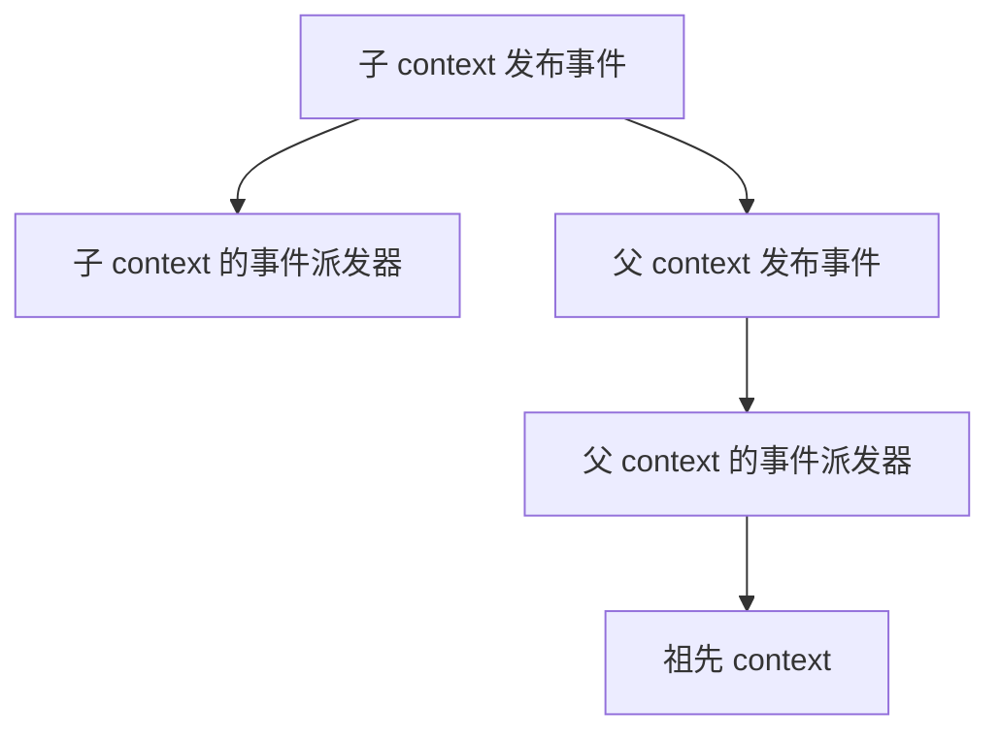

# ApplicationListener
[[toc]]

`ApplicationListener` 是事件回调接口，包名 `org.springframework.context`。它有个和启动期回调不同的地方：**回调时机不固定在某一个节点上**——谁发事件，它就在谁发事件的时候被调用。启动期的事件、请求处理中发布的自定义事件、容器关闭事件，走的都是同一条通道。

本文以 Spring Framework 6.1 及以后为准（Spring Boot 3.4 起的差异已随文标注）。

## 什么时候需要它

它的回调时机由发布方决定，所以它面对的需求有一类共同形状：**一件事发生了，我希望有人知道，但发起方不必认识这些人**。几个典型场景：

**一个动作要牵动多个下游，而且下游还会增加。** 下单成功之后要发短信、加积分、写审计，每多一个下游就得回头改一次支付方法，那个方法被迫认识一堆与支付无关的东西。改成发布一个事件，发布方只管发，下游各自订阅。要注意解耦解掉的只是代码依赖，不是时间——派发默认同步，发布方仍然要等所有监听器跑完。

**同一类处理要覆盖很多个动作。** 这跟上一条正好相反：埋点、审计日志、统一的操作记录，特点是「只关心发生了什么，不改变发生了什么」，需要在很多地方都发生，放哪一段业务代码里都不合适。把它们收进一个监听器、只按事件类型筛选即可。前提是事件得先存在——业务事件要有人在代码里发一笔，框架自己的事件（`ContextRefreshedEvent`、`WebServerInitializedEvent` 等）则本来就有；目标代码根本不发事件的地方，这条路走不通。

**要在启动的某个阶段做事。** 预热缓存、把自己注册进注册中心、上报启动耗时，这些都必须等容器就绪、端口已经在监听之后再做，`ApplicationReadyEvent` 就是这个时刻：它在所有 [`ApplicationRunner`](../../spring-boot/boot-callbacks/application-runner.md) / `CommandLineRunner` 跑完之后发出。想提前一点、在容器刚 refresh 完而 Runner 还没跑时插进去，用 `ApplicationStartedEvent`。这两个事件都走 `context.publishEvent`，写在容器里的监听器 Bean 收得到；启动最早的四个事件收不到，只有注册在 `SpringApplication` 上、或写在 `spring.factories` 里的监听器能收到（见「注册方式与生效时机」）。

**启动失败时要做上报或清理。** 应用拉不起来时要发告警、把失败原因留档、把本次发布标记成失败。这类逻辑指望不上业务 Bean：容器可能压根没建起来，也可能是半成品，所以 `ApplicationFailedEvent` 里的 `getApplicationContext()` 允许为 null，异常本身从 `getException()` 取。要保证任何阶段的失败都能收到，监听器得注册在 `SpringApplication` 上（`addListeners` 或 `spring.factories`），而不是只放在容器里。

**你的组件要跑在别人的容器里。** 组件打成 jar 分发时，要求使用方在自己的启动类上补一句 `addListeners` 是不现实的；写进 `META-INF/spring.factories` 的 `org.springframework.context.ApplicationListener` key，依赖这个 jar 的应用会把它自动挂上。代价是你不知道对方的上下文是怎么搭的：应用里存在多层 `SpringApplication` 时，子 context 的事件会向祖先逐层传播，同一个监听器会被调用多次。只按事件类型判断，就会把子容器的动作当成自己的——这时得靠 `SmartApplicationListener#supportsSourceType` 或注入 context 做比对（见「父子容器之间的事件传播」）。

## 事件从哪来

事件由 `ApplicationEventPublisher.publishEvent(...)` 发出，`ApplicationContext` 就实现了这个接口，Bean 里注入 `ApplicationEventPublisher` 即可：

```java
public class OrderService {

    private final ApplicationEventPublisher publisher;

    public OrderService(ApplicationEventPublisher publisher) {
        this.publisher = publisher;
    }

    public void pay(String orderNo) {
        // 业务逻辑
        this.publisher.publishEvent(new OrderPaidEvent(this, orderNo));
    }
}
```

Spring 4.2 起，`publishEvent` 的入参可以是任意对象，不要求继承 `ApplicationEvent`，框架会把它包成 `PayloadApplicationEvent` 再派发。用 `@EventListener` 时直接把载荷类型写成方法参数即可，注解方法的适配器会负责拆包。

Spring Boot 在启动过程中发布了一串固定事件，每个事件的时机在 `ApplicationRunner` 一文的「执行时机」一节里列了，这里不重复。

## 接口定义

接口只有一个方法，泛型参数声明它要接收的事件类型：

```java
@FunctionalInterface
public interface ApplicationListener<E extends ApplicationEvent> extends EventListener {

    void onApplicationEvent(E event);

}
```

泛型参数 `E` 只用于类型过滤：注册到容器后，事件派发器按事件类型匹配监听器，只有匹配上的才会被调用。接口继承 `java.util.EventListener`（一个没有方法的标记接口），语义上对应观察者模式。

需要按「事件来自哪个容器」过滤时，用子接口 `SmartApplicationListener`：它在 `supportsEventType` 之外多一个 `supportsSourceType(Class<?>)`。另一个子接口 `GenericApplicationListener` 用 `ResolvableType` 做更细的类型判断，`@EventListener` 方法的适配器 `ApplicationListenerMethodAdapter` 就实现了它。

`supportsAsyncExecution()` 是 Spring Framework 6.1 加入的默认方法，默认返回 `true`，表示这个监听器允许被异步执行——前提是事件派发器配了线程池，见「坑」一节。

## 一个完整的例子

自定义事件、监听器，加上发布点：

```java
package com.example.event;

import org.springframework.context.ApplicationEvent;

public class OrderPaidEvent extends ApplicationEvent {

    private final String orderNo;

    public OrderPaidEvent(Object source, String orderNo) {
        super(source);
        this.orderNo = orderNo;
    }

    public String getOrderNo() {
        return this.orderNo;
    }
}
```

```java
package com.example.event;

import org.slf4j.Logger;
import org.slf4j.LoggerFactory;
import org.springframework.context.ApplicationListener;
import org.springframework.stereotype.Component;

@Component
public class OrderPaidListener implements ApplicationListener<OrderPaidEvent> {

    private static final Logger log = LoggerFactory.getLogger(OrderPaidListener.class);

    @Override
    public void onApplicationEvent(OrderPaidEvent event) {
        log.info("订单已支付：{}", event.getOrderNo());
    }
}
```

实现类交给容器管理（`@Component` 或 `@Bean`）就会自动生效，不需要在任何地方注册。启动期的事件同理：

```java
package com.example.event;

import org.slf4j.Logger;
import org.slf4j.LoggerFactory;
import org.springframework.boot.context.event.ApplicationReadyEvent;
import org.springframework.context.ApplicationListener;
import org.springframework.stereotype.Component;

@Component
public class StartupReportListener implements ApplicationListener<ApplicationReadyEvent> {

    private static final Logger log = LoggerFactory.getLogger(StartupReportListener.class);

    @Override
    public void onApplicationEvent(ApplicationReadyEvent event) {
        log.info("应用已就绪，启动耗时 {} ms", event.getTimeTaken().toMillis());
    }
}
```

`getTimeTaken()` 是 Spring Boot 2.6.0 加入的，返回一个 `Duration`。

## 注册方式与生效时机

| 注册方式 | 何时挂上事件派发器 | 能收到哪些事件 |
| --- | --- | --- |
| 容器里的 Bean（`@Component` 实现接口） | refresh 的 `registerListeners()` 阶段按类型登记 | context 上发布的事件 |
| `SpringApplication.addListeners`<br/>`setListeners`<br/>`SpringApplicationBuilder.listeners` | 启动一开始就参与 | 启动早期的四个事件<br/>+ 容器上发布的事件（`contextLoaded` 时它们被注册进容器） |
| `META-INF/spring.factories`<br/>key 为 `org.springframework.context.ApplicationListener` | 对所有依赖该 jar 的应用生效 | 同上 |

差别在于「启动早期事件」这一栏。`ApplicationStartingEvent`、`ApplicationEnvironmentPreparedEvent`、`ApplicationContextInitializedEvent`、`ApplicationPreparedEvent` 这四个都不走 `context.publishEvent`，而是由 `EventPublishingRunListener` 内部的事件派发器转发给在 `SpringApplication` 上登记的监听器：前两个发布时容器还不存在，后两个发布时容器虽已创建、但还没 refresh，容器内的监听器也尚未登记——装在容器里的 Bean 监听器对这四次事件完全没有机会。真正走 `context.publishEvent` 的是 `ApplicationStartedEvent`、`ApplicationReadyEvent` 和 `ApplicationFailedEvent`（后者在容器还活着时走容器，否则也退回内部事件派发器）。

::: warning `context.listener.classes` 已移除
用属性声明监听器类名的 `context.listener.classes` 由 `DelegatingApplicationListener` 处理，该类同样在 Spring Boot 3.2.0 废弃、3.4.0 移除。Boot 3.4 及以上版本里这个属性静默失效，改用 `spring.factories`。
:::

## 与 `@EventListener` 的关系

`@EventListener` 不是另一套机制。`EventListenerMethodProcessor`（Spring Framework 4.2 起）扫描所有 Bean 上带该注解的方法，为每个方法生成一个 `ApplicationListenerMethodAdapter` 注册进事件派发器——**注解方法最终也是以 `ApplicationListener` 的形式执行的**，两条路共用同一个派发通道。

| 对比项 | `ApplicationListener` 接口 | `@EventListener` 注解 |
| --- | --- | --- |
| 写法 | 实现接口 | Bean 的任意方法加注解 |
| 事件类型 | 泛型参数 | 方法参数类型，或 `classes` / `value` 指定多个 |
| 多事件类型 | 需改用 `SmartApplicationListener` | 一个方法就能挂多个类型 |
| 条件判断 | 自己在方法里判断 | `condition` 属性写 SpEL |
| 排序 | `@Order` / `Ordered` | `@Order` |
| 接到容器创建前的事件 | 可以（注册到 `SpringApplication` 上） | 不行（方法所在 Bean 还不存在） |
| 返回值 | 不用管 | 非 `void` 的返回值会作为新事件发布，集合和数组逐个发 |
| 元注解 | — | 可以组合出自定义注解 |

选择上：只在启动期事件上做文章、或者要给别的应用复用（放进 jar 的 `spring.factories`），用接口；业务事件监听用注解更方便。

::: tip 注册时机的差异
接口式的监听器 Bean 在 refresh 早期就以 Bean 名登记进事件派发器；`@EventListener` 的方法要等 `EventListenerMethodProcessor` 在单例全部实例化完成后（`afterSingletonsInstantiated`）才注册。所以在容器内部极早发布的事件，两类监听器不一定都能收到。
:::

## 父子容器之间的事件传播

`AbstractApplicationContext.publishEvent` 先把事件交给本 context 的事件派发器，然后**如果存在父 context，就把同一个事件再往父 context 发一次**，逐层递归到祖先。



方向是单向的：父 context 上发布的事件不会下发给子 context。由此带来两个后果。

- **祖先的监听器会收到子 context 的事件。** 事件对象的 `source` 是子 context，监听器如果只按事件类型判断，会把子容器的动作当成自己的。
- **同一个监听器可能被调用多次。** 应用里存在多层 `SpringApplication`（比如用 `SpringApplicationBuilder` 建了父子上下文）时，同一个事件在每一层都会被本层的事件派发器匹配一次，监听器收到多个实例——这一点 `ApplicationRunner` 一文里也提过。

要限定只处理某一层的事件，有两条路：

- 实现 `SmartApplicationListener` 并用 `supportsSourceType(Class<?>)` 过滤。
- 让监听器实现 `ApplicationContextAware`、把注入的 context 和事件里的 source 做比对。

Spring Boot 内置的 `ParentContextCloserApplicationListener` 用的就是后一种做法——它从 `ApplicationContextAware` 拿到自己的 context，再判断事件里的 context 是不是它自己，从而只在自己的父 context 上安装关闭监听器。

## 坑

下面几条是事件机制本身和监听器写法上最容易出问题的地方。

- **异常会中断派发。** 默认的 `SimpleApplicationEventMulticaster` 没有配 `ErrorHandler`，此时监听器抛出的异常不做捕获，会中断同一事件的后续监听器，并原样抛回给发布者。启动阶段的事件（例如 `ApplicationStartedEvent`）遇到这种情况会直接导致启动失败。
- **checked 异常会被包装。** 监听方法声明并抛出 checked 异常时，会被包成 `UndeclaredThrowableException`，因为派发通道只处理运行时异常。`@EventListener` 的文档写明了这一点。
- **默认同步执行。** 事件派发器在发布线程上依次调用监听器，发布方要等所有监听器跑完。想异步有两种办法：
  - 自己定义一个名为 `applicationEventMulticaster` 的 `SimpleApplicationEventMulticaster` Bean 并调用 `setTaskExecutor(...)`。
  - 用 `@Async` 配合 `@EnableAsync`（此时监听器抛出的异常不会回传给发布方，需要自己配置异常处理器）。
- **lambda 形式的监听器可能拿不到泛型信息。** 用 lambda 或方法引用实现 `ApplicationListener` 时，事件类型可能无法解析，导致 `onApplicationEvent` 里出现类型转换异常——这类 `ClassCastException` 会被派发器当作「类型不匹配」静默忽略，表现为监听器莫名其妙不执行。用匿名内部类或具名实现类可以避免。
- **顺序靠 `@Order`。** 派发前会用 `AnnotationAwareOrderComparator` 对监听器统一排序，接口和注解两种监听器混在一起也是同一套排序规则。
