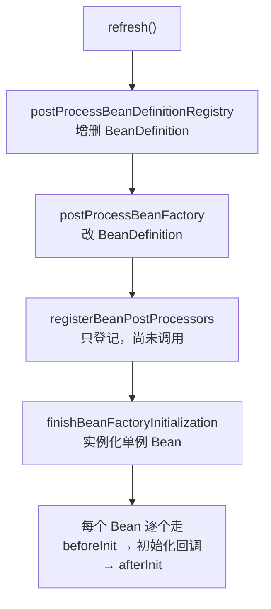

# BeanPostProcessor
[[toc]]

`BeanPostProcessor`、`BeanFactoryPostProcessor`、`BeanDefinitionRegistryPostProcessor` 是 Spring Framework 提供的容器级回调：它们不插在「应用启动」这类业务节点上，而是插在**容器装配 Bean 的过程**里——拿到 Bean 的定义或实例，检查、修改、包装，甚至换掉它。包名在 `org.springframework.beans.factory.config` 和 `org.springframework.beans.factory.support` 下。

本文以 Spring Framework 6.x 为准。

三个接口按「手上拿到什么」分成两拨：

| 接口 | 入参 | 能改什么 | 此时 Bean 造出来了吗 |
| --- | --- | --- | --- |
| `BeanDefinitionRegistryPostProcessor` | `BeanDefinitionRegistry` | 增删 BeanDefinition | 没有 |
| `BeanFactoryPostProcessor` | `ConfigurableListableBeanFactory` | 改已有的 BeanDefinition | 没有 |
| `BeanPostProcessor` | Bean 实例 | 包装、代理、替换实例 | 造好了 |

前两个操作的是「配方」（BeanDefinition），第三个操作的是「成品」（Bean 实例）。`BeanDefinitionRegistryPostProcessor` 是 `BeanFactoryPostProcessor` 的子接口，多出来的能力是**注册新定义**——这正是它存在的理由：`BeanFactoryPostProcessor` 只能看见已经加载的定义，改不了集合本身。

## 什么时候需要它

这三个接口的调用点都在「容器装配 Bean」的过程中，所以它们面对的问题有一类共同形状：**要作用的是一批 Bean（或 Bean 的定义），而不是某一个**。这也是它们和 `@PostConstruct`、`InitializingBean` 这类单 Bean 回调的分界。几个典型场景：

**`BeanPostProcessor`：要给某一类 Bean 统一包一层壳。** 所有带某个自定义注解的 Bean 都要记耗时、所有实现某个接口的 Bean 都要套一层缓存或重试——这段逻辑不属于任何一个业务类，用继承或工具类也收拢不了。做法是在 `postProcessAfterInitialization` 里返回一个代理，和 Spring 自己的 AOP 自动代理干的是同一件事。选包装方式时要想到静态类型：包成 JDK 动态代理后，这个 Bean 只剩接口类型，按具体类型注入的地方会取不到。

**`BeanDefinitionRegistryPostProcessor`：要注册一批编译期还不知道的定义。** 要注册的类名和数量由运行期决定：从配置或数据库里读一份名单逐个注册、扫描一个包把里面的接口声明成 Bean（MyBatis 的 `MapperScannerConfigurer` 就是这么做的）。`BeanFactoryPostProcessor` 拿到的是已经加载好的定义集合，改不了集合本身，这件事只有它干得了。前提是这时手上只有「配方」：能塞构造参数和属性值，不能塞对象。

**`BeanFactoryPostProcessor`：要改的定义不是你写的。** 引了一个 starter，它注册的 Bean 不方便改源码，但你想统一调（改超时、换成自己的实现、覆盖某个属性的默认值）。在 `postProcessBeanFactory` 里 `getBeanDefinition(name)` 读出定义再改即可。这里有条硬边界：只能碰定义，不能 `getBean(...)`——那会把实例提前造出来，绕过后面整条 `BeanPostProcessor` 链，拿到的不是你以为的那个对象。

**三个接口都适用：要把扩展做成 jar 发出去。** 后处理器在自己的包里，指望使用方 `@ComponentScan` 扫到不现实。做法是写自动配置、把后处理器当 `@Bean` 注册进去，再用 `META-INF/spring/org.springframework.boot.autoconfigure.AutoConfiguration.imports` 声明，依赖了这个 jar 的 Boot 应用就会生效（Boot 自己的 `PropertyPlaceholderAutoConfiguration` 就是这么装配 `PropertySourcesPlaceholderConfigurer` 的，用的还是 `static` 方法）。代价集中在依赖上：后处理器要被极早实例化，它依赖的 Bean 会被连带着提前创建、走不完 BPP 链——这条和 `static` 的要求都在「两个容易踩的坑」里。

## 接口定义

三个接口的签名如下。`BeanDefinitionRegistryPostProcessor` 是 `BeanFactoryPostProcessor` 的子接口，多出 `postProcessBeanDefinitionRegistry`；`BeanFactoryPostProcessor` 只有一个方法，所以标了 `@FunctionalInterface`：

```java
public interface BeanDefinitionRegistryPostProcessor extends BeanFactoryPostProcessor {

    void postProcessBeanDefinitionRegistry(BeanDefinitionRegistry registry) throws BeansException;

    @Override
    default void postProcessBeanFactory(ConfigurableListableBeanFactory beanFactory) throws BeansException {
    }   // 6.1 起给了空实现
}

@FunctionalInterface
public interface BeanFactoryPostProcessor {
    void postProcessBeanFactory(ConfigurableListableBeanFactory beanFactory) throws BeansException;
}

public interface BeanPostProcessor {

    default Object postProcessBeforeInitialization(Object bean, String beanName) throws BeansException {
        return bean;
    }

    default Object postProcessAfterInitialization(Object bean, String beanName) throws BeansException {
        return bean;
    }
}
```

`BeanPostProcessor` 的两个方法都是 `default` 且原样返回，只覆写关心的那个即可。返回 `null` 表示**中断整条后处理器链**——不是把 Bean 变成 null（框架会退回上一个结果），而是这条链到此为止，排在后面的 `BeanPostProcessor` 不再被调用。

## 调用顺序

发起这一切的是 `AbstractApplicationContext#refresh()`，具体顺序写在 `PostProcessorRegistrationDelegate` 里，压成一行就是 `postProcessBeanDefinitionRegistry` → `postProcessBeanFactory` → `postProcessBeforeInitialization` → `postProcessAfterInitialization`：



拆开说是四步，前两步内部的分批规则图上标不出来：

1. `postProcessBeanDefinitionRegistry`——所有 `BeanDefinitionRegistryPostProcessor` 按 `PriorityOrdered` → `Ordered` → 无序三批依次调用。无序那批是**反复扫描**的：每轮跑完都可能注册出新的 `BeanDefinitionRegistryPostProcessor`，扫到不再出现新的才停。
2. `postProcessBeanFactory` 分三轮：第一轮是上一步收集到的所有 `BeanDefinitionRegistryPostProcessor`；第二轮是 `ConfigurableApplicationContext#addBeanFactoryPostProcessor` 手工加进去的；第三轮是从 BeanDefinition 里发现的 `BeanFactoryPostProcessor`，同样分三批。前面几轮处理过的 Bean 在这里会被跳过，靠一个 `processedBeans` 集合去重。
3. `registerBeanPostProcessors`——注册前先把 `BeanPostProcessor` 排好序。
4. `finishBeanFactoryInitialization`——只实例化剩下的**非懒加载**单例。

`BeanFactoryPostProcessor` 的 Javadoc 还专门警告过另一头：它可以和 Bean **定义**交互，但**绝不能**和 Bean **实例**交互，「这么做会引起提前实例化，破坏容器并造成意料外的副作用」。所以在这个方法里写 `beanFactory.getBean("xxx")` 是个陷阱——它能把 Bean 造出来，但造出来的这份拿不到后面的 `BeanPostProcessor` 处理，等于绕过了一整套代理机制。

上面第 4 步里的「初始化回调」夹在两次后处理之间，顺序是 `@PostConstruct` → `InitializingBean#afterPropertiesSet()` → `@Bean(initMethod = "...")` 指定的方法。

`@PostConstruct` 排最前面不是巧合：它本身就是靠 `BeanPostProcessor` 触发的——`CommonAnnotationBeanPostProcessor`（继承 `InitDestroyAnnotationBeanPostProcessor`）在 `postProcessBeforeInitialization` 里反射调用它。所以「before」阶段并不存在一条「所有 BPP 的 before 跑完、然后才开始跑 `@PostConstruct`」的分界线，`@PostConstruct` 只是这条 BPP 链上的一环，谁先谁后取决于 BPP 的排列。而 `afterPropertiesSet` 排在自定义 `initMethod` 前面是确定的：两者都在 `invokeInitMethods` 里，先调 `afterPropertiesSet()`，再逐个跑 init method。

## 示例

下面三个例子对应三类后处理器：注册新的 Bean 定义、改一个已注册的定义、包装创建出来的实例。

### BeanDefinitionRegistryPostProcessor：按名单批量注册

要注册的类名和数量在编译期定不下来，比如运行期从配置或数据库里读到一份任务名单，再按名字逐个把定义写进注册表：

```java
@Component
public class JobRegistrar implements BeanDefinitionRegistryPostProcessor {

    private static final String[] JOBS = {"daily-report", "hourly-sync"};

    @Override
    public void postProcessBeanDefinitionRegistry(BeanDefinitionRegistry registry) throws BeansException {
        for (String name : JOBS) {
            RootBeanDefinition definition = new RootBeanDefinition(Job.class);
            definition.getConstructorArgumentValues().addGenericArgumentValue(name);
            registry.registerBeanDefinition("job-" + name, definition);
        }
    }
}
```

`Job` 是应用里的普通类，本例假定它有个接收任务名的构造参数。注意这里用的是**构造参数**而不是属性：这个阶段只能往定义里塞值，塞的是「配方」，实例要到 `finishBeanFactoryInitialization` 才造。

### BeanFactoryPostProcessor：改一个已注册的定义

引了一个 starter，它注册的 `reportJob` 定义里超时太短，又不方便改它的源码，就在 `postProcessBeanFactory` 里把定义读出来改掉：

```java
@Component
public class TimeoutOverridePostProcessor implements BeanFactoryPostProcessor, Ordered {

    @Override
    public void postProcessBeanFactory(ConfigurableListableBeanFactory beanFactory) throws BeansException {
        BeanDefinition definition = beanFactory.getBeanDefinition("reportJob");
        definition.getPropertyValues().add("timeoutSeconds", 120);
    }

    @Override
    public int getOrder() {
        return Ordered.LOWEST_PRECEDENCE;
    }
}
```

`getBeanDefinition(...)` 只是读定义，不会实例化；换成 `getBean(...)` 就会把 Bean 提前造出来。

### BeanPostProcessor：包装实例

给所有 `GreetingService` 的调用记耗时。它把匹配到的 Bean 包成 JDK 动态代理再返回：

```java
@Component
public class GreetingTimingPostProcessor implements BeanPostProcessor {

    private static final Logger log = LoggerFactory.getLogger(GreetingTimingPostProcessor.class);

    @Override
    public Object postProcessAfterInitialization(Object bean, String beanName) {
        if (!(bean instanceof GreetingService service)) {   // GreetingService 是应用里的接口
            return bean;
        }
        return Proxy.newProxyInstance(
                bean.getClass().getClassLoader(),
                new Class<?>[]{GreetingService.class},
                (proxy, method, args) -> {
                    long start = System.nanoTime();
                    try {
                        return method.invoke(service, args);
                    }
                    finally {
                        log.info("{}.{} 耗时 {} ms", beanName, method.getName(),
                                (System.nanoTime() - start) / 1_000_000);
                    }
                });
    }
}
```

放在 `postProcessAfterInitialization` 而不是 before，是因为要包装的必须是**初始化完成**的实例。Spring 自己的 AOP 自动代理（`AnnotationAwareAspectJAutoProxyCreator`）也是在这个方法里生成代理的，所以自定义包装和 `@Transactional`、`@Async` 这些叠加时，先后顺序由各自在 BPP 链上的位置决定。

## 排序

三批的划分只看**接口**，不看注解：

- 实现了 `PriorityOrdered` 的进第一批（`ConfigurationClassPostProcessor` 就是，它负责处理 `@ComponentScan` / `@Import` / `@Bean`）。
- 只实现 `Ordered` 的进第二批（如 Boot 的 `LazyInitializationBeanFactoryPostProcessor`）。
- 都没实现的进第三批——大多数自定义后处理器都落在这里。

前两批桶内还会再排一次，用的是 `beanFactory.getDependencyComparator()`——注解配置的上下文里它被 `AnnotationConfigUtils` 设成 `AnnotationAwareOrderComparator`，`@Order` 也能被读到。但能进这两批的后处理器必然实现了 `PriorityOrdered` 或 `Ordered`，取序时接口值优先于 `@Order`，所以实际决定顺序的一直是接口，`@Order` 从没左右过它们。（`ConfigurationClassPostProcessor` 的 `getOrder()` 返回 `Ordered.LOWEST_PRECEDENCE`，源码注释写的是「within PriorityOrdered」，即它在第一批里排最后。）第三批连排序都不做，`@Order` 在那里同样没有作用；接口也只能在同一批**内部**调先后，不能把后处理器提到 `PriorityOrdered` 前面。所以：

- `BeanFactoryPostProcessor` 和 `BeanPostProcessor` 的 Javadoc 都写了「`@Order` 注解对这类 Bean 不生效」——想调顺序就直接实现 `Ordered` 或 `PriorityOrdered`，别依赖注解。
- 用 `addBeanPostProcessor` 手工注册的，排序接口一律被忽略，按注册顺序追加。

## 两个容易踩的坑

这两处都跟后处理器的实例化时机有关：先是它自己的声明方式，再是它在创建过程中连带的 Bean。

### `@Bean` 返回后处理器时必须是 static

`@Bean` 的 Javadoc 专门有一节讲这个：`BeanFactoryPostProcessor` 必须极早实例化，会干扰声明它的 `@Configuration` 类里 `@Autowired`、`@Value`、`@PostConstruct` 的处理。把方法标成 `static`（如 `public static PropertySourcesPlaceholderConfigurer pspc()`），`@Configuration` 类就不会因为这个方法被提前实例化，冲突消失。

代价是 `static` 的 `@Bean` 方法拿不到 CGLIB 增强，作用域和 AOP 语义都失效——对 BFPP 恰好无所谓。写成非 static 时 Spring 会打一条 INFO 级日志提醒。

### 后处理器创建过程中造出来的 Bean 拿不到全部后处理

`BeanPostProcessor` 和 `BeanFactoryPostProcessor` 本身要在链装配完成前就实例化，它们依赖的 Bean 会被连带着提前创建。这些 Bean 走不完 BPP 链，也就意味着**不会被自动代理**。Spring 会在日志里警告：

```text
Bean 'xxx' of type [com.example.OrderService] is not eligible for getting processed by
all BeanPostProcessors (for example: not eligible for auto-proxying). Is this bean getting
eagerly injected/applied to a currently created BeanPostProcessor [...]. Check the
corresponding BeanPostProcessor declaration and its dependencies/advisors. If this bean does
not have to be post-processed, declare it with ROLE_INFRASTRUCTURE.
```

日志里出现这句，基本就是「某个 BPP 构造/注入时把一个业务 Bean 拖进来了」。解法是把 BPP 的依赖收敛成 `ApplicationContext`、`BeanFactory` 这类基础设施对象，或者用 `ObjectProvider` 延迟到真正需要时再取。

::: warning 归 Spring Framework 管
自动配置、条件装配那套机制对这三个接口帮不上忙：自动配置在这里只是把 `@Bean` 送进容器的载具，Boot 不会给这三个接口任何特殊处理，也没有 `@ConditionalOnMissingBean` 那类专用装配路径。要在 Boot 应用里生效，就是老老实实 `@Component` 或 `@Bean` 一个实例交给容器——`@Component` 只在能扫到自己包时可用，跨 jar 分发才用得上自动配置这种载具。
:::
