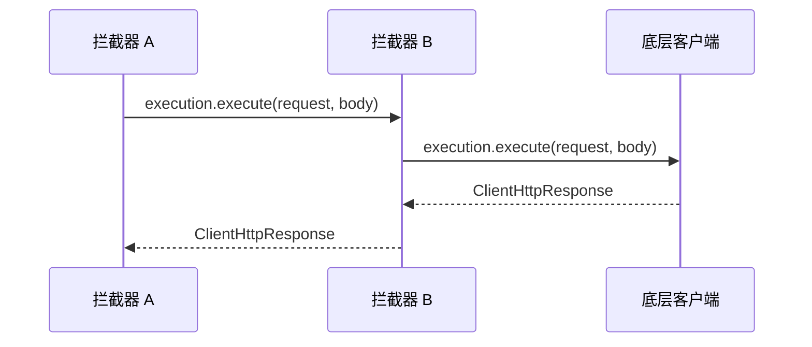

# ClientHttpRequestInterceptor
[[toc]]

`ClientHttpRequestInterceptor` 是 Spring Framework 拦截出站 HTTP 请求的接口。`RestTemplate` 每发一次请求，都会先把这次调用交给链上的拦截器，拦到的东西比客户端上的配置细一档：具体的方法、URI、请求头、请求体都在手上，响应也能拿到。这个接口 Spring Framework 3.1 起就有，包名 `org.springframework.http.client`。

本文以 Spring Framework 7.0 为准。

它和 [RestTemplateCustomizer](../../spring-boot/boot-callbacks/http-client-customizer.md) 的分工可以一句话划开：定制器在客户端构建时跑一次，改的是客户端本身的配置；拦截器在每次调用时跑，改的是这一次请求和它对应的响应。

## 什么时候需要它

客户端的公共设置——超时、消息转换器、错误处理器——在构建时一次配好就够了，那部分是定制器的活。下面这几类事情每次请求都不一样，只有拦截器接得住：

**请求头要按这次调用现算。** token 会过期，签名里要带时间戳和随机串，同一个头对不同下游还要取不同的值，这些在构建客户端时都定不下来。拦截器拿到 `HttpRequest` 之后再往里加头，值可以现算，判断也能按目标 host 做。

**要看清每次调用的全貌。** 耗时、请求体、响应状态码，只有拦截器同时看得到请求和响应。日志、埋点、审计放在这里，覆盖面就是全部出站调用，不用在每个调用点各写一遍。

**下游的错误响应要翻成自己体系的异常。** 默认的 `DefaultResponseErrorHandler` 把 4xx / 5xx 一律抛成框架自带的异常；想把下游返回的错误码和消息带出来、或者换成自己的异常类型，可以在这里看状态码、读响应体，再决定抛什么。

**请求要在发出前被改写，或者干脆不发。** 本地联调时把请求改道到 mock 服务、给请求体加一层签名、按开关临时屏蔽某个下游，都发生在这个位置。拦截器不调 `execution.execute` 就是把这个请求拦下了，代价是要自己造一个响应返回。

**同一套逻辑要按客户端决定装不装。** 拦截器是个普通对象，注册给哪个客户端就只在哪个客户端上生效。A 下游只加认证头、B 下游只记日志，各装各的，不用在一段代码里按 host 判断。

## 接口定义

接口只有一个方法，而且标了 `@FunctionalInterface`：

```java
@FunctionalInterface
public interface ClientHttpRequestInterceptor {

    ClientHttpResponse intercept(HttpRequest request, byte[] body,
            ClientHttpRequestExecution execution) throws IOException;
}
```

三个参数分别是这次调用的哪一部分，返回值则是这次请求的响应——常规写法是把参数原样交给 `execution`，再返回它的返回值：

| 参数 | 是什么 |
| --- | --- |
| `request` | 这次请求本身：方法、URI、请求头。要加头就改它的 `getHeaders()` |
| `body` | 这次要发出去的请求体，已经序列化成字节 |
| `execution` | 链上剩下的部分，调 `execute(request, body)` 把请求交下去 |

`ClientHttpRequestExecution` 同样只有一个方法 `execute(HttpRequest, byte[])`，它的含义由位置决定，Javadoc 的说明是：用来调用链上的下一个拦截器，如果调用者已经是链上最后一个，它就自己把请求发出去（[ClientHttpRequestExecution Javadoc](https://docs.spring.io/spring-framework/docs/current/javadoc-api/org/springframework/http/client/ClientHttpRequestExecution.html)）。

## 怎么写一个拦截器

官方 Javadoc 给的步骤是固定的五步，照着套就行：

1. 看请求和请求体。
2. 需要的话，把请求包一层，过滤或改写 HTTP 属性。
3. 需要的话，改请求体——改了就把新的字节数组传给 `execute`，原来的数组不会跟着变。
4. 调 `execution.execute(request, body)` 往下走；不调，就是把这个请求拦下。
5. 需要的话，把响应包一层，过滤或改写 HTTP 属性。

给每个请求加 traceId，顺带记一次耗时：

```java
public class TraceIdInterceptor implements ClientHttpRequestInterceptor {

    @Override
    public ClientHttpResponse intercept(HttpRequest request, byte[] body,
            ClientHttpRequestExecution execution) throws IOException {
        request.getHeaders().add("X-Trace-Id", MDC.get("traceId"));
        long start = System.nanoTime();
        try {
            return execution.execute(request, body);
        }
        finally {
            log.info("{} {} 耗时 {} ms", request.getMethod(), request.getURI(),
                    (System.nanoTime() - start) / 1_000_000);
        }
    }
}
```

耗时统计写在 `finally` 里，请求失败的那次也记得上。接口只有一个抽象方法，理论上可以写成 lambda，但拦截器通常要复用到多个客户端上，写成具名类更好注册，也更好单独测。

::: warning 拿到响应之后再抛异常，要先关掉响应
Javadoc 明确写了这一条：拦截器在收到响应之后抛异常时，必须自己调 `ClientHttpResponse#close()`，否则这条连接不会归还。
:::

## 多个拦截器的执行顺序

链上挂多个拦截器时，顺序按列表来：**列表里靠前的位置更外层**——请求方向先执行，响应方向后返回。注册 A、B 两个拦截器，实际次序是：



图里能看出谁先谁后，看不出来的是这个次序怎么来的：列表本身的排法取决于拦截器是怎么放进去的，只有一条路会按 `@Order` / `Ordered` 排序。

| 放进去的方式 | 会不会按 `@Order` 重排 |
| --- | --- |
| `setInterceptors(List)` | 会，立即用 `AnnotationAwareOrderComparator` 排一遍 |
| `getInterceptors().add(...)` | 不会，追加到列表末尾 |
| `RestTemplateBuilder#interceptors(...)` / `#additionalInterceptors(...)` | 不会，构建时 `addAll` 追加进模板自身的列表 |

前两行来自 `InterceptingHttpAccessor` 的 Javadoc（`RestTemplate` 的这两个方法就是从它继承的）：`setInterceptors` 的说明是 "The interceptors will get immediately sorted according to their order"；`getInterceptors` 的说明是返回的列表是活列表、可以改，但 "the interceptors will not be resorted according to their order"。第三行是 `RestTemplateBuilder#configure` 的写法决定的，它把自己的拦截器 `addAll` 进模板的列表，而 `addAll` 不排序。

落到实际使用上：

- `additionalInterceptors` 加进来的拦截器总排在最后（最内层）；`RestTemplateCustomizer` 里的 `getInterceptors().add(...)` 更晚，定制器是 `configure` 的最后一步。
- 要让某个拦截器待在最外层，用 `setInterceptors` 明确排一次，别指望 `@Order` 在 `add` 的路径上生效。

Spring Framework 7.0 还给接口加了 `andThen(ClientHttpRequestInterceptor)` 和 `apply(ClientHttpRequestExecution)` 两个默认方法，框架内部就是用它们把列表拼成链的；平时不用自己调，要在别处手工串一条链时才有用。

## 怎么注册

拦截器不会因为被标注了 `@Component` 就自动挂到客户端上，必须显式注册。常见的两条路：

```java
// 客户端已经建好，往列表里追加一个
restTemplate.getInterceptors().add(new TraceIdInterceptor());

// 客户端由 Spring Boot 的 RestTemplateBuilder 构建
@Bean
public RestTemplate restTemplate(RestTemplateBuilder builder) {
    return builder
            .additionalInterceptors(new TraceIdInterceptor())
            .build();
}
```

`RestTemplateBuilder` 上有一对容易混的方法，区别是替换还是追加：

| 方法 | 行为 |
| --- | --- |
| `interceptors(...)` | 替换掉整个列表，之前设过的都作废 |
| `additionalInterceptors(...)` | 追加，不动已有的 |

两个方法各有 varargs 和 `Collection` 两个重载，都是 Spring Boot 1.4.1 起的。`RestClient`（Spring Framework 6.1 起的同步客户端）侧的写法对应为 `RestClient.Builder#requestInterceptor(interceptor)`（追加到链尾）和 `#requestInterceptors(Consumer<List<...>>)`（直接操作整个列表）。

## 和 RestTemplateCustomizer 的分工

两个接口都在出站请求这条线上，但管的是两件事：

| 对比项 | `RestTemplateCustomizer` | `ClientHttpRequestInterceptor` |
| --- | --- | --- |
| 来源 | Spring Boot（`org.springframework.boot.web.client`，4.0 起为 `org.springframework.boot.restclient`） | Spring Framework（`org.springframework.http.client`） |
| 什么时候跑 | 客户端构建时，一个客户端跑一次 | 每次请求跑一次 |
| 拿到什么 | 整个 `RestTemplate`：请求工厂、消息转换器、错误处理器、拦截器列表 | 单次调用：方法、URI、请求头、请求体 |
| 能改什么 | 客户端本身的配置 | 这一次请求和它对应的响应 |
| 典型用法 | 设全局超时、换错误处理器、把拦截器装进列表 | 每次请求加头、计时、改写响应 |

一句话：定制器把客户端配好，拦截器管这次调用怎么做。定制器是装拦截器的地方，拦截器是拦每次调用的地方。

## 读响应体的代价

拦截器里读响应体是要付代价的。`ClientHttpResponse#getBody()` 给的是一个流，读过就没了：前面的拦截器把响应体整个读掉（比如为了打日志），后面 `RestTemplate` 的消息转换器再读就是空的。

要让上下游都能读，得把响应缓冲起来。不挑版本的做法是包一层请求工厂：

```java
restTemplate.setRequestFactory(new BufferingClientHttpRequestFactory(restTemplate.getRequestFactory()));
```

`BufferingClientHttpRequestFactory`（3.1 起）做的事就是把请求和响应的内容先攒在内存里，好让响应体可以被读多次，Javadoc 的原话是 "making it possible to set a content-length on the request, and to read the response body multiple times"。

7.0 起不用自己包工厂，直接在客户端上开：`RestTemplate#setBufferingPredicate(BiPredicate<URI, HttpMethod>)`，`RestClient.Builder#bufferContent(BiPredicate)` 是同一件事的 fluent 版本。传进去的谓词决定哪些请求要缓冲，不必全缓，只给需要读响应体那几个下游开就行。

请求体那一边不用操心：带拦截器时 `RestTemplate` 用的 `InterceptingClientHttpRequest` 自己就会缓冲请求体，拦截器读到的已经是完整的字节数组，改完可以安全地往下传。

## 归属

`ClientHttpRequestInterceptor` 随 Spring Framework 发布，在 `RestTemplate` 和 `RestClient` 之间共用同一套（[ClientHttpRequestInterceptor Javadoc](https://docs.spring.io/spring-framework/docs/current/javadoc-api/org/springframework/http/client/ClientHttpRequestInterceptor.html)）；`RestTemplateCustomizer` 则来自 Spring Boot，包名 `org.springframework.boot.web.client`（Boot 4.0 起迁到 `org.springframework.boot.restclient`）。这个区别有实际后果：定制器跟着 Spring Boot 的版本走，拦截器跟着 Spring Framework 的版本走，可用特性和废弃节奏都不一样。

## WebClient 侧的对应物

`WebClient` 是响应式的，同一层职责由 `ExchangeFilterFunction`（`org.springframework.web.reactive.function.client`，Spring Framework 5.0 起）承担，用 `WebClient.Builder#filter(...)` 挂上去。签名是 `Mono<ClientResponse> filter(ClientRequest request, ExchangeFunction next)`——`next` 就是 `execution` 的对应物，调 `next.exchange(request)` 往下走，不调就是拦下。写法和注册的完整例子在 `RestTemplateCustomizer` 与 `WebClientCustomizer` 一文的 WebClient 一节里。一个差别值得先知道：`filter` 返回的是 `Mono`，响应在订阅之后才到，对响应的处理要接在返回的这个 `Mono` 上，而且 Javadoc 提醒处理完必须把响应内容消费掉或原样往下传。

## 坑

下面几条是实际接入时最容易踩的地方。

- **`getInterceptors()` 返回的是活列表，往里 `add` 不会重排。** 想让 `@Order` 生效得走 `setInterceptors`；另外 `RestTemplate` 的配置不支持并发修改，运行期不要再动它，需要不同配置就多建几个实例。
- **响应一侧有两件事要先想好。** 响应体读过就没了——拦截器里读掉之后，下游的消息转换器读不到，两边都要读就开缓冲；拿到响应之后再抛异常，要先 `close()` 响应，否则连接不归还。
- **拦截器是共享的单例。** 多个线程、多次请求共用同一个对象，别把请求相关的状态存进字段。
- **加了拦截器之后，`getRequestFactory()` 不再返回原来那个工厂。** 它换成了包一层的 `InterceptingClientHttpRequestFactory`，所以按具体类型做 cast 的代码会因为多了拦截器而失败。
