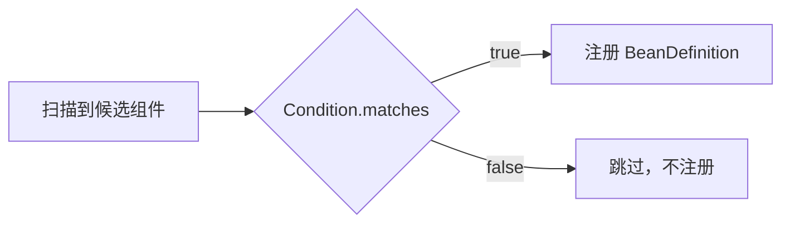

# Condition
[[toc]]

`Condition` 是 Spring Framework 在装配阶段回调的接口：容器扫到候选组件、准备把它的 Bean 定义注册进注册表之前，回调 `matches()`，返回 `false` 就地否决这次注册。类路径上有没有某个依赖、配置里某个开关是什么值、容器里是否已经存在某类 Bean，都能作为判断依据——只要能在那一步从 `ConditionContext` 和注解元数据里读出来。

本文讲的是跨版本稳定的接口，不绑定具体版本。

Spring Boot 自带的一批 `@ConditionalOnXxx` 注解，背后也是实现了这个接口的条件类，只是它们没有直接实现接口，而是继承了 Boot 提供的基类 [`SpringBootCondition`](../../spring-boot/boot-callbacks/spring-boot-condition.md)——判断逻辑一样，额外把「为什么匹配 / 为什么不匹配」记进日志和条件评估报告。这个基类连同 `ConditionOutcome`、`ConditionMessage` 这套配套 API 已经单独成篇。

## 什么时候需要它

它解决的是一类固定问题：同一份代码在不同环境下要装配不同的东西，而差异在装配那一刻就能判断出来。

**按依赖决定装不装。** 类路径上有某个驱动或某个库，才装配配套的实现。写 starter 时最常用——让使用者「引了什么依赖就用什么」，不用再去开一个开关。

**按配置值切换实现。** `app.db.mode=readonly` 才装配只读数据源，`app.cache=redis` 才装配 Redis 的实现，其余情况退回默认的那套。

**使用者自己声明过就不再注册。** 容器里已经有人声明过同类型的 Bean 时，自己这版默认实现就不注册了——这是「使用者优先」的写法，也是 `@ConditionalOnMissingBean` 存在的理由。

**按资源是否存在启用功能。** 类路径下存在某个配置文件、某个目录时才启用对应功能。

::: tip 运行期才确定的事不要放这里
`matches()` 在一次启动里只评估一次，结论之后不再变。想按配置中心热更新的开关切换实现，条件做不到——它只能给出一个静态的装配结论。
:::

## 接口定义

整个接口只有一个方法，签名也简单：

```java
@FunctionalInterface
public interface Condition {

    boolean matches(ConditionContext context, AnnotatedTypeMetadata metadata);

}
```

两个入参各有分工：`ConditionContext` 提供环境、注册表、类加载器这些「装配现场」的访问入口；`AnnotatedTypeMetadata` 是被检查的类或方法的注解元数据。返回值直接决定注册与否，没有第三种状态。

同一个位置挂多个条件时，框架按 `Ordered` / `@Order` 排序后依次评估（`ConditionEvaluator` 里用 `AnnotationAwareOrderComparator.sort`），全部返回 `true` 才算通过。

## 它插在哪个位置

把它放回装配流程里看，位置在「扫到候选」之后、「注册定义」之前：



条件评估发生在 `refresh()` 开头的 `ConfigurationClassPostProcessor` 里（它是个 `BeanDefinitionRegistryPostProcessor`）。所以那一刻容器里只有 Bean 定义，还没有任何业务 Bean 实例；评估的产物是「注册或不注册一条定义」，不是「创建一个对象」。

## ConditionContext 能拿到什么

五个方法是固定的，各自的可空性和异常要记一下：

| 方法 | 返回 | 说明 |
| --- | --- | --- |
| `getEnvironment()` | `Environment` | 读配置属性、激活的 profile，最常用 |
| `getRegistry()` | `BeanDefinitionRegistry` | 即将接收该 Bean 定义的注册表；<br>没有注册表时抛 `IllegalStateException` |
| `getBeanFactory()` | `ConfigurableListableBeanFactory` | 注册表能向下转型成 BeanFactory 时才有值，否则 `null` |
| `getResourceLoader()` | `ResourceLoader` | 读类路径、文件资源的统一入口 |
| `getClassLoader()` | `ClassLoader` | 加载额外用的类，极端情况下才为 `null` |

`getBeanFactory()` 上的界限是「能查定义、不能取实例」：在条件里调 `getBean()` 会强制提前实例化，打断正常的 Bean 生命周期（`Condition` 的 Javadoc 要求它像 `BeanFactoryPostProcessor` 一样，不碰 Bean 实例）。要判断某类 Bean 存不存在，就用注册表里已有的定义信息。

## 自定义条件

最省事的写法是直接实现 `Condition`，只回答「匹配不匹配」这一个布尔值：

```java
public class OnDatabaseModeCondition implements Condition {

    @Override
    public boolean matches(ConditionContext context, AnnotatedTypeMetadata metadata) {
        return "readonly".equals(context.getEnvironment().getProperty("app.db.mode"));
    }
}
```

用 `@Conditional` 把它挂到配置类上：

```java
@Configuration
@Conditional(OnDatabaseModeCondition.class)
public class ReadOnlyDataSourceConfiguration {

    @Bean
    public DataSource dataSource() {
        // 只读数据源
    }
}
```

条件类由 `ConditionEvaluator` 用 `BeanUtils.instantiateClass` 反射新建，容器不接管它（`@Conditional` 的 `value` 只是类数组），所以它必须有无参构造器、也拿不到构造器注入——需要什么，从 `ConditionContext` 和 `metadata` 里取。需要由注解传参时，参数就在 `metadata.getAnnotationAttributes(...)` 里。

- 判断逻辑只要一个布尔值时，用裸 `Condition` 就够。
- 需要让条件评估结果可读、能被条件报告记录时，用 Boot 的 `SpringBootCondition`——它把 `matches` 定成 `final`，子类改实现 `getMatchOutcome`，返回一个既带结论、也带一句说明的 `ConditionOutcome`。

## 与 ConfigurationCondition 的区别

`Condition` 只有一个子接口 `ConfigurationCondition`，多出来的方法是 `getConfigurationPhase()`，返回两个枚举值之一：

| 阶段 | 语义 |
| --- | --- |
| `PARSE_CONFIGURATION` | 解析配置类时评估；不匹配则整个 `@Configuration` 类都不加入 |
| `REGISTER_BEAN` | 注册普通 Bean 时评估；此时所有 `@Configuration` 类都已解析完，<br>也拦不住配置类本身被加入 |

需要「看容器里当前注册了什么」才能判断的条件（`@ConditionalOnMissingBean` 那一类），要放在 `REGISTER_BEAN` 阶段：`PARSE_CONFIGURATION` 时其他配置类可能还没解析到，看到的是不完整的容器。

## 几个坑

写条件时容易踩的地方，基本都在「它不是 Bean、也不该碰 Bean」这条线上：

- 条件类必须有无参构造器，且不参与依赖注入——它是解析器直接 `new` 出来的，不是容器里的 Bean。
- 抛异常不等于「不匹配」。条件里抛出的异常会直接让启动失败，不会退化成一次「不匹配」；想表达不匹配就返回 `false`。Boot 的条件基类还会额外把 `RuntimeException` 包成 `IllegalStateException` 再抛出。
- `@Conditional` 不继承：父类上的、以及被子类覆写过的方法上的条件都不起作用（`@Conditional` 没标 `@Inherited`，自己组合注解时也不要标）。
- 挂在 `@Configuration` 类上的条件会连带管住这个类上的 `@Bean` 方法、`@Import` 和 `@ComponentScan`：类被否决时，这些全都不会生效。
- `getRegistry()` 可能抛 `IllegalStateException`，`getBeanFactory()` 和 `getClassLoader()` 可能为 `null`——用之前先想清楚这两处在不在。
