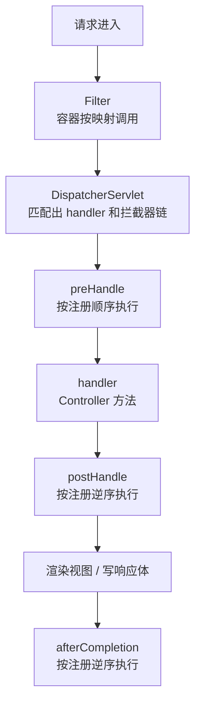

# HandlerInterceptor
[[toc]]

`HandlerInterceptor` 是 Spring MVC 的请求拦截回调：`HandlerMapping` 定好了要执行的 handler 之后、`HandlerAdapter` 真正调用它之前，`DispatcherServlet` 会把请求依次交给链上的每个拦截器。三个回调方法分别卡在「handler 执行前」「handler 执行后、渲染视图前」「请求彻底结束」这三个位置。位置决定了它能做什么：它跑在 `DispatcherServlet` 内部，所以比 Servlet `Filter` 看得细（能拿到 handler 对象），但 Filter 能做的一些事它做不了（换掉 request / response）。

本文以 Spring Framework 7.0 为准。

注册交给 [WebMvcConfigurer](./web-mvc-configurer.md) 的 `addInterceptors`。

## 什么时候需要它

拦截器解决的是「同一段逻辑要在很多个 handler 上重复写」的问题。官方 Javadoc 对它的定位是 `factoring out repetitive handler code`，首选场景也写得很直白：与 handler 强相关的预处理、拆出来的公共代码、鉴权判断（[HandlerInterceptor Javadoc](https://docs.spring.io/spring-framework/docs/current/javadoc-api/org/springframework/web/servlet/HandlerInterceptor.html)）。所以用得上的场合带着两个特征之一：每个进 Controller 的请求都要过一遍，或者要按 handler 方法区分行为。几个典型处境：

**放行判断：不合格的请求不许进 Controller。** 鉴权、权限校验、接口开关、签名校验都属这一类，规则要么对全部接口生效，要么按 method + path 区分。`preHandle` 返回 `false` 就能中断链，但代价必须记住：**响应得由拦截器自己写完**——Javadoc 写的是 `DispatcherServlet assumes that this interceptor has already dealt with the response itself`，返回 `false` 之后框架不会补任何东西，状态码、`Content-Type`、响应体都要在这一句之前设好。

**公共逻辑要按 Controller 方法上的注解改变行为。** 能在 `preHandle` 里拿到 `handler`（通常强转成 `HandlerMethod`）是它区别于 Filter 的地方：方法上标了 `@PublicApi` 就放行、标了 `@Audit` 就记一条审计、按注解取一个缓存前缀。规则写在方法上，比在拦截器里维护一张 URL 清单清楚，方法挪了位置规则也跟着走。前提是 handler 得真的是 `HandlerMethod`——静态资源这类请求交给的是 `ResourceHttpRequestHandler`，注解这条路走不通。

**耗时统计、访问日志这类「请求结束后才算得出来」的记录。** `preHandle` 记下起始时间和请求特征，`afterCompletion` 取出来算差值、写日志。这里有个容易放错位置的点：统计要放 `afterCompletion` 而不是 `postHandle`，后者在视图渲染之前就被调用了，模板渲染那段耗时会漏掉。

**请求级上下文在进入时建立、在结束时清理。** 把当前用户、租户、链路信息放进 `ThreadLocal` 供下游 Service 读，用完必须清掉；`afterCompletion` 是唯一保证「进了就一定出」的时点——Javadoc 明确说它只在 `preHandle` 成功返回 `true` 后才会被调用，所以它不会去清理一个还没申请的资源。在这里做灰度判断也可以，但**分流只能落成「这次请求带什么标记往下走」**：拦截器只拿到 `handler` 和一对 request / response，没有把请求换给另一个 handler 的能力，真要按灰度走不同实现，标记得交给后面的 Service 或网关去用。异步请求下这几个回调还会在重新派发时再跑一遍，初始化和清理都要写成幂等的。

**要拦的范围恰好是「交给 Spring MVC 处理的请求」。** 路径匹配用 MVC 自己那套（`addPathPatterns` / `excludePathPatterns`，默认策略是 `PathPattern`），和 Controller 上的写法一致；要按 HTTP 方法区分还有 `includeHttpMethods` / `excludeHttpMethods`。范围要算清楚一点：**静态资源请求也是被路由到 handler 的**，注册时用了 `/**` 这类宽模式，`/static/...` 的请求同样会过一次这个拦截器，该排除的要排掉。反过来，需要换掉 request / response 对象（读一遍请求体再往下传、GZIP、multipart 解析）、或者要覆盖不由 Spring MVC 处理的 servlet，这些是 Filter 的活，拦截器做不了。

## 插在请求处理的哪一段



拦截器链由 `HandlerExecutionChain` 持有，链的末尾是 handler 本身；`DispatcherServlet` 按链逐个触发。三个方法在接口里都是 `default` 实现，按需覆写，不必整套实现。

## 三个回调的时机与顺序

时机和参数是配套的：越靠后的回调，能看到的东西越多，但能改的东西越少。

| 方法 | 被调用的时刻 | 比前一个多拿到什么 | 默认实现 |
| --- | --- | --- | --- |
| `preHandle` | `HandlerMapping` 选出 handler 之后、`HandlerAdapter` 调用 handler 之前 | `handler`：选中的 handler 对象，通常可强转为 `HandlerMethod` | 返回 `true` |
| `postHandle` | `HandlerAdapter` 执行完 handler 之后、`DispatcherServlet` 渲染视图之前 | `ModelAndView`：handler 返回的模型和视图（可能为 `null`） | 空 |
| `afterCompletion` | 请求处理完成、视图渲染之后 | `Exception ex`：handler 执行中抛出的异常 | 空 |

顺序规则可以两句话说完：`preHandle` 按注册顺序正序执行，`postHandle` 和 `afterCompletion` 按同一顺序逆序执行（Javadoc：`the first interceptor will be the last to be invoked`）。注册 A、B 两个拦截器，实际调用次序是：

| 次序 | 动作 |
| --- | --- |
| 1 | `A.preHandle` |
| 2 | `B.preHandle` |
| 3 | handler |
| 4 | `B.postHandle` |
| 5 | `A.postHandle` |
| 6 | 渲染视图 / 写响应体 |
| 7 | `B.afterCompletion` |
| 8 | `A.afterCompletion` |

`preHandle` 是唯一有返回值的回调，返回值直接决定链要不要继续：返回 `true` 才往下走；返回 `false` 时链被中断，**`DispatcherServlet` 认为该拦截器已经自己处理完响应了**，不再做任何事——所以返回 `false` 之前必须把响应写完。

`afterCompletion` 还有一个前提：**只有该拦截器的 `preHandle` 成功返回过 `true`，它才会被调用**（Javadoc 原文 `Will only be called if this interceptor's preHandle method has successfully completed and returned true`）。这也是它适合做资源清理的原因——不会清理一个还没申请的资源。

## 怎么写

`preHandle` 最常见的作用是判断「这个请求要不要放行」，典型场景是鉴权。因为能拿到 `handler`，还可以顺带读 Controller 方法上的注解，做更细的放行规则：

```java
@Component
public class AuthInterceptor implements HandlerInterceptor {

    @Override
    public boolean preHandle(HttpServletRequest request, HttpServletResponse response, Object handler)
            throws Exception {
        // handler 是 HandlerMethod 时才能读到方法上的注解
        if (handler instanceof HandlerMethod handlerMethod
                && handlerMethod.hasMethodAnnotation(PublicApi.class)) {
            return true;
        }
        if (request.getHeader("Authorization") == null) {
            response.setStatus(HttpServletResponse.SC_UNAUTHORIZED);
            response.setContentType(MediaType.APPLICATION_JSON_VALUE);
            response.getWriter().write("{\"code\":401,\"message\":\"unauthorized\"}");
            return false;   // 中断链，响应由本拦截器自己负责
        }
        return true;
    }
}
```

需要「请求结束才做」的事情要放进 `afterCompletion`，别放 `postHandle`。耗时统计是一个典型例子：`preHandle` 里把起始时间塞进请求属性，`afterCompletion` 里取出来算差值——放 `postHandle` 会漏掉视图渲染的时间。

```java
private static final String START_TIME = "requestStartTime";

@Override
public boolean preHandle(HttpServletRequest request, HttpServletResponse response, Object handler) {
    request.setAttribute(START_TIME, System.currentTimeMillis());
    return true;
}

@Override
public void afterCompletion(HttpServletRequest request, HttpServletResponse response, Object handler,
        Exception ex) {
    Long start = (Long) request.getAttribute(START_TIME);
    if (start != null) {
        log.info("{} {} 耗时 {} ms", request.getMethod(), request.getRequestURI(),
                System.currentTimeMillis() - start);
    }
}
```

## 注册

拦截器不会因为被标注了 `@Component` 就自动生效，必须显式注册进 `InterceptorRegistry`：

```java
@Configuration
public class WebMvcConfig implements WebMvcConfigurer {

    private final AuthInterceptor authInterceptor;

    public WebMvcConfig(AuthInterceptor authInterceptor) {
        this.authInterceptor = authInterceptor;
    }

    @Override
    public void addInterceptors(InterceptorRegistry registry) {
        registry.addInterceptor(authInterceptor)
                .addPathPatterns("/api/**")
                .excludePathPatterns("/api/health", "/api/login")
                .order(1);
    }
}
```

`InterceptorRegistry#addInterceptor` 返回一个 `InterceptorRegistration`，可链式配置：

| 方法 | 作用 |
| --- | --- |
| `addPathPatterns(String...)` | 限定生效路径，语法同 `PathPattern`（默认策略）或 `AntPathMatcher` |
| `excludePathPatterns(String...)` | 排除路径 |
| `includeHttpMethods` / `excludeHttpMethods` | 按 HTTP 方法过滤，Spring Framework 7.0 新增 |
| `order(int)` | 拦截器在链中的位置，默认 `0`（4.3.23 起） |

`InterceptorRegistration#getInterceptor` 的 Javadoc 说明了两种注册结果：

- **给了路径模式或 HTTP 方法**：产出的是 `MappedInterceptor`。
- **什么都没给**：产出的是裸 `HandlerInterceptor`。

裸 `HandlerInterceptor` 对该 `HandlerMapping` 处理的全部请求生效，所以除非确定要拦所有请求，都建议显式写 `addPathPatterns` 收窄范围。

同一个应用里可以有多个 `WebMvcConfigurer`（Spring Boot 自己的 `WebMvcAutoConfigurationAdapter` 也是其中一个），它们的 `addInterceptors` 都往同一个 registry 里加，最终按 `order` 排序。`order` 相同的两个拦截器之间没有约定顺序，要固定次序就得给出不同的值。

::: tip 异步请求下 preHandle 会跑两次
`@ResponseBody` 方法返回 `Callable` / `DeferredResult` 等进入异步处理后，`DispatcherServlet` 会在主线程退出、不调 `postHandle` 和 `afterCompletion`；等异步结果就绪、请求被重新派发（`DispatcherType` 为 `ASYNC`）时，`preHandle`、`postHandle`、`afterCompletion` 会被再调一遍。Javadoc 给的区分办法就是读 `ServletRequest` 的 `DispatcherType`（`REQUEST` 还是 `ASYNC`），否则「进一次请求记一次计数」这类逻辑会翻倍。需要感知异步开始，可以改用 `AsyncHandlerInterceptor#afterConcurrentHandlingStarted`。
:::

## 几个容易踩的点

下面几条是实际用的时候最容易出问题的地方。

- **`postHandle` 改不了响应**。对 `@ResponseBody` / `ResponseEntity` 的 Controller 方法，响应体写在 `HandlerAdapter` 里就已经写出去了，`postHandle` 被调用时响应已经提交——想加响应头、改响应体都太晚。官方给的替代方案是实现 `ResponseBodyAdvice` 并声明成 `@ControllerAdvice` Bean（[Spring Framework 文档](https://docs.spring.io/spring-framework/reference/web/webmvc/mvc-servlet/handlermapping-interceptor.html)）。
- **`afterCompletion` 的 `ex` 不一定是全部异常**。Javadoc 明确写了这个参数「不包含已被异常解析器处理掉的异常」——异常先经过 `HandlerExceptionResolver` 链，被 `@ExceptionHandler` 接住的那些不会传到这里，所以别把「`ex != null`」当成「请求有没有出错」的唯一判据。
- **别把拦截器当安全层**。Javadoc 专门提示：拦截器的路径匹配和注解控制器的路径匹配可能对不上，做安全边界建议用 Spring Security，或者把校验放进 Servlet Filter 链、尽量靠前执行。

## 和 Filter 的区别

两者都在请求路径上，但所处的位置不同——Filter 在 `DispatcherServlet` 之外、由容器调用；拦截器在 `DispatcherServlet` 之内、由框架调用。这个位置差异派生出了下面全部差别：

| 对比项 | HandlerInterceptor | Filter |
| --- | --- | --- |
| 谁来调用 | `DispatcherServlet`（先组 `HandlerExecutionChain`，再逐个触发） | Servlet 容器（按 `FilterChain` 调用） |
| 注册在哪 | Spring 容器：`WebMvcConfigurer#addInterceptors`；也可以直接声明 `MappedInterceptor` Bean——Javadoc 记的是 `AbstractHandlerMethodMapping` 的子类会检测该类型的 Bean | 容器：`Filter` Bean 会被内嵌容器自动注册并映射到 `/*`，或用 `FilterRegistrationBean` / `@WebFilter` 精确控制 |
| 作用范围 | 只覆盖被路由到 handler 的请求（按注册的路径模式再收窄） | 映射到该 Filter 的所有请求，包含静态资源和不由 Spring MVC 处理的 servlet |
| 能拿到什么 | 额外的 `handler` 对象：可读出 Controller 类、方法、方法上的注解 | 只有 `ServletRequest` / `ServletResponse`，没有 handler 这个概念 |
| 能否替换请求 / 响应对象 | 不能，只能读写传进来的同一对对象 | 能，`chain.doFilter` 可以传包装后的新对象下去 |
| 异常的去向 | handler 执行中抛出的异常进入 `HandlerExceptionResolver` 链，`@ExceptionHandler` 能接住 | Filter 在 DispatcherServlet 之前执行，它抛的异常到不了 MVC 的异常解析，最终落到容器的错误页（也就是 `/error`，见 [ErrorController](../../spring-boot/boot-callbacks/error-controller.md)） |
| 官方推荐的适用场景 | 与 handler 强相关的预处理：拆出来的公共逻辑、鉴权判断 | 请求内容 / 视图内容处理：multipart 解析、GZIP 压缩，或需要按内容类型映射的场景 |

一个具体的判断方法：**你的逻辑要不要知道「这是哪个 Controller 方法」**。要，用拦截器；不要，且需要处理请求体或响应体本身，用 Filter。
