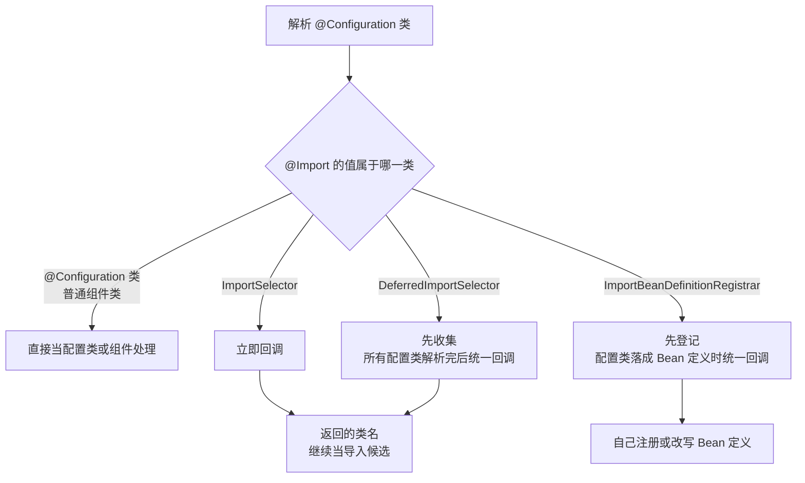
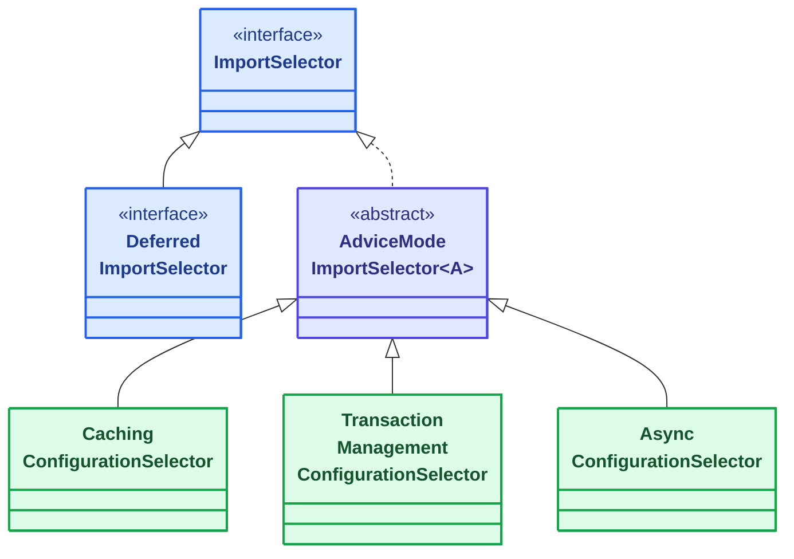

# ImportSelector 与 ImportBeanDefinitionRegistrar
[[toc]]

`ImportSelector` 是 Spring Framework 在解析 `@Import` 时回调的接口：由它决定「要把哪些类导入」，把这些类的名字作为返回值交回框架。这类回调一共三个，都挂在 `@Import` 上被调到。

本文以 Spring Framework 7.0 为准。

## 先说清楚 `@Import` 是什么

`@Import` 是写在配置类上的注解，作用是「把别的类也拉进这一批配置里」。最常见的用法是导入另一个 `@Configuration` 类：

```java
@Configuration
@Import(DataSourceConfiguration.class)
public class AppConfiguration {
    // DataSourceConfiguration 里声明的 Bean，在这里同样生效
}
```

但它能接的不止配置类。`@Import` 的值还可以是**一个实现了特定接口的类**——这种情况下 Spring 不把它当配置类看待，而是当**回调**：解析配置类的过程中创建它的实例、调用约定的方法，由它来决定「到底要导入什么」。

```java
@Configuration
@Import(MyImportSelector.class)   // MyImportSelector implements ImportSelector
public class AppConfiguration { }
```

`ImportSelector`、`DeferredImportSelector`、`ImportBeanDefinitionRegistrar` 就是三个这样的回调接口，都在 `ConfigurationClassPostProcessor` 解析配置类的时候被调到，手里只有 Bean 定义、还没有任何 Bean 实例。它们是你自己封装「加一行注解就开箱即用」的 `@EnableXxx` 时用到的接口——Spring 自己的 [`@EnableCaching`](../spring-framework-ioc.md#功能开关注解)、`@EnableTransactionManagement` 就是这么实现的。

三者的差别只有两处：什么时候被调到，以及回调之后**由谁把结果交出去**——前两个返回类名、交给框架继续处理，第三个自己动手往注册表里写。这两点也决定了它们各自适合什么样的装配需求。

## 什么时候需要它

这三个接口解决的是同一类问题：**有些装配决定没法用注解写死**——到底装哪套实现，要等启动时看环境、看类路径、看使用者已经声明了什么才知道。几种典型处境：

**`ImportSelector`：给使用者一个一行注解的开关。** 你写的框架希望接入成本尽量低：使用者在自己的配置类上写一个 `@EnableXxx` 就接上了，要调的行为通过注解属性给。注解本身不装配任何东西，它上面的 `@Import` 挂的是一个选择器，装哪套由你决定，注解属性就是现成的判断依据。Spring 自己的 `@EnableCaching`、`@EnableTransactionManagement` 都是这个形状——注解上挂的是 `AdviceModeImportSelector` 的子类，按 `mode` 属性返回不同的配置类。

**`ImportSelector`：starter 要按条件挑一套实现，还不让使用者写任何东西。** 场景反过来：使用者只加了一个依赖，配置里什么都没写。把选择器接到自动配置类上（`@Import` 指向它），由它读 `Environment` 里的属性、探类路径、看某个 Bean 定义在不在，再决定装配哪一套。相比在每个候选配置类上各挂一个条件，判断集中在一处；也只有被返回的类名会作为导入候选继续处理，没被选中的类不进入解析流程。

**`DeferredImportSelector`：判断依据要等所有配置类解析完才完整。** 你的判断是「容器里有没有人声明过某个东西」，而它可能由使用者自己的配置类提供，也可能由别的自动配置提供——这些类不一定在你被调到之前就解析完。`ImportSelector` 是遇到 `@Import` 的当下就回调，看到的是半个注册表，结论会随处理顺序变化；换成 `DeferredImportSelector`，回调推迟到所有配置类处理完之后，判断才建立在一个完整的定义集合上。「使用者自己配过就不装配」这类默认实现，全靠这个时机才站得住。

**`ImportBeanDefinitionRegistrar`：要注册或改写 Bean 定义，而不是导入现成的类。** 要装的东西没有对应的现成配置类时，返回类名这条路就不通了：注册什么得看导入方注解上的属性、注册前要先查一眼有没有重名的定义、或者注册完还要按属性改一下它的配置——这些都得自己动手。[`@EnableAspectJAutoProxy`](../spring-framework-aop-impi.md) 就是这么接的，它的 `AspectJAutoProxyRegistrar` 先往注册表里放一个 `AnnotationAwareAspectJAutoProxyCreator`，再按注解上的 `proxyTargetClass`、`exposeProxy` 改它；MyBatis 的 [`@MapperScan`](../../java/orm/mybatis-annotation.md) 同理，从注解属性里取出包名，据此注册 `MapperScannerConfigurer`。

## 配置类是怎么被解析的

这三个接口都插在「解析配置类」这条链上，所以先把这条链说清楚。

**谁在解析。** `ConfigurationClassPostProcessor`——容器里唯一负责读 `@Configuration` 的组件。它本身是个 [`BeanDefinitionRegistryPostProcessor`](./bean-post-processor.md)，跑在 `refresh()` 开头、`BeanFactory` 开始实例化 Bean 之前。这也是为什么这三个回调拿到的信息都限于「定义」层面：那会儿还没有任何 Bean 实例。

**解析什么。** 从 `@Configuration` 类出发，读它上面的 `@ComponentScan`、`@Import`、`@ImportResource`、`@PropertySource`，以及类里带 `@Bean` 的方法。

**插在哪。** 这三个接口插在「处理 `@Import`」这一步——`ConfigurationClassParser` 读到 `@Import`，看它的值是哪种类型，再决定接下来怎么走。（上面那个 `ConfigurationClassPostProcessor` 是入口，真正解析配置类的是它内部委托的 `ConfigurationClassParser`。）以最典型的 `ImportSelector` 为例，会走这么几步：

1. 实例化这个 `ImportSelector`；
2. 调用它的 `selectImports(importingClassMetadata)`；
3. 拿到它返回的类名数组；
4. **把这些类名当作新的 `@Import` 候选，递归解析。**

第 4 步是关键：解析是**递归展开**的，选择器返回的类如果还是配置类、甚至又带了 `@Import`，就继续往下解析，一层层展开直到没有新的候选。所以「导入什么」这件事可以在任意一层决定，最终装配进来的是一棵解析树。

`DeferredImportSelector` 不走这条直路——先记下来，等所有普通配置类解析完之后再统一处理。这正是 Spring Boot 自动配置依赖的机制，下面图里它是单独一支。

`@Import` 的 `value` 接受四类东西：

- **`@Configuration` 类** —— 最常见的用法，它里面的 `@Bean` 方法一并生效。
- **普通组件类** —— 不是配置类，但会被直接注册成一个 Bean。
- **`ImportSelector`** —— 回调接口之一：解析时由它决定「导入哪些类」，返回类名数组。它有个子接口 `DeferredImportSelector`，回调时机不同，所以下面图里单独占一支。
- **`ImportBeanDefinitionRegistrar`** —— 回调接口之二：它不返回类名，而是自己往注册表里注册或改写 Bean 定义。

前两类直接装配，后两类才走回调。解析时的分叉长这样：



`DeferredImportSelector` 与 `ImportBeanDefinitionRegistrar` 的差别都落在「回调推迟到什么时候」上，下文各有一节展开。

## 三者对照

把回调方法和时机放在一张表里对比：

| 接口 | 回调方法 | 什么时候被调到 | 返回值用来做什么 |
| --- | --- | --- | --- |
| `ImportSelector` | `String[] selectImports(AnnotationMetadata)` | 解析到 `@Import` 的当下 | 类名数组，作为新的导入候选继续处理 |
| `DeferredImportSelector` | 同上 | 所有配置类解析完之后 | 同上 |
| `ImportBeanDefinitionRegistrar` | `void registerBeanDefinitions(AnnotationMetadata, BeanDefinitionRegistry)`<br>`void registerBeanDefinitions(AnnotationMetadata, BeanDefinitionRegistry, BeanNameGenerator)` | 配置类转成 Bean 定义时 | 无返回值，直接往注册表里写 |

前两个返回类名、交给框架继续处理（返回配置类最常见，返回另一个选择器或注册器也可以）；第三个不返回东西，自己动手注册定义。

## ImportSelector

接口本身只有一个抽象方法要你实现（下面那段代码里的另一个方法带默认实现，不用管）：

```java
public interface ImportSelector {

    String[] selectImports(AnnotationMetadata importingClassMetadata);

    // 5.2.4 起，还可以覆盖这个方法过滤掉传递导入的类名
    default @Nullable Predicate<String> getExclusionFilter() {
        return null;
    }
}
```

`importingClassMetadata` 是「写了这个 `@Import` 的那个类」的元数据，不是选择器自己的。选择器实例由解析器用 `ParserStrategyUtils.instantiateClass` 新建，不走容器，但支持两种拿依赖的方式：

- **实现某个 [`Aware` 接口](../spring-framework-ioc-impi.md#aware-接口)** —— `EnvironmentAware`、`BeanFactoryAware`、`BeanClassLoaderAware`、`ResourceLoaderAware` 四选一，容器会把对应的对象注入进来。
- **提供一个唯一的带参构造器** —— 参数类型限于 `Environment`、`BeanFactory`、`ClassLoader`、`ResourceLoader`，同样是容器给你。

按配置项选一套实现是最典型的用法：

```java
public class StorageConfigurationSelector implements ImportSelector {

    private final Environment environment;

    public StorageConfigurationSelector(Environment environment) {
        this.environment = environment;
    }

    @Override
    public String[] selectImports(AnnotationMetadata importingClassMetadata) {
        String type = this.environment.getProperty("storage.type", "local");
        return new String[] {
                "local".equals(type) ? LocalStorageConfiguration.class.getName()
                        : S3StorageConfiguration.class.getName()
        };
    }
}
```

用的时候写进 `@Import` 就行——`@Import` 的值可以写多个，选择器和配置类混在一起写也没问题：

```java
@Configuration
@Import(StorageConfigurationSelector.class)
public class StorageAutoConfiguration {
    // 选择器返回的配置类会被继续解析，这里不需要再声明什么
}
```

`getExclusionFilter()` 返回的谓词会被合并进导入候选的过滤链，对**传递**导入的类名生效：返回 `true` 的类名直接跳过，连类文件都不加载、元数据都不解析。

### 官方就是这么用的：`@EnableCaching`

前面那个例子是为了讲清 `selectImports` 怎么写。真实世界里这套机制长什么样，看 Spring 自己的 `@EnableCaching` 最清楚。

这个注解自己只有三个属性（`proxyTargetClass`、`mode`、`order`），一个 Bean 都不装配——真正干活的是它 `@Import` 上的那个选择器：

```java
@Target(ElementType.TYPE)
@Retention(RetentionPolicy.RUNTIME)
@Documented
@Import(CachingConfigurationSelector.class)
public @interface EnableCaching {
    // proxyTargetClass / mode / order 三个属性
}
```

而 `CachingConfigurationSelector` 是这么接上去的：

```java
public class CachingConfigurationSelector extends AdviceModeImportSelector<EnableCaching> {
    // 按 EnableCaching.mode() 决定装哪一套
}
```

这里冒出了第三个角色：**`AdviceModeImportSelector<A>`**。它本身是个抽象类（`implements ImportSelector`），把「按注解上的 `mode` 属性挑实现」这套通用逻辑抽出来复用，子类只需要回答「PROXY 模式装什么、ASPECTJ 模式装什么」。官方 javadoc 对 `CachingConfigurationSelector` 的描述是「Selects which implementation of `AbstractCachingConfiguration` should be used based on the value of `EnableCaching.mode()`」，另外它还会探测类路径上有没有 JSR-107，有就顺带把 JCache 支持也打开。

### 子接口与常见子类

`ImportSelector` 这条线上，除了前面讲的两个接口，还有几个值得记住的名字：



- <span class="spring-legend interface"></span>接口
- <span class="spring-legend abstract"></span>抽象类
- <span class="spring-legend implementation"></span>实现类

另一个接口 `ImportBeanDefinitionRegistrar` 不在这条线上——它是平行的另一条分支，下面单独讲。

同一个 `selectImports`，如果实现类换成 `DeferredImportSelector`，被调用的时机就完全不同了。

## DeferredImportSelector

它继承 `ImportSelector`，只多了一个方法 `getImportGroup()`，但整个意义在时机上：Javadoc 的原话是「在所有 `@Configuration` Bean 都处理完之后运行，当被选中的导入类带 `@Conditional` 时尤其有用」。

时机是这么实现的：解析过程中碰到 `DeferredImportSelector` 不立即调用，先收集进一个列表；等 `ConfigurationClassParser.parse(Set<BeanDefinitionHolder>)` 把这一轮的配置类都解析完，循环结束后才统一处理。处理前会按 `AnnotationAwareOrderComparator` 排序，所以实现类可以靠 `Ordered` 接口或 `@Order` 注解决定彼此的先后。

要理解它为什么能解决顺序问题，看 Spring Boot 自己的用法最清楚：`AutoConfigurationImportSelector` 就是一个 `DeferredImportSelector`，它的 `getOrder()` 返回 `Ordered.LOWEST_PRECEDENCE - 1`，在带 order 的延迟选择器里靠后。于是自动配置类总是在应用自己的配置类都解析完之后才开始处理——官方推荐只在自动配置类上使用 [`@ConditionalOnBean`](../../spring-boot/boot-callbacks/spring-boot-condition.md) / `@ConditionalOnMissingBean`，因为它们要等用户定义的 Bean 定义都注册完才判断得准；而这一点靠的是「推迟到所有配置类解析完」这个时机本身，与 `-1` 无关。少了这个延迟，自动配置的「条件不满足就跳过」判断会看到半个容器，结论随时可能是错的。

它内部的实现只有两个关键动作：

- `getOrder()` 返回 `Ordered.LOWEST_PRECEDENCE - 1`——在带 order 的延迟选择器里靠后。
- `getImportGroup()` 返回内部的 `AutoConfigurationGroup`：所有自动配置类先被收进这个组，组内按 `@AutoConfigureBefore` / `@AutoConfigureAfter` 排好序，再由组的 `selectImports()` 一次性给出最终列表。

`Group` 这套机制本身是通用的：多个延迟选择器只要 `getImportGroup()` 返回同一个 Group 类，结果就先合并到一起、统一排序去重，再一次性交出去。不返回 Group（默认 `null`）时，每个选择器各自成组，框架给一个默认实现。

还有一个细节和前面「怎么拿依赖」那节呼应：**它自己就实现了那四个 `Aware` 接口**——`BeanClassLoaderAware`、`ResourceLoaderAware`、`BeanFactoryAware`、`EnvironmentAware`，外加 `Ordered`。理由正是前面说的：选择器的实例由解析器反射新建、不走容器，想拿到类加载器、资源加载器、`BeanFactory` 和 `Environment`，只能走 `Aware` 这条注入路径。

## ImportBeanDefinitionRegistrar

当你要动的是 Bean 定义本身——注册一条新定义、给已有定义补属性、按条件注册不同实现——装配一个现成的配置类就不够用了，这时用这个接口：

```java
public interface ImportBeanDefinitionRegistrar {

    default void registerBeanDefinitions(AnnotationMetadata importingClassMetadata, BeanDefinitionRegistry registry) {
    }

    // 5.2 起新增，默认实现委托给上面那个方法；框架实际调用的是这个重载
    default void registerBeanDefinitions(AnnotationMetadata importingClassMetadata, BeanDefinitionRegistry registry,
            BeanNameGenerator importBeanNameGenerator) {
        registerBeanDefinitions(importingClassMetadata, registry);
    }
}
```

两个重载都是 `default` 方法，只覆盖两参的那个就行。要注意**实例化时机和调用时机不是一回事**：解析配置类时注册器就被创建并登记到这个配置类上，真正调用 `registerBeanDefinitions` 是在配置类落成 Bean 定义的时候（`ConfigurationClassBeanDefinitionReader#loadBeanDefinitionsFromImportBeanDefinitionRegistrars`，6.x 及以前叫 `loadBeanDefinitionsFromRegistrars`）。

```java
public class FallbackTaskExecutorRegistrar implements ImportBeanDefinitionRegistrar {

    @Override
    public void registerBeanDefinitions(AnnotationMetadata importingClassMetadata, BeanDefinitionRegistry registry) {
        if (!registry.containsBeanDefinition("taskExecutor")) {
            registry.registerBeanDefinition("taskExecutor",
                    BeanDefinitionBuilder.rootBeanDefinition(SimpleAsyncTaskExecutor.class).getBeanDefinition());
        }
    }
}
```

`importingClassMetadata` 同样是「谁导入的」那个类的元数据，所以写出一套注册逻辑给多个配置类共用、由导入方决定注册什么，是它的常见用法。

Javadoc 上有一条明确限制：**不要在这里注册 `BeanDefinitionRegistryPostProcessor`**，配置类的处理还在进行中，注册进去也来不及按生命周期生效。需要这类后处理器时，走别的路径（比如 `@Bean` 方法或普通的 `BeanDefinitionRegistryPostProcessor` 实现）。

## 什么时候用哪个

按你要做的事选，选择器之间没有功能重叠：

| 你要做的事 | 用哪个 |
| --- | --- |
| 按某个条件挑一个配置类装配 | `ImportSelector`，条件写在返回的配置类上 |
| 判断依据要等所有配置类解析完才完整 | `DeferredImportSelector` |
| 要注册或改写 Bean 定义，而不是装配现成的类 | `ImportBeanDefinitionRegistrar` |

## 几个坑

三个接口的实现都不是 Bean，围绕这一点还有几处容易踩：

- 它们由解析器反射新建，因此没有依赖注入、没有 AOP 代理、也没有 Bean 的生命周期回调；能拿到的只有前面列的那四类构造器参数和四个 `Aware` 接口，别指望在里面注入业务 Bean。
- 给选择器类本身加 `@Conditional` 不起作用：解析器拿到候选后直接实例化调用它，不评估它自己的条件。要按条件决定装配，把条件写在被返回的配置类上。
- `DeferredImportSelector` 的「延迟」只在装配阶段内部：它仍然在启动时跑完，拿不到运行期的状态，别把它当成惰性加载。
- `ImportSelector` 的实现类即使同时被 `@Component` 扫描成 Bean，框架用的也是解析器新建的那个实例——多出来的那个 Bean 没有用处。
