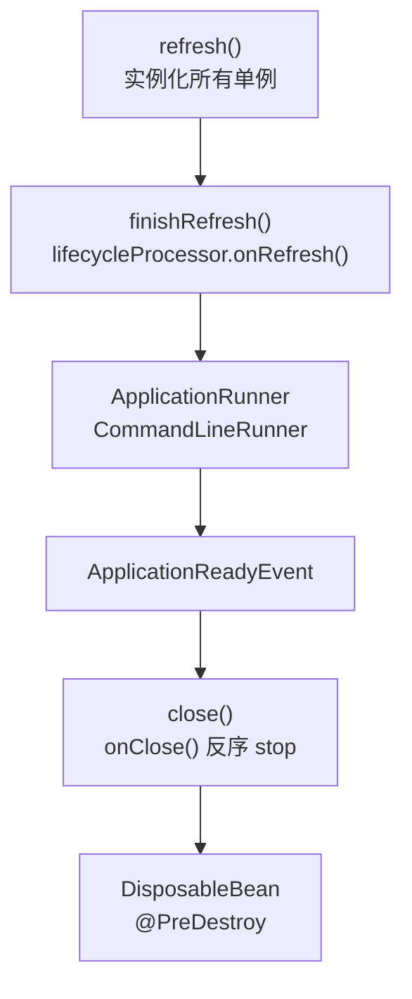

# SmartLifecycle
[[toc]]

`SmartLifecycle` 是给「需要按顺序启停的后台组件」用的接口：容器启动收尾时按顺序把它们启起来，容器关闭时按相反顺序停掉。它比 [`ApplicationRunner`](../../spring-boot/boot-callbacks/application-runner.md) 多了一件事——`ApplicationRunner` 只有「开始跑」，没有「停下来」。

本文以 Spring Framework 7.0 为准。

容器 refresh 收尾时按 phase 从小到大依次 `start()`，容器关闭时按相反顺序依次 `stop()`。所有启动回调里，它是唯一还管「怎么停」的一个。

## 什么时候需要它

`SmartLifecycle` 回答的是「**这个组件怎么停下来**」——启动流程上的回调大多只管启动，它还要管关。所以判断用不用得上它，先问一句：这件事有没有要收尾的那一半。几个典型场景：

**有收尾动作，而且必须赶在资源销毁之前做完。** 停掉消费线程、把缓冲区刷出去、把在途任务等完、关掉长连接，动手时数据源、线程池、HTTP 客户端都得还活着。交给 `@PreDestroy` 或 `DisposableBean` 不保险：那是单 Bean 粒度，几个 Bean 之间谁先谁后没有约定。`stop()` 拿到的位置不一样——正常关闭时容器先让所有 `Lifecycle` Bean 停完，之后才触发销毁回调。反过来说，热刷新和 refresh 中途失败时这个保证不成立（那时 destroy 会被直接调用），所以 `stop()` 里不能是唯一的兜底。

**几个组件的启停顺序有讲究。** 采集器要先于上报器启动、后于上报器停止。用 `getPhase()` 表态即可——启动从小到大、关闭从大到小，所以 phase 小的先启动、后关闭，适合放被别人依赖的组件。已经在 Bean 之间声明了 `depends-on` 的，顺序会跟着这个关系走，并且优先于 phase；但 phase 值相同的组件之间顺序不确定，靠它定次序会时灵时不灵。

**组件的启停不该由容器 refresh 说了算。** 容器一 refresh 就启动、一 close 就停止，对多数组件刚好，但不是所有：有的组件要等运行期从配置中心读到开关、或者中途被摘掉流量放一会儿再恢复。`isAutoStartup()` 返回 false 就不参与 refresh 阶段的自动启动，改由 `ConfigurableApplicationContext#start()` 拉起；运行期想停掉再拉起来，用 `stop()` / `start()` 就行，不必关容器。

**停止要等外部确认，串行等不起。** 停一个上报器要等对端回执、停一个消费线程要等在途消息处理完，这类停止天然是异步的。默认的 `stop(Runnable)` 实现是在调用线程里把 `stop()` 跑完再触发回调，同一 phase 的组件只能一个接一个地停；覆写 `stop(Runnable)`、把「等确认」交给回调之后，同一 phase 的组件就能并行收尾。代价是回调必须调，否则框架只能干等到超时。

## 接口定义

`SmartLifecycle` 继承 `Lifecycle` 和 `Phased`：

```java
public interface Lifecycle {
    void start();
    void stop();
    boolean isRunning();
}

public interface Phased {
    int getPhase();
}

public interface SmartLifecycle extends Lifecycle, Phased {
    int DEFAULT_PHASE = Integer.MAX_VALUE;

    default int getPhase() { return DEFAULT_PHASE; }
    default boolean isAutoStartup() { return true; }
    default void stop(Runnable callback) { stop(); callback.run(); }
    // 7.0 起新增，用来参与「暂停 → 恢复」序列
    default boolean isPauseable() { return true; }
}
```

`Lifecycle` 的 `start()`、`stop()`、`isRunning()` 都是抽象方法，`SmartLifecycle` 新增的几个方法（`getPhase()`、`isAutoStartup()`、`stop(Runnable)`、`isPauseable()`）才带默认实现。所以最小实现是三个方法：`start`、`stop`、`isRunning`；`stop(Runnable)` 和 `getPhase` 按需覆写。

## 五个方法的语义

| 方法 | 语义 |
| --- | --- |
| `start()` | 启动组件；抛出的异常会向上冒泡，直接中断启动 |
| `stop(Runnable callback)` | 停止组件，**停完必须调 `callback.run()`** |
| `isRunning()` | 关容器时用它决定要不要调 `stop()`；返回 false 就不调 |
| `isAutoStartup()` | 是否在 refresh 时自动启动；返回 false 就只能靠显式 `context.start()` 拉起 |
| `getPhase()` | 启停顺序 |

`isAutoStartup()` 返回 false 不是「永远不启动」，而是「不自动启动」——`ConfigurableApplicationContext#start()` 会启动容器里所有 `Lifecycle` Bean，包括非自动启动的。反过来，refresh 阶段只挑 `SmartLifecycle` 且 `isAutoStartup()` 为 true 的。

`isRunning()` 是这三个必修方法里最容易被敷衍掉的一个。容器的停止流程大致是：

```java
if (bean.isRunning()) {
    smartLifecycle.stop(callback);
}
```

返回 false 就等于告诉框架「我本来就没跑，不用停」——那么 `stop()` 里的收尾逻辑（把缓冲刷盘、把未完成的任务落库、关连接）一次都不会执行，而且不会有任何报错。

## 启动和停止的时机

启动发生在 `AbstractApplicationContext#refresh()` 的最后一步：`finishRefresh()` → `initLifecycleProcessor()` → `lifecycleProcessor.onRefresh()`。再往后才轮到 `ApplicationRunner`。



这个顺序是刻意的：正常关闭时，停止通知一定早于销毁回调，这样组件停的时候线程池、数据源还活着。

::: warning 异常路径上这个保证不成立
`Lifecycle#stop()` 的 Javadoc 专门补了一句：正常关闭时 stop 先于销毁回调，但**运行期热刷新、或 refresh 中途失败**时，Bean 的 destroy 方法会直接被调用，不会先走 stop。所以 `stop()` 里那段收尾逻辑不能是唯一的兜底——`@PreDestroy` 或 `DisposableBean` 里也要能独立收尾。
:::

## phase 怎么决定顺序

规则来自 `DefaultLifecycleProcessor#getPhase(Lifecycle)`，一句话：实现了 `Phased` 就用它的 `getPhase()`，否则按 0 算。

| 组件 | phase | 启动顺序 | 关闭顺序 |
| --- | --- | --- | --- |
| 普通 `Lifecycle` | 0 | 晚于负 phase 的组件 | 早于负 phase 的组件 |
| `SmartLifecycle` 覆写为 100 | 100 | 在 0 之后、`MAX_VALUE` 之前 | 在 `MAX_VALUE` 之后、0 之前 |
| `SmartLifecycle` 未覆写 `getPhase()` | `Integer.MAX_VALUE` | 最后 | 最先 |
| Executor / Scheduler 类组件（6.2 起） | `Integer.MAX_VALUE / 2` | 早于默认值 | 晚于默认值 |

表里的「普通 `Lifecycle`」在 refresh 阶段根本不会自动启动——`Lifecycle` 接口本身不带自动启动语义，它只会在显式调用 `ConfigurableApplicationContext#start()` 时被拉起，那时才按 phase 参与排序。

读这张表要知道两条：

- 启动从**小**到大，关闭从**大**到小，所以 phase 小的先启动、后关闭，适合放「被别人依赖」的组件。
- Executor / Scheduler 那一行是 Spring 自己定的默认值，它在默认 phase 的 `SmartLifecycle` 之前启动，于是你在自己的 `stop()` 里仍然可以往注入的线程池里提交收尾任务。

另外两条来自 `SmartLifecycle` 的 Javadoc：

- 显式声明了 `depends-on` 关系的，**依赖关系优先于 phase**（被依赖的必先启动、后关闭）。
- phase 值相同的组件之间顺序**不确定**，要固定次序就得给出不同的值。

## 示例：把文件监听改成可停止的

`ApplicationRunner` 篇里的文件监听只有一个 `start()` 调用，进程退出时那个非守护线程没人管。换成 `SmartLifecycle`：

```java
@Component
public class FileWatchService implements SmartLifecycle {

    private static final Logger log = LoggerFactory.getLogger(FileWatchService.class);

    private final FileAlterationMonitor monitor;

    private volatile boolean running;

    public FileWatchService() {
        FileAlterationObserver observer = new FileAlterationObserver("/data/inbox");
        observer.addListener(new FileAlterationListenerAdaptor() {
            @Override
            public void onFileCreate(File file) {
                log.info("发现新文件：{}", file.getName());
            }
        });
        this.monitor = new FileAlterationMonitor(60_000, observer);
    }

    @Override
    public void start() {
        try {
            this.monitor.start();
        }
        catch (Exception ex) {
            throw new IllegalStateException("文件监听启动失败", ex);
        }
        this.running = true;
        log.info("文件监听已启动");
    }

    @Override
    public void stop(Runnable callback) {
        stop();
        callback.run();
    }

    @Override
    public void stop() {
        try {
            this.monitor.stop();
        }
        catch (Exception ex) {
            log.warn("文件监听停止失败", ex);
        }
        finally {
            this.running = false;
        }
    }

    @Override
    public boolean isRunning() {
        return this.running;
    }
}
```

跟 `ApplicationRunner` 版比，多出来的就是这个 `running` 标志和 `stop()`：进程收到退出信号时，关闭钩子会走到这里，`FileAlterationMonitor` 的轮询线程被中断并 join，不会拖着 JVM 不退。`isAutoStartup()` 和 `getPhase()` 都用默认值——默认自动启动，默认 phase `Integer.MAX_VALUE`。

## stop(Runnable) 的语义

`stop(Runnable)` 是给**异步停止**用的：它接一个回调，让框架知道「这个组件真的停完了」。`DefaultLifecycleProcessor` 的做法是每组相同 phase 的 Bean 配一个 `CountDownLatch`，把 `countDown` 绑进回调里，再用 `latch.await(timeout, MILLISECONDS)` 等这个 phase 的所有组件停完。

所以规则有两条：

- **回调必须调**，否则框架只能干等到超时。
- **同一 phase 内是并发停止的**，`await` 按 phase 分别计超时。

超时时间默认 10 秒（Spring Framework 6.2 起；6.2 之前是 30 秒），超过就记一条 INFO 日志继续往下走：

```text
Shutdown phase 0 ends with 1 bean still running after timeout of 10000ms: [fileWatchService]
```

日志里出现这句，说明某个组件的 `stop()` 超时没返回，而且它后面的关闭步骤照常执行了——也就是说资源可能还开着。要改这个值，定义一个名为 `lifecycleProcessor` 的 `DefaultLifecycleProcessor` Bean 并调 `setTimeoutPerShutdownPhase(...)`（6.2 起还能按 phase 分别设）；容器发现这个名字的 Bean 存在就不会再用默认实现。

不覆写 `stop(Runnable)` 时，接口的默认实现是「同步调 `stop()`，然后在当前线程里立刻触发回调」，对同步停止的组件够用——上面 `FileWatchService` 里覆写的那三行就是把这个语义显式写出来。

## 和 ApplicationRunner 的取舍

判断标准其实就一句：**这件事有没有「停下来」这一半**。文件监听、MQ 消费线程、自定义的 UDP 上报器都有，所以用 `SmartLifecycle`；往缓存里灌一次数据没有，用 `ApplicationRunner` 更直白；只随单个 Bean 生死的东西交给 `@PostConstruct` / `DisposableBean`。如果只有「启动」的需求却写成了 `SmartLifecycle`，代价是组件会被提前到 refresh 阶段启动（早于所有 Runner），一旦它依赖 Runner 准备好的数据，启动时就会因为取不到数据而出错。

## 几个坑

写 `SmartLifecycle` 时，下面这几点最容易出问题。

- **`isRunning()` 返回 false，框架就跳过 `stop()`**。它不是「状态查询」，而是框架判断「要不要停」的依据。
- **`start()` 抛异常会中断整个启动**。`onRefresh()` 捕获到之后会把已经启动的组件停掉（`stopBeans()`），再把异常抛出去，refresh 失败。不是致命的初始化逻辑别在这里抛。
- **`Lifecycle` 只支持顶层单例 Bean**。内部 Bean、原型 Bean、手工 `new` 的对象都识别不到。`SmartLifecycle` 是个例外——`DefaultLifecycleProcessor` 明确会「连标了 lazy-init 的 `SmartLifecycle` 一起创建」，所以 lazy-init 对它基本不起作用。
- **`isPauseable()` 只在 Spring Framework 7.0 及以后存在**。它和 `ConfigurableApplicationContext#pause()` 一起引入，用于「暂停 → 恢复」序列；在 6.x 及更早版本里没有这个方法，写了会编译不过。
