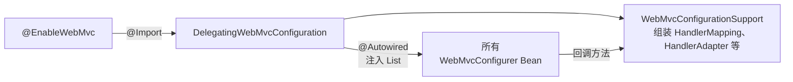

# WebMvcConfigurer
[[toc]]

`WebMvcConfigurer` 是 Spring MVC 向应用「要配置」的一组回调。Javadoc 的第一句就把这件事说透了：**「Defines callback methods to customize the Java-based configuration for Spring MVC」**——它定义的每一个方法，参数都是框架递过来的一个注册器 / 配置器（`InterceptorRegistry`、`CorsRegistry`、`FormatterRegistry`……），你在方法体里往里面塞东西，框架拿走这份配置去组装自己的组件。

本文以 Spring Framework 7.0 为准。

所以它的形态和「某个时刻被调一次」那类回调不一样：那些是「框架在某个时刻调你一次，你去做一件事」，它是「框架在组装 MVC 时把各个配置口递给你，你往里填」。填法只有一种，方法返回后框架不再回头读你的类。

## 什么时候需要它

它递到你手上的是一个又一个注册器，所以用得上的场合有一个共同点：**框架已经给这一类配置留了口子，只是默认值不合你的要求**。改动落在有回调的那些组件上就用它，不需要动自动配置。几个典型处境：

**`addInterceptors`：加拦截器。** 这是最常见的一种。拦截器类标了 `@Component` 也不会自动生效，必须由 `addInterceptors` 交给 `InterceptorRegistry`，也只有在这一步才能用 `addPathPatterns` / `excludePathPatterns` 框定生效范围——注册结果是不是 `MappedInterceptor`，取决于有没有给路径模式或 HTTP 方法。拦截器本身怎么写见 [HandlerInterceptor](./handler-interceptor.md)。

**`addCorsMappings`：全局跨域。** 前后端分离、接口要开放给浏览器里别的站点的页面调用时，按路径成批配一次比在每个 Controller 上贴 `@CrossOrigin` 省事。两处都写的时候注意是**合并**而不是覆盖（Javadoc：`combined with local CORS configuration`），容易配出意料之外的组合；另外 `allowedOrigins` 里出现 `*` 时不能再开 `allowCredentials(true)`，这个组合要到第一次带 CORS 的请求进来时才会被 `CorsConfiguration#validateAllowCredentials` 拦下来（启动阶段不校验），既要通配来源又要带凭证得改用 `allowedOriginPatterns`。如果整个系统前面已经有网关或 Nginx 统一处理跨域，这里就不必再配一份。

**`addArgumentResolvers` / `addReturnValueHandlers`：Controller 方法签名需要框架给不出的参数，或者要支持一种新的返回类型。** 每个方法都要拿到当前登录用户、当前租户这类由上下文提供的对象，与其在每个方法里从 `RequestContextHolder` 里取，不如写一个参数解析器，让方法直接声明；自定义的返回类型（比如一个自己往输出流写的下载对象）可以通过返回值处理器接进来。两者的语义都是**追加**——传进来的 List 一开始是空的，往里加不会覆盖内置支持。代价是这类代码影响所有 Controller，出问题很难定位到具体方法。如果只是想让每个方法都能看到同一个对象，`@ControllerAdvice` 里的 `@ModelAttribute` 方法更轻（官方文档：声明在 `@ControllerAdvice` 里的这类方法对所有 Controller 都生效）；统一包装响应体、加响应头则用 `ResponseBodyAdvice`，不必动返回值处理器。

**`extendMessageConverters`：需要一类默认没有的媒体类型。** 内置的消息转换器只认常见的那几种，要支持 protobuf、Excel 导出这类自定义 `MediaType`，只能自己加一个转换器，而且得用 `extendMessageConverters`——`configureMessageConverters` 一旦被覆写，默认转换器的注册就整个关掉了，得把原来那批全部补齐；注册顺序也有意义，客户端发 `Accept: */*` 时靠前注册的优先。反过来，改已有类型的序列化细节（日期格式、`Long` 精度）是 Jackson 配置的活，不该动转换器列表；要替换的是 `RequestMappingHandlerAdapter` 这类组件本身，也不是这里的事，那是 `WebMvcRegistrations` 的入口。

**`addViewControllers` / `addResourceHandlers`：有一批 URL 不需要业务逻辑，或者一批文件要当静态资源暴露。** 首页跳转、固定返回 `204` 的健康检查、老地址重定向，为了这几个 URL 写 Controller 是浪费，`addViewControllers` 注册一下就行；本地上传目录、前端构建产物这类不在 classpath 上的文件要挂到某个 URL 前缀下，用 `addResourceHandlers`。这里有两处容易撞车：某个 URL 只要被 `@RequestMapping` 方法映射过（任意 HTTP 方法），视图控制器就没法再处理它，所以同一路径别拆到两处写；静态资源方面，如果只是要把默认搜索目录换掉或再加一个，Boot 的属性 `spring.web.resources.static-locations` 比手写资源映射更合适，别两套并存。

## 回调是怎么接上的

链路是固定的三跳，`@EnableWebMvc` 只是入口的语法糖：



- `DelegatingWebMvcConfiguration` 的 Javadoc 说明它「detects and delegates to all beans of type `WebMvcConfigurer`」，探测手段是一个 `@Autowired(required = false) setConfigurers(List<WebMvcConfigurer>)`。
- `DelegatingWebMvcConfiguration` 继承 `WebMvcConfigurationSupport`，后者是真正组装 MVC 组件的地方。回调就在它创建这些组件的 Bean 时被调用——`addInterceptors` 调出来的结果是各 `HandlerMapping` 共享的拦截器（`WebMvcConfigurationSupport#getInterceptors()` 的 Javadoc：`shared handler interceptors used to configure HandlerMapping instances with`），`addFormatters` 配的是共同的 `FormattingConversionService`，`configureMessageConverters` 配的是 `RequestMappingHandlerAdapter` 的消息转换器。

由此得出一条实用结论：**回调在容器 refresh 阶段就跑完了，`WebMvcConfigurer` 自己的构造依赖必须在那之前就能建出来**。把 MVC 组件（`HandlerMapping`、`RequestMappingHandlerAdapter` 等）注入到配置类里是一个方向相反的依赖，容易出现启动期的循环依赖，配置类里只注入自己写的 Service、工具类就够用了。

接口里所有方法都有 `default` 实现，覆写哪个就只管哪个。完整清单如下（按「配哪类东西」分组，后面几节展开说）：

| 方法 | 递给你的对象 | 管什么 |
| --- | --- | --- |
| `addInterceptors` | `InterceptorRegistry` | 请求拦截器 |
| `addCorsMappings` | `CorsRegistry` | 全局跨域规则，按路径模式注册 |
| `configurePathMatch` | `PathMatchConfigurer` | 路径匹配策略：用解析后的 `PathPattern` 还是 `PathMatcher`，是否匹配尾斜杠 |
| `configureContentNegotiation` | `ContentNegotiationConfigurer` | 内容协商选项 |
| `configureAsyncSupport` | `AsyncSupportConfigurer` | 异步请求处理的超时、线程池等 |
| `configureDefaultServletHandling` | `DefaultServletHandlerConfigurer` | 把没被处理的请求交给容器的 default servlet |
| `configureApiVersioning` | `ApiVersionConfigurer` | API 版本解析（Spring Framework 7.0 新增） |
| `addFormatters` | `FormatterRegistry` | 在默认注册之外追加 `Converter` / `Formatter` |
| `addArgumentResolvers` | `List<HandlerMethodArgumentResolver>` | 追加自定义方法参数解析器 |
| `addReturnValueHandlers` | `List<HandlerMethodReturnValueHandler>` | 追加自定义返回值处理器 |
| `configureMessageConverters` | `List<HttpMessageConverter<?>>` | 接管整个消息转换器列表 |
| `extendMessageConverters` | `List<HttpMessageConverter<?>>` | 在默认转换器列表上增删改 |
| `configureMessageConverters(HttpMessageConverters.ServerBuilder)` | `HttpMessageConverters.ServerBuilder` | 用 Builder 接管消息转换器列表（Spring Framework 7.0 新增，替代上面两个 `List` 版） |
| `addViewControllers` | `ViewControllerRegistry` | 不用写 Controller 的简单映射：首页、重定向、固定状态码 |
| `addResourceHandlers` | `ResourceHandlerRegistry` | 静态资源映射 |
| `configureViewResolvers` | `ViewResolverRegistry` | 视图名到 `View` 实例的解析 |
| `configureHandlerExceptionResolvers` | `List<HandlerExceptionResolver>` | 接管异常解析器列表 |
| `extendHandlerExceptionResolvers` | `List<HandlerExceptionResolver>` | 在默认异常解析器列表上增删改 |
| `addErrorResponseInterceptors` | `List<ErrorResponse.Interceptor>` | 渲染 RFC 9457 `ProblemDetail` 时应用的拦截器（Spring Framework 6.2 新增） |
| `getValidator` | 无参数，返回 `Validator` | 替换默认校验器 |
| `getMessageCodesResolver` | 无参数，返回 `MessageCodesResolver` | 替换默认的消息码生成器 |

两个 `List` 版本的消息转换器方法在 **Spring Framework 7.0 起被标记为 deprecated（`forRemoval = true`）**，官方给的替代是 `configureMessageConverters(HttpMessageConverters.ServerBuilder)`。老项目不用急着改，但新代码别再往这两个方法上加逻辑了。

## 请求链上的配置

这一组的共同点是：配出来的东西在每次请求的处理链上起作用。

`addInterceptors` 只在这里提一句：它注册的拦截器由 `DispatcherServlet` 触发、能被路径模式过滤，具体写法见 `HandlerInterceptor`。

`addCorsMappings` 配的是「全局」跨域规则，按路径模式注册，适用于注解控制器、函数式端点和静态资源。注解控制器上另外写了 `@CrossOrigin` 时，两份配置是**合并**关系（Javadoc：`combined with local CORS configuration`），不是覆盖：

```java
@Override
public void addCorsMappings(CorsRegistry registry) {
    registry.addMapping("/api/**")
            .allowedOrigins("https://example.com")
            .allowedMethods("GET", "POST")
            .allowedHeaders("*")
            .allowCredentials(true)
            .maxAge(3600);
}
```

`addMapping(pathPattern)` 返回 `CorsRegistration`，可链式设置的项包括 `allowedOrigins` / `allowedOriginPatterns` / `allowedMethods` / `allowedHeaders` / `exposedHeaders` / `allowCredentials` / `maxAge`。有一处会直接报错：`allowedOrigins` 里带了通配值 `*` 时不能再开 `allowCredentials(true)`，原因是这种情况下 `Access-Control-Allow-Origin` 无法回写为 `*`。`addCorsMappings` 配出来的全局规则不在启动期校验，而是第一次带 CORS 的请求进来时，由 `CorsConfiguration#validateAllowCredentials` 抛 `IllegalArgumentException`。既要通配来源又要带凭证，改用 `allowedOriginPatterns`。

- `configurePathMatch` 决定路径怎么匹配。Spring Boot 默认已经选了 `PathPatternParser`，一般不用动；只有当你要用 `AntPathMatcher` 特有的模式变体、或者要调整尾斜杠匹配时才有必要覆写它。
- `configureAsyncSupport` 管异步请求的超时和任务执行器（`setDefaultTimeout`、`setTaskExecutor` 之类）。
- `configureDefaultServletHandling` 只在需要把 Spring MVC 处理不了的请求转交给容器 default servlet 时才用：

```java
@Override
public void configureDefaultServletHandling(DefaultServletHandlerConfigurer configurer) {
    configurer.enable();
}
```

`enable()` 之后，MVC 会在 `HandlerMapping` 链末尾加一个兜底的映射，把没匹配上的请求转发给容器的 default servlet（按 Javadoc 的说法，典型场景是 `DispatcherServlet` 被映射到 `/`、盖掉了容器原本的静态资源处理）。Spring Boot 不注册 default servlet（`server.servlet.register-default-servlet` 默认 `false`），所以 Boot 应用里通常不需要这一段。

## 参数与返回值

Controller 方法能写什么参数、能返回什么类型，是由两组处理器列表决定的。`addArgumentResolvers` 和 `addReturnValueHandlers` 就是往这两组列表里追加的入口——**追加，不是替换**。Javadoc 特别注明：入参的 List 一开始是空列表，往里面加不会覆盖内置支持；想改内置行为，得直接去配 `RequestMappingHandlerAdapter`。

```java
@Override
public void addArgumentResolvers(List<HandlerMethodArgumentResolver> resolvers) {
    // 让 Controller 方法可以直接声明 LoginUser 参数
    resolvers.add(new LoginUserArgumentResolver());
}
```

`addFormatters` 管的是类型转换，用的是另一套：它配置的是 MVC 共用的 `FormattingConversionService`，负责 `@RequestParam`、`@PathVariable` 之类的字符串到目标类型的转换，以及 `@DateTimeFormat` 这类格式化注解的落地。这里的语义是「在默认注册之外追加」，和 `addArgumentResolvers` 一样不覆盖默认。

::: tip Boot 应用里通常不用写 addFormatters
Spring Boot 自己的 `WebMvcAutoConfigurationAdapter` 也实现了 `addFormatters`，方法体是 `ApplicationConversionService.addBeans(registry, beanFactory)`——它会把容器里所有 `Converter`、`ConverterFactory`、`GenericConverter`、`Formatter`、`Printer`、`Parser` 类型的 Bean 注册进去。所以这六种类型的 Bean 声明出来就自动生效，不必再写 `addFormatters`。
:::

## 消息转换与内容协商

这两个方法决定了「HTTP 请求体怎么变成 Java 对象、Java 对象怎么写回响应体」，Spring Boot 已经配好一整套默认值，改动方式、两个方法的取舍、以及只加一个转换器的写法，都在 [Spring Boot 的 Web 支持](../../spring-boot/spring-boot-web.md) 里写过，这里不重复。

补充一个使用频率不低的坑：`configureMessageConverters(List)` 一旦被覆写，**默认转换器的注册就被关掉了**（Javadoc：`use of this method turns off default converter registration`），你必须在方法里把需要的转换器全部补齐。只想追加一个就改用 `extendMessageConverters(List)`——它在默认列表之后被调用，而且注册顺序有意义：客户端发 `Accept: */*` 时，靠前注册的转换器优先。

`configureContentNegotiation` 管的是「怎么从请求里确定要返回什么媒体类型」，比如关掉路径扩展名协商、调整 `Accept` 头之外的后备策略。默认策略在大多数项目里够用，需要时再覆写。

## 映射到视图

这一组负责「URL 进来之后怎么落到一个响应上」。

`addViewControllers` 是省掉一层 Controller 的地方——不需要业务逻辑、只想返回一个固定视图或状态码时用它。Javadoc 举的场景就是渲染首页、做简单跳转、返回带 HTML 内容的 404、返回无内容的 204：

```java
@Override
public void addViewControllers(ViewControllerRegistry registry) {
    registry.addViewController("/home").setViewName("home");
    registry.addRedirectViewController("/legacy", "/home");
    registry.addStatusController("/health", HttpStatus.NO_CONTENT);
}
```

可用的是三个入口：

- `addViewController(urlPathOrPattern)` 返回 `ViewControllerRegistration`（配 `setViewName` / `setStatusCode`）。
- `addRedirectViewController(urlPath, redirectUrl)` 做跳转。
- `addStatusController(urlPath, statusCode)` 只设状态码。

它们最终被组装成一个 `SimpleUrlHandlerMapping`，`setOrder` 默认是 `1`——紧跟在注解控制器的 `0` 之后。

::: warning 视图控制器和 @RequestMapping 抢同一个 URL
Javadoc 明确提示：某个 URL 只要被 `@RequestMapping` 方法映射过（任意 HTTP 方法），视图控制器就无法再处理这个 URL。所以别把一个 URL 的映射拆到两处，同一路径要么写 Controller，要么写视图控制器。
:::

`addResourceHandlers` 做静态资源映射，写法同样在 Spring Boot 的 Web 支持那篇里写过。这里只补一条协调关系：Boot 的 `WebMvcAutoConfigurationAdapter` 已经在 `addResourceHandlers` 里注册了 `/webjars/**` 和 `spring.mvc.static-path-pattern`（默认 `/**`）两个映射，它每次注册前会先查 `registry.hasMappingForPattern(pattern)` 决定是否跳过。你自己写 `addResourceHandlers` 时如果用了 `/**` 这类宽模式，也会和它撞上——要么用更具体的模式，要么一开始就用 `spring.web.resources.static-locations` 配，别两套并存。

`configureViewResolvers` 把 Controller 返回的字符串视图名翻译成具体的 `View`。有模板引擎时，Boot / 模板 starter 已经把前缀、后缀配好了，需要自己插手的是要加自定义 `ViewResolver` 或者调整它们的顺序。

## 异常与校验

`configureHandlerExceptionResolvers` 和 `extendHandlerExceptionResolvers` 名称对称，语义差得很远：

| 方法 | 传进来的 List 是什么 | 后果 |
| --- | --- | --- |
| `configureHandlerExceptionResolvers` | 一开始是**空**的 | 留空则框架补一套默认解析器；只要往里加了任何一个，应用就接管了，必须自己提供全套初始化好的解析器 |
| `extendHandlerExceptionResolvers` | 已经装好**默认**解析器 | 在默认列表上增删改，适合插一个自己的解析器而不影响其余 |

两者的取舍几乎总是后者。`@ControllerAdvice` + `@ExceptionHandler` 就是通过默认链里的 `ExceptionHandlerExceptionResolver` 生效的，与统一错误响应的关系见 [ErrorController](../../spring-boot/boot-callbacks/error-controller.md)。

`getValidator` 和 `getMessageCodesResolver` 是唯二没有参数的两个回调，它们以「返回一个对象」的形式交配置：`getValidator()` 的默认实现返回 `null`，表示沿用框架的默认校验器——`WebMvcConfigurationSupport#mvcValidator()` 在它返回 `null` 时会替你 new 一个 `OptionalValidatorFactoryBean`（classpath 上有 JSR-303 实现时），想换掉这个默认校验器才覆写它；`getMessageCodesResolver` 同理。

`addErrorResponseInterceptors` 是 Spring Framework 6.2 新增的，只在渲染 RFC 9457 格式的 `ProblemDetail` 错误响应时起作用——Spring Boot 侧需要先把 `spring.mvc.problemdetails.enabled` 打开（默认 `false`）。

## 几个容易踩的点

这几处大多和「回调什么时候生效、和 Boot 自动配置谁说了算」有关：

- **不要在 Boot 应用里加 `@EnableWebMvc`**。它是 `@Import(DelegatingWebMvcConfiguration.class)`，导入之后 Boot 的 MVC 自动配置整体不再生效，默认的消息转换器、静态资源映射、`WebMvcConfigurer` 之外的自动配置全部失效。Boot 里要定制只加 `WebMvcConfigurer` 实现类，**不加**这个注解。
- **Boot 自己也是一个 `WebMvcConfigurer`**，而且带 `@Order(0)`。你的实现类不标 `@Order` 时排在它之后——这解释了为什么「我先注册了拦截器」在 `order` 相同的情况下仍可能不是链头，需要确定次序就显式标 `order`。
- **`configureMessageConverters` 会清空默认转换器**，覆写前先确认自己知道默认那批是什么。只想加一个用 `extendMessageConverters`。
- **两个 List 入参不要当成「默认值」来读**。`addArgumentResolvers`、`addReturnValueHandlers`、`configureHandlerExceptionResolvers` 传进来的 List 都是空的（或空的异常解析器列表），往里加就是追加或接管，读它拿不到框架已有的处理器。
