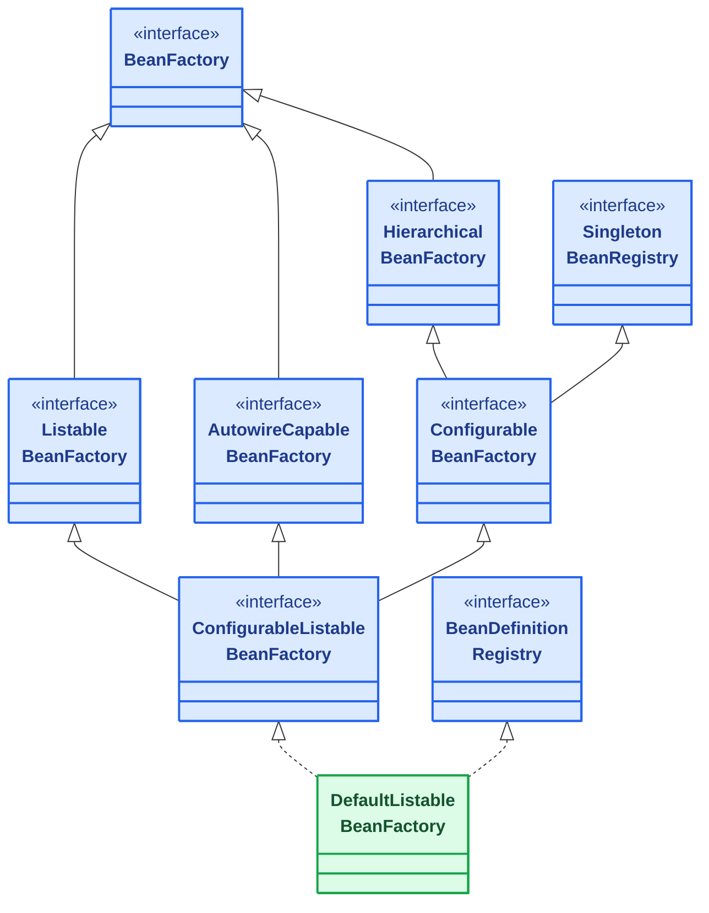
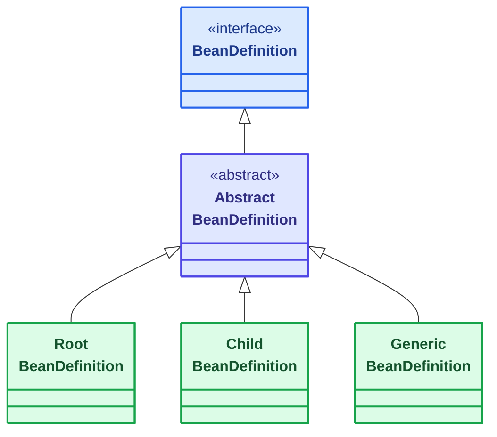
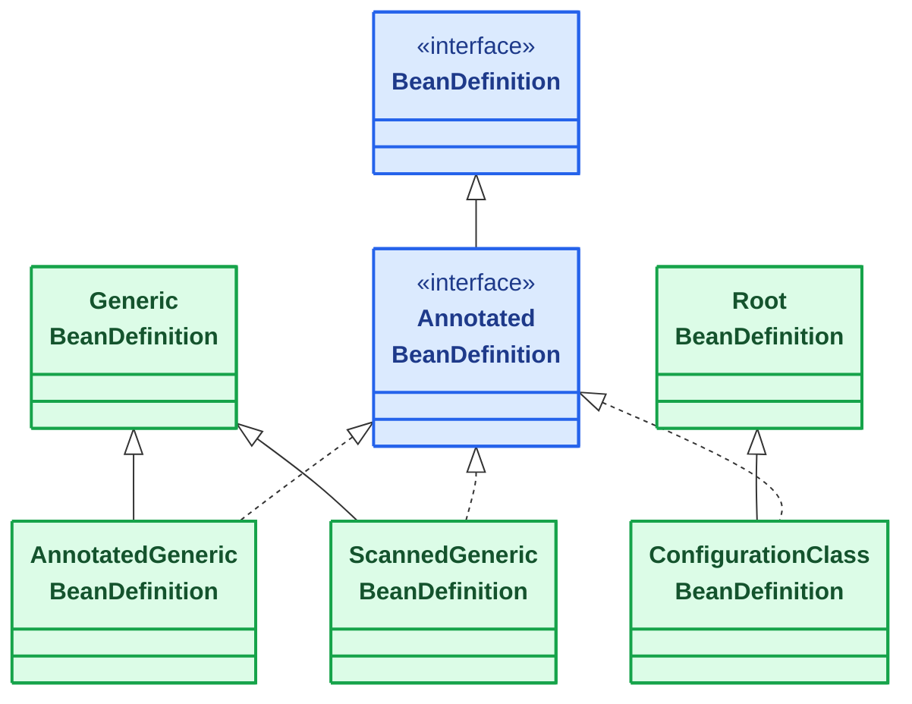
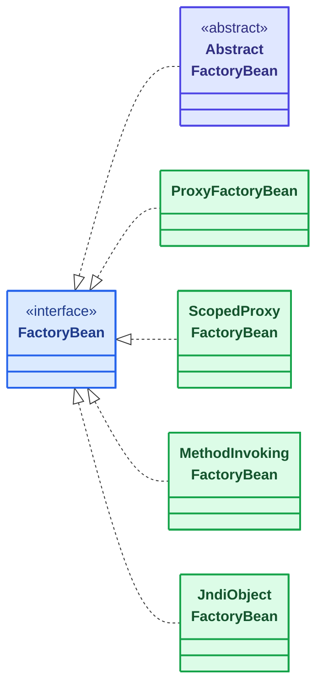
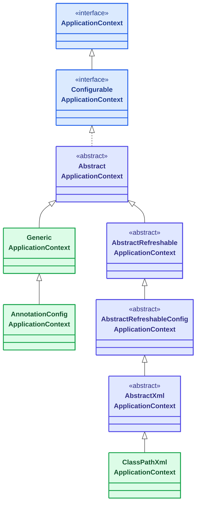

# IoC 容器核心接口体系

[[toc]]

Spring 容器相关的接口集中在 `org.springframework.beans.factory` 和 `org.springframework.context` 两个包及其子包下。它们数量不多，名字却高度相似，单独看其中一个，很难判断它在整体结构里处在什么位置、什么时候该用它：

- `BeanFactory` 和 `FactoryBean` 只差两个字母，含义正好相反：前者是整个容器，后者只是容器里一个负责造对象的 Bean。
- `ListableBeanFactory`、`ConfigurableBeanFactory`、`ConfigurableListableBeanFactory` 沿着同一条继承链层层叠加，名字越长，补上的能力越多。
- `BeanDefinition` 描述「Bean 怎么造」，是容器持有的配置数据；`ApplicationContext` 是容器的对外门面，日常代码接触到的就是它。

这些接口彼此并不平行，而是按角色分成四组，各占一个位置。下面先看哪些场景会真正用到它们，再按这四组逐个展开。

本文讲的是跨版本稳定的接口体系，不绑定具体版本。

::: tip 范围
本文只讲 **Spring Framework 容器自身**的接口。

你实现给框架、由框架在某个时机回头调用的那一批接口（`BeanPostProcessor`、`ApplicationRunner`、`Condition`、`EnvironmentPostProcessor` 等）属于另一条线，判据和本文正好相反——那批是「框架调你」，见 [Spring 与 Spring Boot 回调接口](../spring-boot/boot-callbacks/index.md)。
:::

## 什么时候会直接用到这些接口

日常业务代码用不到——`@Component` 加 `@Autowired` 就能跑起来，容器接口都藏在框架内部。下面几类事情会把你推到它们面前：

- **`BeanDefinitionRegistry`：要在容器启动过程中改东西**。注册一个配置里没有的 Bean、按一份运行期才拿到的名单批量注册、覆盖某个 starter 提供的定义。
- **`ListableBeanFactory`：要从容器里按条件捞一批对象**。不是注入某一个，而是「所有实现了某接口的 Bean 都拿出来」，逐个挂上同一套处理。
- **`FactoryBean`：要把「怎么造对象」也交给容器管**。产物来自 JDK 动态代理、远程连接或静态工厂方法，配置里写不出一个具体的类名。
- **`BeanDefinition`：要排查「为什么这个 Bean 没进来」**。`NoSuchBeanDefinitionException`、循环依赖、`@Conditional` 没生效——最后基本都要看容器里到底注册了哪些定义。
- **`ConfigurableBeanFactory` 与 `ConfigurableListableBeanFactory`：读源码或别人的扩展实现**。分不清这两者差在哪，往下读会很吃力。

<Card title="为什么这条里还提到另一个接口">
  <code>BeanDefinitionRegistry</code> 是接口，注册、移除、查询定义的方法声明在它上面；<code>ConfigurableListableBeanFactory</code> 也是接口，但<strong>不继承</strong> <code>BeanDefinitionRegistry</code>，所以光有它调不了 <code>registerBeanDefinition</code>。<br/>
  对得上「改定义」这个场景的扩展点是 <code>BeanDefinitionRegistryPostProcessor</code>（入参就是 <code>BeanDefinitionRegistry</code>），而 <code>BeanFactoryPostProcessor</code> 拿到的是 <code>ConfigurableListableBeanFactory</code>，那是另一件事。<br/>
  两套方法常能在同一个对象上调，是因为实现类 <code>DefaultListableBeanFactory</code> <strong>同时实现</strong>了这两个接口——<strong>接口之间本身没有继承关系</strong>。
</Card>

## 四组接口的分工

| 体系 | 它是什么 | 职责 |
| --- | --- | --- |
| `BeanFactory` | 容器本体 | 存放和管理 Bean，`getBean()` 从它这里取 |
| `BeanDefinition` | 容器持有的数据 | 描述「这个 Bean 怎么造」，容器照它造对象 |
| `FactoryBean` | 一种特殊的 Bean | 它自己是 Bean，但别人取它时拿到的是它造出来的对象 |
| `ApplicationContext` | 容器门面 | 继承 `BeanFactory`，再叠上事件、国际化、资源加载等能力 |

前两组是容器的内部构造，后两组是使用侧。下面逐组展开。

## 容器整体结构总览

上面按职责把这套接口分成了四组，下面先把它们放回同一张图。这张图只标出接口与类之间的结构关系——谁继承谁、谁实现谁、谁依赖谁，不涉及方法签名和调用顺序。

<!-- @include: ./spring-ioc-overview-diagram.md -->

## BeanFactory：容器本体

整个容器体系的根接口。它本身很薄——只声明了「按名字或类型取 Bean」和几个状态查询，具体怎么存、怎么造、怎么缓存，都在实现类里。

### 接口定义

`BeanFactory` 接口声明的方法不多，下面按用途分组列出：

```java
public interface BeanFactory {

    /** 取 Bean 时加这个前缀，拿到的才是 FactoryBean 自己，而不是它的产物 */
    String FACTORY_BEAN_PREFIX = "&";

    // 取 Bean：按名字、按类型，都可以附带构造参数
    Object getBean(String name) throws BeansException;
    <T> T getBean(String name, Class<T> requiredType) throws BeansException;
    <T> T getBean(Class<T> requiredType) throws BeansException;
    Object getBean(String name, Object... args) throws BeansException;

    // 延迟拿到一个「可能不存在」的 Bean，用于可选依赖
    <T> ObjectProvider<T> getBeanProvider(Class<T> requiredType);

    // 查询，不会创建实例
    boolean containsBean(String name);
    boolean isSingleton(String name) throws NoSuchBeanDefinitionException;
    boolean isPrototype(String name) throws NoSuchBeanDefinitionException;
    boolean isTypeMatch(String name, Class<?> typeToMatch) throws NoSuchBeanDefinitionException;
    @Nullable Class<?> getType(String name) throws NoSuchBeanDefinitionException;
    String[] getAliases(String name);
}
```

上面省掉了几个同义重载（带 `ResolvableType` 的、带 `allowFactoryBeanInit` 开关的）。能看到 `BeanFactory` 只承诺两件事：**取**和**问**。注册、配置、缓存这些都没有。

### 三个直接子接口各补一类能力

`BeanFactory` 之下并列着三个子接口，分别补的是三种不同的用法：

| 子接口 | 补的能力 | 典型方法 |
| --- | --- | --- |
| `ListableBeanFactory` | 批量查询：不看名字，按类型或注解捞一批 | `getBeanNamesForType`、`getBeansOfType`、`getBeansWithAnnotation` |
| `HierarchicalBeanFactory` | 父子容器：本容器找不到时交给父容器 | `getParentBeanFactory`、`containsLocalBean` |
| `AutowireCapableBeanFactory` | 主动装配：对**已有对象**做依赖注入和初始化 | `autowireBean`、`initializeBean`、`createBean` |

第三个接口容易被忽略，但它解决一个具体问题：对象不是容器造的，却想享受容器那套依赖注入和后处理器。比如把一个 Servlet、一个第三方框架回调里 new 出来的实例交给容器接管，走的就是 `autowireBean(existingObject)`。

### 再加一层：配置能力和统一入口

上面三个接口都不提供改容器配置的能力——不注册 Bean 定义，也不删除。要让容器可配置，再叠两代：

- `ConfigurableBeanFactory` —— 继承 `HierarchicalBeanFactory` 和 `SingletonBeanRegistry`。前者用来找父容器，后者提供 `registerSingleton`、`getSingleton` 这类单例注册和查询能力；它自己加的是改配置的方法：`addBeanPostProcessor`、`setTypeConverter`、`registerScope`。
- `ConfigurableListableBeanFactory` —— 把 `ListableBeanFactory`、`AutowireCapableBeanFactory`、`ConfigurableBeanFactory` 三个合到一起，是**扩展和框架代码最常用的类型**。`BeanFactoryPostProcessor.postProcessBeanFactory` 的参数就是它。



- <span class="spring-legend interface"></span>接口
- <span class="spring-legend implementation"></span>实现类

`DefaultListableBeanFactory` 是这条实现链的落点，也是这条链上最常用的可直接实例化的实现——链上的抽象基类都要再配一层子类才能跑起来，能独立实例化的实现不止它一个。它除了实现 `ConfigurableListableBeanFactory`，还实现了 `BeanDefinitionRegistry`，因此在 `BeanFactory` 这条实现链上，注册和移除定义的入口只有它（`BeanDefinitionRegistry` 不止一个实现，见后文）。

它的实现链是这样的：

```text
DefaultListableBeanFactory
└─ AbstractAutowireCapableBeanFactory
   └─ AbstractBeanFactory
      └─ FactoryBeanRegistrySupport
         └─ DefaultSingletonBeanRegistry
            └─ SimpleAliasRegistry
```

这条链上两个名字和后面两节直接相关。`FactoryBeanRegistrySupport` 说明 `FactoryBean` 的处理不是独立体系，而是挂在 BeanFactory 实现链上的一个环节；`DefaultSingletonBeanRegistry` 说明单例缓存也不在 `BeanFactory` 接口里——接口只声明 `isSingleton()` 这种查询，缓存怎么存、存哪儿，是实现的事。

### 一个实际用法

拿 `ListableBeanFactory` 做批量处理，是业务代码里少见的、会直接用容器接口的场景：

```java
ConfigurableApplicationContext context = new AnnotationConfigApplicationContext(AppConfig.class);

ListableBeanFactory beanFactory = context;

// 按类型捞出全部实现，而不是注入某一个
for (String name : beanFactory.getBeanNamesForType(OrderHandler.class)) {
    OrderHandler handler = beanFactory.getBean(name, OrderHandler.class);
    log.info("注册处理器 {} -> {}", name, handler.getClass().getSimpleName());
}
```

`getBeanNamesForType` 只返回名字，不会把实例造出来；`getBeansOfType` 会连实例一起返回。批量遍历时选前者，可以在真正需要之前跳过一部分。

有一个例外：注册成 `FactoryBean` 的 Bean 会被初始化。不调它的 `getObject()`，容器就不知道产物是什么类型，所以按类型判断时只能先把它造出来——javadoc 的原话是 "FactoryBeans will get initialized"。要连这类也跳过，用带 `allowEagerInit` 参数的重载并传 `false`：`getBeanNamesForType(type, true, false)`。

## BeanDefinition：容器持有的配置数据

容器造对象不是「读你的类」那么简单，中间隔了一层：先把配置来源（XML 标签、注解、配置类方法）解析成 `BeanDefinition`，再按它造实例。这一层是配置和对象之间的中间表示，也是扩展 Spring 时最常改的东西。

### 用到的场景

下面几种情况会用到 `BeanDefinition`：

- 想在不改源码的前提下给某个 Bean 换实现、改 scope、加依赖，就是改它对应的 `BeanDefinition`。
- 想注册一批运行期才知道的定义（MyBatis 把 Mapper 接口注册进容器就是这么做的），也得往容器里塞 `BeanDefinition`。
- 排查 Bean 没生效、被覆盖、被 `@Conditional` 挡掉，看的就是容器里实际持有哪条定义。

这两件事各有专门的接口，读定义用 `BeanDefinitionRegistry`，改定义用 `BeanFactoryPostProcessor` / `BeanDefinitionRegistryPostProcessor`。后者属于回调那一批，已在 [BeanPostProcessor](./framework-callbacks/bean-post-processor.md) 一篇里讲过，这里只说定义本身。

### 定义里有什么

`BeanDefinition` 是一个描述性的接口，它继承 `AttributeAccessor` 和 `BeanMetadataElement`，读起来像一份配置清单：

```java
public interface BeanDefinition extends AttributeAccessor, BeanMetadataElement {

    String getBeanClassName();
    String getScope();                       // singleton / prototype / 自定义 scope
    boolean isLazyInit();
    boolean isPrimary();
    String[] getDependsOn();
    String getFactoryBeanName();             // 由哪个 FactoryBean 造
    String getFactoryMethodName();           // 由哪个工厂方法造
    ConstructorArgumentValues getConstructorArgumentValues();
    MutablePropertyValues getPropertyValues();
    // ...
}
```

`BeanDefinition` 跟实例无关，它是纯数据。`getBeanClassName()` 拿到的可能只是个字符串；`getScope()` 的默认值是空串（`SCOPE_DEFAULT`），不是 `singleton`——要判断是不是单例，用 `isSingleton()`，它把空串和 `singleton` 都算作单例。也正因为它只是数据，容器在造对象之前就能把它读出来、改掉、甚至删掉——这正是各种「容器启动前改配置」的扩展点能成立的原因。

### 实现类分两支

第一支是普通实现，只描述「怎么造」，不带注解信息。



- <span class="spring-legend interface"></span>接口
- <span class="spring-legend abstract"></span>抽象类
- <span class="spring-legend implementation"></span>实现类

`RootBeanDefinition` 和 `ChildBeanDefinition` 是早期用来区分「有父定义 / 无父定义」的一对。`GenericBeanDefinition` 出现之后把两种情况统一了——它自己带 `parentName` 字段。现在 XML 解析走的就是后者：读到一个 `<bean>` 标签时，容器先 `new GenericBeanDefinition()`，再按需要调 `setParentName(...)`，不再区分该建哪个类。

第二支多带一份注解元数据，让容器能在不加载类的情况下读到注解信息，`@Conditional` 才有判据可用。它的三个实现类分别继承上一支里的 `GenericBeanDefinition` 和 `RootBeanDefinition`，多了「实现的接口」这一层：



- <span class="spring-legend interface"></span>接口
- <span class="spring-legend implementation"></span>实现类

具体落到哪个实现类，取决于配置是怎么来的：

| 配置来源 | 产生的定义类 | 继承自 |
| --- | --- | --- |
| `@Bean` 方法 | `ConfigurationClassBeanDefinitionReader$ConfigurationClassBeanDefinition` | `RootBeanDefinition` |
| 组件扫描扫到的 `@Component` 之类 | `ScannedGenericBeanDefinition` | `GenericBeanDefinition` |
| 手动 `context.register(Xxx.class)` | `AnnotatedGenericBeanDefinition` | `GenericBeanDefinition` |

这三个名字平时不用记，但排查问题时有用：看到定义类型是 `ScannedGenericBeanDefinition`，就知道这个 Bean 是被扫进来的；看到 `ConfigurationClassBeanDefinition`，就知道它来自某个 `@Bean` 方法。

### 围绕定义的三个协作接口

它们不在这条继承线上，但读到「定义怎么进容器」时一定会碰到：

- **`BeanDefinitionReader`** —— 从某个来源解析出定义。`XmlBeanDefinitionReader` 读 XML，`PropertiesBeanDefinitionReader` 读 properties，`GroovyBeanDefinitionReader` 读 Groovy 脚本。
- **`BeanDefinitionRegistry`** —— 定义的存放处，方法就四个方向：`registerBeanDefinition`、`removeBeanDefinition`、`getBeanDefinition`、`containsBeanDefinition`（外加 `getBeanDefinitionNames` 和计数）。`DefaultListableBeanFactory` 和 `GenericApplicationContext` 都实现了它。
- **`BeanDefinitionHolder`** —— 把「定义 + 名字 + 别名」打包成一个对象传递，因为注册时这三样总是一起出现。

拿 `BeanDefinitionRegistry` 读出定义来看，是排查容器问题时成本最低的入口：

```java
BeanDefinitionRegistry registry = (BeanDefinitionRegistry) context;

BeanDefinition definition = registry.getBeanDefinition("orderService");
log.info("类名 {}", definition.getBeanClassName());
log.info("作用域 {}", definition.getScope());
log.info("来自 {}", definition.getResourceDescription());  // XML 文件路径或类文件位置
```

`getResourceDescription()` 直接告诉这个定义是从哪个文件/类解析出来的，比翻代码找快得多。

## FactoryBean：造对象的那种 Bean

有些对象不能直接 `new`。产物来自 JDK 动态代理、JNDI 查找、静态工厂方法，或者需要一串初始化步骤才能拿到——这些情况下配置里写不出一个「类名」，只能写「一个负责造它的对象」。`FactoryBean` 就是这个角色。

### 它和普通 Bean 差在哪

`FactoryBean` 接口只有三个方法，其中两个必须实现：

```java
public interface FactoryBean<T> {

    @Nullable
    T getObject() throws Exception;

    @Nullable
    Class<?> getObjectType();

    /** 默认 true：getObject() 的返回值由容器缓存，整个容器只调一次 */
    default boolean isSingleton() {
        return true;
    }
}
```

注册一个 `FactoryBean` 之后，容器里有两个东西可以取，靠 `&` 前缀区分：

```java
TokenClient client = context.getBean(TokenClient.class);
// 拿到的是 getObject() 的产物

FactoryBean<?> factoryBean = (FactoryBean<?>) context.getBean("&tokenClientFactoryBean");
// 加 & 才拿到 FactoryBean 自己
```

那个 `&` 就是 `BeanFactory.FACTORY_BEAN_PREFIX` 常量的值。日常取 Bean 时感觉不到它的存在——容器在 `getBean` 里自动剥掉了前缀，只有需要拿到工厂本身时才会手写。

`isSingleton()` 的语义要留意：它说的不是 `FactoryBean` 本身是不是单例（它默认按普通 Bean 的作用域创建），而是 **`getObject()` 的产物要不要缓存**。返回 `true` 时，产物存在 `FactoryBeanRegistrySupport` 的缓存里，整个容器生命周期只调一次 `getObject()`；返回 `false` 则每次取都重新调。

### 常用的几个实现



- <span class="spring-legend interface"></span>接口
- <span class="spring-legend abstract"></span>抽象类
- <span class="spring-legend implementation"></span>实现类

`FactoryBean` 是个很薄的接口，三个方法就够了，不需要复杂的继承体系。

| 实现类 | 它造的产物 |
| --- | --- |
| `AbstractFactoryBean` | 抽象基类，子类要实现 `createInstance()` 和 `getObjectType()` 两个抽象方法，它负责补上初始化/销毁回调 |
| `ProxyFactoryBean` | AOP 代理对象，XML 时代声明式 AOP 的主要入口 |
| `ScopedProxyFactoryBean` | 作用域代理，把一个短命 Bean 包成能注入到长命 Bean 里的代理 |
| `MethodInvokingFactoryBean` | 静态方法或实例方法的返回值，用于把方法调用结果当 Bean 注入 |
| `JndiObjectFactoryBean` | JNDI 名字查出来的对象 |

第三方生态里同一个套路的还有不少：MyBatis 的 `SqlSessionFactoryBean`、Hibernate 的 `LocalSessionFactoryBean`，名字里的 `FactoryBean` 后缀不是巧合，都是这个接口的实现。

### 什么时候自己写一个

`FactoryBean` 和 `@Bean` 方法都能造对象，区别在定位：

- 产物**造出来就完事**，用 `@Bean` 方法更直接，代码也少。
- 产物需要在容器里**以类型被注入**（`getObjectType()` 决定了注入时按什么类型匹配）、或者需要使用方通过配置参数来定义造法（setter 注入配置），才值得包一个 `FactoryBean`。

```java
@Component
public class TokenClientFactoryBean implements FactoryBean<TokenClient> {

    private String endpoint;   // 由配置注入

    @Override
    public TokenClient getObject() {
        // 怎么造由这里决定：换动态代理、换远程 stub，用法上完全一样
        return TokenClient.connect(endpoint);
    }

    @Override
    public Class<?> getObjectType() {
        return TokenClient.class;
    }

    public void setEndpoint(String endpoint) {
        this.endpoint = endpoint;
    }
}
```

### 两个名字别混

`BeanFactory` 和 `FactoryBean` 字母顺序相反，含义也正好相反：

- **`BeanFactory` 是容器**，管着一堆 Bean，提供 `getBean` 给外面取。
- **`FactoryBean` 是容器里的一个 Bean**，它自己不干活，作用是把另一个对象造出来。

还有个近亲容易一起混进来：`ObjectProvider`（继承自 `ObjectFactory`）不是 `FactoryBean`。它是 `getBeanProvider()` 的返回值，用来延迟取 Bean、处理「可能不存在」的情况，跟「造对象」这件事无关。

## ApplicationContext：容器门面

日常注入的那个 `ApplicationContext`，本质是 `BeanFactory` 加上一组横切能力。它需要关心的时候不多，但有两处绕不过去：

- 换一个容器实现：`new AnnotationConfigApplicationContext(...)` 时挑的就是它下面那批具体类。
- 读源码时看到 `AbstractApplicationContext.refresh()`：容器的启动流程都在这一个方法里展开。

### 它在 BeanFactory 之上叠了什么

| 继承的接口 | 加的能力 | 方法 |
| --- | --- | --- |
| `ListableBeanFactory` | 批量查询 | `getBeanNamesForType`、`getBeansWithAnnotation` |
| `HierarchicalBeanFactory` | 父子容器 | `getParentBeanFactory` |
| `EnvironmentCapable` | 读 profile 和属性 | `getEnvironment` |
| `MessageSource` | 国际化文案 | `getMessage` |
| `ApplicationEventPublisher` | 发布应用事件 | `publishEvent` |
| `ResourcePatternResolver` | 按通配符加载资源 | `getResources` |

这里有个容易误解的地方：`ApplicationContext` 继承了 `ListableBeanFactory`，并不代表它自己重新实现了一遍。`AbstractApplicationContext` 内部持有一个 `DefaultListableBeanFactory`，接口方法全都**委托**过去：

```java
// AbstractApplicationContext 中的实际写法
@Override
public String[] getBeanNamesForType(ResolvableType type) {
    assertBeanFactoryActive();
    return getBeanFactory().getBeanNamesForType(type);
}
```

`getBeanFactory()` 返回的就是内部那个 `ConfigurableListableBeanFactory`。所以 `ApplicationContext` 是**包装**关系，不是重写——这也是「容器本体」和「容器门面」能分开讨论的原因。

### 实现类分两条支线



- <span class="spring-legend interface"></span>接口
- <span class="spring-legend abstract"></span>抽象类
- <span class="spring-legend implementation"></span>实现类

两条支线的差别在 `refresh()` 时做什么：

- `GenericApplicationContext` 持有**一个** `DefaultListableBeanFactory`，从头用到尾。它能反复 `register()` 注册新定义，但 `refresh()` 只允许调一次——注解配置在运行时基本不会变，没必要重建工厂。
- `AbstractRefreshableApplicationContext` 每次 `refresh()` 都**新建**一个 `BeanFactory`，把定义重新加载一遍。XML 配置在运行期可能被改，所以这一类实现支持反复刷新。

这也是为什么基于注解的 `AnnotationConfigApplicationContext` 走的是前一支，而 `ClassPathXmlApplicationContext` 走的是后一支。

Web 环境和 Spring Boot 有各自的实现类，都挂在这两支下面：

| 实现类 | 配置来源 | 用在哪 |
| --- | --- | --- |
| `AnnotationConfigApplicationContext` | 注解、配置类 | 非 Web 环境，测试和命令行程序里最常用 |
| `ClassPathXmlApplicationContext` | classpath 下的 XML | XML 配置（含 `classpath:` 前缀） |
| `FileSystemXmlApplicationContext` | 文件系统路径的 XML | XML 配置（绝对路径或相对路径） |
| `GenericXmlApplicationContext` | XML（classpath 或文件系统） | 非 Web 环境，较少用 |
| `GenericGroovyApplicationContext` | Groovy 脚本 | 非 Web 环境，较少用 |
| `AnnotationConfigWebApplicationContext` | 注解、配置类 | 传统外部容器部署的 Web 应用 |
| `XmlWebApplicationContext` | XML | 传统外部容器部署的 Web 应用 |
| `GroovyWebApplicationContext` | Groovy 脚本 | 传统外部容器部署的 Web 应用，较少用 |
| `AnnotationConfigServletWebServerApplicationContext` | 注解、自动配置 | Spring Boot 的 Servlet 应用，启动后拿到的就是它 |

最后一行来自 spring-boot，不在本篇范围内，列在这里只是为了对上号——写 Spring Boot 时如果打断点看到这个类名，知道它同样属于 `ApplicationContext` 这条线。

## 该用哪个

| 要做的事 | 拿哪个 |
| --- | --- |
| 从容器取对象 | `ApplicationContext`（或它的 `getBean`） |
| 按类型/注解捞一批 | `ListableBeanFactory` |
| 遍历容器里有哪些 Bean | `ListableBeanFactory.getBeanDefinitionNames()` |
| 注册或移除一个定义 | `BeanDefinitionRegistry` |
| 看某个 Bean 是怎么配的 | `BeanDefinitionRegistry.getBeanDefinition(name)` |
| 决定某个对象怎么被造出来 | 实现 `FactoryBean` |
| 在容器启动过程中改配置 | `BeanFactoryPostProcessor` / `BeanDefinitionRegistryPostProcessor` |
| 把容器外的对象纳入管理 | `AutowireCapableBeanFactory.autowireBean(obj)` |

前两条覆盖了绝大多数用法：**容器本体指向 `BeanFactory` 这条链，日常门面指向 `ApplicationContext`**，两者之间靠组合关系连起来，不是一份东西的两种叫法。
