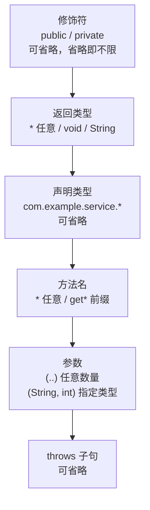

# Spring核心 - AOP
[[toc]]

## AOP是什么
AOP是Aspect Oriented Programming的缩写，意为：面向切面编程。面向切面编程是指将相同逻辑的重复代码横向抽取出来，再织入到目标对象的方法中，实现和原来一样的功能。Spring AOP 在运行期通过代理织入，编译期（预编译）、加载期织入则是 AspectJ 的做法。这样一来，我们就在写业务时只关心业务代码，而不用关心与业务无关的代码。

本文讲的是跨版本稳定的机制，不绑定具体版本。

## AOP 的实际用途
AOP 不只是框架内部在用的机制，Spring 自己就靠它实现了一大批注解式功能——事务、缓存、异步、方法级安全。先看它在真实项目里用在哪，后面再讲它怎么实现。

最典型的是声明式事务。给方法加上 `@Transactional` 就能获得事务能力，但这个注解本身不执行任何逻辑，真正干活的是一个环绕通知——在方法调用前开启事务，方法正常返回就提交，抛异常就回滚。这段「开启 / 提交 / 回滚」被包在业务方法外面，业务代码里看不到一行事务代码。Spring 的声明式事务正是靠 AOP 实现的，[官方文档](https://docs.spring.io/spring-framework/reference/data-access/transaction/declarative.html)明确说了这一点。

真实项目里常见的 AOP 应用有：

- **声明式事务 `@Transactional`**：切面拦在带注解的方法上，把「开启事务 → 执行方法 → 提交 / 回滚」整段包成环绕逻辑。
- **缓存 `@Cacheable` / `@CacheEvict`**：切面在方法调用前先查缓存，命中就直接返回、不进方法；方法执行完再把结果写回缓存。`@CacheEvict` 则在方法执行后清掉缓存。
- **异步执行 `@Async`**：切面把方法体交给线程池（`TaskExecutor`）去跑，调用方立即返回，不等方法执行完。
- **方法级安全 `@PreAuthorize`**：Spring Security 的方法级授权也建在 AOP 上，切面在方法调用前检查权限，没权限就抛 `AccessDeniedException`，方法不会被调到。
- **自己写的切面**：项目里最常见的是日志、审计和接口耗时统计；分布式锁、幂等控制这类也常做成切面。它们的共同点是「每个方法都要做、但跟业务逻辑无关」。

**为什么用 AOP，而不是在每个方法里手写一遍？**

事务、日志、权限、缓存这些逻辑叫横切关注点：它们不属于任何一个业务方法，却要横跨很多方法。手写的话，每个方法里都得重复一段几乎一样的代码——重复、难维护，改一处要动很多地方，还容易漏。AOP 把它们从业务代码里抽出来集中到切面中，业务方法只留业务代码；要改也只改切面一处。

::: warning 边界：AOP 只拦「从代理进来的调用」
AOP 靠代理实现，只有外部通过代理对象发起的调用才会被拦截。以下几种情况切面不生效：
- **类内自调用**：同一个类里用 `this.xxx()` 调自己的另一个方法，走的是 `this` 而不是代理，切面被绕过。这也是 `@Transactional` 失效最常见的原因之一。
- **非 public 方法**：接口式代理（JDK 动态代理）只能拦截接口里声明的方法，且这些方法必须是 public；接口之外的方法拦不到。
- **`final` 类 / `final` 方法 / `private` 方法**：CGLIB 靠继承目标类生成子类，`final` 类不能继承、`final` 和 `private` 方法不能被重写，所以无法增强。
:::

## AOP术语
AOP 的实现围绕一组核心术语展开，它们分别回答「切在哪里」「做什么」「怎么织进去」三个问题。
- 连接点JoinPoint：方法的执行
- 织入Weaving：切面应用到目标对象的过程
  + 切面Aspect：应该使用哪个通知并在哪个关注点使用它
    * 切入点PointCut：匹配连接点的条件
    * 通知Advice：做什么+何时做
  + 目标对象Target ：真正执行业务的核心逻辑对象

::: tip
切面`Aspect`是设计概念，通知器`Advisor`是 Spring AOP 的实现方式：
+ 切面可以包含多个通知和切点
+ 通知器仅组合一个通知和一个切点
+ 在 Spring AOP 中，`@Aspect` 注解的类最终会被解析为多个 `Advisor` 对象
:::

### JoinPoint 连接点
连接点，程序运行中的一些时间点，是插入横切关注点的扩展点，连接点可能是类初始化、方法执行，异常处理等等。在 Spring AOP 中，JoinPoint 总是方法的执行点。

### PointCut 切入点
切入点决定通知应该作用于哪个连接点，可以认为是匹配连接点的条件。

### Advice 通知
定义在连接点做什么，为切面增强提供织入接口，Spring AOP 提供了五种通知类型：
+ @Before：在 JoinPoint 方法之前执行。
+ @AfterReturning：在连接点方法正常执行后执行。
+ @AfterThrowing：在 JoinPoint 方法通过抛出异常后执行。
+ @After：在连接点方法之后执行，无论方法退出是正常还是异常返回。
+ @Around：在连接点之前和之后执行。

### Aspect 切面
Aspect 由切入点和通知组成：切入点定义在哪里执行，通知定义何时执行以及在连接点干什么。

可以简单地认为, 使用 @Aspect 注解的类就是切面。

### Target 目标对象
目标对象，即真正执行业务的核心逻辑对象。

因为 Spring AOP 使用运行时代理来实现 Aspect，调用方从容器拿到的总是代理对象，真正的目标对象被包在代理内部，调用方感知不到这层替换。

### AOP Proxy 代理对象
AOP代理，是调用方持有的增强后的对象引用，即AOP框架使用代理模式创建的对象，在Spring中，AOP代理可以用JDK动态代理或CGLIB代理实现。

### Weaving 织入
织入可以理解为切面应用到目标函数(类)的过程。一般分为静态织入和动态织入。

## Spring AOP的设计与实现
Spring AOP 的织入靠代理实现，代理分静态代理和动态代理两大类，两者的差别见下文。
### AOP的实现方式
实现 AOP 的技术，主要分为两大类：

+ 静态代理 - 指使用 AOP 框架提供的命令进行编译，从而在编译阶段就可生成 AOP 代理类，因此也称为编译时增强
  - 编译时编织（特殊编译器实现）
  - 类加载时编织（特殊的类加载器实现）
+ 动态代理 - 在运行时在内存中“临时”生成 AOP 动态代理类，因此也被称为运行时增强。
  - JDK 动态代理(Proxy，底层通过反射实现)
  - CGLIB(底层通过继承实现)

### 两种动态代理区别
Spring 默认按目标对象有没有实现接口来选代理方式，两者的行为和优缺点如下：
1. 若目标对象实现了若干接口，spring使用JDK的`java.lang.reflect.Proxy`类代理。
   1. 优点：因为有接口，所以使系统更加松耦合
   2. 缺点：为每一个目标类创建接口
2. 若目标对象没有实现任何接口，spring使用CGLIB库生成目标对象的子类。
   1. 优点：因为代理类与目标类是继承关系，所以不需要有接口的存在。
   2. 缺点：因为没有使用接口，所以系统的耦合性没有使用JDK的动态代理好。

::: tip
以上是 Spring Framework 的默认行为。Spring Boot 默认把 `spring.aop.proxy-target-class` 设为 `true`，即使目标对象实现了接口也一律走 CGLIB 代理；要改回「有接口就用 JDK 动态代理」的行为，需把它显式设成 `false`。
:::

### Spring AOP 和 AspectJ之间的关键区别
| 对比项 | Spring AOP | AspectJ |
| --- | --- | --- |
| 是否需要特殊编译器 | × | √ |
| 织入方式 | 运行时织入 | 编译时、编译后和加载时织入 |
| 切入点 | 方法 | 字段、方法、构造函数、静态初始值设定项、最终类/方法 |
| 对象 | Spring IoC 容器管理的bean上实现 | 所有域对象上实现 |


## AOP的配置方式
Spring AOP 支持对XML模式和基于@AspectJ注解的两种配置方式。

### XML配置
XML 模式下用 `<aop:config>` 里的一组标签声明切面、切点和通知：
- `<aop:aspect>`定义切面
- `<aop:pointcut>` 定义切点
- `<aop:before>`、`<aop:after>`、`<aop:around>`  定义通知

```xml
<aop:config>
		<aop:aspect ref="operatorLoggerAop">
			<aop:pointcut id="pointCut" expression="execution(* com.example.service..*.*(..))" />
			<aop:around method="logAround"  pointcut-ref="pointCut" />
		</aop:aspect>
	</aop:config>
```

### @AspectJ注解方式
注解模式下用 `@Aspect`、`@Pointcut`、`@Before` 等注解声明切面、切点和通知：
- `@Aspect`定义切面
- `@Pointcut`定义切点
- `@Before`、`@After`、`@Around`定义通知

```java
@Aspect
@Component
public class XXXAspect {
	@Pointcut("@annotation(com.example.core.annotation.Crypt)")
	public void pointcut() {}

	@Around("pointcut()")
	public Object Around(ProceedingJoinPoint point) throws Throwable {
		...
		result = point.proceed()
		...
		return result;
	}
}
```

## 切点表达式
`execution` 是 Spring AOP 和 AspectJ 中最常用的切点表达式，用于精确匹配方法执行连接点。

### 语法
::: tip 
execution(modifiers-pattern? ret-type-pattern declaring-type-pattern?name-pattern(param-pattern) throws-pattern?)
:::

| 组成部分 | 说明 | 示例 |
| --- | --- | --- |
| annotation-pattern | 注解修饰符（可选） | `@org.springframework.transaction.annotation.Transactional * *(..)` |
| modifiers-pattern | 访问修饰符（可选） | `public`	`protected`	`*` |
| ret-type-pattern | 返回值类型（必选） | `void` `String`	`*` |
| declaring-type-pattern | 类路径（可选） | `com.example.service.*` |
| name-pattern | 方法名（必选） | `get*` `*` |
| param-pattern | 参数列表（必选） | `()`	`(..)`	`(String,*)` |
| throws-pattern | 异常类型（极少用） | `throws java.io.IOException` |

::: tip
常用通配符：
+ `*`：匹配任意字符（除包分隔符外）
+ `..`：
  - 在包路径中：匹配当前包及其子包（如 `com.example..*`）
  - 在参数列表中：匹配任意数量参数
+ `+`：匹配指定类型及其所有子类型（如 `java.util.List+`）
+ `!`：逻辑非，作用于切点或修饰符（如 `!execution(void * *(..))` 匹配非 void 返回类型的方法，`!public` 匹配非 public 方法）

:::

### 使用实例

一个 `execution` 表达式由固定的几段组成，段与段之间用空格分隔：



```java
// 匹配所有public方法
execution(public * * (..))
// 匹配所有以get开头的方法
execution(* get*(..))
// 匹配com.example.service包下所有类的所有方法
execution (* com.example.service.*.*(..))
// 匹配com.example.service包及其子包下所有类的所有方法
execution (* com.example.service..*.*(..))
// 匹配带有@Transactional注解的方法
execution(@org.springframework.transaction.annotation.Transactional * *(..))
```