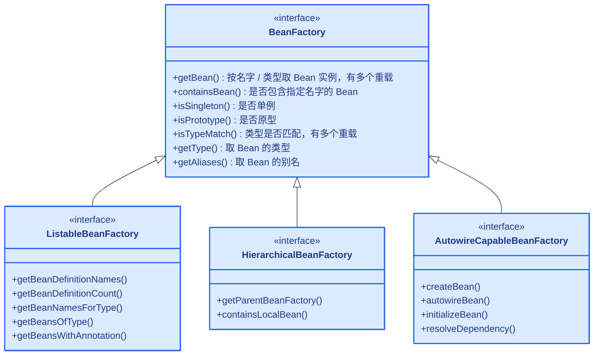
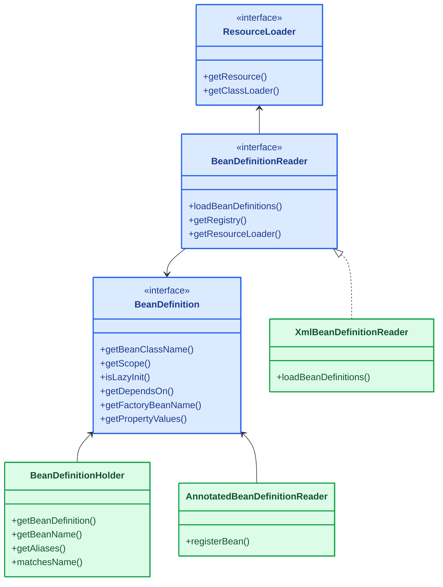
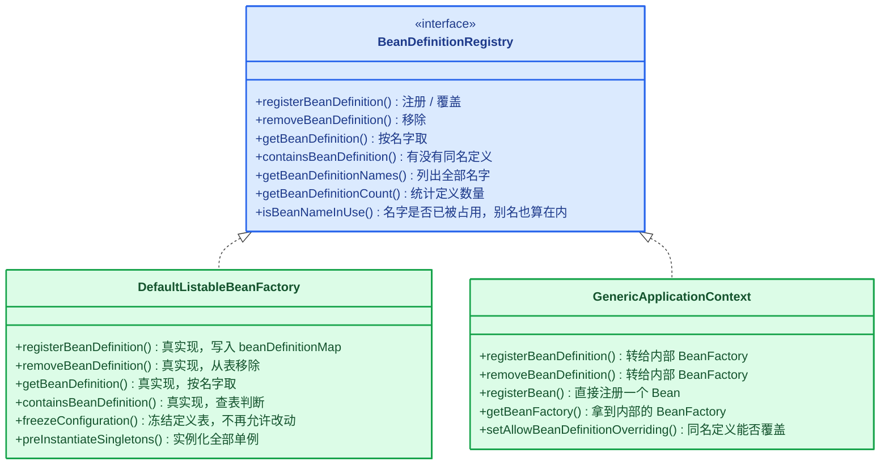
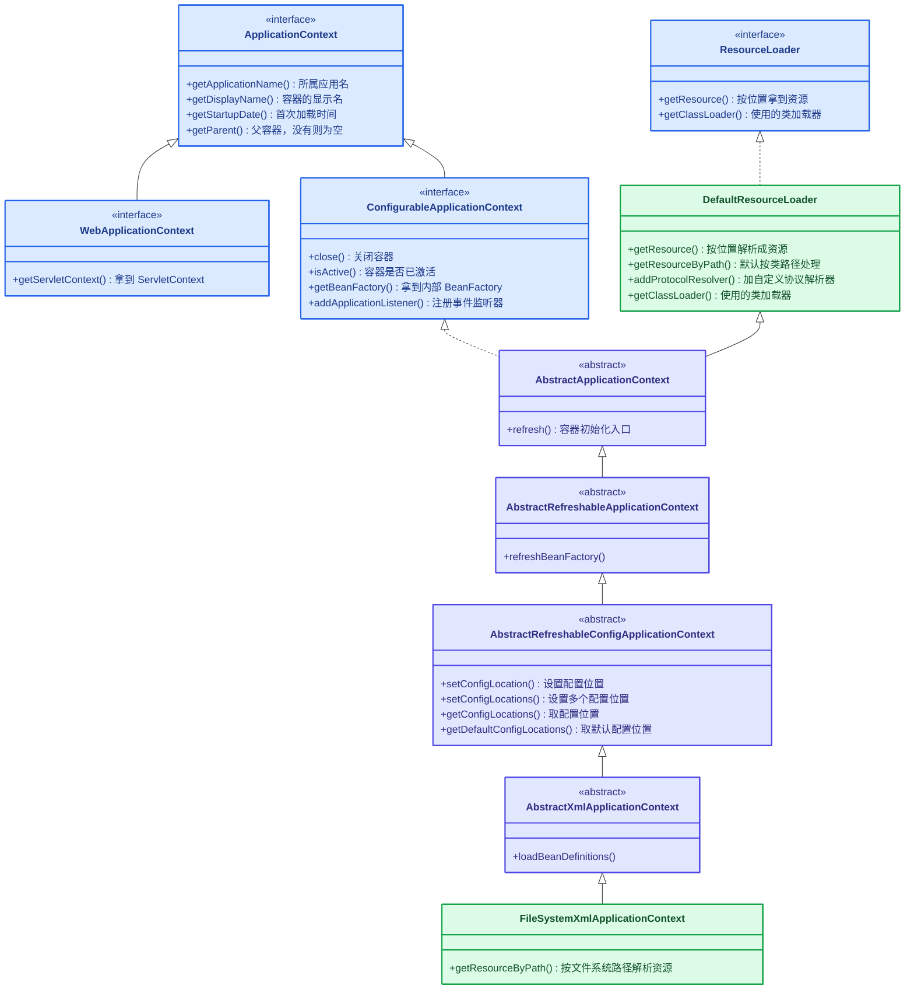
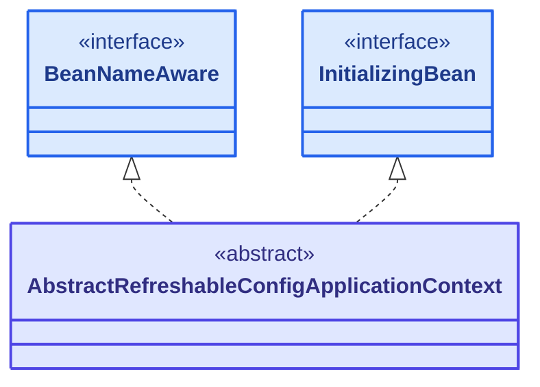
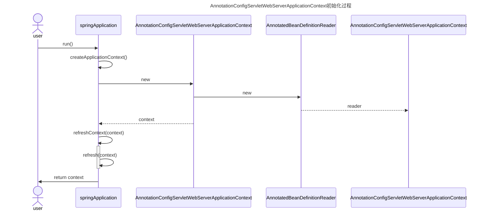
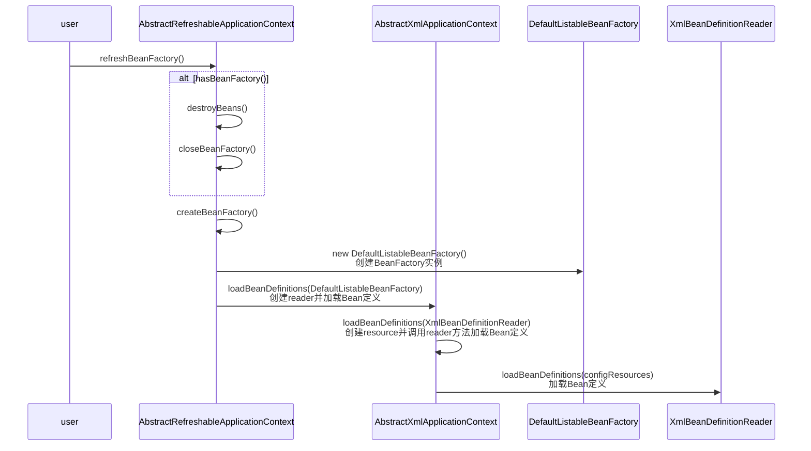
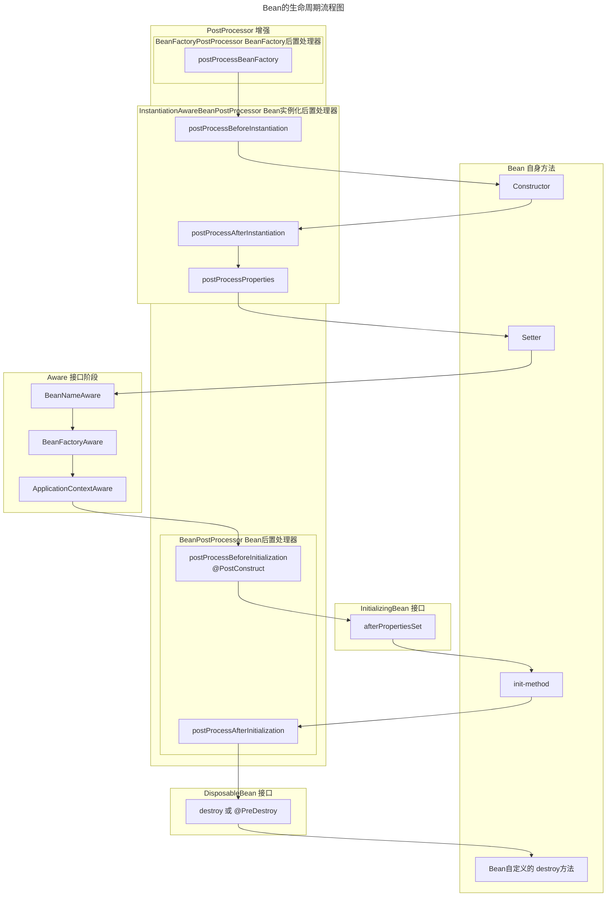

# IoC 容器实现原理
[[toc]]

Spring IoC 容器负责读取配置、创建并管理 Bean；本文从源码出发，讲容器从初始化到 Bean 实例化的完整过程。

本文引用的源码与类名以 Spring Framework 7.0（Spring Boot 4.1）为准；文中标注了版本的新增内容按各自版本读。

## IoC 体系结构设计
这一节从接口层看容器是怎么搭起来的
- [BeanFactory](./spring-core-interfaces.md#beanfactory-容器本体) 定义容器基本功能
- [BeanDefinition](./spring-core-interfaces.md#beandefinition-容器持有的配置数据) 描述 Bean 及其依赖关系
- [BeanDefinitionRegistry](./spring-core-interfaces.md#围绕定义的三个协作接口) 存放这些定义
- [ApplicationContext](./spring-core-interfaces.md#applicationcontext-容器门面) 在它们之上叠加容器级功能。

### 类之间的关系总览

本文涉及的类和接口分布在容器本体、Bean 定义与注册、容器门面、Aware 回调几条线上。下面用一张整体类图把它们的继承与实现关系集中画出来，按这四条线分成四块，后面各节再逐层展开。

<!-- @include: ./spring-ioc-overview-diagram.md -->

本图只画结构，不带方法；方法与调用链留给后面各节的分节图。

图上按直接关系做了几处简化：
- 容器本体这一支里，`BeanFactory` 到 `DefaultListableBeanFactory` 之间还隔着 `ConfigurableBeanFactory`、`ConfigurableListableBeanFactory` 等层次。
- Bean 定义与注册这一支里
    - `BeanDefinitionReader` 与 `XmlBeanDefinitionReader` 之间还有抽象类 `AbstractBeanDefinitionReader`
    - `AnnotatedBeanDefinitionReader` 则不实现 `BeanDefinitionReader`，它把注解类直接注册进容器，只是职责与 `XmlBeanDefinitionReader` 相近
- 容器门面这一支里，`ApplicationContext` 还继承了 `ListableBeanFactory`、`HierarchicalBeanFactory`（叠在 `BeanFactory` 一族之上的那部分能力），图上没有重复连线。
- 还有一类辅助类不属于以上任何一支：它们只被调用、不参与继承体系，因此没有画进来，如 `PostProcessorRegistrationDelegate`。

### BeanFactory 定义了 IoC 容器基本功能规范
BeanFactory 作为最顶层的接口，定义了 IoC 容器基本功能规范。它自己声明了 7 个方法，各方法的用途见下面的类图。

BeanFactory 有三个子接口，各补一类能力：
- `ListableBeanFactory`：提供获取 Bean 名称列表、按类型批量查询的功能
- `HierarchicalBeanFactory`：提供获取父 BeanFactory 的功能
- `AutowireCapableBeanFactory`：提供对已有对象做自动装配的功能



- <span class="spring-legend interface"></span>接口

每个子接口只列它自己新增的代表方法，父接口 `BeanFactory` 上的 `getBean`、`containsBean` 等不再重复。

### BeanDefinition 定义 Bean 对象及其依赖关系

`BeanDefinitionReader` 把不同来源的配置解析成 `BeanDefinition`；`BeanDefinitionHolder` 是 `BeanDefinition` 的包装类，把「定义、name、aliases」打包在一起传递。



- <span class="spring-legend interface"></span>接口
- <span class="spring-legend implementation"></span>具体类

`AnnotatedBeanDefinitionReader` 并不实现 `BeanDefinitionReader`——它拿到的是一批注解类，直接注册进容器，与 `XmlBeanDefinitionReader` 只是职责相近。

### BeanDefinitionRegistry 将 Bean 定义注册到 IoC 容器中

`BeanDefinitionRegistry` 是 Bean 定义的存放处，容器里那张「Bean 名字 → Bean 定义」的表由它来管。它自己声明了 7 个方法，各方法的用途见下面的类图。

`BeanDefinitionReader` 解析出定义之后，就是通过它把定义放进容器的。常见的实现类是 `DefaultListableBeanFactory`（内部用一张 `beanDefinitionMap` 保存所有定义）和 `GenericApplicationContext`。



- <span class="spring-legend interface"></span>接口
- <span class="spring-legend implementation"></span>具体类
### ApplicationContext 继承BeanFactory，提供更多功能
从ApplicationContext的继承关系分析ApplicationContext的功能：
- `ApplicationEventPublisher`：提供应用事件发布功能，包括容器启动事件、关闭事件等。
  + 实现了 [ApplicationListener](./framework-callbacks/application-listener.md) 事件监听接口的 Bean 可以接收到容器事件 ， 并对事件进行响应处理 。
- `Lifecycle`：提供容器生命周期管理功能，包括容器启动、停止等。它不是 `ApplicationContext` 本身的父接口，而是 `ConfigurableApplicationContext` 额外继承进来的（`ConfigurableApplicationContext extends ApplicationContext, Lifecycle, Closeable`）。
- `MessageSource`：提供国际化消息访问功能
- `ResourceLoader`：提供资源加载功能
  
围绕着是否需要Refresh容器衍生出两个抽象类，根据不同的资源加载方式，衍生出了众多ApplicationContext的实现类，常见的ApplicationContext实现类有：
- AbstractRefreshableApplicationContext：提供了容器刷新功能
  + AbstractXmlApplicationContext xml相关的实现类
    * FileSystemXmlApplicationContext
    * ClassPathXmlApplicationContext
  + AbstractRefreshableWebApplicationContext web相关的实现类
    * AnnotationConfigWebApplicationContext
    * XmlWebApplicationContext    
    * GroovyWebApplicationContext
- GenericApplicationContext：提供了容器基本功能，不支持多次刷新，刷新时不重建 BeanFactory
  + AnnotationConfigApplicationContext 
  + GenericXXX和StaticXXX 包括web相关的实现类和xml相关的实现类

注：
- AnnotationConfigApplicationContext不支持多次刷新，刷新时不重建 BeanFactory，因为基于注解的配置，是不太会被运行时修改的
- xml相关的常用实现类支持刷新功能，因为配置文件是容易修改的，需要支持刷新功能


- <span class="spring-legend interface"></span>接口
- <span class="spring-legend abstract"></span>抽象类
- <span class="spring-legend implementation"></span>具体类

注意 `AbstractRefreshableApplicationContext` 和 `AbstractXmlApplicationContext` 中间还夹着一层 `AbstractRefreshableConfigApplicationContext`，配置文件路径（configLocations）就存在这一层。这条链上还有一个抽象类实现了一批接口：



- <span class="spring-legend interface"></span>接口
- <span class="spring-legend abstract"></span>抽象类

## IoC 容器初始化过程
下面介绍BeanFactory容器和ApplicationContext容器的初始化过程。虽然BeanFactory容器是ApplicationContext容器的子集，但为了方便直观理解BeanFactory的初始化过程，还是单独介绍BeanFactory的初始化过程。

进入源码之前，先建立一张整体的地图。IoC 容器做的事可以拆成**两个阶段**和**三个扩展点**，后面所有源码细节都落在这几个位置上。

**两个阶段：先拿图纸，再造对象**

- 解析出「图纸」：容器把配置（XML、注解、Java 配置类）读进来，解析成一批 `BeanDefinition`。`BeanDefinition` 描述的是「这个 Bean 是哪个类、有哪些属性、依赖谁、单例还是多例、怎么初始化」——它只描述，不创建对象，相当于一张图纸。
- 按图纸「造对象」：容器再照着 `BeanDefinition` 把真正的 Bean 实例造出来，走完「实例化 → 属性填充 → 初始化 → 使用 → 销毁」这条生命周期。

所以这里的「图纸」就是 `BeanDefinition`（描述数据），「对象」就是实例化出来的 Bean 实例，两者是两回事：注册完定义时还没造出任何业务对象，真正造对象发生在容器刷新的最后一步。

**三个扩展点：各自能插手哪一层**

- `BeanFactoryPostProcessor`：改「图纸」。它在 Bean 实例创建之前执行，拿到的是 `BeanDefinition`，可以修改、新增、删除这些定义（比如把 `${}` 占位符换成真实值、把 `@Configuration` 类解析成一批定义）。它动的是配置数据，不碰对象。
- `BeanPostProcessor`：改「对象」。它在每个 Bean 实例创建过程中被回调，拿到的是已经实例化出来的 Bean 实例，可以在初始化前后对它做加工（比如生成代理对象、注入字段）。
- `Aware` 接口：容器把「自己」给 Bean。前两个是「给你一个东西让你改」，`Aware` 是反过来的——Bean 实现某个 `Aware` 子接口，容器在初始化早期主动把自己内部的对象（Bean 名字、`BeanFactory`、`ApplicationContext`、`Environment` 等）通过 setter 塞进来。它既不改图纸也不改对象，交出去的是容器自身的引用。

前两个扩展点是「你去改容器里的东西」，`Aware` 是「容器把东西给你」，作用方向相反，不是同一层的三件事。下面的源码会反复回到这五处：两个阶段对应的注册与实例化，以及三个扩展点对应的回调位置。

::: tip
BeanFactory 采用懒加载机制创建Bean实例，因此Bean的实例化过程发生在getBean()方法调用时。  
ApplicationContext会在容器初始化时创建所有非懒加载的Bean实例，所以Bean的实例化也属于ApplicationContext初始化过程的一部分。  
Bean的实例化过程比较多，放在下一节介绍，本节只介绍容器初始化主流程。
:::
### BeanFactory 容器初始化
BeanFactory 容器初始化过程主要分为以下几个步骤：
1. 创建BeanFactory实例（通常为 DefaultListableBeanFactory）
2. 创建并配置读取器 BeanDefinitionReader
3. 加载配置并注册 Bean 定义 `reader.loadBeanDefinitions()`
    1. ResourceLoader 加载资源
    2. BeanDefinitionReader 解析配置，生成 Bean 定义
    3. BeanDefinitionRegistry 将 Bean 定义注册到 IoC 容器中
4. 按需初始化 Bean 实例（放在[Bean 实例化](#bean-实例化)介绍）

```java
// 1. 创建工厂
DefaultListableBeanFactory factory = new DefaultListableBeanFactory();

// 2. 创建读取器
XmlBeanDefinitionReader reader = new XmlBeanDefinitionReader(factory);

// 3. 加载配置
reader.loadBeanDefinitions(new ClassPathResource("beans.xml"));

// 4. 获取Bean（此时才初始化）
MyBean bean = factory.getBean(MyBean.class);
```

### ApplicationContext 容器初始化
ApplicationContext有多个实现类，这些容器的初始化流程在细节上有差别，但大体流程相同，下面按照以下顺序介绍ApplicationContext容器的初始化过程：
1. 首先介绍ApplicationContext初始化流程框架。
1. 然后以AnnotationConfigServletWebServerApplicationContext和ClassPathXmlApplicationContext为例介绍具体容器初始化过程。
1. 最后介绍ApplicationContext初始化过程的核心方法refresh()。
#### ApplicationContext 容器初始化框架
核心步骤：
1. 创建BeanFactory实例
2. 创建Reader实例
3. 调用`refresh()`方法
4. 返回ApplicationContext实例
::: tip
AbstractRefreshableApplicationContext可省略步骤1和步骤2，会在`refresh() -> obtainFreshBeanFactory() -> refreshBeanFactory()`方法中创建BeanFactory实例
:::
#### AnnotationConfigServletWebServerApplicationContext初始化过程
在`SpringApplication::run()`方法中简化版本的初始化过程如下：
1. 创建`AnnotationConfigServletWebServerApplicationContext`实例
   1. 父类构造函数`GenericApplicationContext()`中创建`BeanFactory`实例 <Tip>核心步骤1</Tip>
   1. 创建`AnnotatedBeanDefinitionReader`实例  <Tip>核心步骤2</Tip>  
2. 刷新上下文 `refreshContext(context)`  
   1. 调用`refresh(context)`方法  
      1. context.refresh() <Tip>核心步骤3</Tip>
3. 返回`ApplicationContext`实例  <Tip>核心步骤4</Tip>
时序图如下：

简化版本的代码如下：
```java
public ConfigurableApplicationContext run(String... args) {
    ......
    ConfigurableEnvironment environment = prepareEnvironment(listeners, bootstrapContext, applicationArguments);
    context = createApplicationContext();
    context.setApplicationStartup(this.applicationStartup);
    prepareContext(bootstrapContext, context, environment, listeners, applicationArguments, printedBanner);
    refreshContext(context);
    return context;
}

protected ConfigurableApplicationContext createApplicationContext() {
    ConfigurableApplicationContext context = this.applicationContextFactory
        .create(this.properties.getWebApplicationType());
    Assert.state(context != null, "ApplicationContextFactory created null context");
    return context;
}

private void refreshContext(ConfigurableApplicationContext context) {
    if (this.properties.isRegisterShutdownHook()) {
        shutdownHook.registerApplicationContext(context);
    }
    refresh(context);
}
```

AnnotationConfigServletWebServerApplicationContext的构造方法中创建了AnnotatedBeanDefinitionReader：
```java
public AnnotationConfigServletWebServerApplicationContext() {
  this.reader = new AnnotatedBeanDefinitionReader(this);
  this.scanner = new ClassPathBeanDefinitionScanner(this);
}
```
#### ClassPathXmlApplicationContext初始化过程
ClassPathXmlApplicationContext可以在代码中直接创建，初始化过程放在了构造函数中：
```java
public ClassPathXmlApplicationContext(String... configLocations) throws BeansException {
    this(configLocations, true, null);
}
public ClassPathXmlApplicationContext(String[] configLocations, boolean refresh, @Nullable ApplicationContext parent) throws BeansException {
  super(parent);
  setConfigLocations(configLocations);
  if (refresh) {
    refresh();
  }
}
```
1. 调用父类的构造方法，设置id、name、资源加载器等属性，合并父容器的Environment
2. 设置配置路径`setConfigLocations`
3. 初始化容器`refresh()` <Tip>核心步骤3</Tip>
    - `AbstractApplicationContext::obtainFreshBeanFactory()`
      + `AbstractRefreshableApplicationContext::refreshBeanFactory()` <Tip>子类扩展点</Tip>
        * `AbstractRefreshableApplicationContext::createBeanFactory()` <Tip>子类扩展点</Tip>
          - 创建 DefaultListableBeanFactory <Tip>核心步骤1</Tip>
        * `AbstractXmlApplicationContext::loadBeanDefinitions(beanFactory)` <Tip>子类扩展点</Tip>
          - 创建`XmlBeanDefinitionReader`实例<Tip>核心步骤2</Tip>
::: tip
ClassPathXmlApplicationContext并没有显式创建BeanFactory实例和Reader实例，它们在`refresh() -> obtainFreshBeanFactory() -> refreshBeanFactory()`方法中创建。
:::
            
#### 核心方法refresh()
`refresh()` 方法是 Spring IoC 容器初始化的核心，主要完成以下工作：
1. 准备刷新 `prepareRefresh()` 
2. 创建/刷新 BeanFactory  `obtainFreshBeanFactory()`
3. 准备BeanFactory `prepareBeanFactory()`
    - 设置类加载器、表达式解析器、属性编辑器注册器、Bean后置处理器、忽略的依赖接口
    - 注册可解析的依赖、早期后置处理器、默认环境单例（`environment`、`systemProperties`、`systemEnvironment`、`applicationStartup`）
4. 执行 BeanFactory 后置处理 
    - `postProcessBeanFactory()`
      + 模板方法，子类可以通过覆盖 postProcessBeanFactory() 添加专有逻辑
    - `invokeBeanFactoryPostProcessors()`
      + 具体实现方法，执行所有注册的[BeanFactoryPostProcessor](./framework-callbacks/bean-post-processor.md)的核心逻辑
5. 注册 Bean 后置处理器 `registerBeanPostProcessors()`
6. 初始化消息源 `initMessageSource()`
7. 初始化事件派发器 `initApplicationEventMulticaster()`
8. 刷新（模板方法，子类扩展点） `onRefresh()`
9. 注册监听器 `registerListeners()`  
10. 完成 BeanFactory 初始化（实例化所有非懒加载的单例Bean） `finishBeanFactoryInitialization()`
11. 完成刷新并发布相应事件 `finishRefresh()` 

##### 准备刷新 `prepareRefresh()`
`prepareRefresh()` 是 `refresh()` 的第一步，做刷新前的准备：把容器置为活跃状态、校验运行环境。它还没有创建任何 Bean。其中 `initPropertySources()` 是留给子类的钩子，Web 容器就靠它把 Servlet 相关的属性源补进 `Environment`。
```java
protected void prepareRefresh() {
  // 记录启动时间
  this.startupDate = System.currentTimeMillis();

  // 设置容器状态为活跃
  this.closed.set(false);
  this.active.set(true);

  // 初始化属性源
  // Initialize any placeholder property sources in the context environment
  initPropertySources();

  // 验证必要的属性
  // Validate that all properties marked as required are resolvable:
  // see ConfigurablePropertyResolver#setRequiredProperties
  getEnvironment().validateRequiredProperties();

  // 保存刷新前的监听器
  // Store pre-refresh ApplicationListeners...
  if (this.earlyApplicationListeners == null) {
    this.earlyApplicationListeners = new LinkedHashSet<>(this.applicationListeners);
  }
  else {
    // 恢复刷新前的监听器
    this.applicationListeners.clear();
    this.applicationListeners.addAll(this.earlyApplicationListeners);
  }

  // 存储早期应用事件
  // Allow for the collection of early ApplicationEvents,
  // to be published once the multicaster is available...
  this.earlyApplicationEvents = new LinkedHashSet<>();
}
```
##### 获取/刷新BeanFactory `obtainFreshBeanFactory()`
围绕着是否需要Refresh容器衍生出两个抽象类：
- AbstractRefreshableApplicationContext：提供了容器刷新功能，执行`refreshBeanFactory()`方法会创建新BeanFactory并加载定义
- GenericApplicationContext：提供了容器基本功能，不支持多次刷新，执行`refreshBeanFactory()`方法仅验证状态，不重建BeanFactory
::: tip
这里的刷新功能有点绕，和`refreshBeanFactory()`方法中的刷新含义不太一样：
- 提供Refresh功能的ApplicationContext，在`refreshBeanFactory()`方法中重建BeanFactory。 
- 不提供Refresh功能的ApplicationContext，在`refreshBeanFactory()`方法中仅验证状态。
:::
```java
protected ConfigurableListableBeanFactory obtainFreshBeanFactory() {
  // 1. 如果是GenericApplicationContext，刷新内部BeanFactory
  // 2. 如果是AbstractRefreshableApplicationContext，创建新BeanFactory并加载定义
  refreshBeanFactory();
  return getBeanFactory();
}
```
###### `AbstractRefreshableApplicationContext::refreshBeanFactory()`
创建新BeanFactory并加载Bean定义：
1. 判断BeanFactory是否存在，如果存在则销毁
2. 创建新BeanFactory实例 `createBeanFactory()`
3. 创建Reader并加载Bean定义 `loadBeanDefinitions()` 
   - 子类扩展点,以AbstractXmlApplicationContext为例说明：
   - **new XmlBeanDefinitionReader(beanFactory) 创建XmlBeanDefinitionReader**
   - loadBeanDefinitions(beanDefinitionReader)
     + **reader.loadBeanDefinitions(configResources) 加载Bean定义**
::: tip
这里初始化 BeanFactory 的过程和 BeanFactory 容器初始化中的创建过程类似，只是分散在不同的方法中。
:::

```java [AbstractRefreshableApplicationContext]
protected final void refreshBeanFactory() throws BeansException {
  if (hasBeanFactory()) {
    destroyBeans();
    closeBeanFactory();
  }
  try {
    DefaultListableBeanFactory beanFactory = createBeanFactory();
    beanFactory.setSerializationId(getId());
    beanFactory.setApplicationStartup(getApplicationStartup());
    customizeBeanFactory(beanFactory);
    loadBeanDefinitions(beanFactory);
    this.beanFactory = beanFactory;
  }
  catch (IOException ex) {
    throw new ApplicationContextException("I/O error parsing bean definition source for " + getDisplayName(), ex);
  }
}

protected DefaultListableBeanFactory createBeanFactory() {
  return new DefaultListableBeanFactory(getInternalParentBeanFactory());
}
```
`loadBeanDefinitions(DefaultListableBeanFactory)`是模板方法，子类通过覆盖该方法实现加载Bean定义，以AbstractXmlApplicationContext为例说明：
```java [AbstractXmlApplicationContext]
protected void loadBeanDefinitions(DefaultListableBeanFactory beanFactory) throws BeansException, IOException {
    XmlBeanDefinitionReader beanDefinitionReader = new XmlBeanDefinitionReader(beanFactory);
    beanDefinitionReader.setEnvironment(this.getEnvironment());
    beanDefinitionReader.setResourceLoader(this);
    beanDefinitionReader.setEntityResolver(new ResourceEntityResolver(this));
    this.initBeanDefinitionReader(beanDefinitionReader);
    this.loadBeanDefinitions(beanDefinitionReader);
}

protected void loadBeanDefinitions(XmlBeanDefinitionReader reader) throws BeansException, IOException {
    Resource[] configResources = this.getConfigResources();
    if (configResources != null) {
        reader.loadBeanDefinitions(configResources);
    }

    String[] configLocations = this.getConfigLocations();
    if (configLocations != null) {
        reader.loadBeanDefinitions(configLocations);
    }

}
```
##### 准备BeanFactory `prepareBeanFactory()`
`prepareBeanFactory()` 给刚创建出来的 BeanFactory 补齐容器运行需要的基础设施，让它从「一个能装 Bean 的工厂」变成「ApplicationContext 内部的工厂」。这一步只做配置，不创建业务 Bean。
```java
protected void prepareBeanFactory(ConfigurableListableBeanFactory beanFactory) {
  // 设置类加载器
  // Tell the internal bean factory to use the context's class loader etc.
  beanFactory.setBeanClassLoader(getClassLoader());
  
  // 设置表达式解析器
  beanFactory.setBeanExpressionResolver(new StandardBeanExpressionResolver(beanFactory.getBeanClassLoader()));
  
  // 设置属性编辑器注册器
  beanFactory.addPropertyEditorRegistrar(new ResourceEditorRegistrar(this, getEnvironment()));

  // 添加Bean后置处理器
  // Configure the bean factory with context callbacks.
  beanFactory.addBeanPostProcessor(new ApplicationContextAwareProcessor(this));
  
  // 设置忽略的依赖接口
  beanFactory.ignoreDependencyInterface(EnvironmentAware.class);
  beanFactory.ignoreDependencyInterface(EmbeddedValueResolverAware.class);
  beanFactory.ignoreDependencyInterface(ResourceLoaderAware.class);
  beanFactory.ignoreDependencyInterface(ApplicationEventPublisherAware.class);
  beanFactory.ignoreDependencyInterface(MessageSourceAware.class);
  beanFactory.ignoreDependencyInterface(ApplicationContextAware.class);
  beanFactory.ignoreDependencyInterface(ApplicationStartupAware.class);

  // 注册可解析的依赖
  // BeanFactory interface not registered as resolvable type in a plain factory.
  // MessageSource registered (and found for autowiring) as a bean.
  beanFactory.registerResolvableDependency(BeanFactory.class, beanFactory);
  beanFactory.registerResolvableDependency(ResourceLoader.class, this);
  beanFactory.registerResolvableDependency(ApplicationEventPublisher.class, this);
  beanFactory.registerResolvableDependency(ApplicationContext.class, this);

  // 注册早期后置处理器
  // Register early post-processor for detecting inner beans as ApplicationListeners.
  beanFactory.addBeanPostProcessor(new ApplicationListenerDetector(this));

  // Detect a LoadTimeWeaver and prepare for weaving, if found.
  if (!NativeDetector.inNativeImage() && beanFactory.containsBean(LOAD_TIME_WEAVER_BEAN_NAME)) {
    beanFactory.addBeanPostProcessor(new LoadTimeWeaverAwareProcessor(beanFactory));
    // Set a temporary ClassLoader for type matching.
    beanFactory.setTempClassLoader(new ContextTypeMatchClassLoader(beanFactory.getBeanClassLoader()));
  }

  // Register default environment beans.
  if (!beanFactory.containsLocalBean(ENVIRONMENT_BEAN_NAME)) {
    beanFactory.registerSingleton(ENVIRONMENT_BEAN_NAME, getEnvironment());
  }
  if (!beanFactory.containsLocalBean(SYSTEM_PROPERTIES_BEAN_NAME)) {
    beanFactory.registerSingleton(SYSTEM_PROPERTIES_BEAN_NAME, getEnvironment().getSystemProperties());
  }
  if (!beanFactory.containsLocalBean(SYSTEM_ENVIRONMENT_BEAN_NAME)) {
    beanFactory.registerSingleton(SYSTEM_ENVIRONMENT_BEAN_NAME, getEnvironment().getSystemEnvironment());
  }
  if (!beanFactory.containsLocalBean(APPLICATION_STARTUP_BEAN_NAME)) {
    beanFactory.registerSingleton(APPLICATION_STARTUP_BEAN_NAME, getApplicationStartup());
  }
}
```
##### 执行 BeanFactory 后置处理 `postProcessBeanFactory()`
供子类扩展的钩子方法，在BeanFactory准备完成后，处理器执行前调用，是子类添加特定的BeanFactory初始化逻辑。典型子类实现：
- GenericWebApplicationContext：添加ServletContext相关处理器
##### 调用 BeanFactory 后置处理器 `invokeBeanFactoryPostProcessors()`
委托给PostProcessorRegistrationDelegate执行，实例化并调用所有已注册的BeanFactoryPostProcessor，包含完整的执行逻辑，通常不需要子类覆盖：
- 先执行 BeanDefinitionRegistryPostProcessor 的 postProcessBeanDefinitionRegistry()
- 再执行 BeanFactoryPostProcessor 的 postProcessBeanFactory()
- 按照优先级顺序执行（PriorityOrdered > Ordered > 普通）

```java
protected void invokeBeanFactoryPostProcessors(ConfigurableListableBeanFactory beanFactory) {
  // 委托给PostProcessorRegistrationDelegate执行
  PostProcessorRegistrationDelegate.invokeBeanFactoryPostProcessors(beanFactory, getBeanFactoryPostProcessors());

  // 检测LoadTimeWeaver并准备编织
  // Detect a LoadTimeWeaver and prepare for weaving, if found in the meantime
  // (for example, through a @Bean method registered by ConfigurationClassPostProcessor)
  if (!NativeDetector.inNativeImage() && beanFactory.getTempClassLoader() == null &&
      beanFactory.containsBean(LOAD_TIME_WEAVER_BEAN_NAME)) {
    beanFactory.addBeanPostProcessor(new LoadTimeWeaverAwareProcessor(beanFactory));
    beanFactory.setTempClassLoader(new ContextTypeMatchClassLoader(beanFactory.getBeanClassLoader()));
  }
}

```
##### 注册 Bean 后置处理器 `registerBeanPostProcessors()`
委托给PostProcessorRegistrationDelegate执行，注册Bean后置处理器。
```java
protected void registerBeanPostProcessors(ConfigurableListableBeanFactory beanFactory) {
    PostProcessorRegistrationDelegate.registerBeanPostProcessors(beanFactory, this);
}
```
### BeanFactory VS ApplicationContext
通过BeanFactory和ApplicationContext的初始化过程，可以看出BeanFactory和ApplicationContext的区别：
- BeanFactory：提供 IoC 容器基本功能，加载资源、解析配置、注册 Bean，但不支持容器级的 `Lifecycle`（start/stop）与事件发布机制。
- ApplicationContext：继承BeanFactory，提供了生命周期管理和事件发布功能。

| |BeanFactory|	ApplicationContext|
|-|-|-|
|后置处理器	| 需要手动注册|	自动检测并注册|
|AOP支持|需手动配置ProxyFactoryBean|自动代理创建|
|事件机制|不支持|内置支持|

## Bean 实例化
IoC 容器初始化实现了将资源文件的元数据转换为 Bean 定义，并将 Bean 定义注册到 IoC 容器中，Bean 实例化的过程就是从 IoC 容器中根据 Bean 定义获取 Bean 实例的过程。
实例化过程主要分为以下几个步骤：
1. 根据 Bean 定义的配置信息，创建 Bean 实例
2. 处理Bean的依赖关系，将依赖的Bean注入到Bean实例中
3. 调用Bean的初始化方法，完成Bean的实例化
4. 将 Bean 实例注册到 IoC 容器中

### 创建Bean实例
BeanFactory会在调用getBean()方法时创建Bean实例。

getBean()方法的实现主要分为以下几个步骤：
1. 解析bean的真正name，如果bean是工厂类，name会增加前缀`&`，需去掉
2. 无参单例尝试从缓存中获取Bean实例
3. 如果bean实例还在创建中，直接抛异常
4. 如果bean definition 存在于父的bean工厂中，委派给父Bean工厂获取
5. 标记这个beanName的实例正在创建   
6. 根据 Bean 名称从 IoC 容器中获取 Bean 定义
7. 初始化它依赖的Bean
8. 创建bean实例，按照单例、原型、scope等不同模式创建实例
   - 单例：创建后放入单例池缓存，下次直接从缓存取
   - 原型：每次调用都新建一个实例，不放入缓存
   - 其他 scope：交给容器里注册的 `Scope` 实现创建（如 Web 环境的 request、session）
   - 从 `BeanDefinition` 中获取 Bean 的类名，通过反射机制创建 Bean 实例
     - `getConstructorArgumentValues()`：获取 Bean 的构造方法参数值
     - `getPropertyValues()`：获取 Bean 的属性值
   - 返回 Bean 实例
9. 处理Bean的依赖关系，将依赖的Bean注入到Bean实例中

### 循环依赖
Spring只解决了单例模式下属性依赖的循环问题。
#### 单例模式下属性循环依赖的解决方案
Spring 使用三个缓存层存储不同状态的 Bean：
- 一级缓存（单例池） singletonObjects：存放完全初始化好的 Bean。
- 二级缓存 earlySingletonObjects：存放提前暴露的半成品 Bean（已实例化但未填充属性）。
- 三级缓存 singletonFactories：存放 Bean 的工厂对象，用于生成半成品 Bean。

解决流程（以 A → B → A 为例）：
1. 创建 A：实例化 A，将 A 的工厂对象放入三级缓存。
2. 填充 A 的属性：发现需要注入 B，开始创建 B。
3. 创建 B： 实例化 B，将 B 的工厂对象放入三级缓存。
4. 解决依赖：填充 B 的属性，发现需要注入 A：
   - 从三级缓存中找到 A 的工厂，生成半成品 A 并放入二级缓存。
   - 将半成品 A 注入 B，完成 B 的初始化。
   - 将 B 放入一级缓存。
5. 完成A的初始化：
   - 将初始化好的 B 注入 A
   - 将 A 放入一级缓存。
#### 非单例属性之外的循环依赖
构造器循环依赖
  - 改为Setter/字段注入
  - 使用@Lazy注解，延迟加载
多例循环依赖
  - 改为单例模式
### Bean生命周期
Bean 的生命周期指它从创建到销毁经历的完整过程，中间穿插着一串由容器触发的回调：容器在实例化、属性填充、初始化这几个位置前后回调注册过的后置处理器，Bean 自己也可以实现 `InitializingBean`、`DisposableBean`，或者声明 init-method、destroy-method 来插手。完整顺序如下图：



### Aware 接口

有时 Bean 需要拿到容器内部的某个对象，比如自己的名字、创建自己的 BeanFactory、加载自己的类加载器。Spring 为此定义了一组 `Aware` 子接口：Bean 实现哪个子接口，容器就在初始化早期把对应的对象通过 setter 注入进来，不用写 `@Autowired`。

`Aware` 本身是个空的标记接口，里面没有任何方法，只用来把这一组接口归到一起；真正注入东西的是它的各个子接口。常用的几个：

- `BeanNameAware`：注入 Bean 在容器里的名字（`String`）。要按名字做判断或记日志时用；不过这个名字来自外部配置，一般不建议让业务对象依赖它。
- `BeanFactoryAware`：注入创建它的 `BeanFactory`。想在 Bean 里主动按名字查别的 Bean（依赖查找）时用；能用依赖注入拿到的引用就别用它。
- `BeanClassLoaderAware`：注入当前 BeanFactory 用来加载 Bean 类的那个 `ClassLoader`。主要是框架类在用——框架自身的类可能由共享类加载器加载，需要按类名去取应用侧的类时，只能让容器把应用侧的类加载器注进来。
- `ApplicationContextAware`：注入 Bean 所在的 `ApplicationContext`。要访问容器里的一批协作 Bean、读文件资源、发布应用事件或访问 `MessageSource` 时用。
- `EnvironmentAware`：注入 Bean 运行所在的 `Environment`。想直接读当前有哪些 profile、或从属性源里取属性时用。
- `ResourceLoaderAware`：注入 `ResourceLoader`（通常就是 `ApplicationContext` 本身）。想按路径加载资源、又不想依赖整个 `ApplicationContext` 时用它，它是 `ApplicationContextAware` 的轻量替代。

注入时机分两批，两批都在初始化回调之前：

- 第一批是 `BeanNameAware`、`BeanClassLoaderAware`、`BeanFactoryAware`，由 `AbstractAutowireCapableBeanFactory#invokeAwareMethods` 调用，位置在普通属性填充之后、Bean 后置处理器的 `postProcessBeforeInitialization` 之前。`setBeanClassLoader` 的 Javadoc 原话就是：在普通属性填充之后、`InitializingBean.afterPropertiesSet()` 或自定义 init-method 这类初始化回调之前被调用。
- 第二批是 `EnvironmentAware`、`ResourceLoaderAware`、`ApplicationContextAware` 这几个，由 `prepareBeanFactory` 里注册的 `ApplicationContextAwareProcessor` 在 `postProcessBeforeInitialization` 里注入（`EmbeddedValueResolverAware`、`ApplicationEventPublisherAware`、`MessageSourceAware` 也由它注入）。同样早于初始化回调，只是比第一批晚一步。

生命周期图里的「Aware 接口阶段」，画的就是这两批回调发生的位置。


    